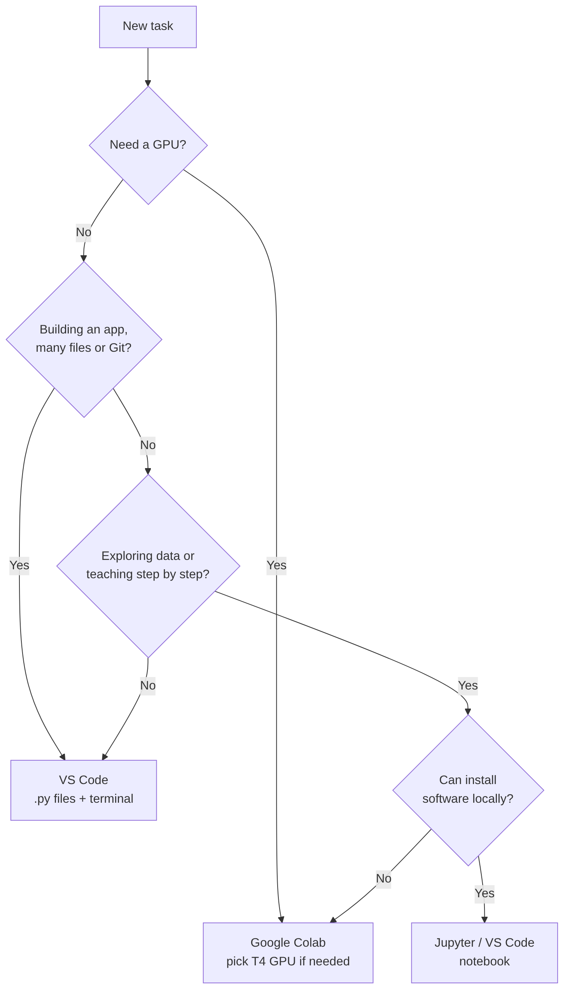
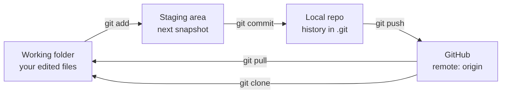
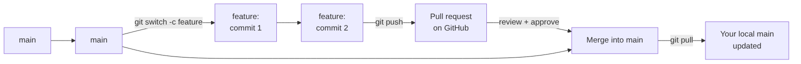
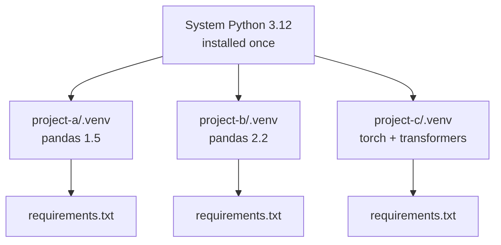
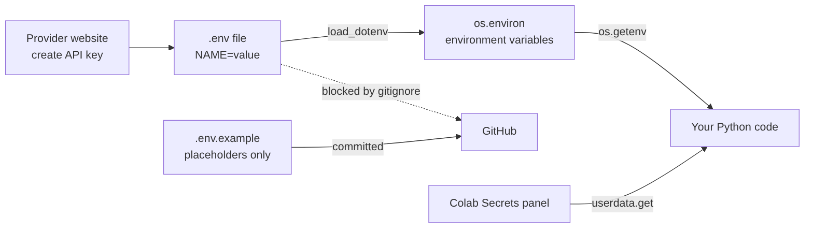

# Module 00 — Setting up your AI engineering toolkit

This lesson assumes you have **never opened a terminal**. By the end you will have Python installed, an editor ready, a GitHub account connected, a clean project folder with its own private set of packages, and a safe way to store secret API keys. Every later module depends on this one, so take it slowly.

There are no screenshots in this course. Instead, every click is described in words: the name of the menu, the name of the button, and where it sits on the screen. Read each step, then look for the exact words on your screen.

---

## 1. The big picture: what are we installing and why?

Think of setting up a kitchen before you cook.

| Kitchen | Our toolkit | What it does |
|---|---|---|
| The cook's skills | **Python** | The programming language. A set of rules for writing instructions a computer can follow. |
| The countertop | **VS Code** | A program for writing and editing code files. |
| A recipe card you can cook from step by step | **Jupyter notebook** | A document that mixes notes, code and results. |
| A borrowed restaurant kitchen | **Google Colab** | Jupyter notebooks running on Google's computers, in your web browser. |
| The kitchen's intercom | **Terminal** | A text window where you type commands to the computer. |
| A photo album of every version of the dish | **Git** | A tool that records snapshots of your files over time. |
| A shared cloud album | **GitHub** | A website that stores your Git snapshots online and lets others collaborate. |
| A separate spice rack per recipe | **Virtual environment** | A private folder of Python packages for one project. |
| The shop where you buy spices | **pip** | The tool that downloads Python packages. |
| The key to the pantry | **API key** | A secret password that lets your code use a paid online service. |

You do not need to understand each item yet. We will go through them one by one.

---

## 2. Installing Python

**Python** — a programming language. It is also the name of the program (the **interpreter** — the program that reads your Python code and carries it out line by line) that you install.

**Version** — a numbered release of a program. Python versions look like `3.12.4`: the first number is the major version (always 3 today), the second is the minor version (12), the third is a small bug-fix release (4). For this course, use **Python 3.11, 3.12 or 3.13**. Some AI libraries take a few months to support the newest release, so if a brand-new Python version has just come out, pick the one before it.

### 2.1 Windows

1. Open your web browser and go to `https://www.python.org/downloads/`.
2. Click the big yellow button that says **Download Python 3.x.x**. A file named something like `python-3.12.x-amd64.exe` downloads.
3. Double-click the downloaded file to start the installer.
4. **Very important:** at the bottom of the first installer window there is a checkbox labelled **Add python.exe to PATH**. Tick it. (**PATH** — a list of folders where Windows looks for programs when you type a command. If Python is not on the PATH, typing `python` will fail.)
5. Click **Install Now**. Wait for "Setup was successful", then click **Close**.
6. Check it worked: press the **Windows key**, type `PowerShell`, and press **Enter**. A dark blue or black window opens. Type `python --version` and press **Enter**. You should see `Python 3.12.x`.

Windows also installs a small helper called the **py launcher**. Typing `py --version` also works and is handy if you have several Python versions installed.

> If typing `python` opens the Microsoft Store instead, Windows has a fake shortcut in the way. Open **Settings → Apps → Advanced app settings → App execution aliases** and switch **off** the two entries named "python.exe" and "python3.exe". Then close and reopen PowerShell.

### 2.2 macOS

Macs may include an old system Python or a "python3" stub tied to Apple's developer tools. Do not rely on it.

1. Go to `https://www.python.org/downloads/` and click **Download Python 3.x.x**. A `.pkg` file downloads.
2. Double-click it and click **Continue** through the screens, then **Install**. Enter your Mac password when asked.
3. When it finishes, a Finder window opens. Double-click **Install Certificates.command** in it. This lets Python make secure web connections.
4. Open **Terminal**: press **Command + Space**, type `Terminal`, press **Enter**.
5. Type `python3 --version` and press **Enter**. You should see `Python 3.12.x`.

On macOS and Linux the command is usually `python3`, not `python`. In this course, when you see `python`, type `python3` on a Mac or Linux machine unless you are inside an activated virtual environment (section 9), where both work.

(Alternative for people who already use it: **Homebrew**, a package manager for macOS, can install Python with `brew install python`.)

### 2.3 Linux (Ubuntu / Debian)

Most Linux systems already have Python 3. Open a terminal (**Ctrl + Alt + T** on Ubuntu) and type:

```bash
python3 --version
sudo apt update
sudo apt install python3 python3-venv python3-pip
```

`sudo` means "run this as the administrator", so it will ask for your password. The `python3-venv` package is needed for virtual environments; on Ubuntu it is not included by default.

### 2.4 A modern alternative: uv

**uv** is a newer, very fast tool that can install Python versions, create virtual environments and install packages, all in one program. It is popular with professional teams. We teach the classic tools (`python`, `venv`, `pip`) first because every tutorial and error message assumes them. Once you are comfortable, look at uv (link in resources.md).

---

## 3. The terminal: talking to your computer in text

**Terminal** — a window where you type commands instead of clicking. Other names you will hear: **command line**, **shell** (the program inside the terminal that understands your commands), **console**, **prompt**. On Windows the usual one is **PowerShell**; on macOS it is **Terminal** running a shell called **zsh**; on Linux it is usually **bash**.

**Analogy:** clicking around in folders is like pointing at pictures in a restaurant menu. The terminal is like speaking to the waiter. It feels harder at first, but you can ask for exactly what you want, and you can write the request down and repeat it.

### 3.1 Where am I? The working directory

**Directory** — another word for folder. The terminal is always "standing inside" one folder, called the **current working directory**. Commands act on that folder unless you say otherwise.

| What you want | Windows PowerShell | macOS / Linux |
|---|---|---|
| Show where I am | `pwd` | `pwd` |
| List files here | `ls` (or `dir`) | `ls` |
| Go into a folder | `cd projects` | `cd projects` |
| Go up one folder | `cd ..` | `cd ..` |
| Go to my home folder | `cd ~` | `cd ~` |
| Make a new folder | `mkdir ai-course` | `mkdir ai-course` |
| Clear the screen | `cls` (or `clear`) | `clear` |
| Show a file's contents | `type notes.txt` (or `cat`) | `cat notes.txt` |
| Stop a running command | **Ctrl + C** | **Ctrl + C** |
| Repeat an earlier command | **Up arrow** | **Up arrow** |

**Path** — the address of a file, made from folder names joined by a separator. Windows uses backslashes: `C:\Users\asha\ai-course\notes.txt`. macOS and Linux use forward slashes: `/Users/asha/ai-course/notes.txt`. An **absolute path** starts from the top of the drive. A **relative path** starts from where you are now: `ai-course/notes.txt`.

### 3.2 Your first terminal session

Type these one at a time, pressing **Enter** after each:

```bash
cd ~
mkdir ai-course
cd ai-course
pwd
python --version
```

You have made a folder called `ai-course` in your home folder and moved into it. This is where you will keep your course work.

**Tips that save hours**
- Press **Tab** while typing a folder or file name; the terminal completes it for you.
- Folder names with spaces need quotes: `cd "My Projects"`. Better: avoid spaces in names. Use `my-projects`.
- Copy and paste: in PowerShell and VS Code, **Ctrl + C / Ctrl + V** usually work (Ctrl + C copies only if text is selected; otherwise it stops the running command). In macOS Terminal use **Command + C / Command + V**. In Linux terminals use **Ctrl + Shift + C / Ctrl + Shift + V**.
- A line starting with `$` or `>` in a tutorial is showing the prompt. Do not type the `$` itself.

---

## 4. VS Code: your code editor

**Editor** — a program for writing text files, with extra help for code. **VS Code** (Visual Studio Code) is a free editor from Microsoft. It colours your code, spots mistakes, runs programs and has a terminal built in. **Extensions** are add-ons that teach VS Code new skills.

### 4.1 Install VS Code

1. Go to `https://code.visualstudio.com/` and click the big **Download** button for your system.
2. Windows: run the installer. On the "Select Additional Tasks" screen tick **Add "Open with Code" action** (both boxes) and **Add to PATH**. Click **Next**, then **Install**.
3. macOS: open the downloaded `.zip`; drag **Visual Studio Code** into your **Applications** folder. Then open VS Code, press **Command + Shift + P**, type `shell command`, and choose **Shell Command: Install 'code' command in PATH**. This lets you type `code .` in Terminal.
4. Linux: download the `.deb` file and install with `sudo apt install ./code_*.deb`.

### 4.2 Install the Python and Jupyter extensions

1. Open VS Code.
2. On the far left there is a thin vertical bar of icons, the **Activity Bar**. Click the icon made of four small squares (one square slightly separated). That is the **Extensions** view. Shortcut: **Ctrl + Shift + X** (Windows/Linux) or **Command + Shift + X** (macOS).
3. In the search box at the top, type `Python`. Click the result named **Python** published by **Microsoft** (it has a blue tick). Click **Install**. This also installs **Pylance** (code completion) and the **Python Debugger**.
4. Search `Jupyter` and install **Jupyter** by **Microsoft**.

### 4.3 The parts of the VS Code window

- **Explorer** (top icon, two sheets of paper): your project's files.
- **Editor area** (the big middle part): the file you are editing. Each open file is a **tab**.
- **Status bar** (the thin coloured strip at the very bottom): shows the current Python version, Git branch and errors.
- **Panel** (bottom area, opened with **Ctrl + `** — the backtick key, usually under Esc): holds the **integrated terminal**. It is a normal terminal that already starts inside your project folder.
- **Command Palette** (**Ctrl + Shift + P** / **Command + Shift + P**): a search box for every command VS Code knows. If you cannot find a button, search here.

### 4.4 Open a folder and run your first file

1. **File → Open Folder…**, choose your `ai-course` folder, click **Select Folder** (Windows) or **Open** (macOS). If asked "Do you trust the authors of the files in this folder?", click **Yes, I trust the authors**.
2. In the Explorer, hover over the folder name and click the **New File** icon (a sheet with a plus). Name it `hello.py` and press **Enter**.
3. Type `print("Hello, AI engineer!")` and save with **Ctrl + S** / **Command + S**.
4. Choose which Python VS Code uses: open the Command Palette, type `Python: Select Interpreter`, press **Enter**, and pick the Python you installed (later: your project's `.venv`). (**Interpreter** here means "which installed copy of Python".)
5. Click the **triangle play button** in the top-right corner of the editor (tooltip: "Run Python File"). The terminal opens and prints `Hello, AI engineer!`.

You can also run it yourself in the terminal: `python hello.py`.

---

## 5. Notebooks: what a `.ipynb` file really is

A normal Python file (`.py`) is a plain list of instructions. It runs from top to bottom in one go.

A **notebook** is a document made of **cells** — boxes stacked one under another. There are two main kinds:

- **Markdown cell** — formatted text: headings, bullet points, explanations. (**Markdown** is a simple way to format text with symbols, like `# Heading` and `**bold**`.)
- **Code cell** — Python code you can run on its own. The result (**output**) appears right under the cell: numbers, tables, charts.

**Analogy:** a `.py` file is a recipe you hand to a chef who cooks the whole thing at once. A notebook is a cooking show: explain a step, do the step, show the result, then move on.

### 5.1 Inside the file: it is JSON

**JSON** (JavaScript Object Notation) — a text format for storing structured data using curly braces `{}`, square brackets `[]`, and `"key": value` pairs. A `.ipynb` file ("IPython notebook", the old name of Jupyter) is a JSON file. Shortened, it looks like this:

```json
{
  "cells": [
    {"cell_type": "markdown", "source": ["# My first notebook"]},
    {"cell_type": "code",
     "source": ["print(2 + 2)"],
     "outputs": [{"output_type": "stream", "text": ["4\n"]}],
     "execution_count": 1}
  ],
  "metadata": {"kernelspec": {"name": "python3"}},
  "nbformat": 4, "nbformat_minor": 5
}
```

Things to notice:
- The notebook stores the **outputs** too. That is why notebooks on GitHub show results without running anything. It also means **a printed secret is saved inside the file**. Never print an API key in a notebook.
- The `execution_count` is the number in square brackets, like `[1]`, next to a cell. It records the order you ran cells in.
- Because it is JSON, Git sees a notebook as one big text file. Two people editing the same notebook often create messy conflicts.

### 5.2 The kernel and running order

**Kernel** — the Python program running behind the notebook that actually executes the code. It remembers every variable you created, in the order you ran cells, **not** the order they appear on the page.

This is the number-one notebook trap. If you run cell 5, then edit cell 2 and run it, the kernel's memory no longer matches what you see. When things look strange: **restart the kernel and run all cells from the top** (Jupyter: **Kernel → Restart Kernel and Run All Cells…**; Colab: **Runtime → Restart session and run all**; VS Code: **Restart** then **Run All** buttons on the notebook toolbar).

### 5.3 Ways to open a notebook

1. **Jupyter in the browser (local).** Install with `pip install jupyterlab notebook`. Start with `jupyter lab` (the full workspace, with file browser and tabs) or `jupyter notebook` (the simpler classic-style view). A browser tab opens at an address like `http://localhost:8888`. **localhost** means "this same computer" — the notebook runs on your machine, the browser is only the screen. Stop it with **Ctrl + C** in the terminal.
2. **VS Code.** Open any `.ipynb` file. Click **Select Kernel** in the top-right of the notebook and pick your Python or `.venv`. Run a cell with **Shift + Enter**.
3. **Google Colab.** In the browser, nothing to install. See section 6.

Keyboard shortcuts that work almost everywhere: **Shift + Enter** runs the cell and moves down; **Ctrl + Enter** runs the cell and stays; in Jupyter, press **Esc** then **A** (add cell above), **B** (below), **M** (make Markdown), **Y** (make code), **D D** (delete).

---

## 6. Google Colab: notebooks on Google's computers

**Google Colab** (Colaboratory) is a free website that runs Jupyter notebooks on Google's servers. You need only a Google account and a browser.

**Analogy:** your laptop is your home kitchen. Colab is a restaurant kitchen you can borrow for free, with industrial ovens (GPUs). But the restaurant cleans up after you leave: anything you leave on the counter is thrown away.

### 6.1 Starting

1. Go to `https://colab.research.google.com` and sign in.
2. In the pop-up, click **New notebook** (bottom-left of the pop-up). Or use **File → New notebook in Drive**.
3. Rename it: click the name `Untitled0.ipynb` at the top-left and type a new name.
4. Type `print("hi")` in the code cell and click the round **play** button on its left (or press **Shift + Enter**).

The notebook file is saved in your Google Drive, in a folder named **Colab Notebooks**.

To open a notebook from this course's GitHub repo, click the **Open in Colab** badge at the top of any notebook. Colab opens a copy; to keep your changes use **File → Save a copy in Drive**.

### 6.2 Runtimes and GPUs

**Runtime** — the temporary computer (a **virtual machine** — a computer simulated inside a bigger physical computer) that Google lends you to run the notebook. When you press play the first time, Colab connects to one. The top-right corner shows **Connect**, then a small RAM/Disk graph once connected.

**CPU** — the general-purpose processor in every computer. **GPU** (graphics processing unit) — a chip with thousands of small cores that do many simple maths operations at the same time. Neural networks are mostly that kind of maths, so GPUs make training much faster.

To get a GPU: **Runtime → Change runtime type**, under **Hardware accelerator** choose **T4 GPU**, click **Save**. The **T4** is an NVIDIA GPU with 16 GB of memory that Colab's free tier often offers. Check it with:

```python
!nvidia-smi
```

(A leading `!` runs a terminal command from inside a notebook cell.)

Important limits of the free tier (as of late 2026; check the official Colab FAQ, they change):
- Sessions end after a period of inactivity and have a maximum lifetime of some hours.
- GPUs are not guaranteed; at busy times you may get none.
- **Everything on the runtime's disk is deleted when it disconnects**: installed packages, downloaded files, results. Save important files to Google Drive or download them.

Paid plans (Colab Pro and others) give longer sessions and stronger GPUs. Check the official pricing page before recommending one to students.

### 6.3 Installing packages in Colab

Colab already has numpy, pandas, scikit-learn, PyTorch and many more. For anything else:

```python
%pip install python-dotenv
```

You must re-run this every new session, because the runtime is wiped.

### 6.4 Getting files in and out

**Upload from your computer (small files):** click the **folder icon** in the left sidebar to open the **Files** panel, then click the **Upload** icon (a page with an up-arrow) and choose the file. It appears in `/content/`. Or in code:

```python
from google.colab import files
uploaded = files.upload()      # opens a "Choose Files" button under the cell
files.download("results.csv")  # sends a file back to your computer
```

**Mount Google Drive (bigger or long-lived files):** **mounting** means connecting a storage drive so it appears as a folder.

```python
from google.colab import drive
drive.mount("/content/drive")
# Your Drive files are now under /content/drive/MyDrive/
```

A pop-up asks you to choose your Google account and allow access. After that, read and write files in `/content/drive/MyDrive/` and they survive when the runtime disconnects. You can also click the **Mount Drive** icon (a folder with the Drive triangle) at the top of the Files panel.

### 6.5 The Secrets panel

Colab has a safe place for API keys. In the left sidebar, click the **key icon** (tooltip "Secrets").
1. Click **+ Add new secret**.
2. In **Name**, type for example `OPENAI_API_KEY`. In **Value**, paste the key.
3. Switch on the **Notebook access** toggle for this notebook.

Read it in code:

```python
from google.colab import userdata
api_key = userdata.get("OPENAI_API_KEY")
```

Secrets are stored with your Google account, not inside the notebook file. Sharing the notebook does **not** share the secret value. This is the Colab equivalent of the `.env` file in section 11.

---

## 7. Which tool when? Colab vs Jupyter vs VS Code



| Question | Google Colab | Jupyter (local) | VS Code |
|---|---|---|---|
| Install anything? | No, browser only | Python + Jupyter | Python + VS Code + extensions |
| Free GPU? | Yes (T4, limited) | Only if your computer has one | Only if your computer has one |
| Files persist? | No (unless saved to Drive) | Yes | Yes |
| Works offline? | No | Yes | Yes |
| Good for exploring data and teaching step by step | Excellent | Excellent | Good (it opens notebooks too) |
| Good for real apps, many files, APIs, tests | Poor | Poor | Excellent |
| Git integration | Basic (save copy to GitHub) | Manual, in terminal | Built in |
| Private data / company code | Uploaded to Google | Stays on your machine | Stays on your machine |

**Rules of thumb used in this course**
- **Colab** — when you need a GPU (deep learning, fine-tuning), when a student's laptop is weak, or for a zero-install first lesson.
- **Jupyter** — exploring data, trying ideas, step-by-step experiments on your own machine.
- **VS Code** — building anything that will be run by others: scripts, APIs, agents, projects with several files and Git. VS Code also opens notebooks, so many engineers live in VS Code all the time.

A common real-world flow: explore in a notebook, then move the working code into `.py` files in VS Code, commit with Git, and train the big version on a GPU in Colab.

---

## 8. Git and GitHub, step by step

**Git** — a **version control** program: it records snapshots of your project's files so you can see what changed, go back in time, and work with others without overwriting each other. It runs on your computer.

**GitHub** — a website that hosts Git projects online. It adds sharing, backups, discussions and review tools. (Git is the tool; GitHub is one place to store Git projects. GitLab and Bitbucket are others.)

**Analogy:** writing an essay and saving `essay-final.docx`, `essay-final-2.docx`, `essay-REALLY-final.docx`. Git replaces that mess with one folder plus a neat history of labelled snapshots. GitHub is the shared cloud drive where your team sees that history.

### 8.1 Vocabulary

- **Repository (repo)** — a project folder that Git tracks. It contains a hidden `.git` folder where the history lives.
- **Commit** — one saved snapshot, with a message describing what changed and who changed it.
- **Staging area** — a waiting room where you put the changes you want in the next commit. It lets you commit some changes and not others.
- **Clone** — download a full copy of a repo (with its history) from GitHub to your computer.
- **Push** — upload your new commits to GitHub.
- **Pull** — download other people's new commits from GitHub and merge them into your copy.
- **Remote** — the online copy of the repo; by convention it is named `origin`.
- **Branch** — a separate line of work. The main line is usually called `main`.
- **Pull request (PR)** — a request on GitHub to merge one branch into another, where others can review the changes first.



### 8.2 Install and configure Git

- **Windows:** download from `https://git-scm.com/downloads`, run the installer and accept the defaults (they include **Git Credential Manager**, which handles GitHub logins for you). This also installs **Git Bash**, a Linux-style terminal.
- **macOS:** in Terminal type `git --version`. If Git is missing, macOS offers to install the "command line developer tools"; click **Install**. (Or `brew install git`.)
- **Linux:** `sudo apt install git`.

Tell Git who you are (once per computer). Use the same email as your GitHub account:

```bash
git config --global user.name "Asha Rao"
git config --global user.email "asha@example.com"
git config --global init.defaultBranch main
git config --list
```

### 8.3 Create a GitHub account and connect

1. Go to `https://github.com`, click **Sign up**, and follow the steps. Students can also apply for the GitHub Student Developer Pack (free tools; link in resources.md).
2. The easiest way to log in from the terminal is the **GitHub CLI** (`gh`, a GitHub command-line tool; install from `https://cli.github.com`). Run `gh auth login`, choose **GitHub.com**, **HTTPS**, and **Login with a web browser**, then follow the prompts.
3. Without `gh`: the first time you push, Git Credential Manager opens a browser window to sign in. On macOS or Linux without a credential manager you may be asked for a password: GitHub no longer accepts your account password there. You must create a **personal access token** (a long password made for programs): on GitHub click your profile picture (top-right) → **Settings** → **Developer settings** (bottom of the left menu) → **Personal access tokens** → generate a token, and paste it when asked for a password. Treat it like a key: never commit it.

### 8.4 Two ways to start a repo

**A. Clone an existing repo** (for example, this course):
1. On the repo's GitHub page, click the green **Code** button, make sure **HTTPS** is selected, and click the copy icon next to the URL.
2. In your terminal:
```bash
cd ~/ai-course
git clone https://github.com/OWNER/REPO.git
cd REPO
```

**B. Start your own and put it on GitHub:**
1. On GitHub, click the **+** at the top-right → **New repository**. Type a name, choose **Public** or **Private**, leave "Add a README" unticked, click **Create repository**.
2. In your project folder:
```bash
git init
git add .
git commit -m "First commit"
git remote add origin https://github.com/YOUR-NAME/YOUR-REPO.git
git push -u origin main
```
`-u` remembers that your `main` goes to `origin`'s `main`, so next time `git push` is enough.

### 8.5 The daily loop: status, add, commit, push

```bash
git status                 # what changed? what is staged?
git add hello.py           # stage one file (or: git add .  for everything)
git commit -m "Add hello script"
git push                   # upload to GitHub
git pull                   # get teammates' changes (do this before you start work)
git log --oneline          # short history
git diff                   # exact lines changed but not yet staged
```

Read `git status` every time. Red file names are changed but not staged. Green are staged and ready to commit. Write commit messages that finish the sentence "This commit will…": "Add data loader", "Fix typo in README".

### 8.6 Branches and pull requests



A branch lets you try something without disturbing `main`. **Analogy:** photocopy a chapter, scribble on the copy, and only replace the real chapter once an editor approves.

```bash
git switch -c add-login          # create a new branch and move to it
# ... edit files ...
git add .
git commit -m "Add login form"
git push -u origin add-login     # publish the branch
```

(`git switch -c` needs Git 2.23 or newer; older tutorials use `git checkout -b add-login`, which does the same.)

Then open a pull request:
1. Go to the repo on GitHub. A yellow banner usually appears saying the branch had recent pushes, with a green **Compare & pull request** button. Click it. (If not, open the **Pull requests** tab → **New pull request**, set **base: main** and **compare: add-login**.)
2. Write a title and a short description of what and why. Click **Create pull request**.
3. Teammates review in the **Files changed** tab and leave comments. You can push more commits to the same branch to respond.
4. When approved, click **Merge pull request** → **Confirm merge**. Then back on your computer:
```bash
git switch main
git pull
```

**Merge conflict** — when two branches changed the same lines, Git cannot decide which to keep. It marks the file with `<<<<<<<`, `=======`, `>>>>>>>` lines. Open the file (VS Code shows **Accept Current / Accept Incoming / Accept Both** buttons above the conflict), keep the right version, delete the markers, then `git add` and `git commit`.

### 8.7 `.gitignore`: files Git should never track

A `.gitignore` file lists patterns of files Git must ignore. Typical lines for an AI project:

```gitignore
.env            # secret keys - never commit
.venv/          # your virtual environment (huge, rebuildable)
__pycache__/    # Python's compiled cache files
.ipynb_checkpoints/
*.pt            # saved model weights (large)
data/raw/       # big datasets
```

Create `.gitignore` **before** your first commit. If a file is already committed, adding it to `.gitignore` does not remove it from history — see section 12.

### 8.8 Git inside VS Code

The **Source Control** icon in the Activity Bar (three dots connected by lines, like a branch) shows changed files. Click **+** next to a file to stage it, type a message in the box at the top, click **Commit**, then **Sync Changes** to push and pull. The current branch name is shown at the bottom-left of the status bar; click it to switch or create branches.

---

## 9. Virtual environments: one spice rack per project

**Package** (also **library**) — code someone else wrote that you can install and use, like `numpy` or `pandas`. **Dependency** — a package your project needs to run.

The problem: project A needs `pandas 1.5`, project B needs `pandas 2.2`. A computer with one shared set of packages can only hold one version. Upgrading for B breaks A.

**Virtual environment (venv)** — a folder containing its own copy of Python's package space. Each project gets one. Installing into it affects only that project.

**Analogy:** instead of one shared spice cupboard where someone keeps swapping the chilli for a milder one, each recipe box has its own little spice rack.



### 9.1 Create and activate

Run these inside your project folder. We name the environment `.venv` (the dot makes it a hidden folder; most tools and VS Code look for this name automatically).

| Step | Windows (PowerShell) | macOS / Linux |
|---|---|---|
| Create | `python -m venv .venv` | `python3 -m venv .venv` |
| Activate | `.venv\Scripts\Activate.ps1` | `source .venv/bin/activate` |
| Activate (Command Prompt / cmd.exe) | `.venv\Scripts\activate.bat` | — |
| Check | `python -c "import sys; print(sys.prefix)"` | same |
| Deactivate | `deactivate` | `deactivate` |

**Activate** — tell this terminal window to use the environment's Python and pip. After activating, the prompt starts with `(.venv)`. Activation only lasts for that terminal window; open a new window, activate again.

`python -m venv` means "run the module named `venv` that comes with Python". The `-m` flag runs a module as a program.

**Windows PowerShell error "running scripts is disabled on this system":** run this once, then try again:
```powershell
Set-ExecutionPolicy -ExecutionPolicy RemoteSigned -Scope CurrentUser
```
It allows scripts you created locally to run for your user only.

**VS Code:** after creating `.venv`, VS Code usually asks "We noticed a new environment… select it for the workspace?" Click **Yes**. Otherwise use **Python: Select Interpreter** and pick the one whose path contains `.venv`. New integrated terminals will activate it automatically. For notebooks, pick `.venv` in **Select Kernel**.

You can also let VS Code create it: Command Palette → **Python: Create Environment** → **Venv** → choose your Python.

Never commit `.venv` to Git. It is large and specific to your computer. Instead, commit a `requirements.txt` so anyone can rebuild it.

---

## 10. pip and requirements.txt

**pip** — Python's package installer. It downloads packages from **PyPI** (the Python Package Index, `https://pypi.org`, the public warehouse of Python packages).

Always use pip with your environment activated, or call it through Python to be sure which Python it installs into:

```bash
python -m pip install --upgrade pip      # update pip itself
python -m pip install pandas             # install latest version
python -m pip install "pandas==2.2.3"    # install an exact version
python -m pip list                       # what is installed?
python -m pip show pandas                # details of one package
python -m pip uninstall pandas
```

### 10.1 requirements.txt

**requirements.txt** — a plain text file listing the packages a project needs, one per line. It is the shopping list that lets someone else rebuild your environment.

```text
numpy==2.1.3
pandas==2.2.3
python-dotenv==1.2.1
requests>=2.31,<3
```

- `==` **pins** an exact version (**pinning** — fixing a dependency to one version so the project behaves the same everywhere, today and in a year).
- `>=2.31,<3` allows a range.
- `~=2.2.0` means "2.2.x, any bug-fix release".

Write one automatically from your current environment, and install from one:

```bash
python -m pip freeze > requirements.txt     # save every installed package with its exact version
python -m pip install -r requirements.txt   # install everything in the list
```

`pip freeze` lists *everything*, including the dependencies of your dependencies. That is fine for reproducibility. Many people prefer to hand-write only the packages they import, with pinned versions, which is easier to read. In this course, projects ship a hand-written, pinned `requirements.txt`.

The `>` in `pip freeze > requirements.txt` is **redirection**: it sends the command's output into a file instead of the screen.

---

## 11. API keys, environment variables and `.env`

### 11.1 What an API key is

**API** (Application Programming Interface) — a way for one program to ask another program to do something, usually over the internet. When your Python code asks OpenAI, Anthropic or Google for an AI answer, it sends a request to their API.

**API key** — a long secret string that identifies you to the API. The company uses it to know who is calling and whom to bill. **Anyone who has your key can spend your money.** Treat it like a bank card PIN.

Where to get keys (each site's layout changes often; look for "API keys" in the account or dashboard menu): OpenAI (`platform.openai.com`), Anthropic (`console.anthropic.com`), Google Gemini (`aistudio.google.com`), Hugging Face (**Settings → Access Tokens** on `huggingface.co`). Most providers show the full key only once, at creation. Copy it straight into your `.env` file or Colab Secrets.

### 11.2 Environment variables

**Environment variable** — a named value that lives in the operating system's settings for a running program, outside your code. Every program started from a terminal inherits that terminal's environment variables.

**Analogy:** your code is a recipe published in a book. The secret ingredient is not printed in the book; the chef gets it from a locked drawer in their own kitchen. Environment variables are the locked drawer.

Setting one for the current terminal window only:

| | Windows PowerShell | macOS / Linux |
|---|---|---|
| Set | `$env:OPENAI_API_KEY = "paste-here"` | `export OPENAI_API_KEY="paste-here"` |
| Read | `echo $env:OPENAI_API_KEY` | `echo $OPENAI_API_KEY` |

Reading it in Python:

```python
import os
key = os.getenv("OPENAI_API_KEY")      # None if it is not set
if key is None:
    print("Key not set")
```

Typing keys into the terminal every time is tiring, and they disappear when you close the window. That is why we use a `.env` file.

### 11.3 The `.env` file and python-dotenv

A **`.env` file** is a plain text file in your project folder holding `NAME=value` lines:

```text
OPENAI_API_KEY=your-key-here
ANTHROPIC_API_KEY=your-key-here
```

**python-dotenv** — a small package that reads `.env` and puts each line into the environment variables of the running Python program.

```python
from dotenv import load_dotenv
import os

load_dotenv()                       # finds .env and loads it
key = os.getenv("OPENAI_API_KEY")
print("Key loaded:", key is not None)   # prints True/False, never the key
```

Facts worth knowing (checked with python-dotenv 1.2):
- `load_dotenv()` searches for `.env` starting from the folder of the calling script and walking up through parent folders. In notebooks it starts from the current working directory.
- By default it does **not** overwrite a variable that is already set in the environment. Pass `override=True` to change that.
- `dotenv_values(".env")` returns the values as a dictionary without touching the environment.
- No spaces around `=`, no quotes needed. Lines starting with `#` are comments.



### 11.4 `.env.example`: the safe template

Your real `.env` is ignored by Git. To tell teammates *which* keys they need, commit a `.env.example` file with the same names and fake placeholder values. A new teammate copies it (`cp .env.example .env` on macOS/Linux, `Copy-Item .env.example .env` in PowerShell) and fills in their own keys. This module ships one: [`.env.example`](.env.example).

---

## 12. Never commit keys (and what to do if you do)

Bots scan GitHub constantly for leaked keys, often within minutes of a push. A leaked AI key can run up a large bill fast.

**Prevention checklist**
1. Put `.env` in `.gitignore` **before** the first commit.
2. Never paste a key into a `.py` file or notebook cell. Not even "just for a quick test".
3. Never `print()` a key. Notebook outputs are saved into the file.
4. Run `git status` before every commit and read the file list. If `.env` appears, stop.
5. Use Colab Secrets in Colab, `.env` locally, and your hosting platform's secret settings in production.
6. GitHub's **push protection** (secret scanning) blocks many known key formats automatically. It is a safety net, not a plan.

**If a key leaks**
1. **Revoke (delete) the key immediately** on the provider's website and create a new one. This is the only real fix.
2. Removing the file in a new commit is not enough. The key is still in the history. Rewriting history needs special tools (for example `git filter-repo`), and copies may already exist. Revoke first.
3. Check the provider's usage page for unexpected charges.

---

## 13. Putting it together: a fresh project in 10 commands

```bash
mkdir my-ai-project && cd my-ai-project      # 1-2 make and enter a folder
git init                                      # 3 start tracking with Git
python -m venv .venv                          # 4 create the environment
source .venv/bin/activate                     # 5 activate (Windows: .venv\Scripts\Activate.ps1)
python -m pip install python-dotenv pandas    # 6 install packages
python -m pip freeze > requirements.txt       # 7 record them
printf ".env\n.venv/\n__pycache__/\n" > .gitignore   # 8 ignore secrets and the venv
cp .env.example .env                          # 9 make your private .env (then edit it)
git add . && git commit -m "Project skeleton" # 10 first commit (.env is ignored)
```

(On Windows, create `.gitignore` in VS Code instead of using `printf`.)

Then run this module's checker to see everything is in order:

```bash
python code/check_env.py
```

It prints your Python version, whether you are inside a virtual environment, which key packages are installed, and whether each API key is set — **without ever printing the keys themselves**.

---

## 14. Summary

- **Python** is the language; install 3.11–3.13 and remember to tick **Add python.exe to PATH** on Windows.
- The **terminal** is where you type commands. Know `pwd`, `ls`, `cd`, `mkdir`, Ctrl + C, Tab, Up arrow.
- **VS Code** + Python + Jupyter extensions is your main workbench. **Select Interpreter** and **Select Kernel** choose which Python runs.
- A **`.ipynb`** notebook is JSON holding cells *and their outputs*. The **kernel** remembers run order, not page order: restart and run all when confused.
- **Colab** = free GPU in the browser, but the disk is wiped; use Drive for files and the **Secrets** panel for keys.
- **Git** records snapshots; **GitHub** hosts them. Daily loop: `status → add → commit → push`, `pull` before you start. Work on branches; merge through **pull requests**.
- One **virtual environment** per project; never commit `.venv`.
- **pip** installs packages; **requirements.txt** with pinned versions rebuilds the environment anywhere.
- Keys live in **environment variables**, loaded from a **`.env`** file by **python-dotenv**. `.env` is in `.gitignore`; `.env.example` is committed. If a key leaks, revoke it first.
