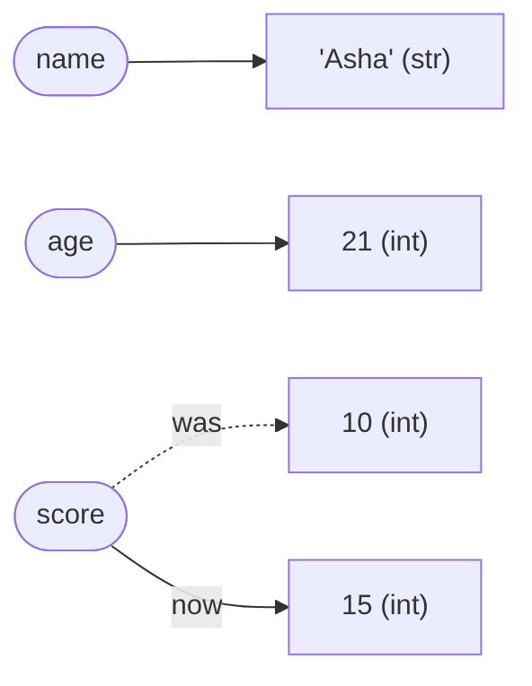
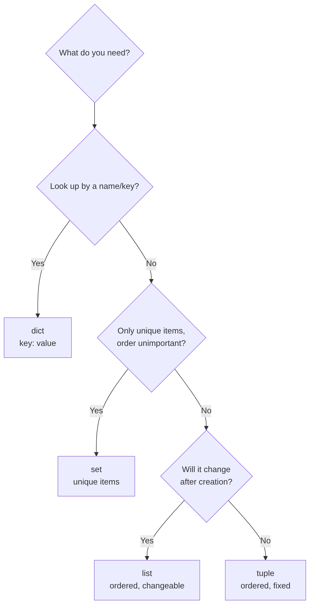
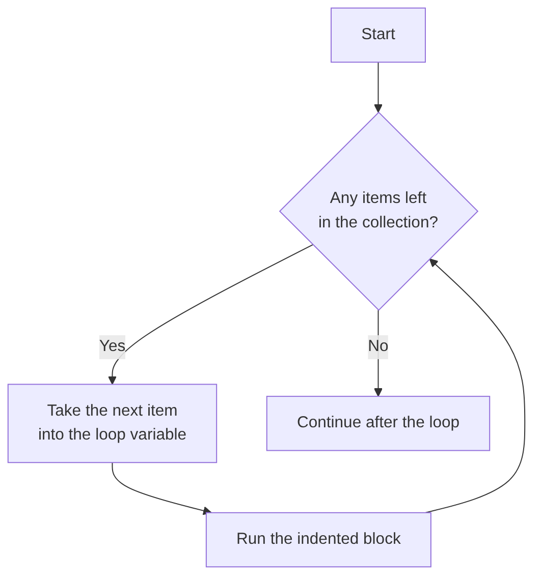
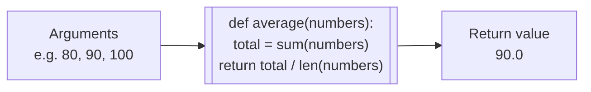
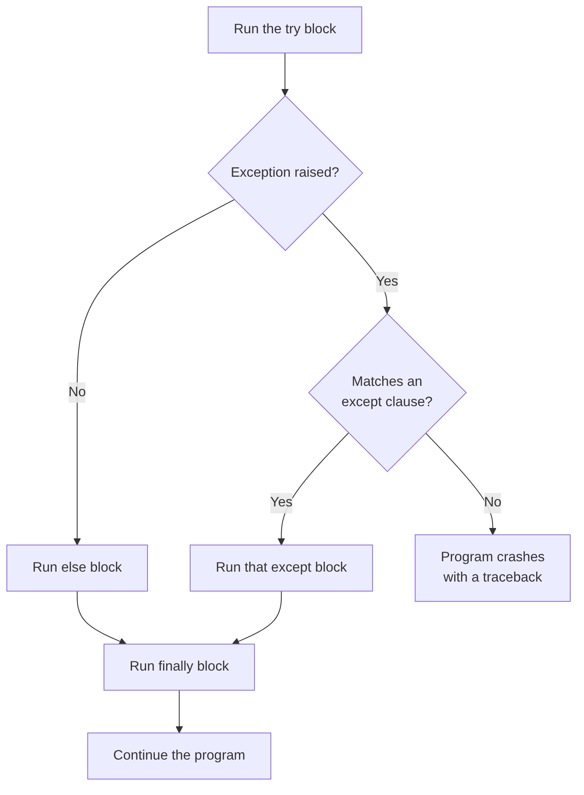
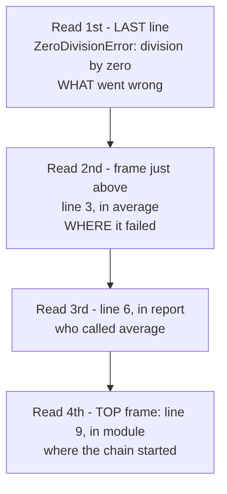

# Module 01 — Python basics: from zero to confident

This lesson teaches the core of the Python language. It is written for someone who has never programmed. Every example is short and runnable: type it into a notebook cell or a `.py` file and run it. Reading code is not enough. Change the numbers, break things on purpose, and see what happens.

Why Python for AI? Almost every AI library — PyTorch, Hugging Face, LangChain, the OpenAI and Anthropic SDKs (**SDK**, software development kit: a ready-made library for talking to a service) — is used from Python. The language reads almost like English, so you can focus on ideas instead of punctuation.

You need module 00 done: Python installed, or a Google Colab notebook open.

---

## 1. Programs, statements and `print`

A **program** is a list of instructions. Python runs them from top to bottom, one line at a time. Each instruction is a **statement**.

```python
print("Hello, world!")
print("I am learning Python.")
print(2 + 3)
```

**`print`** is a **function** — a named, reusable action. You **call** a function by writing its name and round brackets. What goes inside the brackets is the **argument**: the input you hand to the function. `print` shows its argument on the screen.

**Comments** start with `#`. Python ignores everything after `#` on that line. Comments are notes for humans.

```python
# This line is a comment. Python skips it.
print("This runs")  # a comment can also follow code
```

**Analogy:** a program is a recipe. Each statement is one step. `print` is the step "say this out loud". Comments are the notes in the margin.

---

## 2. Values, types and variables

### 2.1 Values and types

A **value** is a piece of data: `42`, `3.14`, `"hello"`, `True`. Every value has a **type**, which says what kind of data it is and what you can do with it.

| Type | Name in Python | Examples | Used for |
|---|---|---|---|
| Integer | `int` | `0`, `42`, `-7` | Counting things |
| Floating-point number | `float` | `3.14`, `0.5`, `-2.0` | Measurements, decimals, probabilities |
| String | `str` | `"hello"`, `'AI'` | Text |
| Boolean | `bool` | `True`, `False` | Yes/no answers |
| None | `NoneType` | `None` | "Nothing here yet" |

Ask Python for a value's type with `type()`:

```python
print(type(42))       # <class 'int'>
print(type(3.14))     # <class 'float'>
print(type("hi"))     # <class 'str'>
print(type(True))     # <class 'bool'>
```

### 2.2 Variables: name tags on values

A **variable** is a name that refers to a value. You create one with `=`, the **assignment** operator. `=` does not mean "equals" as in maths. Read it as "now refers to".

```python
age = 21
name = "Asha"
temperature = 36.6
is_student = True

print(name, "is", age)
```

**Analogy:** a variable is a sticky name tag. The value is the object; the tag lets you find it. You can move a tag to a different object at any time:

```python
score = 10
score = score + 5     # take the current value (10), add 5, put the tag on 15
print(score)          # 15
```



**Naming rules:** letters, digits and underscores only; cannot start with a digit; case matters (`Age` and `age` are different). By convention Python uses **snake_case**: lowercase words joined with underscores, like `learning_rate` or `max_tokens`. Pick names that say what the value means: `num_students`, not `n2`.

### 2.3 Arithmetic

```python
print(7 + 2)    # 9    addition
print(7 - 2)    # 5    subtraction
print(7 * 2)    # 14   multiplication
print(7 / 2)    # 3.5  division always gives a float
print(7 // 2)   # 3    floor division: whole part only
print(7 % 2)    # 1    remainder ("modulo")
print(7 ** 2)   # 49   power
```

Shortcuts: `x += 1` means `x = x + 1`. Also `-=`, `*=`, `/=`.

Floats are stored in binary, so some decimals are not exact: `0.1 + 0.2` prints `0.30000000000000004`. This is normal in every language. Use `round(value, 2)` when displaying.

### 2.4 Converting between types

```python
int("42")       # 42     text to whole number
float("3.5")    # 3.5    text to decimal
str(42)         # "42"   number to text
int(3.9)        # 3      cuts off the decimal (does not round)
round(3.9)      # 4      rounds
bool(0)         # False  (0, "", empty collections and None are "falsy")
```

Data from files, web forms and the `input()` function always arrives as **text**, even when it looks like a number. You must convert it before doing maths.

---

## 3. Strings and f-strings

A **string** is text: a sequence of characters inside quotes. Single `'...'` and double `"..."` quotes do the same thing. Triple quotes `"""..."""` allow text across several lines — you will use these a lot for AI prompts.

```python
greeting = "Hello"
prompt = """You are a helpful assistant.
Answer in one sentence."""
```

### 3.1 Indexing and slicing

Each character has a position number called an **index**, starting at **0**.

```python
word = "Python"
print(word[0])      # P   first character
print(word[-1])     # n   negative counts from the end
print(word[0:3])    # Pyt slice: from index 0 up to (not including) 3
print(word[2:])     # thon from 2 to the end
print(len(word))    # 6   length
```

**Analogy:** indexes are the gaps between beads on a necklace, counted from zero. A slice `[0:3]` cuts at gap 0 and gap 3.

### 3.2 Useful string methods

A **method** is a function that belongs to a value. You call it with a dot: `value.method()`.

```python
text = "  Large Language Models  "
print(text.strip())          # "Large Language Models"  removes spaces at both ends
print(text.lower())          # lowercase
print(text.upper())          # uppercase
print(text.replace("Large", "Small"))
print("a,b,c".split(","))    # ['a', 'b', 'c']  cut into a list
print("-".join(["a", "b"]))  # "a-b"            glue a list into a string
print("data" in "big data")  # True             does it contain?
print("report.csv".endswith(".csv"))  # True
```

Strings are **immutable** — they cannot be changed in place. Methods like `.upper()` return a **new** string. To keep the result, assign it: `text = text.upper()`.

### 3.3 f-strings: putting values into text

An **f-string** is a string with `f` before the opening quote. Anything inside `{}` is evaluated and inserted.

```python
name = "Asha"
score = 87.456
print(f"{name} scored {score}")          # Asha scored 87.456
print(f"{name} scored {score:.1f}")      # Asha scored 87.5   (1 decimal place)
print(f"Accuracy: {0.9234:.1%}")         # Accuracy: 92.3%
print(f"{'Item':<10}|{'Qty':>5}")        # left / right align in a fixed width
print(f"{1234567:,}")                    # 1,234,567
print(f"{score=}")                       # score=87.456  (handy for debugging)
```

The part after `:` is the **format specification**: `.2f` = 2 decimals, `%` = percentage, `<10` = left-align in 10 characters, `,` = thousands separators. In AI work you will build prompts with f-strings: `f"Summarise this text:\n{document}"`.

---

## 4. Collections: holding many values

Real data comes in groups: a list of reviews, a table of scores, a set of labels. Python has four built-in **collections** (containers for several values).



### 4.1 Lists: ordered, changeable

A **list** holds items in order, inside square brackets. You can add, remove and change items.

```python
scores = [72, 88, 95, 60]
print(scores[0])        # 72
print(scores[-1])       # 60
print(scores[1:3])      # [88, 95]
print(len(scores))      # 4

scores.append(81)       # add to the end
scores.insert(0, 50)    # insert at position 0
scores.remove(60)       # remove the first 60
last = scores.pop()     # remove and return the last item
scores[0] = 55          # change an item
scores.sort()           # sort in place (changes the list)
print(sorted(scores, reverse=True))   # a new sorted list, biggest first
print(sum(scores), max(scores), min(scores))
```

**Analogy:** a list is a numbered row of lockers. You can open locker 2, swap its contents, add a locker at the end, or remove one.

Lists can hold anything, even other lists: `matrix = [[1, 2], [3, 4]]`, then `matrix[1][0]` is `3`. Later, NumPy arrays (module 02) do this much faster.

**Watch out:** `b = a` does not copy a list. Both names point to the **same** list, so changing `b` changes `a`. Use `b = a.copy()` for a real copy.

### 4.2 Tuples: ordered, fixed

A **tuple** is like a list that cannot be changed after creation. Use round brackets.

```python
point = (3, 4)
rgb = (255, 128, 0)
x, y = point            # "unpacking": x = 3, y = 4
print(x, y)
```

Use a tuple for a fixed group of values that belong together: coordinates, an image's (height, width), a function returning two results. A tuple with one item needs a comma: `(5,)`.

### 4.3 Dictionaries: look up by name

A **dictionary** (`dict`) stores **key → value** pairs inside curly braces. You look things up by key instead of by position.

```python
student = {"name": "Ravi", "age": 20, "scores": [88, 92]}
print(student["name"])              # Ravi
student["age"] = 21                 # change a value
student["city"] = "Hyderabad"       # add a new key
print(student.get("email"))         # None  (no error for a missing key)
print(student.get("email", "n/a"))  # n/a   (with a default)
print("age" in student)             # True  (checks keys)

for key, value in student.items():  # loop over pairs
    print(key, "->", value)
```

**Analogy:** a real dictionary. You look up a word (the key) and read its meaning (the value). You do not need to know what page it is on.

Dictionaries are everywhere in AI engineering. A chat message to an LLM is a dict: `{"role": "user", "content": "Hello"}`. JSON data from web APIs becomes dicts and lists in Python. Keys must be **unique** and **immutable** (strings, numbers, tuples).

### 4.4 Sets: unique items, no order

A **set** holds each value at most once, with no particular order.

```python
tags = {"nlp", "vision", "nlp", "audio"}
print(tags)                    # {'nlp', 'vision', 'audio'}  duplicates removed
tags.add("rl")
print("vision" in tags)        # True, and very fast even for huge sets

a = {"python", "sql", "git"}
b = {"python", "docker"}
print(a & b)                   # {'python'}               in both (intersection)
print(a | b)                   # all of them              (union)
print(a - b)                   # {'sql', 'git'}           in a but not b
print(len(set([1, 1, 2, 3])))  # 3   count unique values
```

An empty set is `set()`; `{}` makes an empty dict.

| | list | tuple | dict | set |
|---|---|---|---|---|
| Brackets | `[1, 2]` | `(1, 2)` | `{"a": 1}` | `{1, 2}` |
| Ordered | Yes | Yes | Yes (keeps insertion order) | No |
| Changeable | Yes | No | Yes | Yes |
| Duplicates | Allowed | Allowed | Keys unique | Not allowed |
| Access by | Position | Position | Key | Membership only |

---

## 5. Making decisions: `if`, `elif`, `else`

**Comparison operators** produce `True` or `False`:

| Operator | Meaning |
|---|---|
| `==` | equal to (two `=` signs; one `=` is assignment) |
| `!=` | not equal |
| `<`, `>` | less than, greater than |
| `<=`, `>=` | less/greater than or equal |
| `in` | is inside (string, list, dict keys, set) |

Combine them with `and`, `or`, `not`.

```python
score = 78

if score >= 90:
    grade = "A"
elif score >= 75:
    grade = "B"
elif score >= 60:
    grade = "C"
else:
    grade = "F"

print(f"Score {score} -> grade {grade}")
```

**Indentation** — the spaces at the start of a line — is how Python knows which lines belong to the `if`. Use **4 spaces** (VS Code inserts them when you press Tab). The line before an indented block ends with a colon `:`. Python checks conditions top to bottom and runs only the **first** block whose condition is true.

**Analogy:** a railway junction. The train (your program) takes exactly one track depending on the signal.

**Truthiness:** in a condition, empty things count as false: `0`, `""`, `[]`, `{}`, `None`. So `if reviews:` means "if the list is not empty".

A one-line version, the **conditional expression**: `label = "pass" if score >= 60 else "fail"`.

---

## 6. Loops: doing things again and again

### 6.1 `for` loops

A `for` loop runs a block once for each item in a collection.

```python
fruits = ["apple", "banana", "mango"]
for fruit in fruits:
    print("I like", fruit)
```

**`range`** produces a sequence of numbers: `range(5)` is 0, 1, 2, 3, 4. `range(2, 10, 2)` is 2, 4, 6, 8.

```python
for i in range(3):
    print("Epoch", i)          # "epoch" = one pass over training data, module 05

for index, fruit in enumerate(fruits):     # position + item together
    print(index, fruit)

names = ["Asha", "Ravi"]
marks = [88, 92]
for name, mark in zip(names, marks):       # walk two lists side by side
    print(name, mark)
```

**Analogy:** a teacher going down the register, calling each name once.



### 6.2 `while` loops

A `while` loop repeats **as long as** a condition stays true.

```python
balance = 100
months = 0
while balance < 200:
    balance = balance * 1.1
    months += 1
print(months, "months to double")
```

If the condition never becomes false, the loop runs forever (an **infinite loop**). Stop it with **Ctrl + C** in a terminal, or the **stop** button (square) in a notebook.

### 6.3 `break` and `continue`

- `break` leaves the loop immediately.
- `continue` skips to the next item.

```python
for n in [3, 8, -1, 5, 0, 9]:
    if n < 0:
        continue     # skip negatives
    if n == 0:
        break        # stop at the first zero
    print(n)         # prints 3, 8, 5
```

### 6.4 The accumulator pattern

Most loops build up a result: a total, a count, a new list.

```python
reviews = ["great", "bad", "great", "ok"]
count = 0
for r in reviews:
    if r == "great":
        count += 1
print(count)   # 2
```

---

## 7. List and dictionary comprehensions

A **comprehension** builds a new collection from an old one in one readable line.

```python
numbers = [1, 2, 3, 4, 5, 6]

squares = [n * n for n in numbers]                 # [1, 4, 9, 16, 25, 36]
evens = [n for n in numbers if n % 2 == 0]         # [2, 4, 6]
words = ["  Hello ", "WORLD  "]
clean = [w.strip().lower() for w in words]         # ['hello', 'world']

lengths = {w: len(w) for w in ["ai", "data", "model"]}   # {'ai': 2, 'data': 4, 'model': 5}
unique_lengths = {len(w) for w in ["ai", "ml", "data"]}  # {2, 4}
```

Read it as English: "**n times n**, **for** each **n in numbers**, **if** n is even". It is the same as a loop with `.append()`:

```python
squares = []
for n in numbers:
    squares.append(n * n)
```

Use comprehensions for short transformations and filters. If it needs more than one `if` or does not fit on one line, write a normal loop instead — clear beats clever.

---

## 8. Functions: reusable recipes

A **function** packages steps under a name, so you can run them again with different inputs.

```python
def average(numbers):
    """Return the mean of a list of numbers."""
    total = sum(numbers)
    return total / len(numbers)

result = average([80, 90, 100])
print(result)      # 90.0
```

Parts:
- `def` starts a **definition**. `average` is the name.
- `numbers` is a **parameter**: a placeholder name for the input. The actual value you pass when calling, `[80, 90, 100]`, is the **argument**.
- The triple-quoted line is a **docstring**: a description shown by `help(average)` and by VS Code when you hover.
- `return` sends a value back to the caller and ends the function. A function without `return` gives back `None`.

**Analogy:** a function is a juice machine. Fruit goes in (arguments), the machine does its steps, juice comes out (return value). You do not need to rebuild the machine every time you want juice.



### 8.1 Default and keyword arguments

```python
def greet(name, greeting="Hello"):        # greeting has a default value
    return f"{greeting}, {name}!"

print(greet("Asha"))                       # Hello, Asha!
print(greet("Asha", "Namaste"))            # Namaste, Asha!
print(greet(greeting="Hi", name="Ravi"))   # keyword arguments: order does not matter
```

AI libraries use keyword arguments heavily: `client.messages.create(model=..., max_tokens=200, temperature=0.7)`.

### 8.2 Returning several values

```python
def min_max(values):
    return min(values), max(values)     # actually returns one tuple

low, high = min_max([4, 9, 1])          # unpack it
```

### 8.3 Scope

Variables created inside a function are **local**: they exist only while the function runs. This is called **scope** (where a name is visible).

```python
def f():
    secret = 42
    return secret

f()
# print(secret)   -> NameError: secret only existed inside f
```

Pass values in as arguments and get them out with `return`. Avoid relying on variables from outside the function.

### 8.4 Type hints (a preview)

You will see code like this in professional projects and AI libraries:

```python
def average(numbers: list[float]) -> float:
    return sum(numbers) / len(numbers)
```

`: list[float]` and `-> float` are **type hints**: notes that say what types are expected. Python does not enforce them, but editors use them to warn you about mistakes. Pydantic (used later for structured LLM output) builds on them.

### 8.5 Lambdas

A **lambda** is a tiny unnamed function written in one expression, often used as a sort key:

```python
students = [("Asha", 88), ("Ravi", 92), ("Meera", 75)]
by_score = sorted(students, key=lambda pair: pair[1], reverse=True)
```

---

## 9. Errors, exceptions and `try` / `except`

Errors are normal. Professionals see them all day. The skill is reading them calmly.

There are two families:
- **Syntax errors** — the code is not valid Python (a missing bracket or colon). Python refuses to start running it.
- **Exceptions** — the code is valid, but something goes wrong while it runs (dividing by zero, a missing file, a missing dictionary key).

### 9.1 Common exceptions you will meet

| Exception | What it means | Example that causes it |
|---|---|---|
| `SyntaxError` | Not valid Python | `print("hi"` (bracket never closed) |
| `IndentationError` | Spaces at line start are wrong | Nothing indented after `if x:` |
| `NameError` | Name not defined (typo, or cell not run) | `print(nme)` |
| `TypeError` | Wrong type for this operation | `"5" + 3` |
| `ValueError` | Right type, bad value | `int("abc")` |
| `IndexError` | Position past the end of a list | `[1, 2][5]` |
| `KeyError` | Key not in dict | `{"a": 1}["b"]` |
| `AttributeError` | Value has no such method/attribute | `"abc".uppr()` |
| `ZeroDivisionError` | Divided by zero | `1 / 0` |
| `FileNotFoundError` | File path does not exist | `open("nofile.txt")` |
| `ModuleNotFoundError` | Package not installed in this Python | `import numpyy` |

### 9.2 Handling exceptions

`try` / `except` lets your program recover instead of crashing.

```python
text = "abc"
try:
    number = int(text)
except ValueError:
    print(f"{text!r} is not a number, using 0")
    number = 0
```



Full form:

```python
def safe_divide(a, b):
    try:
        result = a / b
    except ZeroDivisionError:
        print("Cannot divide by zero")
        return None
    except TypeError as err:          # `as err` keeps the error object
        print("Bad input:", err)
        return None
    else:
        return result                 # runs only if no exception happened
    finally:
        print("safe_divide finished") # always runs, error or not
```

**Analogy:** a trapeze artist's safety net. The act (the `try` block) goes ahead; if they fall (an exception), the net (`except`) catches them and the show continues.

Rules of thumb:
- Catch **specific** exceptions (`except ValueError:`), not everything. A bare `except:` hides real bugs, including typos.
- Only wrap the lines that can actually fail.
- In AI apps you will catch network errors and rate limits (too many requests) from APIs, and retry.

You can raise your own exceptions to reject bad input:

```python
def set_temperature(t):
    if not 0 <= t <= 2:
        raise ValueError(f"temperature must be between 0 and 2, got {t}")
    return t
```

---

## 10. Reading a traceback

When an exception is not caught, Python prints a **traceback**: a report of the chain of function calls that led to the error. Beginners panic at the wall of text. It is actually a helpful map.

Here is a real one from Python 3.13. The program calls `report()`, which calls `average()`, with an empty list of scores:

```text
Traceback (most recent call last):
  File "/tmp/tb.py", line 9, in <module>
    print(report({"name": "Ravi", "scores": []}))
          ~~~~~~^^^^^^^^^^^^^^^^^^^^^^^^^^^^^^^^
  File "/tmp/tb.py", line 6, in report
    avg = average(student["scores"])
  File "/tmp/tb.py", line 3, in average
    return total / len(scores)
           ~~~~~~^~~~~~~~~~~~~
ZeroDivisionError: division by zero
```



**How to read it — bottom up:**

1. **Last line first.** `ZeroDivisionError: division by zero`. The exception type (before the colon) and a message (after). This tells you *what* went wrong.
2. **The frame just above it** — "frame" means one entry in the call chain. `File "/tmp/tb.py", line 3, in average` and the code `return total / len(scores)`. This is *where* it went wrong. The `~~~^~~~` markers point at the exact part of the line.
3. **Keep going up** to see *how you got there*: `average` was called by `report` (line 6), which was called from the main program, `<module>` (line 9). `<module>` means "the top level of the file, not inside any function".
4. **Ask why** the value was bad. Here `len(scores)` was `0` because the list was empty. The fix might be in `average` (handle empty lists) or in the data.

"Most recent call last" means the list is in time order: the oldest call at the top, the line that actually failed at the bottom.

**Tips**
- Frames from library files (paths containing `site-packages`) are usually not where *your* bug is. Find the lowest frame that is **your** file.
- Read the message carefully. Modern Python often suggests fixes: `AttributeError: 'str' object has no attribute 'uppr'. Did you mean: 'upper'?`
- For a `SyntaxError`, the caret `^` points at where Python got confused. The real mistake is often on the line **before** (for example, an unclosed bracket).
- Copy the last line into a search engine. Someone has had it before.
- In notebooks, the traceback shows cell inputs instead of file names, but you read it the same way.

---

## 11. Files: reading and writing

A **file** stores data on disk so it survives after the program ends. Use `open()` inside a `with` block. **`with`** guarantees the file is closed afterwards, even if an error happens.

```python
# Write (mode "w" creates the file or replaces it)
with open("notes.txt", "w", encoding="utf-8") as f:
    f.write("first line\n")
    f.write("second line\n")

# Append (mode "a" adds to the end)
with open("notes.txt", "a", encoding="utf-8") as f:
    f.write("third line\n")

# Read the whole file
with open("notes.txt", encoding="utf-8") as f:
    content = f.read()

# Read line by line
with open("notes.txt", encoding="utf-8") as f:
    for line in f:
        print(line.strip())      # strip removes the "\n" at the end
```

`"\n"` is the **newline** character: an invisible "go to the next line" marker. `encoding="utf-8"` says how characters are stored as bytes; always pass it so accents, Hindi, Chinese and emoji work the same on every computer.

**`pathlib`** handles file paths cleanly on every operating system:

```python
from pathlib import Path
data_dir = Path("data")
data_dir.mkdir(exist_ok=True)              # make the folder if missing
path = data_dir / "scores.txt"             # "/" joins path parts, on Windows too
path.write_text("88\n92\n75\n", encoding="utf-8")
print(path.exists(), path.name, path.suffix)   # True scores.txt .txt
```

**JSON files** are how you save dicts and lists, and how most APIs send data:

```python
import json
config = {"model": "small", "temperature": 0.2, "tags": ["demo"]}
with open("config.json", "w", encoding="utf-8") as f:
    json.dump(config, f, indent=2)
with open("config.json", encoding="utf-8") as f:
    loaded = json.load(f)
print(loaded["temperature"])
```

**CSV** (comma-separated values) files are simple tables. The built-in `csv` module reads them; in module 02, pandas makes it easier.

---

## 12. Modules and imports

A **module** is a `.py` file of code you can reuse. A **package** is a folder of modules. The **standard library** is the large set of modules that ships with Python (`math`, `random`, `json`, `pathlib`, `datetime`, `csv`, `os`...). Third-party packages (`numpy`, `pandas`) are installed with `pip`.

```python
import math                       # import the whole module
print(math.sqrt(16))              # 4.0

from random import choice, seed   # import specific names
seed(0)                           # makes "random" results repeatable
print(choice(["rock", "paper", "scissors"]))

import numpy as np                # import with a short nickname (an "alias")
from datetime import date
print(date.today())
```

**Your own modules:** save functions in `helpers.py`, then in another file in the same folder write `from helpers import average`. That is how real projects are organised.

```python
# helpers.py
def average(xs):
    return sum(xs) / len(xs)

if __name__ == "__main__":        # only runs when you execute helpers.py directly
    print(average([1, 2, 3]))
```

The `if __name__ == "__main__":` line separates "code to run when this file is the program" from "code to share when imported". You will see it in almost every script.

`ModuleNotFoundError` means the package is not installed in the Python that is running — usually the wrong virtual environment or kernel (see module 00).

---

## 13. Classes and objects (a light introduction)

A **class** is a blueprint for creating **objects** — bundles of data (**attributes**) and actions (**methods**) that belong together.

**Analogy:** a class is a cookie cutter; objects are the cookies. Every cookie has the same shape, but each can have different icing.

```python
class Student:
    """A student with a name and a list of scores."""

    def __init__(self, name):
        self.name = name          # attribute: data stored on this object
        self.scores = []

    def add_score(self, score):   # method: an action this object can do
        self.scores.append(score)

    def average(self):
        if not self.scores:
            return 0.0
        return sum(self.scores) / len(self.scores)

    def __repr__(self):           # how the object looks when printed
        return f"Student({self.name!r}, avg={self.average():.1f})"


asha = Student("Asha")            # create an object ("an instance")
asha.add_score(88)
asha.add_score(94)
print(asha.name, asha.average())  # Asha 91.0
print(asha)                       # Student('Asha', avg=91.0)
```

- `__init__` runs automatically when you create an object. It sets up the starting attributes.
- `self` means "this particular object". Python passes it in for you when you call `asha.add_score(88)`.
- Names with double underscores on both sides (`__init__`, `__repr__`) are **special methods** that Python calls in specific situations.

You do not need to write many classes yet. But you will **use** objects constantly: a pandas `DataFrame`, a PyTorch model, an OpenAI `client` — all are objects with attributes and methods. When you see `model.train()` or `df.head()`, that is a method call on an object.

---

## 14. Putting it together: a tiny program

```python
from pathlib import Path

def letter_grade(score):
    if score >= 90:
        return "A"
    if score >= 75:
        return "B"
    if score >= 60:
        return "C"
    return "F"

raw = "Asha,88\nRavi,92\nMeera,abc\nJohn,59\n"
Path("marks.csv").write_text(raw, encoding="utf-8")

results = {}
for line in Path("marks.csv").read_text(encoding="utf-8").splitlines():
    name, mark_text = line.split(",")
    try:
        mark = float(mark_text)
    except ValueError:
        print(f"Skipping {name}: {mark_text!r} is not a number")
        continue
    results[name] = letter_grade(mark)

print(results)    # {'Asha': 'B', 'Ravi': 'A', 'John': 'F'}
```

It uses files, strings, a loop, a function, a dict, `try`/`except` and an f-string. The mini-project notebook grows this into a full grade calculator.

---

## 15. Habits of good Python programmers

- **Run code often.** Write two lines, run, check. Do not write fifty lines and hope.
- **Print to investigate.** `print(f"{variable=}")` shows a name and its value. Check `type()` and `len()` when confused.
- **Name things clearly.** Future you is a stranger who has to read this code.
- **Keep functions small.** One function, one job.
- **Read the error's last line first.** Then find your own file's lowest frame.
- **Restart and run all** in notebooks before trusting results.
- **Use the official docs** (`help(len)` or the Python tutorial linked in resources.md).
- **Style:** follow **PEP 8**, Python's official style guide: 4-space indents, snake_case names, spaces around `=` in assignments.

---

## 16. Summary

| Concept | One-line reminder |
|---|---|
| Variables | Name tags on values; `=` means "now refers to" |
| Types | `int`, `float`, `str`, `bool`, `None`; convert with `int()`, `float()`, `str()` |
| Strings | Index from 0; slices `[a:b]` stop before `b`; f-strings `f"{x:.2f}"` |
| list / tuple / dict / set | Ordered & changeable / ordered & fixed / key→value / unique |
| `if / elif / else` | First true branch runs; indentation defines the block |
| `for` / `while` | For each item / while a condition holds; `break`, `continue` |
| Comprehensions | `[f(x) for x in xs if cond]` |
| Functions | `def name(params): ... return value`; defaults and keyword args |
| Exceptions | `try / except SpecificError / else / finally`; `raise` to reject bad input |
| Tracebacks | Read bottom up: type + message, then where, then how you got there |
| Files | `with open(path, mode, encoding="utf-8") as f:`; `pathlib.Path`; `json` |
| Imports | `import x`, `from x import y`, `import x as z`; your own `.py` files are modules |
| Classes | Blueprints; `__init__` sets attributes; methods use `self` |
