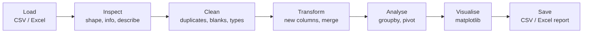
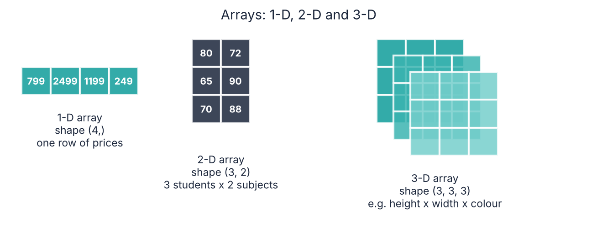
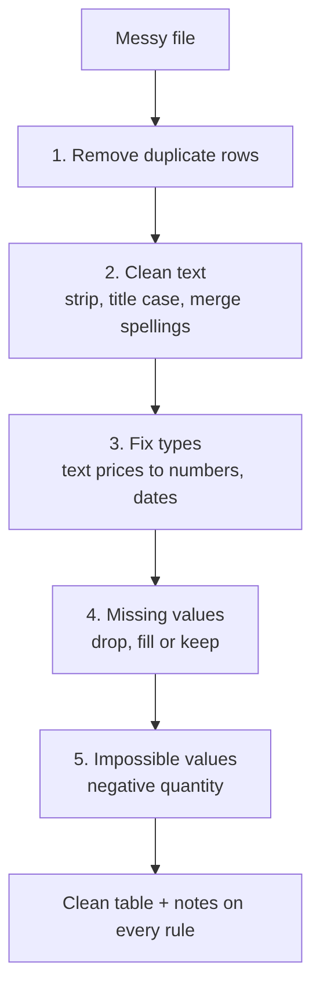
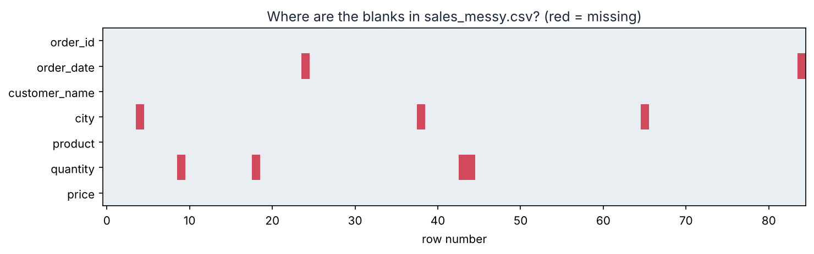
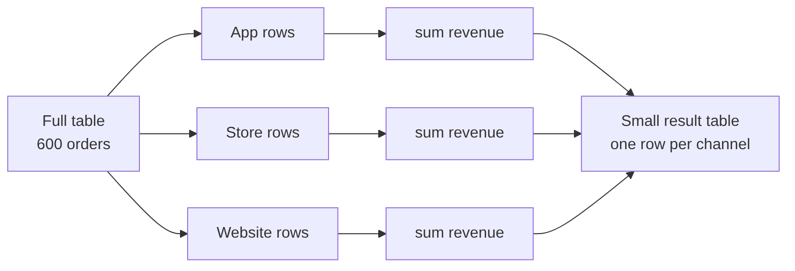
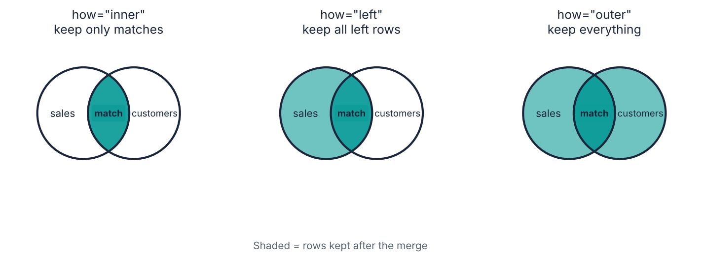
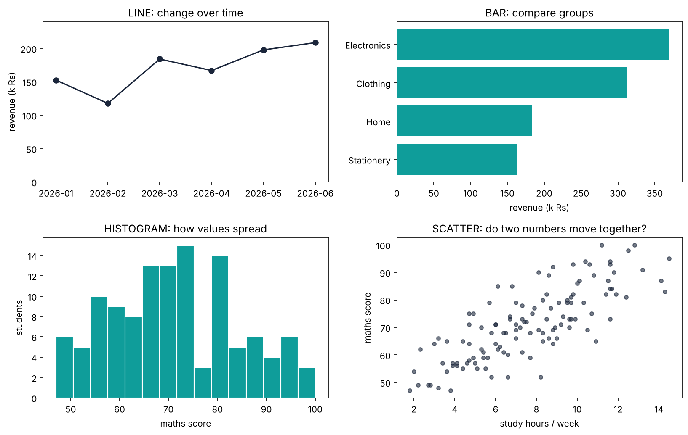
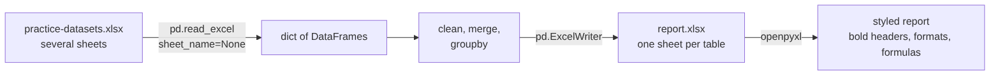

# Module 02 — Python for Data: NumPy, pandas, matplotlib and Excel

> **Goal of this lesson:** by the end you can load a CSV or Excel file into Python, clean it, answer questions about it with a few lines of code, draw clear charts, and save the results back to Excel. These are the everyday skills of anyone who works with data, including AI engineers.

This lesson assumes you finished Module 01 (Python basics): you know variables, lists, dictionaries, loops, functions and `import`. Everything new is defined the first time it appears.

---

## 1. Why AI engineers need data skills

Every AI system eats data. A spam filter learns from thousands of labelled emails. A chatbot that answers questions about your company reads your company's documents. A sales forecast learns from last year's sales table. Before any model sees that data, a person has to **load** it, **look** at it, **fix** it and **reshape** it.

People in the field often say that most of the work in a machine-learning project is data preparation, not model building. Whatever the exact share, you will spend a lot of your time doing exactly what this module teaches.

Three libraries do almost all of this work in Python:

| Library | What it is for | Everyday analogy |
|---|---|---|
| **NumPy** | Fast maths on big grids of numbers | A calculator that can press "+" on a million numbers at once |
| **pandas** | Tables with named columns (like spreadsheets) | Excel, but driven by code you can rerun |
| **matplotlib** | Drawing charts | A pen and graph paper that never get tired |

A **library** (also called a **package**) is code someone else wrote that you can `import` and use. These three are installed with `pip install numpy pandas matplotlib openpyxl` (Colab already has them).

The usual journey through a dataset looks like this:



Keep this picture in mind. Every notebook in this module walks along it.

---

## 2. NumPy: fast grids of numbers

### 2.1 What an array is

An **array** is a grid of numbers that all have the same type. A Python list can hold anything (`[1, "hello", 3.5]`). A NumPy array holds one kind of thing (all whole numbers, or all decimals). That restriction is what makes it fast: the computer can store the numbers side by side in memory and process them in one sweep.

```python
import numpy as np            # "np" is the nickname everyone uses
prices = np.array([799, 2499, 1199, 249])
print(prices * 2)             # [1598 4998 2398  498]
```

With a plain list, `[799, 2499] * 2` gives `[799, 2499, 799, 2499]` (it repeats the list). With an array, `* 2` doubles every number. That difference is the heart of NumPy.

### 2.2 Shape, dimensions and dtype

Every array has three facts you should check first:

- **shape** — how many items along each direction. `(4,)` means a row of 4. `(3, 2)` means 3 rows and 2 columns.
- **ndim** — the number of **dimensions** (directions). A row of numbers is 1-D, a table is 2-D, a stack of tables (like a colour image: height × width × colour) is 3-D.
- **dtype** — the **data type** of every item, such as `int64` (whole numbers) or `float64` (decimals).



**Analogy:** a 1-D array is one egg tray row; a 2-D array is a full egg tray (rows and columns); a 3-D array is a stack of egg trays.

```python
scores = np.array([[80, 72], [65, 90], [70, 88]])
scores.shape   # (3, 2) -> 3 students, 2 subjects
scores.ndim    # 2
scores.dtype   # int64
```

### 2.3 Indexing and slicing

**Indexing** means picking items out by position. Positions start at 0, as with lists.

```python
scores[0]        # first row -> [80, 72]
scores[0, 1]     # row 0, column 1 -> 72
scores[:, 0]     # every row, column 0 -> [80, 65, 70]
scores[1:, :]    # rows 1 to the end, all columns
```

The colon `:` means "everything along this direction". `scores[:, 0]` reads as "all rows, column zero".

### 2.4 Vectorisation: no more loops

**Vectorisation** means writing one operation that applies to a whole array, instead of a Python `for` loop over each item. NumPy runs the loop inside fast pre-compiled code.

```python
# slow way (pure Python)
total = []
for q, p in zip(quantity, price):
    total.append(q * p)

# vectorised way (NumPy)
total = quantity * price
```

On a million numbers the vectorised version is typically tens to hundreds of times faster (notebook 01 times it on your machine). It is also shorter and easier to read.

**Analogy:** a loop is a cashier scanning items one at a time. Vectorisation is a scanner that reads the whole trolley in one beep.

### 2.5 Aggregations and the `axis` idea

An **aggregation** squashes many numbers into one: sum, mean (average), min, max, standard deviation.

```python
scores.mean()          # average of everything
scores.mean(axis=0)    # average of each COLUMN (per subject)
scores.mean(axis=1)    # average of each ROW (per student)
```

`axis=0` means "collapse downwards, across rows" so you get one answer per column. `axis=1` means "collapse sideways, across columns" so you get one answer per row. Students mix these up constantly. A memory trick: **axis=0 squashes the rows away**.

### 2.6 Boolean masks

A **boolean** is a True/False value. A **mask** is an array of booleans you use to filter another array.

```python
prices = np.array([799, 2499, 1199, 249])
mask = prices > 1000         # [False, True, True, False]
prices[mask]                 # [2499, 1199]
```

This "build a True/False list, then keep the True ones" pattern appears again in pandas. Learn it once, use it everywhere.

### 2.7 Broadcasting (in one paragraph)

**Broadcasting** is NumPy's rule for combining arrays of different shapes. If you add a single number to an array, it is "stretched" to match every item. If you add a row of 2 numbers to a 3×2 table, that row is added to every row. Example: `scores + np.array([5, 0])` gives every student 5 bonus marks in subject 1 only. You do not need the full rules yet; you need to know that it exists, so you are not surprised when it happens.

### 2.8 Random numbers with a seed

`np.random.default_rng(42)` creates a **random number generator**. The `42` is a **seed**: a starting value that makes the "random" numbers come out the same every run. Seeds make experiments **reproducible** (someone else can rerun your code and get exactly your result). All the practice data in this module was generated with seed 42.

---

## 3. pandas: tables you can program

### 3.1 Series and DataFrame

pandas has two main objects:

- A **Series** is one labelled column of values (like a single column in Excel, with row labels).
- A **DataFrame** is a whole table: several Series side by side, sharing the same row labels.

The row labels are called the **index**. By default they are 0, 1, 2, …

**Analogy:** a DataFrame is a spreadsheet tab. A Series is one column of that tab. The index is the grey row numbers on the left.

```python
import pandas as pd           # "pd" is the standard nickname
df = pd.DataFrame({
    "product": ["Mouse", "Headphones"],
    "price":   [799, 2499],
})
df["price"]       # a Series
```

### 3.2 Loading data: CSV and Excel

A **CSV** (comma-separated values) file is plain text where each line is a row and commas separate the columns. Almost every system can export CSV.

```python
sales = pd.read_csv("data/sales.csv", parse_dates=["order_date"])
```

`parse_dates` tells pandas to turn that column into real dates (more on that below).

An **Excel workbook** (`.xlsx` file) can hold several **sheets** (tabs). pandas reads them with the help of a second library called **openpyxl**, which knows how the `.xlsx` format works inside.

```python
students = pd.read_excel("excel/practice-datasets.xlsx", sheet_name="Students")
all_sheets = pd.read_excel("excel/practice-datasets.xlsx", sheet_name=None)  # dict of DataFrames
all_sheets.keys()   # 'About', 'Sales', 'Customers', ...
```

`sheet_name=None` is a handy trick: it loads **every** sheet and returns a dictionary whose keys are the sheet names.

### 3.3 First look: the five questions

Whenever you load a table, ask these five questions before anything else:

| Question | Code |
|---|---|
| How big is it? | `df.shape` |
| What do the first rows look like? | `df.head()` |
| What type is each column, and are there blanks? | `df.info()` |
| What are typical values? | `df.describe()` |
| How many blanks per column? | `df.isna().sum()` |

`describe()` gives **summary statistics**: count, mean, standard deviation (how spread out the numbers are), minimum, the 25 %/50 %/75 % points, and maximum. The 50 % point is the **median**: the middle value when sorted.

### 3.4 Selecting columns and filtering rows

```python
sales["quantity"]                         # one column -> Series
sales[["order_id", "quantity"]]           # several columns -> DataFrame (note the double brackets)
sales[sales["quantity"] > 3]              # rows where quantity > 3 (a boolean mask again)
sales[(sales["channel"] == "App") & (sales["discount_pct"] > 0)]   # two conditions
```

Use `&` for "and", `|` for "or", and wrap each condition in brackets. Python's words `and`/`or` do **not** work here; this is one of the most common beginner errors.

`loc` and `iloc` are the two precise ways to pick rows and columns:

- `df.loc[rows, columns]` uses **labels** (names). `sales.loc[sales["quantity"] > 3, ["order_id", "quantity"]]`
- `df.iloc[rows, columns]` uses **integer positions**. `sales.iloc[0:5, 0:3]` = first 5 rows, first 3 columns.

**Analogy:** `loc` is finding a house by its address; `iloc` is "the third house from the corner".

### 3.5 New columns and sorting

```python
sales["revenue"] = sales["quantity"] * sales["unit_price"] * (1 - sales["discount_pct"] / 100)
sales.sort_values("revenue", ascending=False).head(10)   # ten biggest orders
```

The new column is computed for all 600 rows at once: vectorisation again, because pandas is built on NumPy.

### 3.6 Dates

A **datetime** column stores real dates, not text. Once a column is a datetime you can ask for parts of it with `.dt`:

```python
sales["order_date"] = pd.to_datetime(sales["order_date"])
sales["month"] = sales["order_date"].dt.month          # 1..12
sales["weekday"] = sales["order_date"].dt.day_name()   # "Monday", ...
sales["year_month"] = sales["order_date"].dt.to_period("M")   # 2026-01, 2026-02, ...
```

Text like `"2026-03-04"` cannot be sorted by month or subtracted. A datetime can.

---

## 4. Cleaning messy data

Real files are dirty. Our `sales_messy.csv` file has every classic problem. Cleaning is a checklist, not magic.



### 4.1 Duplicates

A **duplicate** is a row that appears more than once, often because a file was exported twice.

```python
messy.duplicated().sum()          # how many exact repeat rows
messy = messy.drop_duplicates()
```

### 4.2 Missing values

A **missing value** is a cell with no data. pandas shows it as `NaN` ("not a number") for numbers, `NaT` ("not a time") for dates, and `NaN` or `<NA>` for text.

A quick picture of where the blanks are helps. Each red mark below is one missing cell in `sales_messy.csv`:



You have three choices, and the right one depends on the meaning:

1. **Drop** the row: `df.dropna(subset=["order_date"])`. Good when the row is useless without that value.
2. **Fill** with a sensible value: `df["quantity"] = df["quantity"].fillna(1)`. Good when a default makes sense, or use the median: `df["science"].fillna(df["science"].median())`. The median is less affected by extreme values than the mean.
3. **Leave** it and remember it is there. Many pandas functions skip NaN automatically.

> **pandas 3 warning.** Older tutorials write `df["col"].fillna(0, inplace=True)`. In pandas 3.x (installed here, version 3.0) this **silently does nothing** to `df` and prints a `ChainedAssignmentError` warning, because of a feature called **Copy-on-Write** (each step works on its own copy). Always write `df["col"] = df["col"].fillna(0)` instead.

**Analogy:** missing values are blank boxes on a paper form. You can throw the form away, write a sensible guess in pencil, or leave it blank and be careful later. Which you choose depends on the question you are asking.

### 4.3 Cleaning text

Text columns have invisible problems: extra spaces, different capitalisation, different spellings of the same thing. The `.str` accessor applies string methods to every value:

```python
messy["city"] = messy["city"].str.strip().str.title()        # " hyderabad " -> "Hyderabad"
messy["city"] = messy["city"].replace({"Bangalore": "Bengaluru", "New Delhi": "Delhi"})
```

Always check the result with `messy["city"].value_counts()`. **value_counts** counts how many times each distinct value appears; it is your best friend for spotting typos.

### 4.4 Fixing types

Our messy prices look like `"1,299"` and `"Rs 799"`. They are text, so you cannot add them up. Remove anything that is not a digit or a dot, then convert:

```python
messy["price"] = messy["price"].str.replace(r"[^0-9.]", "", regex=True).astype(float)
```

`regex=True` means the pattern is a **regular expression**: a mini-language for describing text patterns. `[^0-9.]` means "any character that is not a digit or a dot". `.astype(float)` converts to decimal numbers.

### 4.5 Impossible values

A quantity of `-2` is impossible. Decide on a rule and apply it with a mask:

```python
messy = messy[messy["quantity"] > 0]
```

Write your rules down in a markdown cell so the next person knows what you changed and why. That note is part of the work.

---

## 5. Grouping: split, apply, combine

"What is total revenue **per city**?" "What is the average score **per section**?" Questions with the word *per* are **groupby** questions.

`groupby` works in three steps, often called **split-apply-combine**:

1. **Split** the table into groups (one group per city).
2. **Apply** a calculation to each group (sum the revenue).
3. **Combine** the answers into a new small table.



**Analogy:** sorting a bag of coins into piles by type (split), counting each pile (apply), and writing the counts on one sheet of paper (combine).

```python
sales.groupby("channel")["revenue"].sum()
sales.groupby(["month", "channel"])["revenue"].sum()          # two keys
sales.groupby("channel").agg(
    orders=("order_id", "count"),
    revenue=("revenue", "sum"),
    avg_qty=("quantity", "mean"),
)
```

The last form is called **named aggregation**: `new_name=(column, function)`. It gives tidy column names and lets you compute several things at once.

A **pivot table** is a groupby laid out as a grid, exactly like Excel's PivotTable feature:

```python
pd.pivot_table(sales, index="month", columns="channel", values="revenue", aggfunc="sum")
```

---

## 6. Merging: joining tables together

Our sales file only has `customer_id` and `product_id`. The customer's city lives in `customers.csv`, and the product's category lives in `products.csv`. Storing each fact once and linking with IDs is normal: it avoids typing the same city 200 times. To analyse "revenue per category", you first **merge** (also called **join**) the tables.

```python
full = sales.merge(products, on="product_id", how="left")
full = full.merge(customers, on="customer_id", how="left")
```

- `on` is the **key**: the column both tables share.
- `how` says what to do with rows that do not match:



| `how=` | Keeps | Use when |
|---|---|---|
| `"inner"` | only rows whose key is in both tables | you only want complete records |
| `"left"` | every row of the left table; blanks where the right has no match | the left table is your main data (most common) |
| `"right"` | every row of the right table | rarely; swap the tables instead |
| `"outer"` | everything from both | you are checking what is missing on either side |

**Analogy:** merging is like matching name badges to a guest list. A *left* join keeps everyone on the guest list, even if their badge is missing. An *inner* join only lets in guests who have both.

Our sales data deliberately contains three orders from customer `C099`, who is not in the customer table. After a left join their `city` is NaN. Use `indicator=True` to see where each row came from:

```python
check = sales.merge(customers, on="customer_id", how="left", indicator=True)
check["_merge"].value_counts()    # both: 597, left_only: 3
```

Always count rows before and after a merge. If the count grows unexpectedly, the key was not unique in one table (one row matched several).

---

## 7. Charts with matplotlib

A chart turns a table into a picture your brain reads in a second. **matplotlib** is the standard Python plotting library; pandas and seaborn are built on top of it.

The basic pattern:

```python
import matplotlib.pyplot as plt
fig, ax = plt.subplots(figsize=(8, 4))     # a figure (the page) with one axes (the plot area)
ax.plot(monthly.index, monthly.values, marker="o")
ax.set_title("Revenue by month")
ax.set_xlabel("Month")
ax.set_ylabel("Revenue (Rs)")
plt.show()
```

- A **figure** is the whole image (the sheet of paper).
- An **axes** is one plot inside it (one graph drawn on the paper). A figure can hold several axes.

Pick the chart from the question you are asking:



| Question | Chart | matplotlib |
|---|---|---|
| How does something change over time? | line | `ax.plot` |
| Which group is bigger? | bar | `ax.bar` / `ax.barh` |
| How are values spread out? | histogram | `ax.hist` |
| Do two numbers move together? | scatter | `ax.scatter` |

A **histogram** cuts the number line into bins (buckets) and counts how many values fall into each. A **scatter plot** places one dot per row at (x, y).

Good chart habits: always a title, always axis labels with units, start bar charts at zero, and use one colour unless colour means something. Save with `fig.savefig("chart.png", dpi=150, bbox_inches="tight")`.

pandas also has a shortcut: `monthly.plot(kind="bar")`. It calls matplotlib for you. Fine for quick looks; use `plt.subplots` when you want control.

---

## 8. Excel in and out (pandas + openpyxl)

Many teams live in Excel. Being able to read their workbooks and hand back a tidy report is a very practical skill.



### 8.1 Reading

```python
pd.read_excel(path, sheet_name="Sales")          # one sheet by name
pd.read_excel(path, sheet_name=0)                # first sheet by position
pd.read_excel(path, sheet_name=None)             # all sheets -> dict
pd.read_excel(path, sheet_name="Sales", usecols="A:E", nrows=100)   # part of a sheet
```

### 8.2 Writing one or many sheets

```python
summary.to_excel("outputs/report.xlsx", sheet_name="Summary", index=False)
```

To put several tables into one workbook, use an **ExcelWriter** (an object that keeps the file open while you add sheets) inside a `with` block:

```python
with pd.ExcelWriter("outputs/report.xlsx", engine="openpyxl") as writer:
    by_city.to_excel(writer, sheet_name="By city")
    by_month.to_excel(writer, sheet_name="By month")
    full.to_excel(writer, sheet_name="Raw data", index=False)
```

The `with` block makes sure the file is saved and closed at the end. `index=False` stops pandas writing the 0, 1, 2… row labels as an extra column.

### 8.3 Styling with openpyxl

pandas writes values. To make the file look professional (bold headers, column widths, money formats, formulas), open it with **openpyxl** directly:

```python
from openpyxl import load_workbook
from openpyxl.styles import Font
wb = load_workbook("outputs/report.xlsx")
ws = wb["By city"]
for cell in ws[1]:
    cell.font = Font(bold=True)
ws.column_dimensions["A"].width = 18
ws["D2"] = "=B2/C2"                 # a live Excel formula
wb.save("outputs/report.xlsx")
```

openpyxl stores formulas as text; Excel calculates them when the file is opened. pandas reading the file back will see the formula text (or the last cached value), not a fresh calculation. That is a common surprise.

### 8.4 CSV or Excel?

| | CSV | Excel (.xlsx) |
|---|---|---|
| Sheets | one | many |
| Formatting, formulas | no | yes |
| Size and speed | small, fast | bigger, slower |
| Opens anywhere | yes, even in a text editor | needs Excel / LibreOffice / Sheets |
| Best for | data exchange between programs | reports for people |

---

## 9. Exploratory Data Analysis (EDA)

**Exploratory Data Analysis** (EDA) means getting to know a dataset by asking questions, computing summaries and drawing charts, before building any model. It is detective work.

A simple EDA recipe:

1. **Write down questions** first. ("Which month sold most?" "Do discounts lead to bigger orders?" "Do students who study more score higher?")
2. **Load and check** (the five questions in section 3.3).
3. **Clean** (section 4) and **merge** what you need (section 6).
4. **Summarise one column at a time** (counts, averages, histograms). This is called **univariate** analysis: one variable at a time.
5. **Compare two columns** (groupby, scatter, correlation). This is **bivariate** analysis: two variables together.
6. **Write findings in plain sentences**, each backed by a number or a chart.
7. **Save** the cleaned data and summary tables (Excel for people, CSV for programs).

**Correlation** is a number from −1 to +1 that says how strongly two columns move together in a straight-line way. +1 means "when one goes up, the other goes up perfectly". 0 means "no straight-line link". −1 means "one goes up, the other goes down". In our student data, study hours and maths score have a correlation near 0.8: strong. Remember: **correlation is not causation.** Two things moving together does not prove one causes the other.

Notebook 04 runs this whole recipe on the sales and students data.

---

## 10. How this connects to AI

- In Module 04 (machine learning) you will hand pandas DataFrames to scikit-learn. **Features** (the input columns) and **labels** (the column you want to predict) are columns you select with exactly the code from this module.
- In Module 05 (deep learning) PyTorch **tensors** are NumPy arrays that can live on a GPU. Shapes and axes work the same way.
- In Module 09 (RAG) you will load documents, clean text and keep metadata in DataFrames.
- In Module 12 (data annotation) labelled data usually arrives as CSV or Excel sheets, and quality checks are groupby and value_counts.

---

## 11. Glossary

| Term | Meaning |
|---|---|
| array | a grid of same-type numbers (NumPy) |
| shape | the size along each direction, e.g. (3, 2) |
| dtype | the data type of an array or column (int64, float64, str, datetime64) |
| vectorisation | one operation applied to a whole array, no Python loop |
| axis | the direction an aggregation collapses (0 = down the rows, 1 = across the columns) |
| boolean mask | True/False array used to filter rows |
| broadcasting | NumPy stretching a smaller array to match a bigger one |
| seed | starting value that makes random numbers repeatable |
| Series | one labelled column (pandas) |
| DataFrame | a table of Series sharing an index (pandas) |
| index | the row labels of a Series/DataFrame |
| CSV | plain-text table, commas between columns |
| NaN / NaT | pandas markers for a missing number / missing date |
| groupby | split-apply-combine summary per group |
| pivot table | groupby laid out as a grid |
| merge / join | combining two tables on a shared key column |
| key | the column used to match rows when merging |
| ExcelWriter | pandas object to write several sheets into one .xlsx |
| openpyxl | library that reads/writes .xlsx files, including styles and formulas |
| EDA | exploratory data analysis: getting to know data with summaries and charts |
| correlation | −1 to +1 measure of how two columns move together |

---

## 12. What to do next

1. Run the four notebooks in `notebooks/` in order.
2. Try the exercises in `exercises.md` (easy → hard). Solutions are in `solutions/`.
3. Keep `excel/pandas-cheatsheet.xlsx` open while you work.
4. Move on to Module 03 (Math for AI), where arrays become vectors and matrices.
