# Module 03 — Math for AI (intuition only)

> **Goal of this lesson:** understand, in pictures and plain words, the handful of maths ideas that appear again and again in machine learning and large language models: vectors, dot products, cosine similarity, matrices, probability, softmax, derivatives, gradients, gradient descent and loss functions. There are **no proofs** here. You will compute everything with NumPy in the notebooks and see it in a spreadsheet.

You need Module 02 (NumPy arrays) before this one. If you can make an array and call `.sum()` and `.mean()`, you have enough.

---

## 1. Why a little maths goes a long way

You do not need to be a mathematician to build AI applications. But when you read "the model computes the **cosine similarity** between **embeddings**", or "training uses **gradient descent** to minimise the **loss**", you want those words to mean something concrete. This module gives each word a picture.

Here is where each idea shows up later in the course:

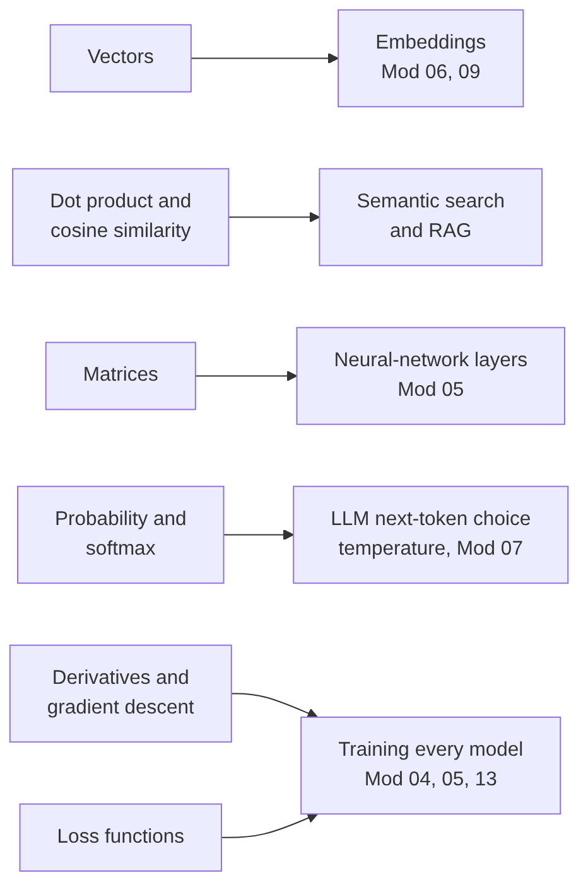

Keep one idea in your head the whole time: **in AI, everything becomes a list of numbers**. A photo is a grid of pixel numbers. A sentence becomes a list of numbers called an embedding. A model is a big collection of numbers called weights. The maths in this module is simply the set of tools for comparing, combining and adjusting those lists.

---

## 2. Vectors: lists of numbers that point somewhere

### 2.1 Two ways to see a vector

A **vector** is an ordered list of numbers. `[3, 2]` is a vector with two numbers; `[0.1, -0.4, 0.9]` has three. Each number is called a **component** (or an element). The number of components is the vector's **dimension**: `[3, 2]` is 2-dimensional.

There are two equally useful ways to picture a vector:

1. **As a row in a table.** A house described by `[bedrooms, bathrooms, area_in_100_sqft]` = `[3, 2, 14]`. Each position always means the same thing.
2. **As an arrow.** `[3, 2]` is an arrow that starts at the origin `(0, 0)` and ends at the point `(3, 2)`: 3 steps right, 2 steps up.

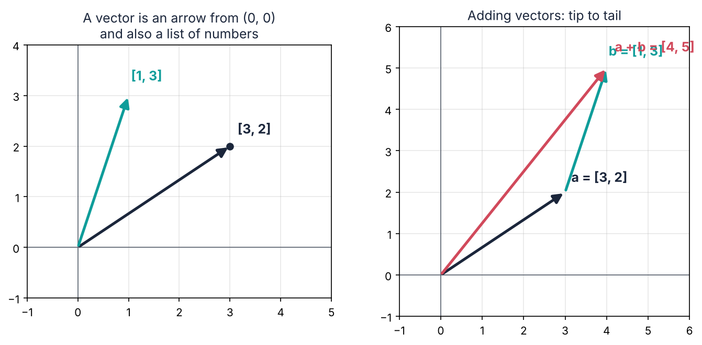

**Analogy:** a vector is a set of directions to a treasure: "3 steps east, 2 steps north". The list form is the written instructions; the arrow form is the path drawn on the map.

In NumPy a vector is a 1-D array: `v = np.array([3, 2])`.

### 2.2 Adding and scaling

- **Adding** two vectors adds matching components: `[3, 2] + [1, 3] = [4, 5]`. As arrows: put the second arrow's tail on the first arrow's tip; the sum goes from the start to the final tip.
- **Scaling** (multiplying by a single number, called a **scalar**) stretches or shrinks the arrow: `2 × [3, 2] = [6, 4]`. A negative scalar flips its direction.

### 2.3 Length (magnitude)

The **length** (also called **magnitude** or **norm**) of a vector is how long the arrow is. For `[3, 4]` it is 5, from the right-angled triangle rule you may remember from school (Pythagoras): √(3² + 4²) = √25 = 5. For more components you square them all, add, and take the square root. In NumPy: `np.linalg.norm(v)`.

---

## 3. The dot product: "multiply matching pairs, then add"

### 3.1 The recipe

The **dot product** of two vectors of the same length is: multiply each pair of matching components, then add all the products.

```
a = [2, 1, 3]
b = [4, 0, 1]
a · b = 2×4 + 1×0 + 3×1 = 8 + 0 + 3 = 11
```

In NumPy: `np.dot(a, b)` or `a @ b`. The answer is **one single number**.

**Everyday example: a shopping bill.** Quantities `[2, 1, 3]` (mouse, headphones, notebook) and prices `[799, 2499, 249]`. The dot product `2×799 + 1×2499 + 3×249 = 4844` is the total bill. You have done dot products every time you checked a receipt.

### 3.2 What the dot product tells you about direction

The dot product has a second meaning, which is why it matters so much in AI. It measures **how much two arrows point the same way**:

- Big positive → they point in a similar direction.
- Zero → they are at a right angle (**perpendicular**): unrelated.
- Negative → they point in roughly opposite directions.

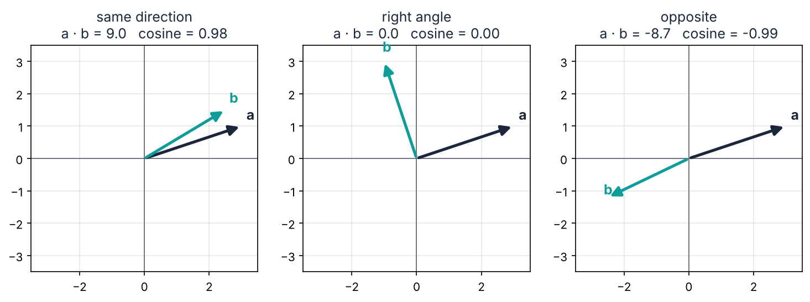

**Analogy:** two people pushing a box. If they push the same way, their efforts add up (large positive). If one pushes north and the other east, neither helps the other along their direction (zero). If they push against each other, they cancel (negative).

### 3.3 Weighted sums: the heart of a neuron

A **weighted sum** is a dot product between inputs and **weights** (numbers that say how important each input is). A final grade = 0.5 × exam + 0.3 × project + 0.2 × homework is a dot product of `[0.5, 0.3, 0.2]` with `[exam, project, homework]`. An artificial **neuron** (the basic unit of a neural network, Module 05) does exactly this: a weighted sum of its inputs, then a small squashing function. So every neural network is, at its core, a huge number of dot products.

---

## 4. Cosine similarity: comparing meaning

### 4.1 The problem with the raw dot product

The dot product grows when vectors are long, not only when they point the same way. A long document might get a high score with everything. We often want **direction only**.

### 4.2 The fix: divide by the lengths

**Cosine similarity** is the dot product divided by the two lengths:

```
cosine_similarity(a, b) = (a · b) / (length(a) × length(b))
```

The result is always between −1 and +1:

| Value | Meaning |
|---|---|
| +1 | exactly the same direction |
| 0 | unrelated (right angle) |
| −1 | exactly opposite |

The name comes from the **cosine** of the angle between the arrows, a function from school trigonometry that is 1 at 0° and 0 at 90°. You do not need trigonometry to use it: think of it as "how aligned are these two arrows, on a scale from −1 to +1".

### 4.3 Why this matters: embeddings

An **embedding** is a list of numbers that represents the *meaning* of something: a word, a sentence, an image. A trained model produces embeddings such that things with similar meanings get vectors pointing in similar directions. Real embeddings have hundreds of components (for example, the small `all-MiniLM-L6-v2` model you will use in Modules 06 and 09 makes 384-number vectors), so we cannot draw them. But the idea works in 2-D:

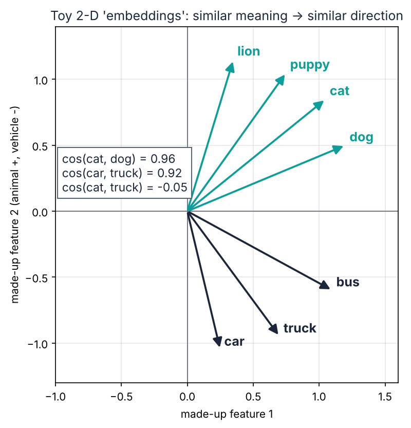

"cat" and "dog" point in nearly the same direction, so their cosine similarity is close to 1. "cat" and "truck" point in very different directions, so their similarity is low.

This one formula powers **semantic search** (search by meaning, not exact words), **recommendations** ("people who liked this also liked…"), and **RAG** (retrieval-augmented generation, Module 09), where the system finds the document chunks whose embeddings are most similar to the question's embedding and gives them to the language model.

**Analogy:** two compasses. Cosine similarity does not care how big each compass is; it only asks whether their needles point the same way.

---

## 5. Matrices: tables of numbers that can also move space

### 5.1 A matrix as a data table

A **matrix** is a rectangular grid of numbers with rows and columns. Its **shape** is written rows × columns. You already met matrices in Module 02: a 2-D NumPy array or a numeric DataFrame is a matrix.

```
           maths  science  english
student 0 [  80     72       65  ]
student 1 [  65     90       70  ]
student 2 [  70     88       92  ]
```

This is a 3 × 3 matrix. Each **row** is one student's vector; each **column** is one subject's vector. In machine learning the input data is almost always a matrix like this, usually called **X**: one row per example, one column per **feature** (input column).

The **transpose** of a matrix (written Aᵀ, in NumPy `A.T`) flips rows and columns: a 3 × 2 matrix becomes 2 × 3.

### 5.2 Matrix times vector = many dot products at once

Multiply the scores matrix by the weight vector `[0.5, 0.3, 0.2]` and you get each student's final grade, **all in one operation**. Each row of the matrix is dotted with the vector:

```
[80 72 65]   [0.5]   [80×0.5 + 72×0.3 + 65×0.2]   [74.6]
[65 90 70] · [0.3] = [65×0.5 + 90×0.3 + 70×0.2] = [73.5]
[70 88 92]   [0.2]   [70×0.5 + 88×0.3 + 92×0.2]   [79.8]
```

In NumPy: `scores @ weights`.

### 5.3 Matrix times matrix, shown visually

**Matrix multiplication** extends this: each cell of the answer is the dot product of **one row** of the left matrix with **one column** of the right matrix.

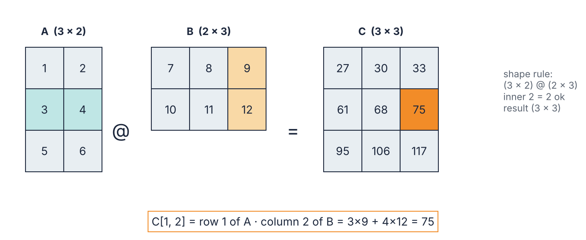

**The shape rule.** You can multiply an (m × **n**) matrix by an (**n** × p) matrix: the inner numbers must match. The result is (m × p).

- (3 × **2**) @ (**2** × 4) → (3 × 4). Allowed.
- (3 × 2) @ (3 × 4) → error: 2 ≠ 3.

When NumPy says `matmul: Input operand 1 has a mismatch in its core dimension`, it is telling you the inner numbers do not match. Checking shapes is the first debugging step for almost every deep-learning error you will meet.

Also notice: A @ B is usually **not** the same as B @ A. Order matters.

**Analogy:** a matrix multiplication is a restaurant bill for many tables. The left matrix lists what each table ordered (rows = tables, columns = dishes). The right matrix lists each dish's price and calories (rows = dishes, columns = price, calories). Multiply them and you get, for each table, its total price and total calories. The "dishes" dimension has to match on both sides, and it disappears in the answer.

### 5.4 A matrix as a transformation

A 2 × 2 matrix can also be seen as a machine that **moves every point in the plane**. Multiply each point (vector) by the matrix and the whole grid gets stretched, rotated or slanted:

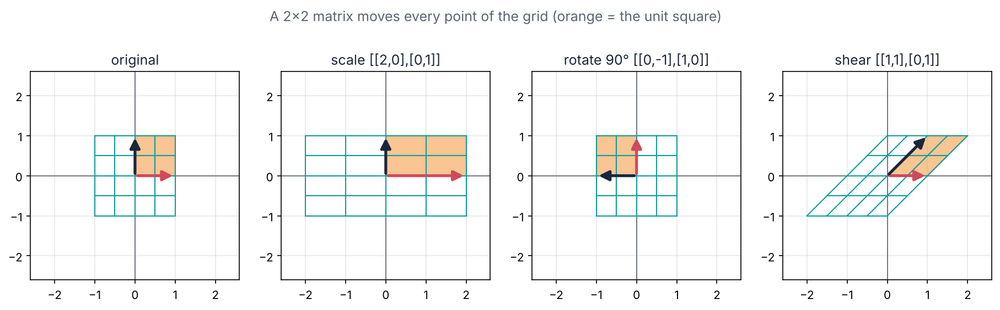

- `[[2, 0], [0, 1]]` stretches everything sideways by 2 (**scale**).
- `[[0, -1], [1, 0]]` turns everything 90° anticlockwise (**rotation**).
- `[[1, 1], [0, 1]]` slants the grid (**shear**).

Why care? A layer of a neural network is a matrix multiplication followed by a simple function. Each layer *transforms* the data into a new space where the task becomes easier: for example, where pictures of cats and dogs end up on different sides of a line. When people say a model "learns a representation", they mean it learns the numbers in these matrices.

### 5.5 One neural-network layer in one line

```python
output = X @ W + b
```

- `X` is the input matrix (examples × features),
- `W` is the **weight matrix** (features × neurons), which the model learns,
- `b` is a **bias** vector (one number per neuron) added to every row by broadcasting.

You will write exactly this line in Module 05. The whole of a large language model is many thousands of these, stacked.

---

## 6. Probability: measuring uncertainty

### 6.1 Basics

A **probability** is a number from 0 to 1 that says how likely something is. 0 means impossible, 1 means certain, 0.5 means "as likely as not". A fair coin lands heads with probability 0.5; a fair die shows a six with probability 1/6 ≈ 0.167.

The probabilities of all possible outcomes add up to 1 (something has to happen).

**Simulation** is a great way to build intuition: flip a virtual coin 10 times and you might see 7 heads; flip it 10,000 times and you will be very close to 50 %. This is the **law of large numbers**: averages of many random trials settle down near the true probability. Notebook 03 shows it.

### 6.2 Distributions

A **probability distribution** describes how likely each possible value is. Three you will meet:

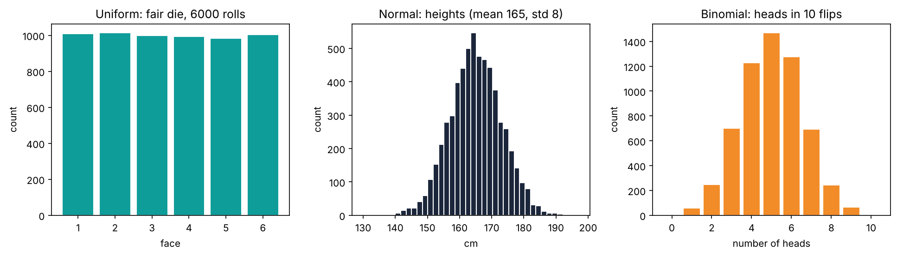

- **Uniform**: every value in a range is equally likely (a fair die; `rng.uniform`).
- **Normal** (the "bell curve", also called **Gaussian**): most values near the middle, fewer far away, symmetric. Heights, measurement errors, and the starting weights of many neural networks follow it (`rng.normal`).
- **Binomial**: the number of successes in a fixed number of yes/no trials, such as "number of heads in 10 flips" (`rng.binomial`).

A fourth kind is the one language models use: a **categorical** distribution, a probability for each item in a list, like `{"cat": 0.7, "dog": 0.2, "car": 0.1}`. When an LLM writes the next word, it produces a categorical distribution over its whole vocabulary and picks from it.

### 6.3 Mean, variance and standard deviation

- The **mean** (average) is the centre: add all values, divide by how many.
- The **variance** measures spread: for each value, take its distance from the mean, square it, then average those squares. Squaring makes all distances positive and punishes big distances more.
- The **standard deviation** (std) is the square root of the variance. It is in the same units as the data, so it is easier to read: "heights average 165 cm with a standard deviation of 8 cm".

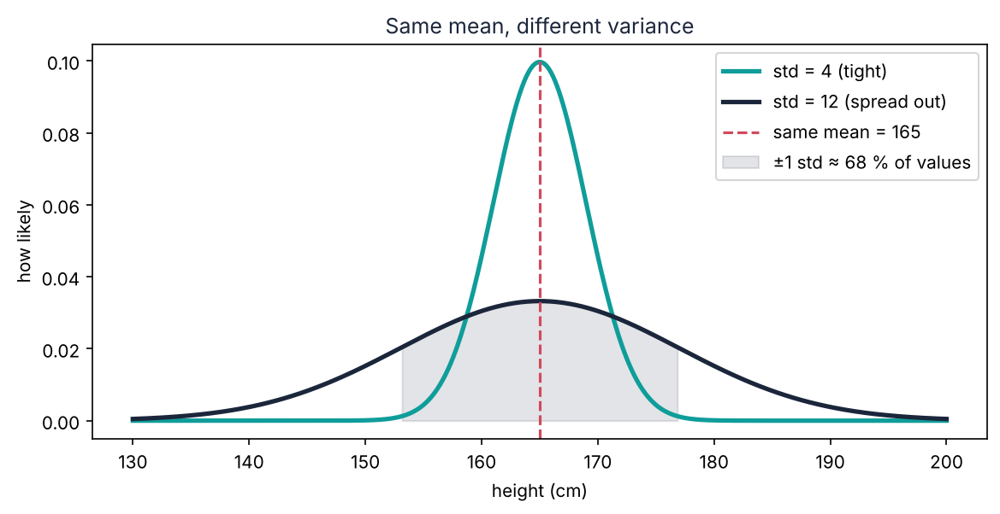

For a normal distribution, about 68 % of values lie within one standard deviation of the mean, and about 95 % within two.

**Analogy:** two archers both average the bullseye (same mean). One's arrows cluster tightly (small variance); the other's are scattered all over the target (large variance). The mean alone hides that difference.

---

## 7. Softmax: turning scores into probabilities

### 7.1 The problem

A classification model (or an LLM choosing the next token) first produces raw scores called **logits**: any real numbers, positive or negative, like `[2.0, 1.0, 0.1]`. We need probabilities: non-negative and adding up to 1.

### 7.2 The recipe

**Softmax** does it in two steps:

1. Raise *e* (a special constant ≈ 2.718) to the power of each score: `exp(score)`. This makes every number positive and makes bigger scores *much* bigger.
2. Divide each result by the total, so they add up to 1.

```
scores      = [2.0, 1.0, 0.1]
exp(scores) = [7.39, 2.72, 1.11]      total = 11.21
softmax     = [0.66, 0.24, 0.10]      (sums to 1)
```

The biggest score gets the biggest probability, but the others still get some.

### 7.3 Temperature

If you divide the scores by a number called the **temperature** before softmax:

- **Low temperature** (e.g. 0.5) → the distribution gets sharper: the top choice takes almost all the probability. The model becomes predictable.
- **High temperature** (e.g. 2) → the distribution gets flatter: other choices get more chance. The model becomes more varied (and more random).

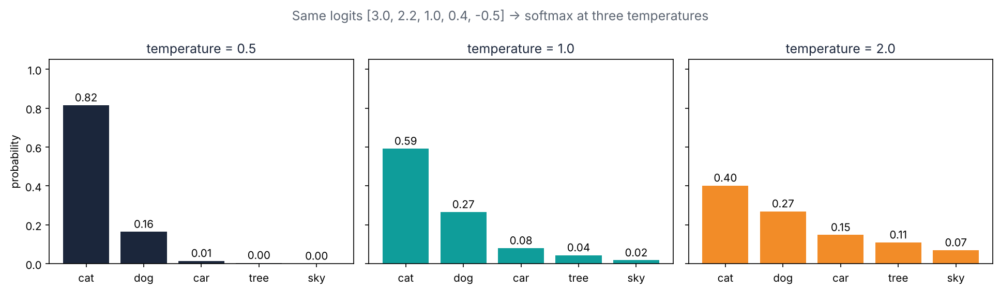

This is literally the `temperature` setting you will pass to the OpenAI, Anthropic and Gemini APIs in Module 07.

**Analogy:** a talent show where the judges' scores are turned into "share of the prize money". At low temperature, the winner takes almost everything. At high temperature, the prize is shared more evenly.

---

## 8. Derivatives: the slope of a curve

### 8.1 Slope of a straight line

The **slope** of a line is "how much it goes up for each step to the right": rise ÷ run. A road that rises 1 metre for every 10 metres forward has slope 0.1.

### 8.2 Slope of a curve

A curve does not have one slope: it is steep in some places and flat in others. The **derivative** of a function at a point is the slope of the curve **at that exact point**: the slope of the straight line that just touches the curve there (the **tangent line**).

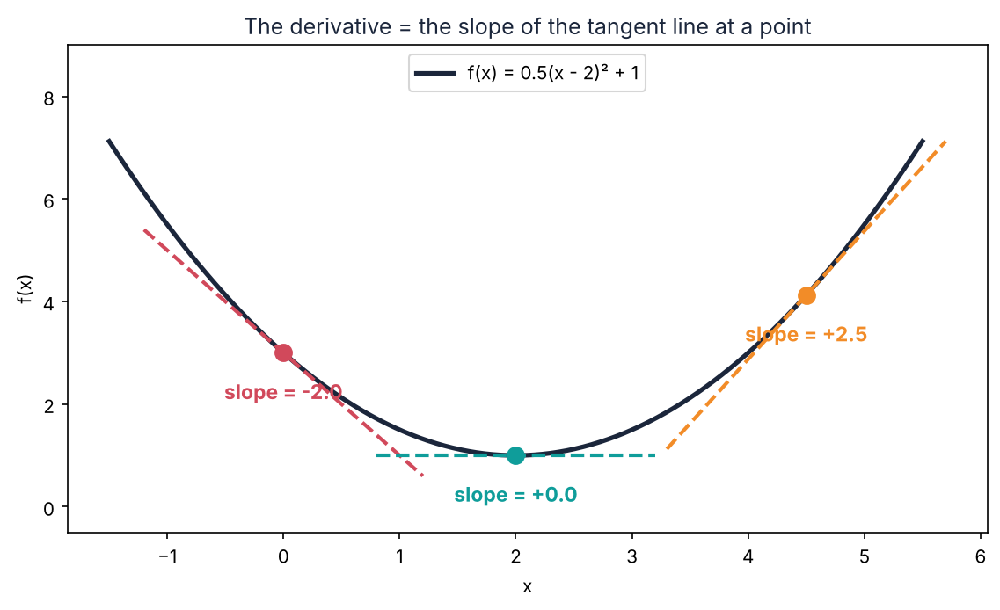

You can estimate it without any formulas: move a tiny step `h` to the right and see how much the function changes.

```
slope ≈ (f(x + h) − f(x)) / h      with a tiny h, like 0.0001
```

This is called a **numerical derivative**. For f(x) = x², the slope at x = 3 comes out ≈ 6. (The exact rule says the derivative of x² is 2x, and 2 × 3 = 6.)

The sign of the slope tells you which way is "downhill":

- Positive slope → the function goes up if you move right, so move **left** to go down.
- Negative slope → move **right** to go down.
- Zero slope → you are at a flat spot: a bottom, a top, or a plateau.

**Analogy:** standing on a hillside in thick fog. You cannot see the valley, but you can feel the ground under your feet tilting. The derivative is that tilt.

---

## 9. Loss functions: one number for "how wrong"

A **loss function** (also called a **cost** function) turns a model's mistakes into one number. Lower is better. Training a model means finding the weights that make the loss as small as possible.

Two loss functions cover most of what you will see:

- **Mean squared error (MSE)** for predicting numbers (prices, temperatures): for each example, take (prediction − true value), square it, then average. Big mistakes are punished much more than small ones because of the square.
- **Cross-entropy** (also called **log loss**) for predicting categories (spam / not spam, the next word): look at the probability the model gave to the **correct** answer, and take −log of it. If the model gave the right answer probability 0.9, the loss is small (0.105). If it gave only 0.01, the loss is large (4.6). The **logarithm** (log) is a function that turns tiny numbers into large negative numbers, so confident wrong answers are punished hard.

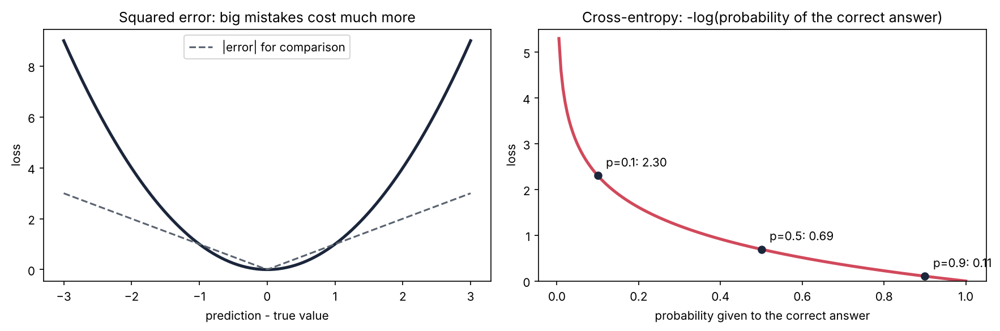

Language models are trained with cross-entropy on the next token: "you gave the real next word probability 0.02; that costs 3.9; adjust the weights so it is higher next time."

---

## 10. Gradients and gradient descent: walking downhill

### 10.1 The gradient

Real models have many weights, not one. The loss depends on all of them. The **gradient** is the list of slopes, one per weight: "if I nudge weight 1 up a little, the loss changes by this much; if I nudge weight 2, by that much…". It is a vector, and it points in the direction where the loss **increases** fastest.

So the direction of steepest **decrease** is the **negative** gradient.

### 10.2 Gradient descent

**Gradient descent** is the algorithm almost every neural network uses to learn:

1. Start with some weights (often random).
2. Compute the loss.
3. Compute the gradient (the slopes).
4. Take a small step **against** the gradient: `new_weight = weight − learning_rate × slope`.
5. Repeat until the loss stops going down.

The **learning rate** is the step size: a small number such as 0.1 or 0.001 that you choose.

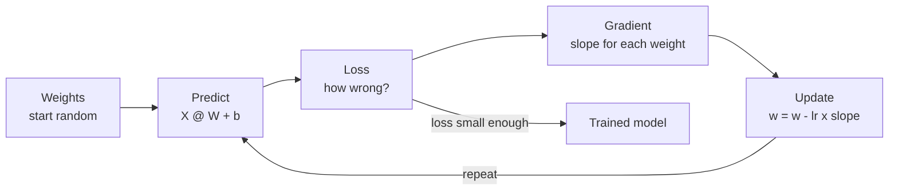

Here is gradient descent on the simple loss `L(w) = (w − 3)² + 1`, starting from `w = −1` with learning rate 0.2. Each frame is one step; the ball rolls down towards the bottom at w = 3:

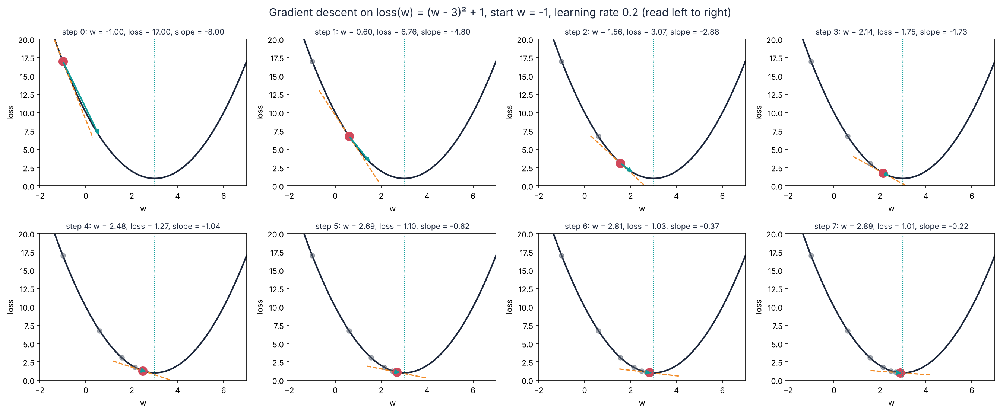

The individual frames are in `images/gd_frames/` (`gd_frame_01.png` … `gd_frame_08.png`) so you can flick through them like a flip-book on a slide or in a document. Notice the steps get **smaller** as the slope flattens near the bottom, even though the learning rate stays the same.

### 10.3 Choosing the learning rate

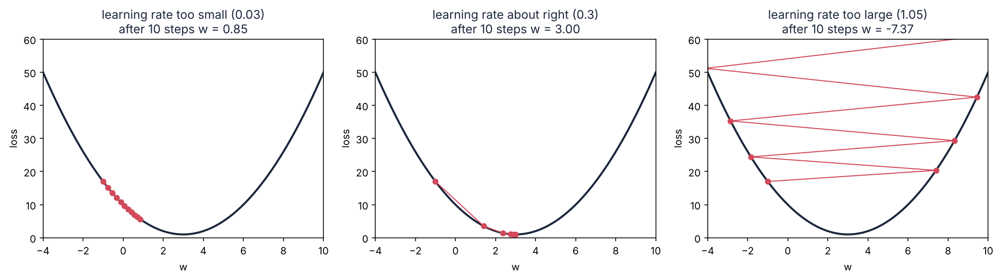

- **Too small**: progress is painfully slow.
- **About right**: smooth, quick convergence (**convergence** = settling at the bottom).
- **Too large**: the steps overshoot the bottom, bounce from side to side, and can even fly off to infinity (**divergence**).

Try it yourself in the spreadsheet `excel/math-in-a-spreadsheet.xlsx` (sheet "Gradient descent"): change the learning rate cell from 0.1 to 0.9, then to 1.1, and watch the column of w values.

### 10.4 Two weights: a bowl

With two weights the loss is a surface, like a bowl. Contour lines (like on a hiking map) connect points with equal loss. Gradient descent always steps straight across the contour lines, downhill:

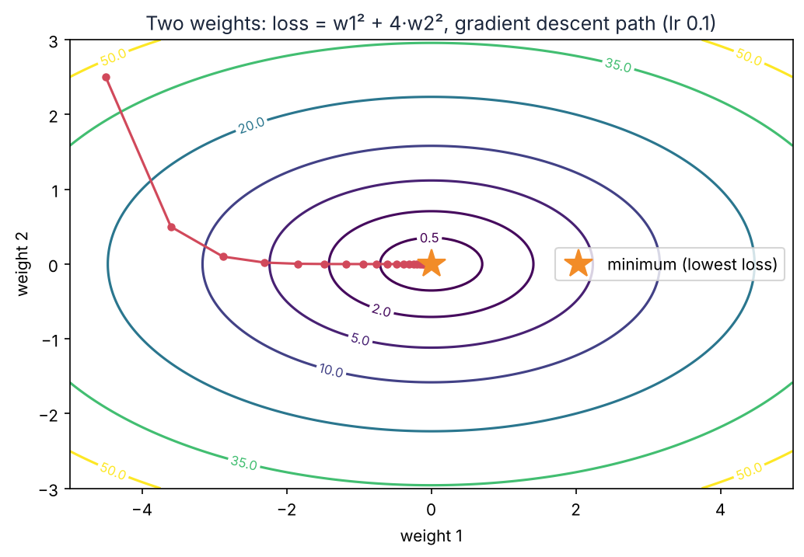

Real models have millions or billions of weights. We cannot draw that bowl, but the algorithm is exactly the same.

### 10.5 Putting it all together: fitting a line

Notebook 04 fits a straight line `y = w·x + b` to some points using only what is in this lesson:

1. Prediction = `w * x + b` (vectorised).
2. Loss = MSE.
3. Gradient = slopes of the MSE with respect to `w` and `b`.
4. Update `w` and `b` with gradient descent, 200 times.

The line starts flat and swings into place:

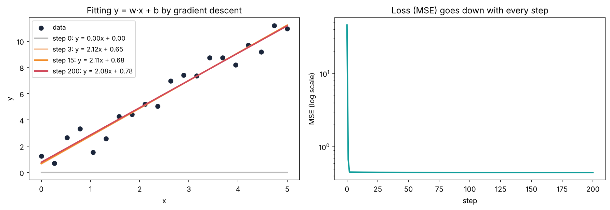

That is machine learning in miniature. Module 04 does it with scikit-learn, Module 05 with PyTorch, where a feature called **autograd** computes the gradients for you, but the idea never changes.

---

## 11. Summary table

| Idea | One-line meaning | Where you will see it |
|---|---|---|
| vector | an ordered list of numbers / an arrow | every input, embedding and weight list |
| dot product | multiply pairs, add up; measures alignment | neurons, attention in transformers |
| cosine similarity | dot product divided by lengths; −1..+1 | semantic search, RAG, recommendations |
| matrix | grid of numbers; data table or transformation | datasets (X), layer weights (W) |
| matrix multiplication | rows of A dotted with columns of B | every neural-network layer |
| probability | 0..1 likelihood | classifier outputs, next-token choice |
| distribution | how likely each value is | weight initialisation, sampling |
| mean / variance / std | centre / spread / spread in original units | data exploration, normalisation |
| softmax | scores → probabilities that sum to 1 | last layer of classifiers and LLMs |
| temperature | sharpens or flattens softmax | LLM API setting |
| derivative | slope of a curve at a point | gradients |
| gradient | slopes for every weight | training |
| gradient descent | step against the gradient, repeat | training every neural network |
| learning rate | the step size | a setting you tune |
| loss function | one number for "how wrong" (MSE, cross-entropy) | training and evaluation |

## 12. Glossary

| Term | Meaning |
|---|---|
| component | one number inside a vector |
| dimension | how many numbers a vector has |
| scalar | a single number (not a list) |
| norm / magnitude | the length of a vector |
| perpendicular | at a right angle (90°) |
| weighted sum | inputs multiplied by importance weights and added (a dot product) |
| embedding | a vector that represents meaning |
| feature | one input column of a dataset |
| transpose | flip rows and columns |
| weight / bias | numbers a model learns; bias is added after the weighted sum |
| logits | raw scores before softmax |
| tangent line | straight line touching a curve at one point, with the curve's slope there |
| numerical derivative | slope estimated with a tiny step h |
| convergence / divergence | settling at the minimum / blowing up |
| autograd | automatic gradient calculation in PyTorch |

## 13. What to do next

1. Run the four notebooks in order: vectors → matrices → probability & softmax → derivatives & gradient descent.
2. Open `excel/math-in-a-spreadsheet.xlsx` and change the input cells; watch the formulas update.
3. Do `exercises.md`. Solutions are in `solutions/`.
4. Continue to Module 04 (machine learning), where these tools start making predictions.
