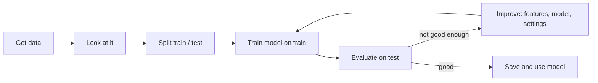
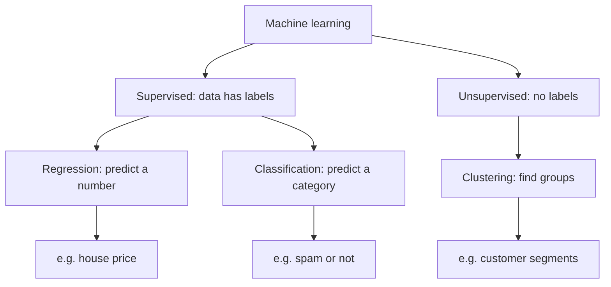
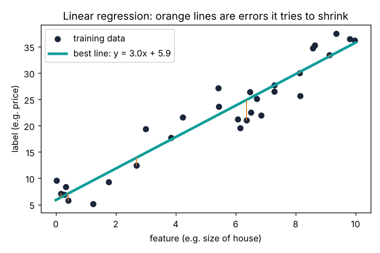
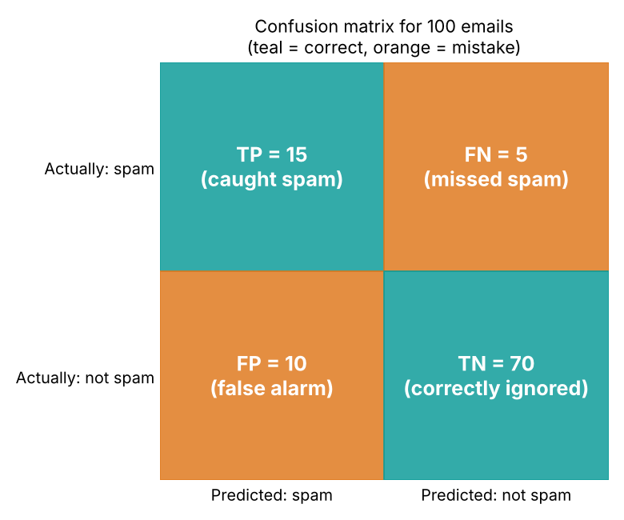
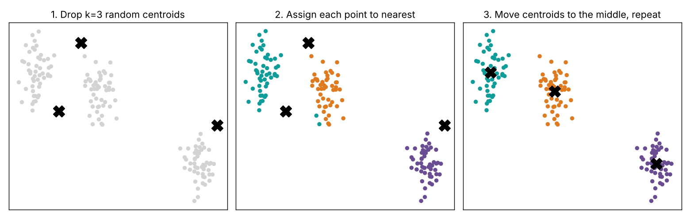
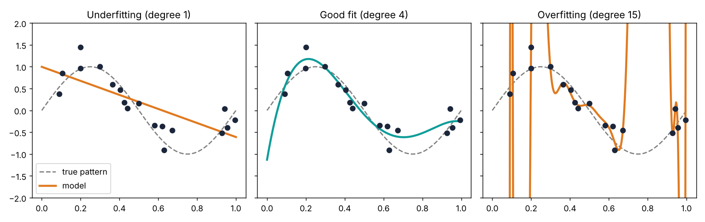
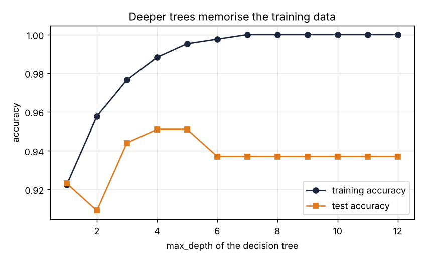
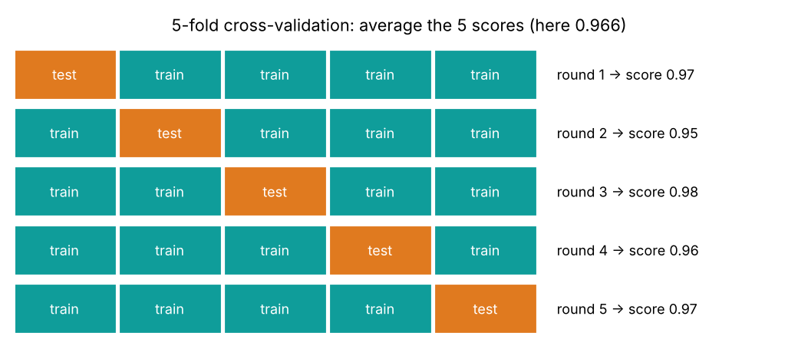
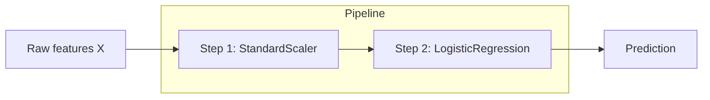
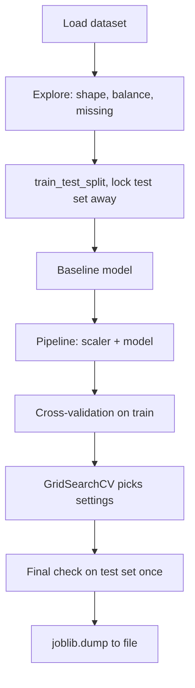

<!-- nav:start -->
> [🏠 Course home](../README.md) · [🗺️ Roadmap](../ROADMAP.md) · [⬅️ 03 Math for AI](../03-math-for-ai/README.md) · [05 Deep Learning ➡️](../05-deep-learning/README.md)  
> **🎯 Module 04 · Machine Learning** · [📋 Module overview](README.md)  
> [📖 Lesson](concepts.md) · [📄 PDF handout](pdf/04-machine-learning-handout.pdf) · [🎞️ Slides](slides/04-machine-learning.pptx) · [📓 Notebooks](notebooks/) · [✍️ Exercises](exercises.md) · [✅ Solutions](solutions/) · [🧑‍🏫 Trainer notes](trainer-notes.md) · [🔗 Resources](resources.md)
<!-- nav:end -->

# Module 04 — Machine Learning: the Core Ideas

> **Read this first.** This lesson assumes you can write basic Python (module 01), have used pandas and matplotlib a little (module 02), and know what a "slope" is (module 03). Nothing else. Every new word is defined the first time it appears.

---

## 1. What is machine learning?

Normal programming works like a recipe. You, the programmer, write the rules: "if the email contains the word *lottery*, put it in spam". The computer follows your rules exactly.

**Machine learning (ML)** — a way of building programs where the computer works out the rules by itself, from examples.

Instead of writing the spam rules, you show the computer 10,000 emails that people have already marked "spam" or "not spam". The computer looks for patterns that separate the two groups. The result is a set of learned rules we call a model.

**Model** — the thing that comes out of the learning step. You give it a new input (a new email) and it gives you an output (a guess: "spam"). Think of it as a function whose insides were filled in automatically.

**Training** (also called **fitting**) — the learning step: showing the model examples so it can adjust itself.

**Prediction** (also called **inference**) — using a trained model on new data it has never seen.

### Analogy: learning to price a used car

Imagine a new employee at a used-car shop. On day one they know nothing about prices. Their manager shows them 500 old sales: "this 2015 Honda with 80,000 km sold for ₹4.5 lakh, this 2019 Hyundai with 20,000 km sold for ₹7 lakh...". After a while, the employee starts to "feel" the pattern: newer and fewer kilometres means more money. Now a customer arrives with a car the employee has never seen. The employee makes a sensible guess.

That is machine learning:

| Car shop | Machine learning word |
|---|---|
| The 500 old sales | **training data** |
| Year, kilometres, brand | **features** |
| The price it sold for | **label** (or **target**) |
| The employee's "feel" for prices | the **model** |
| Studying the old sales | **training / fitting** |
| Guessing the price of a new car | **prediction** |



The diagram above is the workflow you will repeat in every notebook in this module: get data, split it, train, evaluate, improve, and finally use or save the model.

---

## 2. Features and labels

ML data almost always looks like a table (a pandas DataFrame).

- Each **row** is one example (one car, one patient, one email). Rows are also called **samples** or **observations**.
- Each **column** that describes the example is a **feature** — an input measurement such as age, blood pressure or number of kilometres.
- The column we want to predict is the **label** (also called **target**).

By convention, in Python code:

- `X` (capital X) is the table of features. Capital because it is a 2-D grid (many rows, many columns).
- `y` (small y) is the column of labels. Small because it is 1-D (one value per row).

```python
from sklearn.datasets import load_diabetes
X, y = load_diabetes(return_X_y=True, as_frame=True)
print(X.shape)   # (442, 10)  -> 442 patients, 10 features each
print(y.shape)   # (442,)     -> one label per patient
```

**scikit-learn** (imported as `sklearn`) — the most popular Python library for classic machine learning. It comes with small practice datasets built in, so you do not need the internet. In this module we use:

| Loader | What is in it | Task type |
|---|---|---|
| `load_diabetes` | 442 patients, 10 body measurements, label = disease progression one year later (a number) | regression |
| `load_breast_cancer` | 569 tumours, 30 measurements of cell shape, label = malignant or benign | classification |
| `load_iris` | 150 flowers, 4 petal/sepal sizes, label = one of 3 species | classification |
| `load_wine` | 178 wines, 13 chemical measurements, label = one of 3 grape types | classification |
| `load_digits` | 1,797 tiny 8×8 pictures of handwritten digits, label = 0–9 | classification |

We also make our own fake data with `make_classification` and `make_blobs`. Fake data is useful because *we* know the true answer and can check whether the model found it.

---

## 3. The two big families: supervised and unsupervised



**Supervised learning** — learning when every training example comes with the right answer (a label). It is "supervised" because a teacher (the label) tells the model whether it was right. The used-car example is supervised: every old sale has a price.

Supervised learning splits again into two kinds of task:

- **Regression** — predicting a **number** on a continuous scale. House price, temperature tomorrow, how many minutes a delivery will take.
- **Classification** — predicting a **category** (a class) from a fixed list. Spam or not spam. Cat, dog or rabbit. Malignant or benign.
  - **Binary classification** — exactly two classes.
  - **Multi-class classification** — three or more classes.

Easy test: *Could the answer be 3.7?* If yes, it is regression. If the answer must be one of a list of names, it is classification.

**Unsupervised learning** — learning when there are **no labels**. The model looks for structure on its own. The most common job is **clustering** — putting similar rows into groups. Example: a shop has 50,000 customers and no labels; clustering might find "weekend big spenders", "bargain hunters" and "once-a-year visitors".

Analogy: supervised learning is studying with an answer key. Unsupervised learning is being handed a box of mixed buttons and asked to sort them into piles that "seem to belong together" — nobody tells you what the piles should be.

---

## 4. Train/test split: never mark your own homework

Here is the most important habit in all of ML.

If you test a model on the same examples it learned from, it can look perfect just by memorising. That tells you nothing about how it will do on *new* data — which is the only thing you care about.

So before training, we hide part of the data:

- **Training set** — the part the model is allowed to learn from (usually 70–80%).
- **Test set** — the part we lock away and only use at the end to measure performance (usually 20–30%).

```python
from sklearn.model_selection import train_test_split
X_train, X_test, y_train, y_test = train_test_split(
    X, y, test_size=0.2, random_state=42)
```

- `test_size=0.2` — put 20% of rows in the test set.
- `random_state=42` — the split is random, but fixing this number makes it the *same* random split every time you run the code, so your results are repeatable. The number itself does not matter; 42 is a joke from a famous novel.
- `stratify=y` — (for classification) keep the same mix of classes in both parts. If 37% of tumours are malignant overall, about 37% will be malignant in both the train and test sets.

**Analogy:** a teacher writes 100 practice questions. She gives students 80 to study, and keeps 20 for the final exam. If the exam used the same 80 questions, a student who memorised the answers would score 100% without understanding anything.

**Generalisation** — how well a model does on data it has never seen. This is the real goal. The test set is our estimate of it.

---

## 5. Your first model: linear regression

**Linear regression** — a model that predicts a number by drawing the best straight line (or flat surface, when there are many features) through the data.

With one feature it is the school formula:

> prediction = slope × feature + intercept

- **Slope** (in ML called a **weight** or **coefficient**) — how much the prediction goes up when the feature goes up by 1.
- **Intercept** (also called **bias**) — the prediction when the feature is 0.

With many features, each feature gets its own weight:

> prediction = w₁×age + w₂×bmi + w₃×blood_pressure + … + intercept

**How does it pick the "best" line?** It tries to make the errors small. For each training row, the error is *(true value − predicted value)*. Linear regression squares each error (so negatives do not cancel positives, and big errors count a lot), adds them up, and picks the weights that make this total as small as possible. This is called **least squares**.



In scikit-learn, every model follows the same three-step pattern. Learn it once and you can use any model:

```python
from sklearn.linear_model import LinearRegression
model = LinearRegression()        # 1. create the model (empty brain)
model.fit(X_train, y_train)       # 2. train it on the training set
preds = model.predict(X_test)     # 3. predict on data it has not seen
```

**Estimator** — scikit-learn's name for any object with a `.fit()` method. Models are estimators.

### Regression metrics: how wrong are we?

A **metric** — a number that summarises how good (or bad) predictions are.

Suppose a model predicts delivery times for 4 orders:

| Order | True minutes | Predicted | Error | Absolute error | Squared error |
|---|---|---|---|---|---|
| A | 30 | 34 | −4 | 4 | 16 |
| B | 25 | 22 | 3 | 3 | 9 |
| C | 40 | 41 | −1 | 1 | 1 |
| D | 20 | 28 | −8 | 8 | 64 |

- **MAE (Mean Absolute Error)** — the average size of the mistakes, ignoring direction. (4+3+1+8)/4 = **4.0 minutes**. Easy to explain: "on average we are 4 minutes off".
- **MSE (Mean Squared Error)** — the average of the squared errors. (16+9+1+64)/4 = **22.5**. Its unit is "minutes squared", which is hard to picture.
- **RMSE (Root Mean Squared Error)** — the square root of MSE. √22.5 ≈ **4.74 minutes**. Back in normal units, but big mistakes (order D) push it up more than MAE does. If RMSE is much larger than MAE, you have a few large mistakes.
- **R² (R-squared, "coefficient of determination")** — compares your model with the laziest possible model, one that always predicts the average. R² = 1 is perfect. R² = 0 means "no better than guessing the average". It can even be negative (worse than the average).

On the diabetes data, plain linear regression gets about MAE ≈ 43, RMSE ≈ 54 and R² ≈ 0.45 on the test set. The labels average about 152, so we are off by roughly a quarter of a typical value. That is a realistic, honest result — medical data is noisy.

---

## 6. Classification with logistic regression

**Logistic regression** — despite the name, a **classification** model. It computes a weighted sum of the features (like linear regression) and then squashes that number into the range 0 to 1 using the **sigmoid** function (an S-shaped curve). The result is read as a **probability** — for example, "0.92 chance this tumour is benign".

To turn a probability into a class, we use a **threshold** (normally 0.5): above it, predict class 1; below it, predict class 0.

```python
from sklearn.linear_model import LogisticRegression
clf = LogisticRegression(max_iter=1000)
clf.fit(X_train, y_train)
clf.predict(X_test[:3])          # -> array([1, 0, 1])  classes
clf.predict_proba(X_test[:3])    # -> probabilities for each class
```

- `max_iter=1000` — logistic regression finds its weights by trying many small improvements (iterations). The default limit is sometimes too low and you get a `ConvergenceWarning` ("I ran out of tries before settling"). Raising the limit, or scaling the features (section 11), fixes it.

**Analogy:** a doctor looks at several test results, mentally weighs them up, and says "I'm about 90% sure this is fine". Logistic regression does the same arithmetic, openly.

---

## 7. Classification metrics, walked through with real numbers

Accuracy is the first metric everyone reaches for:

> **Accuracy** — the fraction of predictions that were correct.

But accuracy can lie. Imagine 1,000 bank transactions where only 10 are fraud. A "model" that always says "not fraud" is 99% accurate — and completely useless. This situation, where one class is much rarer than the other, is called **class imbalance**. We need better tools.

### The confusion matrix

**Confusion matrix** — a small table that counts every kind of right and wrong answer. For binary classification it has four boxes. First, choose which class is the **positive** class — the thing you are hunting for (spam, fraud, disease). "Positive" does not mean "good"; it means "the thing we are looking for".



- **True Positive (TP)** — it *was* spam and we *said* spam. ✔
- **True Negative (TN)** — it was *not* spam and we said not spam. ✔
- **False Positive (FP)** — it was *not* spam but we said spam. A false alarm. (Also called a **Type I error**.)
- **False Negative (FN)** — it *was* spam but we said not spam. A miss. (Also called a **Type II error**.)

Memory trick: the second word (Positive/Negative) is what the model *said*. The first word (True/False) is whether the model was right.

### A complete worked example

A spam filter checks **100 emails**. In reality **20 are spam** and **80 are not**. The filter's results:

|  | Predicted spam | Predicted not spam | Row total |
|---|---|---|---|
| **Actually spam** | TP = **15** | FN = **5** | 20 |
| **Actually not spam** | FP = **10** | TN = **70** | 80 |
| **Column total** | 25 | 75 | 100 |

Now every metric is just a fraction of these boxes:

**Accuracy** = (TP + TN) / everything = (15 + 70) / 100 = **0.85 (85%)**.
"85 of 100 emails were put in the right folder."

**Precision** = TP / (TP + FP) = 15 / (15 + 10) = 15 / 25 = **0.60 (60%)**.
"When the filter shouts *spam*, it is right 60% of the time." Precision answers: *of everything I flagged, how much was really positive?* Low precision = lots of false alarms (good emails lost in the spam folder).

**Recall** (also called **sensitivity** or **true positive rate**) = TP / (TP + FN) = 15 / (15 + 5) = 15 / 20 = **0.75 (75%)**.
"The filter caught 75% of all real spam." Recall answers: *of all the real positives, how many did I find?* Low recall = lots of misses.

**Specificity** = TN / (TN + FP) = 70 / 80 = **0.875**. "Of the genuine emails, 87.5% were correctly left alone."

**F1 score** — a single number that balances precision and recall. It is their **harmonic mean**, a kind of average that is dragged down hard if either one is low:

> F1 = 2 × (precision × recall) / (precision + recall) = 2 × (0.60 × 0.75) / (0.60 + 0.75) = 0.90 / 1.35 ≈ **0.667**

If precision were 1.0 and recall 0.0, the ordinary average would be 0.5 (looks OK) but F1 would be 0 (correctly says "useless").

### Which metric should I care about?

It depends on which mistake costs more:

| Situation | Worse mistake | Focus on |
|---|---|---|
| Cancer screening | Missing a cancer (FN) | **Recall** |
| Spam filter | Losing a real email (FP) | **Precision** |
| Fraud alerts that a human checks | Missing fraud (FN), but too many alerts annoy staff | **F1**, or recall with a precision floor |
| Balanced classes, equal costs | Neither | **Accuracy** is fine |

**Analogy — a fishing net.** Recall is "what fraction of the fish in the lake did my net catch?" Precision is "what fraction of the things in my net are fish (not old boots)?" A huge net catches every fish (high recall) and lots of boots (low precision). A tiny careful net brings up only fish (high precision) but misses most of them (low recall).

### Precision–recall trade-off and the threshold

Remember the 0.5 threshold? If we lower it to 0.3, the model says "spam" more often: recall goes up, precision goes down. Raise it to 0.8 and the opposite happens. The threshold is a dial you choose based on the costs in the table above.

### ROC curve and ROC-AUC

**ROC curve** (Receiver Operating Characteristic — an old name from radar engineering) — a graph that shows how the true positive rate (recall) and the **false positive rate** (FP / (FP + TN), i.e. 1 − specificity) change as you slide the threshold from 1 down to 0.

**ROC-AUC** (Area Under the ROC Curve) — one number between 0 and 1 that summarises the whole curve.

- **1.0** — perfect: every positive gets a higher score than every negative.
- **0.5** — no better than flipping a coin.
- A nice plain-English meaning: AUC is the chance that a randomly chosen positive example gets a higher score than a randomly chosen negative one.

AUC is useful because it judges the model's *scores*, before you pick any threshold.

On the breast-cancer data (with malignant as the positive class), a scaled logistic regression gets about 96–97% accuracy and an AUC above 0.99 on the test set — yet its confusion matrix shows it still **misses 4 of the 53 cancers** (TP = 49, FN = 4, FP = 1, TN = 89). Accuracy hid that; recall (49/53 ≈ 0.92) shows it. The notebook walks through this box by box and shows that lowering the threshold to 0.3 cuts the misses to 2 while adding no extra false alarms. The Excel workbook in `excel/` has a calculator: type your four box counts and every metric updates.

---

## 8. Decision trees and random forests

**Decision tree** — a model that makes predictions by asking a series of yes/no questions, like the game "20 Questions".

```
Is the worst cell radius > 16.8?
├── yes → Is texture > 20? ...
└── no  → Is concave points < 0.05? → benign
```

At each step the tree picks the question that best separates the classes. It keeps splitting until each group (each **leaf** — an end point of the tree) is pure, or until it hits a limit you set.

- **max_depth** — the maximum number of questions in a row. A depth-1 tree asks one question; a depth-None tree keeps going until every leaf is pure.

**Hyperparameter** — a setting *you* choose before training (like `max_depth`), as opposed to **parameters**, which the model learns by itself (like the weights in linear regression). Analogy: the oven temperature you set is a hyperparameter; how the cake rises is learned.

Trees are easy to explain to a non-technical boss, and they do not need feature scaling. Their weakness: a deep tree can memorise the training data (see overfitting below).

**Random forest** — many decision trees (often 100–500) trained on slightly different random samples of the rows and random subsets of the features, which then **vote**. The majority vote is the prediction.

**Ensemble** — any model built by combining many smaller models.

**Analogy — wisdom of the crowd.** One person guessing the number of sweets in a jar is often far off. The average of 200 people's guesses is usually very close, because individual mistakes cancel out. Each tree in a forest makes different mistakes, so the vote is more reliable than any single tree.

Random forests also give **feature importances** — a score for how much each feature helped. This is a quick way to see what the model "pays attention to".

---

## 9. Unsupervised learning: k-means clustering

**k-means** — a clustering method that splits rows into **k** groups (you choose k).

How it works, in plain steps:

1. Drop k random "pins" (called **centroids** — the centre point of a group) onto the data.
2. Assign every point to its nearest pin.
3. Move each pin to the middle (average position) of the points assigned to it.
4. Repeat steps 2–3 until the pins stop moving.



**Analogy — ice-cream vans on a beach.** Three vans park at random. Every sunbather walks to the nearest van. Each van then drives to the middle of its crowd to be closer to its customers. People re-choose their nearest van. After a few rounds, the vans settle in the middle of three natural crowds.

- **Inertia** — the total squared distance from each point to its centroid. Smaller means tighter clusters. Adding more clusters always lowers inertia, so we look for the "elbow" — the k where adding another cluster stops helping much.
- k-means needs you to pick k, works best on round blob-shaped groups, and is sensitive to feature scale (a feature measured in thousands will dominate one measured in single digits).

Because there are no labels, there is no "accuracy". In the notebook we cheat a little by clustering data where we *do* secretly know the groups (`make_blobs`, and iris) so we can check the result.

---

## 10. Overfitting and underfitting

This is the central problem of machine learning.

- **Underfitting** — the model is too simple to capture the pattern. It does badly on training data *and* test data. Like a student who did not study.
- **Overfitting** — the model is so flexible that it memorises the training data, including its random noise. It looks brilliant on training data but does badly on new data. Like a student who memorised last year's answers word for word and panics when the questions change slightly.
- **Good fit** — the sweet spot in between.



In the picture, the same noisy points are fitted by a straight line (too simple), a gentle curve (about right), and a wild wiggly curve that passes through almost every point (memorised the noise).

**How to spot it:** compare the training score with the test score.

| Training score | Test score | Diagnosis |
|---|---|---|
| Low | Low | Underfitting — use a more powerful model or better features |
| High | Much lower | Overfitting — simplify, regularise, or get more data |
| High | Close to training | Good fit |

On the breast-cancer data, a decision tree with no depth limit scores **100%** on training data but about **94%** on test data, while a depth-5 tree scores about 99.5% / 95%. The fully grown tree memorised; the limited one generalised slightly better.



**Ways to fight overfitting:**

- Use a simpler model (shallower tree, fewer features).
- **Regularisation** — adding a penalty for complexity, so the model prefers small weights. In scikit-learn, `Ridge` and `Lasso` are regularised linear regression; `LogisticRegression` is regularised by default (its `C` setting: smaller `C` = stronger penalty).
- Get more training data.
- Use an ensemble (random forests overfit less than single trees).
- Use cross-validation (next section) to choose settings honestly.

---

## 11. Feature scaling

Many models (logistic regression, k-means, k-nearest neighbours, neural networks) care about the *size* of numbers. If one feature is "income in rupees" (values like 500,000) and another is "number of children" (values like 2), the income feature can dominate just because its numbers are bigger.

**Scaling** — transforming features so they are on comparable ranges.

**StandardScaler** — for each feature, subtract its mean and divide by its standard deviation. Afterwards, every feature has mean 0 and spread 1. (A standard deviation is "the typical distance from the average".)

Important rule: the scaler must learn the mean and spread **from the training set only**, then apply those same numbers to the test set. If it peeks at the test set, information leaks from the exam into the study notes. This mistake is called **data leakage** — any way that information from the test set sneaks into training, making results look better than they really are. Pipelines (section 13) prevent it automatically.

Tree-based models (decision trees, random forests) do not need scaling, because they only ask "is this bigger than that?".

---

## 12. Cross-validation: a fairer exam

One train/test split is a bit of luck. Maybe the 20% you held out happened to be easy. **Cross-validation (CV)** gives a more reliable estimate.

**k-fold cross-validation**:

1. Cut the data into k equal pieces called **folds** (k = 5 is common).
2. Train on 4 folds, test on the 5th. Write down the score.
3. Repeat 5 times so that every fold gets one turn as the test set.
4. Report the average score (and how much it varies).



```python
from sklearn.model_selection import cross_val_score
scores = cross_val_score(model, X, y, cv=5)
print(scores.mean(), scores.std())
```

**Analogy:** instead of judging a cricketer on one match, you look at their average over five matches on different pitches.

A good workflow is:

1. Split off a test set and lock it away.
2. Use cross-validation **on the training set** to compare models and choose hyperparameters. `GridSearchCV` automates this: it tries every combination of settings you list and keeps the best by CV score.
3. Only at the very end, check the chosen model once on the test set.

**Validation set** — data used to choose between models or settings. In k-fold CV, each held-out fold plays the role of the validation set. It is different from the final test set.

---

## 13. Pipelines: tidy, leak-proof workflows

A real ML workflow has several steps: fill in missing values, scale features, then train a model. **Pipeline** — a scikit-learn object that chains these steps into one estimator. You call `.fit()` and `.predict()` on the pipeline, and it runs every step in the right order.



```python
from sklearn.pipeline import make_pipeline
from sklearn.preprocessing import StandardScaler
from sklearn.linear_model import LogisticRegression

pipe = make_pipeline(StandardScaler(), LogisticRegression(max_iter=1000))
pipe.fit(X_train, y_train)    # scaler learns from TRAIN only
pipe.score(X_test, y_test)    # TRAIN numbers applied to TEST
```

Why bother?

1. **No leakage.** Inside `cross_val_score`, the pipeline re-fits the scaler on each training fold only.
2. **Less code, fewer bugs.** One object instead of remembering to call every step.
3. **Easy to save and ship.** The whole thing — scaler and model — is saved as one file.

**Analogy — a coffee machine.** You press one button. Inside, the machine grinds, tamps, heats and pours in the right order every time. You never accidentally pour before grinding.

---

## 14. Saving and loading a model with joblib

Training can take minutes or hours. You do not want to retrain every time your app starts. **Serialisation** — turning a Python object into a file so it can be loaded later — solves this.

**joblib** — a small library (installed with scikit-learn) that saves and loads Python objects, and is efficient with the big number arrays inside models.

```python
import joblib
joblib.dump(pipe, "cancer_model.joblib")       # save to a file
loaded = joblib.load("cancer_model.joblib")    # later, in another program
loaded.predict(X_test[:5])
```

Two warnings to teach every student:

- **Only load files you trust.** A joblib (or pickle) file can run code when it is loaded. Never load a model file from a stranger.
- **Versions matter.** A model saved with one scikit-learn version may not load in a very different version. Write the version down (for example in `requirements.txt`).

---

## 15. Putting it all together



The habits that separate a beginner from a professional:

1. Look at the data first (shape, missing values, class balance).
2. Split off a test set *before* doing anything clever.
3. Start with a simple **baseline** — the simplest reasonable model (or even "always predict the average / most common class") — so you know what "good" means.
4. Put preprocessing and model in a pipeline.
5. Compare models with cross-validation on the training set.
6. Pick the metric that matches the real-world cost of mistakes.
7. Check the final model once on the test set, and report the result honestly.
8. Save the pipeline with joblib, along with the library versions.

### Where this leads

Everything in later modules builds on these ideas. Neural networks (module 05) are just much more flexible models trained with the same split–fit–evaluate loop. Large language models are judged with the same worry about overfitting and leakage. RAG systems (module 09) are evaluated with precision and recall. Learn this module well and the rest of the course becomes much easier.

---

## Glossary (quick reference)

| Term | Plain meaning |
|---|---|
| Feature | An input column used to make a prediction |
| Label / target | The answer column we want to predict |
| Training / fitting | Letting the model learn from examples |
| Regression | Predicting a number |
| Classification | Predicting a category |
| Clustering | Grouping similar rows without labels |
| Train/test split | Hiding some data to check the model fairly |
| Overfitting | Memorising the training data, failing on new data |
| Hyperparameter | A setting you choose before training |
| Precision | Of what I flagged, how much was right |
| Recall | Of what was really there, how much I found |
| Cross-validation | Repeating the train/test split k times and averaging |
| Pipeline | Preprocessing + model chained into one object |
| Data leakage | Test information sneaking into training |

<!-- nav:start -->
---
[🏠 Course home](../README.md) · [🗺️ Roadmap](../ROADMAP.md) · [⬅️ 03 Math for AI](../03-math-for-ai/README.md) · [05 Deep Learning ➡️](../05-deep-learning/README.md)
<!-- nav:end -->
