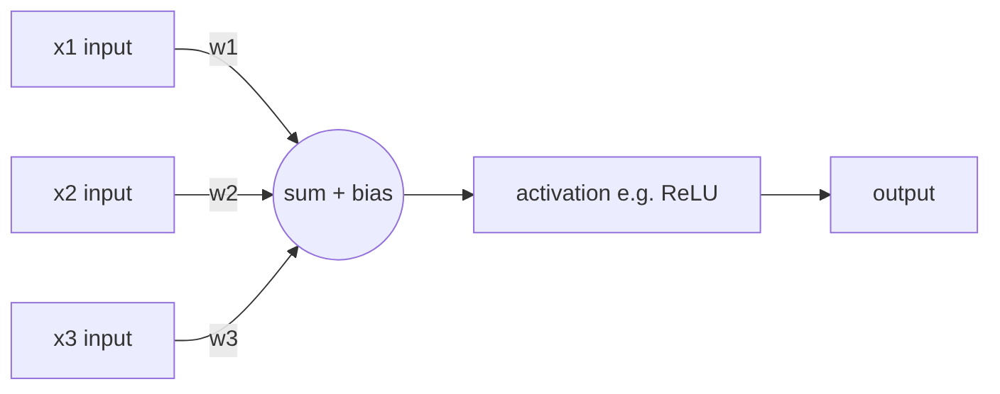
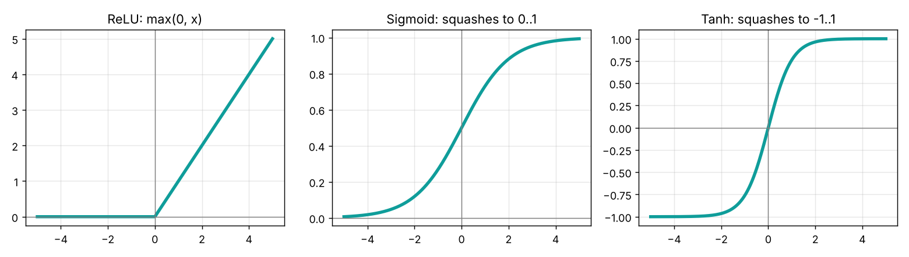
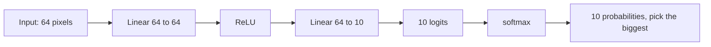
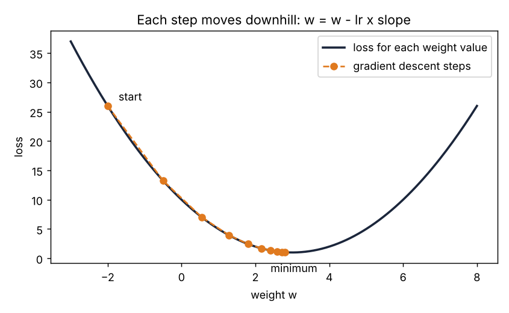
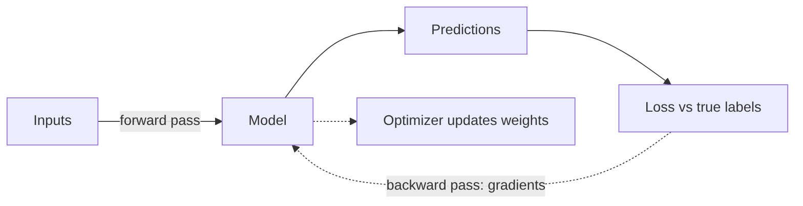
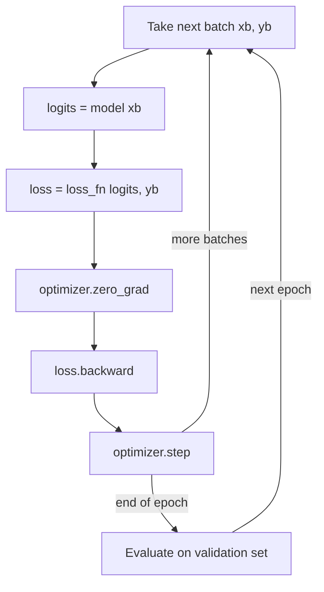
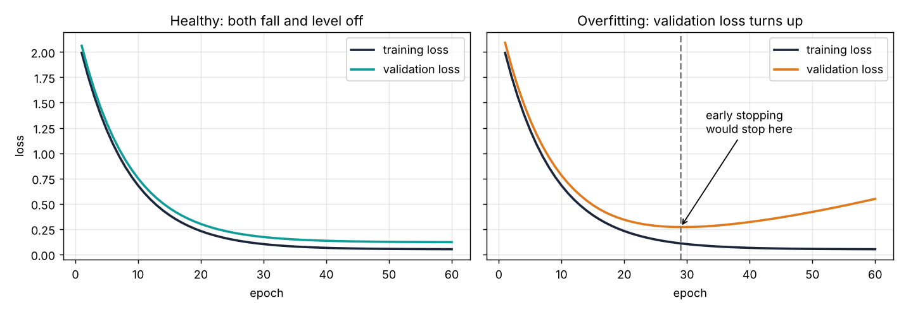
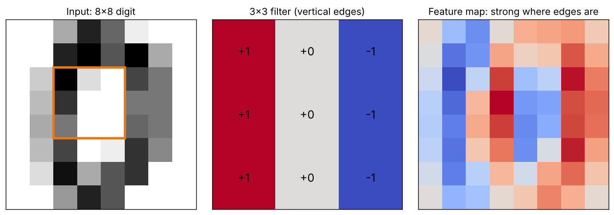
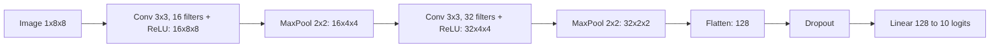
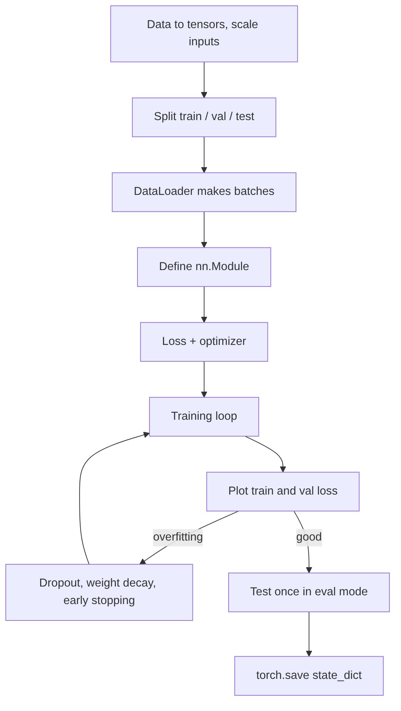

# Module 05 — Deep Learning with PyTorch

> **Before you start.** You should be comfortable with module 04 (train/test split, overfitting, accuracy, the fit-then-predict idea) and the "slope" and "gradient descent" ideas from module 03. Every new word is defined the first time it appears.

---

## 1. What is deep learning, and why does it matter?

**Deep learning** — machine learning with **neural networks** that have many layers. "Deep" just means "many layers stacked on top of each other".

**Neural network** — a model made of many small, simple calculators (called **neurons**) wired together in layers. Each neuron does a tiny bit of arithmetic. Together, with enough of them and the right settings, they can learn very complicated patterns: recognising faces, translating languages, generating text.

In module 04 you used models like logistic regression and random forests. They work well on tables of numbers. Deep learning shines on messy, high-dimensional data — images, sound, text — where good features are hard to design by hand. A neural network learns its own features.

Everything modern in AI is built on this: the image models in your phone camera, speech recognition, and the large language models (LLMs) you will meet in module 07. An LLM is "just" a very large neural network trained with the same loop you will write in this module.

**Analogy — a factory assembly line.** Raw material (pixels) enters at one end. The first station spots simple things (edges). The next station combines edges into shapes (curves, corners). The next combines shapes into parts (a loop, a stroke). The last station announces the product ("this is a 7"). Nobody tells each station what to look for — they all adjust themselves during training until the final answer is right.

---

## 2. The neuron: a tiny weighted vote

One **artificial neuron** does three things:

1. Takes some input numbers, x₁, x₂, x₃ …
2. Multiplies each by a **weight** (w₁, w₂, w₃ …), adds them up, and adds a **bias** b.
3. Passes the total through an **activation function** (explained below).

> output = activation(w₁·x₁ + w₂·x₂ + w₃·x₃ + b)

- **Weight** — how much the neuron cares about each input. Big positive weight = "this input pushes me up a lot". Negative weight = "this input pushes me down".
- **Bias** — a constant added at the end; it shifts how easily the neuron "switches on".

If this looks familiar, it should: without the activation, it is exactly linear regression from module 04. With a sigmoid activation, it is exactly logistic regression. A neural network is many of these stacked together.

**Analogy — deciding whether to go to a party.** Inputs: is it raining (x₁), are your friends going (x₂), do you have an exam tomorrow (x₃). You weigh each one — friends going matters a lot (big positive weight), the exam pushes you strongly against (big negative weight). You add it all up, and if the total crosses your personal "bother" level (the bias), you go.



---

## 3. Activation functions: adding the bends

**Activation function** — a simple function applied to each neuron's total that adds **non-linearity** (the ability to make bends and curves, not only straight lines).

Why do we need it? If every layer just multiplied and added, stacking 100 layers would still only give you one big straight-line (linear) model — layers of multiply-and-add collapse into a single multiply-and-add. The activation is what lets a deep network draw curvy decision boundaries.

The common ones:

- **ReLU** (Rectified Linear Unit) — `max(0, x)`. If the total is negative, output 0; otherwise pass it through unchanged. Simple, fast and the default choice for hidden layers.
- **Sigmoid** — squashes any number into 0…1. Used for a single yes/no probability at the output.
- **Tanh** — squashes into −1…1. Seen in older networks.
- **Softmax** — used at the output for multi-class problems. It turns a list of scores into probabilities that add up to 1 ("70% a seven, 20% a one, 10% a four").



---

## 4. Layers and the multi-layer perceptron (MLP)

**Layer** — a group of neurons that all receive the same inputs and work side by side.

- **Input layer** — not really neurons; just the input numbers (for an 8×8 image, 64 pixel values).
- **Hidden layer** — any layer between input and output. "Hidden" because you never see its values directly in the data.
- **Output layer** — produces the final answer. For 10-digit classification it has 10 neurons, one score per digit.

**Fully connected layer** (in PyTorch: `nn.Linear`) — every neuron receives every output of the previous layer.

**MLP (multi-layer perceptron)** — a network made only of fully connected layers with activations between them. ("Perceptron" is the historical name for an artificial neuron.) It is the simplest kind of deep network.



A layer with 64 inputs and 32 neurons has 64 × 32 weights + 32 biases = 2,080 **parameters** (numbers the network learns). Even small networks have thousands; LLMs have billions.

**Logits** — the raw scores that come out of the final layer, before softmax. They can be any number, positive or negative. The biggest logit is the predicted class.

---

## 5. Loss: a single number for "how wrong"

To learn, the network needs a score for how wrong it is. **Loss function** (also called **cost** or **objective**) — a formula that takes the network's outputs and the true labels and returns one number. Lower is better. Training means "make the loss small".

- **MSE loss** (`nn.MSELoss`) — mean squared error, for regression (predicting numbers). Same as module 04.
- **Cross-entropy loss** (`nn.CrossEntropyLoss`) — for classification. It looks at the probability the network gave to the **correct** class and punishes it for being low. If the network says "the right answer has probability 0.9", the loss is small (about 0.11). If it says 0.01, the loss is large (about 4.6). Mathematically it is −log(probability of correct class).

PyTorch detail that trips everyone up: `nn.CrossEntropyLoss` applies softmax **for you**. Feed it the raw logits, not probabilities. Do not put a softmax layer at the end of your model when training with it.

**Analogy — a game of "hot and cold".** The loss is the "you're getting colder / warmer" voice. It does not tell you where the treasure is; it only tells you how far away you are right now.

---

## 6. Gradient descent and backpropagation (the intuition)

We have a loss. We want to change thousands of weights so the loss goes down. How?

**Gradient** — for each weight, a number saying "if you nudge this weight up a tiny bit, the loss goes up by this much". It is the slope from module 03, one slope per weight. A positive gradient means "increasing this weight makes things worse", so we should decrease it.

**Gradient descent** — repeatedly nudge every weight a small step in the direction that lowers the loss:

> new weight = old weight − learning rate × gradient

- **Learning rate** — the size of each step. Too large: you overshoot and bounce around (the loss may explode). Too small: training crawls. Typical values: 0.1 to 0.0001.

**Analogy — walking down a foggy hill.** You are on a hillside in thick fog and want to reach the valley (low loss). You cannot see the valley, but you can feel the slope under your feet. Each step, you move a little downhill. The learning rate is your stride length.



**Backpropagation** ("backprop") — the clever method that computes the gradient for *every* weight in one backward sweep through the network. It starts at the loss and works backwards layer by layer, using the **chain rule** (a calculus rule for "how a change ripples through a chain of steps").

**Analogy — blame flowing backwards.** A football team concedes a goal. The coach watches the replay backwards: the goalkeeper was out of position (a lot of blame), because the defender lost the ball (some blame), because the midfielder's pass was weak (a little blame). Each player gets told how much they contributed and adjusts. Backprop hands out "blame" (gradients) to every weight in the same way.

The good news: **you never compute gradients by hand.** PyTorch does it automatically. This is called **autograd** (automatic gradients). You call `loss.backward()` and every weight's gradient appears in its `.grad` attribute.



- **Forward pass** — run inputs through the network to get predictions and the loss.
- **Backward pass** — run backprop to get gradients.

---

## 7. PyTorch basics

**PyTorch** — the most popular deep-learning library for research and a large share of industry. Made by Meta, open source. Imported as `torch`.

### Tensors

**Tensor** — PyTorch's version of a NumPy array: a grid of numbers with a shape. A single number is a 0-D tensor, a list is 1-D, a table is 2-D, a batch of colour images is 4-D.

```python
import torch
a = torch.tensor([[1., 2.], [3., 4.]])   # 2x2 tensor
a.shape        # torch.Size([2, 2])
a.dtype        # torch.float32  (the number type)
a @ a          # matrix multiplication
a.reshape(4)   # same numbers, new shape: tensor([1., 2., 3., 4.])
```

Two things tensors can do that NumPy arrays cannot:

1. **Live on a GPU** — `a.to("cuda")` moves it to the graphics card for fast maths.
2. **Track gradients** — if created with `requires_grad=True`, PyTorch records every operation so it can run backprop later.

**dtype** — the data type of the numbers. Neural network inputs and weights are usually `float32`. Class labels for `CrossEntropyLoss` must be whole numbers of type `long` (`int64`).

### Autograd in four lines

```python
w = torch.tensor(3.0, requires_grad=True)
loss = (w - 5) ** 2          # loss is smallest when w = 5
loss.backward()              # compute d(loss)/d(w)
print(w.grad)                # tensor(-4.): negative, so increase w
```

The slope of (w − 5)² at w = 3 is 2 × (3 − 5) = −4. PyTorch got it automatically.

### nn.Module: the model blueprint

**`nn.Module`** — the base class for every PyTorch model. You write a class with two parts:

- `__init__` — create the layers (this is where the weights live).
- `forward` — describe how an input flows through the layers.

```python
import torch.nn as nn

class DigitMLP(nn.Module):
    def __init__(self):
        super().__init__()
        self.hidden = nn.Linear(64, 64)   # 64 pixels in, 64 hidden neurons
        self.out = nn.Linear(64, 10)      # 10 scores out, one per digit
    def forward(self, x):
        x = torch.relu(self.hidden(x))
        return self.out(x)                # logits
```

You never call `forward` directly; you call the model like a function: `logits = model(x)`.

`nn.Sequential` is a shortcut for simple stacks: `nn.Sequential(nn.Linear(64, 64), nn.ReLU(), nn.Linear(64, 10))`.

### Batches, epochs and DataLoader

- **Batch** (mini-batch) — a small group of examples (e.g. 64) processed together. We update the weights after each batch instead of after the whole dataset. This is faster and the slight randomness actually helps learning.
- **Epoch** — one full pass over all training examples. With 1,077 training images and a batch size of 64, one epoch is 17 batches (the last one is smaller).
- **`DataLoader`** — a PyTorch helper that cuts a dataset into batches and shuffles them each epoch.
- **Optimizer** — the object that applies the gradient descent update to every weight. `torch.optim.SGD` is plain gradient descent; `torch.optim.Adam` is a smarter variant that adapts the step size for each weight and is a good default.

---

## 8. The training loop, line by line

This is the heart of deep learning. Every model — from our tiny digit classifier to an LLM — is trained with this same loop.



```python
model = DigitMLP().to(device)                              # 1
loss_fn = nn.CrossEntropyLoss()                            # 2
optimizer = torch.optim.Adam(model.parameters(), lr=1e-3)  # 3

for epoch in range(30):                                    # 4
    model.train()                                          # 5
    for xb, yb in train_loader:                            # 6
        xb, yb = xb.to(device), yb.to(device)              # 7
        logits = model(xb)                                 # 8
        loss = loss_fn(logits, yb)                         # 9
        optimizer.zero_grad()                              # 10
        loss.backward()                                    # 11
        optimizer.step()                                   # 12
```

1. Build the model and move its weights to the **device** (CPU or GPU).
2. Choose the loss: cross-entropy for classification.
3. Choose the optimizer and give it the weights it is allowed to change. `lr` is the learning rate.
4. Repeat for a number of epochs.
5. Put the model in **training mode** (matters for dropout; see section 10).
6. Take one batch: `xb` = inputs, `yb` = labels.
7. Move the batch to the same device as the model. Model and data must be on the same device or PyTorch raises an error.
8. **Forward pass**: compute the logits.
9. Compute the loss for this batch.
10. **Zero the gradients.** PyTorch *adds* new gradients to old ones by default. If you forget this line, gradients pile up from every batch and training goes haywire. This is the most common beginner bug.
11. **Backward pass**: compute the gradient of the loss for every weight.
12. **Optimizer step**: update every weight using its gradient.

Then, to measure progress, an **evaluation loop**:

```python
model.eval()                          # evaluation mode (dropout off)
with torch.no_grad():                 # no gradient tracking: faster
    logits = model(X_val.to(device))
    preds = logits.argmax(dim=1)      # biggest score = predicted class
    accuracy = (preds == y_val.to(device)).float().mean().item()
```

**Analogy — practising free throws.** Shoot (forward pass). See how far you missed (loss). Forget how the last shot felt (zero_grad). Work out what to change — elbow, knees, wrist (backward). Adjust slightly (step). Repeat hundreds of times. Every so often, play a practice match without adjusting anything (evaluation).

### Loss curves

**Loss curve** — a chart of the loss after each epoch. Always plot two lines: **training loss** and **validation loss**.

**Validation set** — a slice of data held out from training and used to watch for overfitting during training and to make decisions (like when to stop). The test set stays locked until the very end, exactly as in module 04.



- Both lines fall and level off together → healthy.
- Training loss keeps falling but validation loss turns upward → **overfitting** (memorising).
- Both lines stay high → **underfitting**: model too small, learning rate wrong, or not trained long enough.

---

## 9. Convolutional neural networks (CNNs)

An MLP treats an image as a flat list of 64 numbers. It has no idea that pixel 10 is right next to pixel 11. It must learn separately that a stroke in the top-left and the same stroke in the bottom-right mean the same thing. That is wasteful.

**Convolutional neural network (CNN)** — a network designed for grid data like images. It uses **convolution layers** that slide small pattern detectors across the image.

### Convolution

**Filter** (also called a **kernel**) — a tiny grid of weights, for example 3×3. The filter slides across the image. At each position it multiplies its 9 weights by the 9 pixels under it and adds them up, producing one number. Doing this at every position gives a new image called a **feature map**, which is bright wherever the pattern matched.

**Analogy — a torch on a dark wall.** You sweep a small torch (the filter) across a big dark mural, one patch at a time, looking for one specific shape — say, a vertical edge. Wherever you find it, you put a mark on a second sheet of paper (the feature map). A CNN layer has many torches, each looking for a different shape, and **it learns what shapes to look for during training**.



Key ideas:

- **Weight sharing** — the same filter is used at every position, so a "vertical edge detector" works anywhere in the image. Far fewer weights than an MLP.
- **Channels** — the number of feature maps. A greyscale image has 1 input channel; a colour image has 3 (red, green, blue). A conv layer with 16 filters outputs 16 channels.
- **Padding** — adding a border of zeros so the filter can sit on edge pixels and the output keeps the same size. `padding=1` with a 3×3 filter keeps 8×8 as 8×8.
- **Stride** — how many pixels the filter jumps each step (usually 1).

### Pooling

**Pooling** — shrinking a feature map by summarising small blocks. **Max pooling** with a 2×2 window keeps only the largest value in each 2×2 block, halving the width and height (8×8 → 4×4). This makes the network cheaper and a little more tolerant of small shifts ("there is an edge *somewhere around here*").

### A small CNN for 8×8 digits



Shapes are written as (batch, channels, height, width) — PyTorch's convention, often called **NCHW**:

| Step | Shape out |
|---|---|
| Input image | (N, 1, 8, 8) |
| Conv 3×3, 16 filters, padding 1 + ReLU | (N, 16, 8, 8) |
| Max-pool 2×2 | (N, 16, 4, 4) |
| Conv 3×3, 32 filters, padding 1 + ReLU | (N, 32, 4, 4) |
| Max-pool 2×2 | (N, 32, 2, 2) |
| Flatten | (N, 128) |
| Linear 128 → 10 | (N, 10) logits |

Early layers learn edges; later layers combine them into strokes and loops; the final linear layer decides the digit. On the 8×8 digits, the CNN reaches roughly 96–98% test accuracy, a little better than the MLP — and the gap grows enormously on real, larger photos.

---

## 10. Fighting overfitting in neural networks

Neural networks have so many parameters that they overfit easily — they can memorise every training example. The tools from module 04 still apply (more data, simpler model). Deep learning adds a few more.

### Dropout

**Dropout** — during training, randomly switch off a fraction of neurons (e.g. 30%) on every batch. Each batch, a different random set is turned off. At evaluation time all neurons are used.

Why it works: no neuron can rely on one particular partner always being there, so the network learns several overlapping ways to recognise each pattern. That is more robust.

**Analogy — a team that practises with random players missing.** If any player might be absent on a given day, everyone learns to cover several positions. On match day, with the full team present, they are stronger and less dependent on one star.

This is why `model.train()` and `model.eval()` matter: dropout is only active in training mode. Forgetting `model.eval()` before measuring accuracy gives noisy, too-low results.

### Early stopping

**Early stopping** — watch the validation loss after every epoch; when it has not improved for a set number of epochs (**patience**, e.g. 5), stop training and restore the weights from the best epoch.

**Analogy — baking a cake.** You check it every few minutes. The moment it is perfectly golden you take it out. Leaving it in longer only burns it (overfits).

### Weight decay

**Weight decay** — a penalty that keeps weights small, the neural-network version of the regularisation you met in module 04. In PyTorch you pass it to the optimizer: `torch.optim.AdamW(model.parameters(), lr=1e-3, weight_decay=1e-2)`.

Other tools you will hear about: **data augmentation** (making extra training images by slightly shifting, rotating or flipping the ones you have) and **batch normalisation** (a layer that re-scales activations to keep training stable).

---

## 11. Saving and loading weights

**state_dict** — a Python dictionary that holds all of a model's learned weights, keyed by layer name. Saving the state_dict (not the whole model object) is the recommended PyTorch way.

```python
torch.save(model.state_dict(), "digit_mlp.pt")          # save weights only

model2 = DigitMLP()                            # rebuild the architecture
model2.load_state_dict(torch.load("digit_mlp.pt", map_location="cpu"))
model2.eval()                                  # ready for predictions
```

- You need the class definition (the code) to rebuild the model; the file only has the numbers.
- `map_location="cpu"` lets you load weights trained on a GPU onto a machine without one.
- Recent PyTorch versions load with `weights_only=True` by default, which refuses to run arbitrary code — safer than older pickle-based loading. Still, only load files you trust.
- To resume training later, also save the optimizer's state_dict and the epoch number in a **checkpoint** dictionary.

---

## 12. GPUs, devices and Google Colab

**CPU** (central processing unit) — your computer's general-purpose processor. A few powerful cores; good at doing varied tasks one after another.

**GPU** (graphics processing unit) — originally for drawing video games, it has thousands of small cores that do the same simple maths in parallel. Neural networks are mostly giant multiply-and-add operations, so GPUs can train them 10–100× faster.

**CUDA** — NVIDIA's software that lets programs (like PyTorch) use NVIDIA GPUs. In PyTorch, "cuda" is the name of the GPU device. (Apple Silicon Macs have their own GPU backend called "mps".)

**Analogy — one master chef vs a hundred line cooks.** The master chef (CPU) can cook anything but makes one dish at a time. A hundred line cooks (GPU) can each only chop onions, but they chop a mountain of onions at once. Neural networks are mostly onion-chopping.

The standard device pattern — write it once at the top of every notebook and the same code runs on a laptop CPU or a Colab GPU:

```python
device = "cuda" if torch.cuda.is_available() else "cpu"
model = model.to(device)
xb, yb = xb.to(device), yb.to(device)
```

Rules:

- The model and every tensor it touches must be on the **same device**.
- To turn a GPU tensor into NumPy (for plotting), bring it back first: `t.detach().cpu().numpy()`.

**Google Colab** gives free (time-limited) GPU access. In Colab: *Runtime → Change runtime type → T4 GPU* (as of late 2026 the free GPU types and limits change often — check Colab's own FAQ). Then rerun the notebook; `device` becomes `"cuda"` automatically.

For the tiny 8×8 digit models in this module, a GPU is **not** faster — the data is so small that moving it to the GPU costs more than the maths saves. GPUs win when models and images are big. On a busy shared CPU, tiny models also run faster with `torch.set_num_threads(1)`, because several threads fighting over tiny jobs waste time; the notebooks do this automatically on CPU.

---

## 13. The big picture



1. Prepare data as tensors (scale inputs; labels as `long`). Split into train / validation / test.
2. Wrap training data in a `DataLoader`.
3. Define the model as an `nn.Module`.
4. Pick a loss and an optimizer.
5. Run the training loop; record training and validation loss each epoch.
6. Plot loss curves; use dropout, weight decay and early stopping against overfitting.
7. Evaluate once on the test set in `eval()` mode under `torch.no_grad()`.
8. Save the `state_dict`.

### Where this leads

- **Module 06 (NLP and transformers):** the same training loop, with layers built for text (embeddings, attention).
- **Module 07 (LLMs):** a transformer with billions of parameters, trained to predict the next word with cross-entropy loss — the exact loss you used here.
- **Module 13 (fine-tuning):** continuing training of a pre-trained network on your own data, with LoRA to update only a small number of extra weights.

---

## Glossary

| Term | Plain meaning |
|---|---|
| Neuron | Weighted sum of inputs + bias, passed through an activation |
| Activation (ReLU, sigmoid, softmax) | A simple function that adds bends (non-linearity) |
| Layer / hidden layer | A group of neurons working side by side / any layer between input and output |
| MLP | Network of fully connected layers |
| Logits | Raw output scores before softmax |
| Loss | One number measuring how wrong the predictions are |
| Gradient | Slope of the loss with respect to one weight |
| Learning rate | Size of each gradient-descent step |
| Backpropagation | Computing all gradients in one backward sweep |
| Autograd | PyTorch's automatic gradient calculator |
| Tensor | PyTorch's array; can live on GPU and track gradients |
| Batch / epoch | A small group of examples / one pass over all training data |
| Optimizer | Applies the weight updates (SGD, Adam) |
| Convolution / filter | Sliding a small pattern detector over an image |
| Pooling | Shrinking a feature map by keeping the max in each block |
| Dropout | Randomly switching off neurons during training |
| Early stopping | Stop when validation loss stops improving; keep the best weights |
| state_dict | Dictionary of a model's learned weights |
| Device / CUDA | Where tensors live (CPU or GPU) / NVIDIA's GPU software |
