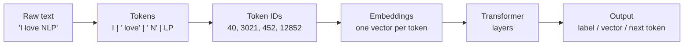
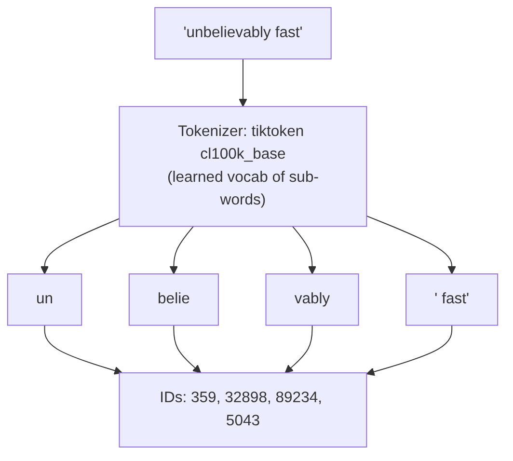
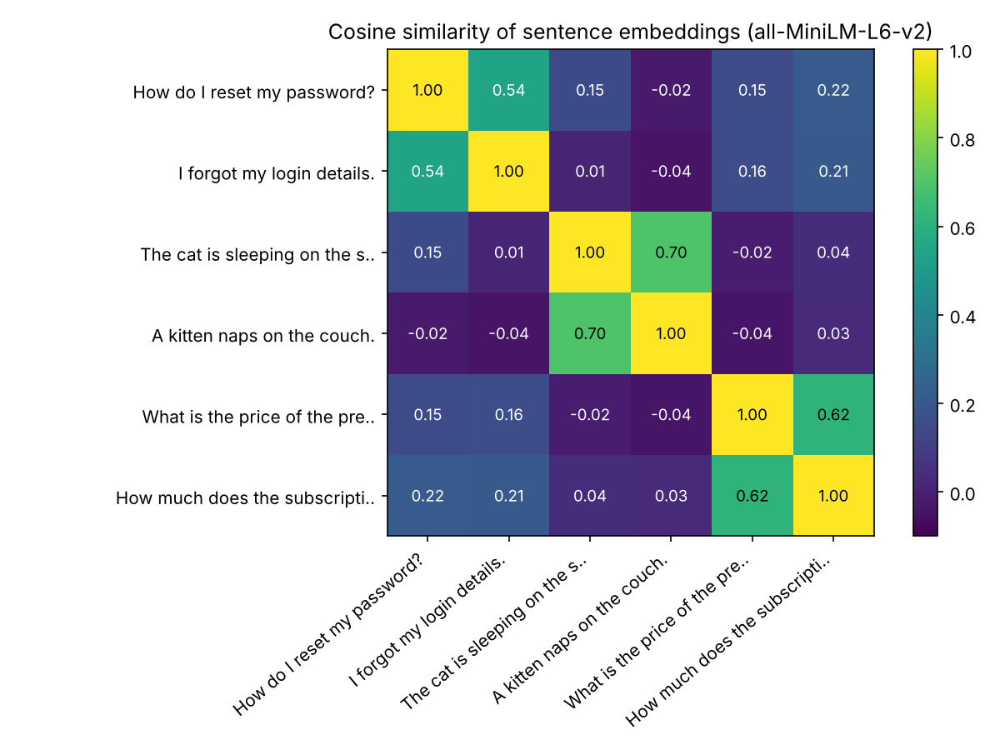
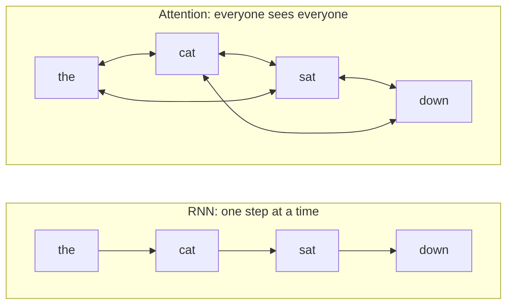
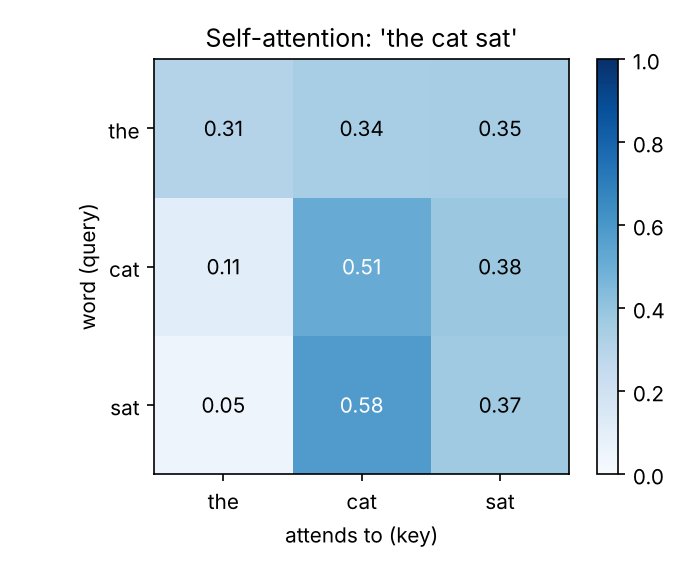
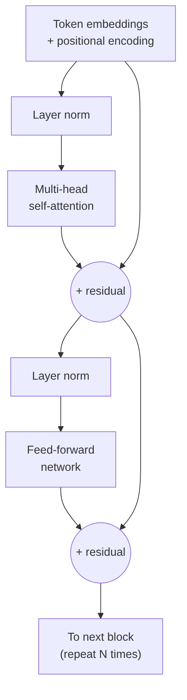
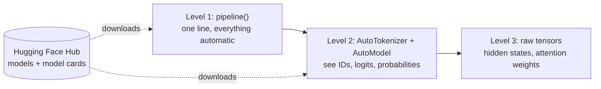

# Module 06 - NLP and Transformers

This lesson explains how computers turn human text into numbers, how they compare the meaning of sentences, and how the **transformer** (the design behind ChatGPT, Claude and Gemini) reads text. You need no maths beyond "multiply and add". Every new word is defined the first time it appears.

---

## 1. Text as data

**NLP (Natural Language Processing)** — the part of AI that works with human language: reading it, sorting it, translating it, answering questions about it, writing it.

Computers only understand numbers. A photo is already numbers (each pixel is a brightness value). Text is not. The word "cat" has no natural number. So every NLP system starts with the same job: **turn text into numbers without losing the meaning**.

**Analogy — the translator's notebook.** Imagine you must explain English words to a calculator. First you chop the sentence into pieces you have in a dictionary (tokens). Then you look up each piece's page number (token IDs). Then, for each page, you copy down a short list of numbers that describes what the word "feels like" (an embedding). The calculator can now work with the lists of numbers.



The rest of this lesson walks through that pipeline one box at a time.

Typical NLP tasks you will meet:

| Task | Input | Output | Example |
|---|---|---|---|
| **Classification** — putting text into a category | a review | "positive" / "negative" | spam filter, sentiment |
| **Named-entity recognition (NER)** — finding names of things | a sentence | labelled spans | "Hyderabad" → LOCATION |
| **Semantic search** — finding text with similar meaning | a question | best matching documents | help-desk search |
| **Generation** — writing new text | a prompt | continuation | chatbots, summaries |
| **Translation** | text in language A | text in language B | English → Hindi |

---

## 2. Tokens and tokenisation

**Token** — one small piece of text that a model treats as a single unit. It can be a whole word ("cat"), part of a word ("ization"), a single character, or a punctuation mark.

**Tokenisation** — the process of cutting text into tokens. The program that does it is a **tokenizer**.

**Vocabulary (vocab)** — the fixed list of all tokens a tokenizer knows. Each token in the list has a number, its **token ID**. GPT-2's vocab has about 50,000 tokens; modern models often have 100,000-200,000.

### 2.1 Three ways to cut text

1. **Word tokens** — split on spaces. "I love NLP" → `["I", "love", "NLP"]`. Easy, but the vocab must contain every word ever written, including typos, names and new slang. Any unknown word becomes a useless "unknown" token.
2. **Character tokens** — every letter is a token. The vocab is tiny (a few hundred symbols) and nothing is ever unknown, but sentences become very long, and single letters carry almost no meaning.
3. **Sub-word tokens** — the middle path used by every modern model. Common words stay whole ("the", "love"). Rare words are built from common pieces (OpenAI's `cl100k_base` tokenizer cuts "unbelievably" into "un" + "belie" + "vably"). Nothing is ever unknown, because in the worst case a word can be spelled out piece by piece.

**Analogy — LEGO bricks.** A word tokenizer needs a special moulded brick for every possible object. A character tokenizer only has 1x1 bricks, so every model takes forever to build. A sub-word tokenizer has a sensible kit: big bricks for common shapes, small ones to fill gaps.

### 2.2 BPE in one paragraph

**BPE (Byte-Pair Encoding)** — the most common recipe for building a sub-word vocab. Start with single characters (or single bytes). Count which pair of neighbouring symbols appears most often in a big pile of text, for example `t` + `h`. Glue that pair into a new symbol `th` and add it to the vocab. Repeat thousands of times: `th` + `e` → `the`, and so on. Frequent words end up as one token; rare words stay as several. Other recipes you will see named are **WordPiece** (used by BERT) and **SentencePiece/Unigram** (used by many multilingual models). The idea is the same: learn useful pieces from data.



### 2.3 Real tokenizer output

Here is the same sentence cut by four real tokenizers (produced by notebook 01 in this module):

Sentence: `Tokenization isn't magic: unbelievably, ChatGPT reads tokens!`

| Tokenizer | Tokens |
|---|---|
| BERT (`bert-base-uncased`, WordPiece) | `token, ##ization, isn, ', t, magic, :, un, ##bel, ##ie, ##va, ##bly, ...` |
| GPT-2 (BPE) | `Token, ization, Ġisn, 't, Ġmagic, :, Ġunbelievably, ...` |
| tiktoken `cl100k_base` | 15 tokens: `Token, ization, " isn", "'t", " magic", ...` |
| tiktoken `o200k_base` | 12 tokens: `Token, ization, " isn't", " magic", ":", " unbelievably", ...` |

Things to notice:

- `##` in BERT means "this piece is glued to the previous one".
- `Ġ` in GPT-2 output is how that tokenizer shows "there was a space before this token". The space is part of the token.
- BERT lower-cases everything ("uncased"); GPT tokenizers keep capitals.
- A bigger vocab (`o200k_base` has about 200,000 tokens) needs fewer tokens for the same sentence.

**tiktoken** — OpenAI's fast tokenizer library. `cl100k_base` and `o200k_base` are the names of two of its encodings (vocabularies). You will use it in Module 07 to count tokens and estimate cost.

### 2.4 Why tokens matter in practice

- **Models are priced per token**, not per word. A rough rule for English: 1 token ≈ 4 characters ≈ 0.75 words. Other languages (Hindi, Telugu, Chinese) often need more tokens per word.
- **Models have a token limit** (the context window, Module 07).
- **Strange model mistakes come from tokens.** Counting the letters in "strawberry" is hard for a model because it never sees letters, only chunks like `str` + `aw` + `berry`.
- **Each model needs its own tokenizer.** Feeding GPT-2 token IDs into BERT produces nonsense, because ID 1000 means different things in different vocabs.

---

## 3. Embeddings and similarity

### 3.1 From IDs to meaning

A token ID such as 3894 is only a label. ID 3894 is not "bigger" than ID 12. We need numbers that carry meaning.

**Embedding** — a list of numbers (a **vector**) that represents a token, word or sentence so that things with similar meaning get similar lists. A typical size is 384, 768 or 1,536 numbers. Each number is called a **dimension**.

**Analogy — describing fruit with sliders.** Describe each fruit with three sliders: sweetness, size, redness. Strawberry = [0.8, 0.1, 0.9]. Cherry = [0.7, 0.1, 0.95]. Watermelon = [0.7, 0.95, 0.6]. Strawberry and cherry have close numbers, so they "feel" similar. An embedding is the same idea with hundreds of sliders that the model invented itself during training. Nobody chose what each slider means.

The model learns embeddings by reading huge amounts of text. Words that appear in similar places ("I drank a cup of **tea** / **coffee**") are pushed to similar vectors. This is sometimes summed up as "a word is known by the company it keeps".

**Embedding layer / embedding table** — inside a model, a big table with one row per token ID. Looking up row 3894 gives that token's embedding. The table is learned during training.

**Sentence embedding** — one vector for a whole sentence or paragraph. Models such as `sentence-transformers/all-MiniLM-L6-v2` (384 numbers per sentence, small enough for a laptop) are trained so that sentences with the same meaning land close together, even with no shared words.

### 3.2 Cosine similarity

To compare two embeddings we need one number for "how alike are they?".

**Cosine similarity** — a score between -1 and 1 that measures whether two vectors point in the same direction. 1 = same direction (very similar meaning), 0 = unrelated, -1 = opposite.

The recipe for vectors `a` and `b`:

1. Multiply matching positions and add them up. This is the **dot product**: `a·b = a1*b1 + a2*b2 + ...`
2. Divide by the length of `a` times the length of `b`. (Length = square root of the sum of squares.)

```python
import numpy as np
a = np.array([0.8, 0.1, 0.9])   # strawberry
b = np.array([0.7, 0.1, 0.95])  # cherry
cos = a @ b / (np.linalg.norm(a) * np.linalg.norm(b))   # about 0.996
```

**Analogy — arrows on a map.** Two people point at a far mountain. If they point the same way, the angle between their arms is tiny and the cosine is close to 1, no matter if one person has a longer arm. Cosine cares about direction (meaning), not length.

In notebook 01 you embed sentences with MiniLM and get a similarity grid like this:



"How do I reset my password?" and "I forgot my login details" share almost no words, yet score high. That is **semantic search** — search by meaning — and it is the heart of RAG (Module 09).

---

## 4. From reading in order to paying attention

### 4.1 RNNs: reading one word at a time

Before transformers, the popular design for text was the **RNN (Recurrent Neural Network)**. It reads tokens one by one, left to right, and keeps a running summary called the **hidden state** — a vector that is updated after every token.

**Analogy — the whisper game.** Each child hears a message, adds a bit, and whispers it to the next. By the end of a long line, the start of the message is blurred. RNNs have the same problem: by token 500, token 3 is mostly forgotten. Improved RNNs called **LSTMs** and **GRUs** helped, but two problems stayed:

1. **Forgetting** over long texts.
2. **Slowness** — token 10 must wait for token 9. You cannot spread the work across thousands of GPU cores at once.

### 4.2 Attention: look at everything, decide what matters

**Attention** — a way for each token to look directly at every other token in the text and decide how much each one matters for understanding it.

Read: "The animal didn't cross the street because **it** was too tired." What does "it" mean? You look back at "animal", not "street". Attention lets the model do exactly that: the token "it" gives a high **attention weight** (an importance score between 0 and 1) to "animal".

**Analogy — a meeting room.** An RNN is a relay race: information passes hand to hand. Attention is a meeting where everyone can hear everyone. Each person decides whose comments matter to them right now.



In 2017 a research paper titled *Attention Is All You Need* showed that a model built mostly from attention, with no RNN, worked better and trained much faster. That design is the **transformer**.

---

## 5. Self-attention step by step

**Self-attention** — attention where the tokens of one text look at the other tokens of the same text. This is the core calculation of a transformer. Notebook 02 does it by hand in NumPy with three words; here is the idea.

### 5.1 Query, Key, Value

Each token's embedding is turned into three new vectors by multiplying by three learned matrices (**weight matrices** — tables of numbers the model learns in training):

- **Query (Q)** — "what am I looking for?"
- **Key (K)** — "what do I contain?" (a label other tokens can match against)
- **Value (V)** — "what information do I hand over if you pick me?"

**Analogy — a library.** You walk in with a question (your query). Every book has a label on its spine (its key). You compare your question with each label to decide how useful each book is. Then you read the books (their values), spending more time on the useful ones. Your final understanding is a blend of what you read, weighted by usefulness.

### 5.2 The four steps

For tokens with query `q`, keys `k`, values `v`:

1. **Score** — for every pair of tokens, take the dot product of one token's query with the other's key. High = good match.
2. **Scale** — divide every score by the square root of the vector size (√d). This keeps numbers from getting so big that the next step becomes all-or-nothing.
3. **Softmax** — turn each row of scores into weights that are positive and add up to 1. **Softmax** is a function that does this: it raises *e* to the power of each score and divides by the total, so the biggest score gets the biggest share.
4. **Blend** — each token's new vector is the weighted sum of all the value vectors.

In one line, the famous formula is: `Attention(Q, K, V) = softmax(Q Kᵀ / √d) V`. (`Kᵀ` means K "transposed" — rows turned into columns — so every query meets every key.)

Here is the result for the toy sentence "the cat sat" from notebook 02. Each row shows how much one word attends to every word:



In this toy example "sat" pays most attention to "cat" — the thing doing the sitting. The numbers come from small hand-made matrices, not a trained model, but the arithmetic is exactly what a real transformer does, only with bigger matrices.

### 5.3 Multi-head attention

**Multi-head attention** — running several attention calculations side by side, each with its own Q, K, V matrices. Each one is a **head**. One head might learn to track "who did what", another "which adjective goes with which noun", another "what is the previous word". Their outputs are joined together. GPT-2 small has 12 heads in each layer.

**Analogy — a panel of editors.** One checks grammar, one checks facts, one checks tone. Each reads the whole text with a different focus, then they combine their notes.

### 5.4 Positional encoding

Attention on its own ignores order: "dog bites man" and "man bites dog" would look the same, because every token sees every other token at once. So the model adds information about position.

**Positional encoding** — extra numbers added to each token's embedding that say where in the sequence it sits (1st, 2nd, 3rd ...). The original transformer used wave patterns (sines and cosines); many modern models use a method called **RoPE (rotary position embedding)** that rotates the Q and K vectors by an amount that depends on position. You do not need the details. Remember only this: "attention needs to be told the order".

### 5.5 Masking (for text generators)

A model that writes text must not peek at future words while learning to predict them. **Causal mask** — a rule that blocks each token from attending to tokens to its right. In the heatmap above, a masked version would have zeros above the diagonal. Notebook 02 shows both versions.

---

## 6. The transformer block

A transformer is a stack of identical **blocks** (also called **layers**). GPT-2 small has 12; large modern models have around 100. Each block has two main parts:

1. **Multi-head self-attention** — tokens share information with each other.
2. **Feed-forward network (FFN)** — a small two-layer neural network (Module 05) applied to each token separately. It "thinks about" what the token has learned from the others. Most of a model's stored knowledge is thought to live in these layers.

Two helpers wrap each part:

- **Residual connection** (also "skip connection") — add the part's input back to its output. Information can flow straight through, so deep stacks still train well. Analogy: tracking changes in a document instead of rewriting it from scratch.
- **Layer normalisation** — rescale each token's vector so its numbers stay in a sensible range. Analogy: adjusting the volume so nobody shouts or whispers.



At the very end, an **output head** (a final matrix) turns the last vector into one score per vocab token. These raw scores are **logits**. Softmax turns them into probabilities: "the next token is ' Paris' with 47%, ' the' with 27% ...". Module 07 builds on exactly this.

### 6.1 Three families of transformers

| Family | Sees | Good at | Examples |
|---|---|---|---|
| **Encoder-only** | whole text both ways | understanding: classification, embeddings, search | BERT, DistilBERT, MiniLM |
| **Decoder-only** | only earlier tokens (causal mask) | generating text | GPT, Llama, Claude, Gemini, SmolLM2 |
| **Encoder-decoder** | encoder reads input, decoder writes output | translation, summarising | T5, BART |

**Encoder** — the part that reads and understands. **Decoder** — the part that writes, one token at a time.

**Parameter** — one learned number inside a model (a single cell in some weight matrix). Model size is counted in parameters: SmolLM2-135M has 135 million; DistilBERT about 66 million; frontier chat models have hundreds of billions or more.

---

## 7. Hugging Face: the toolbox

**Hugging Face** — a company and website that hosts most of the world's open AI models and the Python libraries to use them. Four pieces matter:

1. **The Hub** (huggingface.co) — a free website where people share models, datasets and demos. Each model has a name like `distilbert-base-uncased-finetuned-sst-2-english` (owner/model-name, the owner sometimes omitted for older models) and a **model card** (a README describing what it does, its training data, licence and limits). Always read the card before using a model.
2. **`transformers`** — the Python library that downloads and runs models.
3. **Tokenizer** classes — `AutoTokenizer.from_pretrained(name)` downloads the tokenizer that matches a model.
4. **Model** classes — `AutoModel...from_pretrained(name)` downloads the weights. The "Auto" classes read the model's config and pick the right architecture for you.

**Pretrained** — already trained by someone else, ready to use. **`from_pretrained`** downloads the files once into a local **cache** folder (usually `~/.cache/huggingface`) and reuses them afterwards.

### 7.1 Three levels of control



**Level 1 — `pipeline`**: one line, does everything.

```python
from transformers import pipeline
clf = pipeline("sentiment-analysis", model="distilbert-base-uncased-finetuned-sst-2-english")
clf("I love this course!")   # [{'label': 'POSITIVE', 'score': 0.9999}]
```

**Level 2 — tokenizer + model**: you see the numbers.

```python
from transformers import AutoTokenizer, AutoModelForSequenceClassification
import torch
name = "distilbert-base-uncased-finetuned-sst-2-english"
tok = AutoTokenizer.from_pretrained(name)
model = AutoModelForSequenceClassification.from_pretrained(name)
inputs = tok("I love this course!", return_tensors="pt")   # token IDs as a PyTorch tensor
with torch.no_grad():                                       # no training, so skip gradient tracking
    logits = model(**inputs).logits                         # raw scores, one per label
probs = torch.softmax(logits, dim=-1)                       # turn scores into probabilities
```

**Level 3 — the raw tensors**: you inspect hidden states, attention weights, and so on (`output_attentions=True`). Useful for research and debugging.

**Tensor** — PyTorch's name for an array of numbers (Module 05). `return_tensors="pt"` asks the tokenizer for PyTorch tensors.

### 7.2 Fine-tuned models and sentiment analysis

**Fine-tuning** — taking a pretrained model and training it a bit more on a smaller, task-specific dataset. `distilbert-base-uncased-finetuned-sst-2-english` is DistilBERT (a smaller, faster version of BERT) fine-tuned on **SST-2**, a dataset of movie-review sentences labelled positive or negative. So it is good at English positive/negative, and only that. It has no "neutral" label, and it can be fooled by sarcasm ("Great, it broke on day one.").

**Sentiment analysis** — classifying the feeling of a text (positive, negative, sometimes neutral). Common uses: product reviews, support tickets, social media.

### 7.3 Text generation with a tiny model

```python
gen = pipeline("text-generation", model="HuggingFaceTB/SmolLM2-135M-Instruct")
gen("Once upon a time", max_new_tokens=30)
```

SmolLM2-135M-Instruct is a 135-million-parameter decoder-only model that runs on a laptop CPU in seconds. Its answers are often wrong or odd — it is roughly 1,000 times smaller than a frontier model — but it uses the same machinery: tokenize, predict one token, append it, repeat. **Instruct** in the name means it was further trained to follow chat-style instructions (Module 07 explains this).

**Practical tip — `dtype`.** Each parameter is stored as a number with a certain precision. **float32** uses 32 bits per number; **bfloat16** uses 16 bits, half the memory. SmolLM2's files are stored in bfloat16, and most laptop CPUs are very slow at bfloat16 maths (on the course machine, generating 30 tokens took about a minute instead of a second or two). So the notebooks load it with `dtype=torch.float32`. On a GPU, 16-bit is usually the better choice.

### 7.4 Licences and responsibility

Every model on the Hub has a **licence** (the legal terms of use) shown on its card: Apache-2.0 and MIT allow commercial use; some models forbid it or add conditions. Models also inherit biases from their training text. Check the card's "limitations" section before using a model on real people's data.

---

## 8. Putting it together

| Step | What happens | Tool in this module |
|---|---|---|
| Text → tokens | sub-word tokenizer (BPE / WordPiece) | `AutoTokenizer`, `tiktoken` |
| Tokens → IDs | look up each token in the vocab | `tokenizer(text)["input_ids"]` |
| IDs → embeddings | look up rows in the embedding table | inside every model |
| Mix context | self-attention + feed-forward, many blocks | the transformer |
| Output | class label, sentence vector, or next-token probabilities | `pipeline`, `SentenceTransformer` |

## 9. Key words (quick glossary)

| Word | Plain meaning |
|---|---|
| Token | a chunk of text the model treats as one unit |
| Vocabulary | the fixed list of tokens a tokenizer knows |
| BPE | recipe that builds sub-word tokens by merging frequent pairs |
| Embedding | list of numbers representing meaning |
| Cosine similarity | -1..1 score of how alike two vectors' directions are |
| Attention | each token decides how much every other token matters |
| Q / K / V | query (what I seek), key (what I offer as a label), value (what I hand over) |
| Softmax | turns scores into probabilities that sum to 1 |
| Multi-head | several attention calculations in parallel |
| Positional encoding | adds word-order information |
| Transformer block | attention + feed-forward + residuals + layer norm |
| Logits | raw scores before softmax |
| Encoder / decoder | the reading part / the writing part |
| Parameter | one learned number in the model |
| Fine-tuning | extra training on a small, specific dataset |
| Hugging Face Hub | website hosting open models and datasets |

## 10. What to do next

1. Run `notebooks/01-tokens-and-embeddings.ipynb`.
2. Run `notebooks/02-attention-by-hand.ipynb` and change the numbers to see what moves.
3. Run `notebooks/03-hugging-face-pipelines.ipynb`.
4. Try `exercises.md`. Solutions are in `solutions/`.
5. Module 07 turns the "next-token probabilities" at the end of section 6 into full chatbots and API calls.
