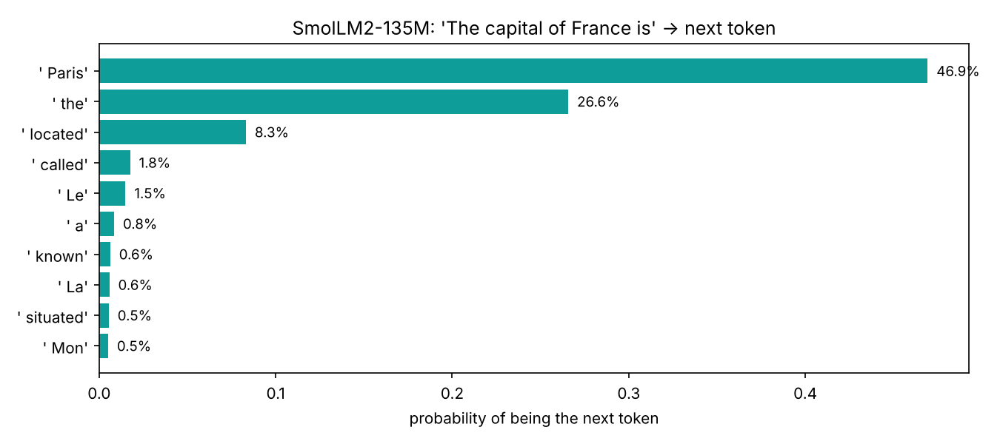
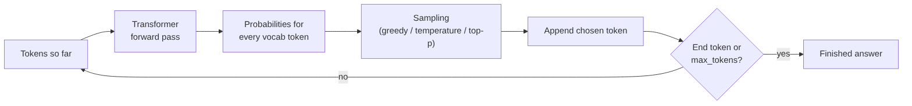
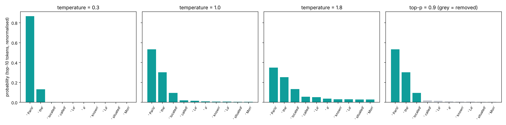
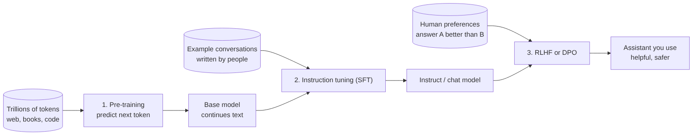
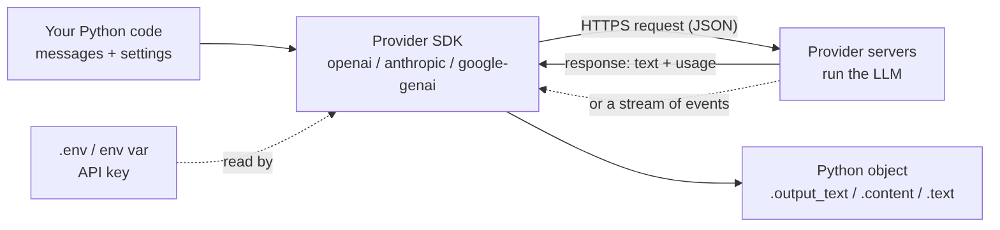
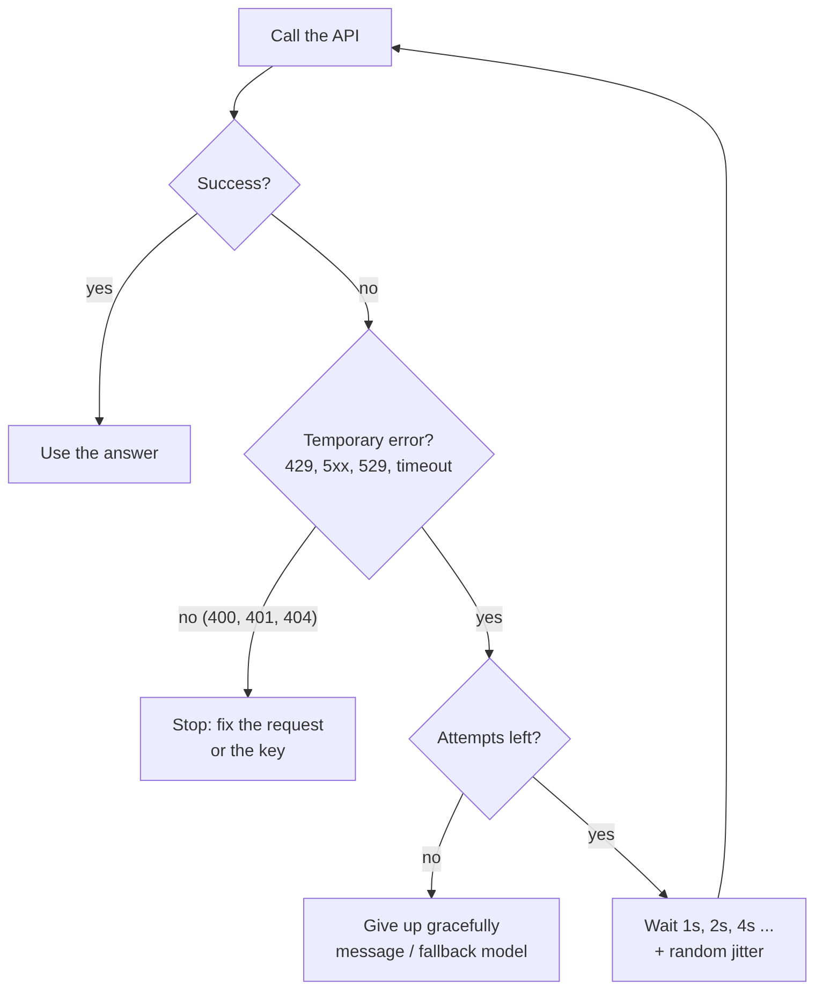
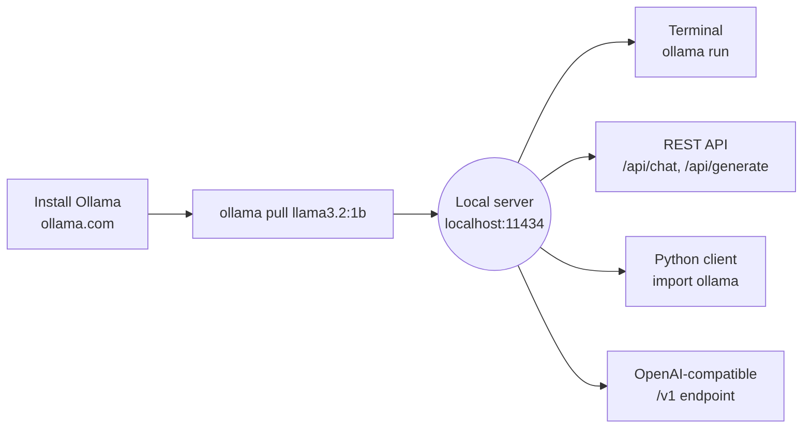
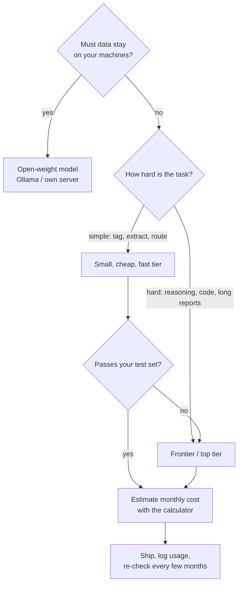

<!-- nav:start -->
> [🏠 Course home](../README.md) · [🗺️ Roadmap](../ROADMAP.md) · [⬅️ 06 NLP & Transformers](../06-nlp-and-transformers/README.md) · [08 Prompt & Context Engineering ➡️](../08-prompt-and-context-engineering/README.md)  
> **✨ Module 07 · LLMs & GenAI** · [📋 Module overview](README.md)  
> [📖 Lesson](concepts.md) · [📄 PDF handout](pdf/07-llms-and-genai-handout.pdf) · [🎞️ Slides](slides/07-llms-and-genai.pptx) · [📓 Notebooks](notebooks/) · [✍️ Exercises](exercises.md) · [✅ Solutions](solutions/) · [🧑‍🏫 Trainer notes](trainer-notes.md) · [🔗 Resources](resources.md)
<!-- nav:end -->

# Module 07 - LLMs and Generative AI

This lesson explains what a large language model really does, how its settings (temperature, top-p, context window) change its behaviour, how it is trained, and how to use one from Python — through the OpenAI, Anthropic and Google Gemini APIs, and on your own computer with Ollama. It ends with how to count tokens, estimate cost and choose a model.

Module 06 (tokens, embeddings, attention, transformers) is assumed. Every new word is still defined the first time it appears.

---

## 1. What is an LLM?

**LLM (Large Language Model)** — a very large transformer (Module 06) trained on huge amounts of text to do one thing: predict the next token. "Large" means billions of **parameters** (learned numbers) and training text measured in trillions of tokens.

**Generative AI (GenAI)** — AI that creates new content (text, images, audio, code) rather than only labelling existing content. LLMs are the text part of GenAI.

**Analogy — the world's most-read autocomplete.** Your phone keyboard suggests the next word from your last few words. An LLM is the same idea after reading a large part of the public internet, many books and a lot of code. Because predicting the next word well requires knowing grammar, facts, styles and reasoning patterns, the model picks all of those up along the way.

Important consequences:

- An LLM does not look facts up (unless you connect it to a search tool or documents, Modules 09-10). It produces text that is *likely*, which is usually but not always *true*. A confident, fluent, wrong answer is called a **hallucination**.
- Its knowledge stops at its **training cutoff** — the date its training text was collected.
- It has no memory between API calls. Each request must include everything it needs to know.

---

## 2. Next-token prediction

At each step the model reads all tokens so far and outputs one score (a **logit**) for every token in its vocabulary. **Softmax** turns the scores into **probabilities** that add up to 1.

Real output from the tiny model `HuggingFaceTB/SmolLM2-135M-Instruct` (notebook 01, run in 32-bit precision; tiny differences in the last digit are normal on other machines) for the text "The capital of France is":

| Next token | Probability |
|---|---|
| " Paris" | 46.9% |
| " the" | 26.6% |
| " located" | 8.3% |
| " called" | 1.8% |
| " Le" | 1.5% |



Notice that " the" is also a fine continuation ("...is the city of Paris"). The model is not choosing a fact; it is ranking continuations.

### 2.1 The generation loop

To write a whole answer, the model repeats a loop:

1. Read the tokens so far.
2. Compute probabilities for the next token.
3. Pick one token (how it picks is the **sampling** step, section 3).
4. Append it to the text.
5. Stop if it picked a special **end-of-sequence** token or hit the length limit (`max_tokens`); otherwise go to 1.



This is called **autoregressive** generation — each new token depends on the ones the model produced before it. It explains two practical facts: answers appear word by word (streaming), and long answers take longer and cost more than short ones.

---

## 3. Sampling: temperature, top-k and top-p

**Sampling** — how one token is picked from the probability list.

**Greedy decoding** — always pick the most likely token. Same input → same output every time. Good for factual extraction, but often dull and repetitive for long text.

**Temperature** — a number (usually 0 to 2) that sharpens or flattens the probabilities before picking. Technically, each logit is divided by the temperature before softmax.

- Low temperature (e.g. 0.2): the top token gets almost all the probability. Predictable, focused.
- Temperature 1: the model's own probabilities.
- High temperature (e.g. 1.5): probabilities flatten, unusual tokens get picked more often. Creative, but risks nonsense.

**Analogy — a cautious vs adventurous diner.** At low temperature you always order your favourite dish. At high temperature you happily order something odd from the bottom of the menu.

**Top-k** — only keep the k most likely tokens (e.g. k = 50), then pick among them.

**Top-p (nucleus sampling)** — keep the smallest group of top tokens whose probabilities add up to at least p (e.g. p = 0.9), then pick among them. When the model is sure, that group is tiny; when it is unsure, it is larger. Top-p adapts; top-k does not.



Practical guidance (check each provider's docs, because defaults differ and some newer models fix these values themselves):

| Goal | Typical setting |
|---|---|
| Extracting data, classification, code | low temperature (0-0.3) |
| General chat | provider default |
| Brainstorming, stories | higher temperature (0.8-1.2) |
| Changing both temperature and top-p at once | usually avoided; adjust one |

Note for this course's software versions: in the Anthropic Python SDK installed here (`anthropic` 2.12), `messages.create` does **not** accept a `temperature` argument — newer Claude models manage sampling themselves. OpenAI's Responses API and Gemini still accept `temperature`. As of late 2026, always check the official API reference for the model you use.

---

## 4. The context window

**Context window** — the maximum number of tokens a model can handle in one request: your input (system prompt, conversation history, documents) **plus** the output it writes. Measured in tokens, not words.

**Analogy — a desk.** The model can only work with the papers on its desk. A bigger desk holds more papers, but everything must fit at once, and you pay for every page you put on it. When the desk is full, something must be removed.

Facts to remember:

- Sizes range from a few thousand tokens (tiny local models; SmolLM2-135M supports 8,192) to hundreds of thousands or more for frontier API models. Check the model's page for the exact limit.
- **Max output tokens** is a separate, smaller limit on how long a single answer can be.
- In a chat app, the whole conversation is re-sent every turn. Long chats eventually overflow and old messages must be dropped or summarised.
- Models tend to use information at the start and end of a long context better than information buried in the middle. More context is not automatically better; relevant context is. (Module 08 covers context engineering.)
- You pay for input tokens every time they are sent, so a long system prompt repeated on every call adds up. Many providers offer **prompt caching** (a discount when the same opening text is re-sent) — see their pricing pages.

---

## 5. How an LLM is trained (at a glance)



### 5.1 Pre-training

The model reads trillions of tokens of text (web pages, books, code) and learns to predict the next token. Training means: guess, compare with the real next token, nudge the parameters to make the right answer more likely (backpropagation, Module 05), repeat billions of times. This needs thousands of GPUs for weeks or months and costs millions of dollars, so only a few organisations do it.

The result is a **base model** (also "foundation model"): brilliant at continuing text, but not at following instructions. Ask a base model "What is the capital of France?" and it might continue with "What is the capital of Germany? What is the capital of Spain?" because that looks like a quiz page.

**Analogy:** a student who has read the whole library but has never been taught to answer exam questions.

### 5.2 Instruction tuning (SFT)

**SFT (Supervised Fine-Tuning)**, also called **instruction tuning** — further training on many thousands of example conversations written or checked by people: an instruction and a good answer. The model learns the format "user asks → assistant answers helpfully". The result is an **instruct** or **chat** model (that is what "Instruct" means in `SmolLM2-135M-Instruct`).

Chat models are trained with special markers around each message, called a **chat template**. Notebook 01 prints SmolLM2's: `<|im_start|>user ... <|im_end|>`. APIs add these markers for you.

### 5.3 Preference tuning: RLHF and DPO

**RLHF (Reinforcement Learning from Human Feedback)** — a stage that teaches the model which of several answers people prefer. Roughly:

1. The model writes two or more answers to the same prompt.
2. Human raters choose the better one (more helpful, more honest, safer).
3. A separate **reward model** learns to predict those human choices as a score.
4. The LLM is trained (with a reinforcement-learning method such as **PPO**) to produce answers the reward model scores highly.

**DPO (Direct Preference Optimization)** — a simpler method that learns straight from the "preferred vs rejected" pairs without a separate reward model. Many open models use DPO or related methods.

**Analogy:** pre-training is reading the library; SFT is a teacher showing worked answers; RLHF is a coach watching you answer and saying "that one was better".

Module 12 covers preference data and annotation jobs; Module 13 covers fine-tuning in practice.

---

## 6. Using LLMs through an API

**API (Application Programming Interface)** — a way for one program to ask another program to do something. LLM providers run the giant models on their own computers; you send a request over the internet and get the reply back.

**SDK (Software Development Kit)** — the provider's official Python library that builds those requests for you. In this module:

| Provider | Python package | Install | Client |
|---|---|---|---|
| OpenAI | `openai` | `pip install openai` | `OpenAI()` |
| Anthropic (Claude) | `anthropic` | `pip install anthropic` | `Anthropic()` |
| Google (Gemini) | `google-genai` | `pip install google-genai` | `genai.Client()` |



### 6.1 API keys and environment variables

**API key** — a long secret string that proves who you are and lets the provider bill you. Treat it like a password.

- Never write a key in code, notebooks, slides or git. Bots scan GitHub for leaked keys within minutes.
- Store keys in **environment variables** (named settings that live outside your code) or a `.env` file that is listed in `.gitignore`. This module ships a `.env.example` with placeholders; copy it to `.env` and fill in your own keys.
- Each SDK reads its key automatically from a standard variable: `OPENAI_API_KEY`, `ANTHROPIC_API_KEY`, `GEMINI_API_KEY` (the Google SDK also accepts `GOOGLE_API_KEY`).
- In Colab, use the "Secrets" panel (key icon) and read them into environment variables.

Every notebook in this module checks `if os.getenv("ANTHROPIC_API_KEY"):` before a real call and otherwise uses an **offline fallback** (a small local model or a clearly labelled fake response), so everything runs without keys.

### 6.2 Messages and roles

Chat APIs take a list of **messages**. Each message has a **role** and **content**:

- **system** — instructions that set the assistant's behaviour for the whole conversation ("You are a polite support agent for a bakery. Answer in under 50 words."). Providers place it differently: OpenAI uses `instructions=` (Responses API) or a `{"role": "system"}` message (Chat Completions API); Anthropic uses the `system=` parameter; Gemini uses `system_instruction` in the config.
- **user** — what the person says.
- **assistant** — what the model said earlier (Gemini calls this role `model`).

Because the API remembers nothing, a multi-turn chat is built by sending the whole history every time:

```python
messages = [
    {"role": "user", "content": "My name is Asha."},
    {"role": "assistant", "content": "Nice to meet you, Asha!"},
    {"role": "user", "content": "What is my name?"},   # the model can answer only because history is included
]
```

**Analogy — a pen pal with amnesia.** Each letter must recap the whole conversation, because the pen pal forgets everything after replying.

### 6.3 The same request, three providers

The code below is the shape you will use. Full, runnable versions (with the offline fallback) are in `code/` and notebook 02. Model names are read from environment variables because they change often; the defaults are examples only — as of late 2026, check each provider's models page.

**OpenAI** (Responses API):

```python
from openai import OpenAI
client = OpenAI()                                   # reads OPENAI_API_KEY
resp = client.responses.create(
    model="gpt-5.4-mini",                           # example name; check the models page
    instructions="You are a concise tutor.",        # the system prompt
    input=[{"role": "user", "content": "What is a token?"}],
    max_output_tokens=200,
)
print(resp.output_text)
print(resp.usage.input_tokens, resp.usage.output_tokens)
```

OpenAI's older **Chat Completions** API (`client.chat.completions.create(model=..., messages=[...])`) is still widely used in tutorials and by other providers that copy its format.

**Anthropic** (Messages API):

```python
from anthropic import Anthropic
client = Anthropic()                                # reads ANTHROPIC_API_KEY
msg = client.messages.create(
    model="claude-haiku-5-5",                       # example name; check the models page
    max_tokens=200,                                 # required: the most tokens the answer may use
    system="You are a concise tutor.",
    messages=[{"role": "user", "content": "What is a token?"}],
)
print(msg.content[0].text)
print(msg.usage.input_tokens, msg.usage.output_tokens, msg.stop_reason)
```

**Google Gemini** (`google-genai`):

```python
from google import genai
from google.genai import types
client = genai.Client()                             # reads GEMINI_API_KEY (or GOOGLE_API_KEY)
resp = client.models.generate_content(
    model="gemini-flash-latest",                    # example alias; check the models page
    contents="What is a token?",
    config=types.GenerateContentConfig(system_instruction="You are a concise tutor.",
                                       max_output_tokens=200, temperature=0.3),
)
print(resp.text)
print(resp.usage_metadata.prompt_token_count, resp.usage_metadata.candidates_token_count)
```

All three: you give a model name, instructions, the conversation and a length limit; you get text back plus a **usage** record (how many input and output tokens you were billed for).

### 6.4 Streaming

**Streaming** — receiving the answer piece by piece as it is generated, instead of waiting for the whole thing. Users see text appear immediately, which feels much faster. Under the hood the server sends **server-sent events (SSE)** — small messages pushed over one open connection.

```python
# OpenAI
for event in client.responses.create(model=..., input="Tell a story", stream=True):
    if event.type == "response.output_text.delta":
        print(event.delta, end="", flush=True)

# Anthropic
with client.messages.stream(model=..., max_tokens=300, messages=[...]) as stream:
    for text in stream.text_stream:
        print(text, end="", flush=True)

# Gemini
for chunk in client.models.generate_content_stream(model=..., contents="Tell a story"):
    print(chunk.text, end="", flush=True)
```

### 6.5 Structured (JSON) output

Programs need data, not prose. **Structured output** — asking the model to answer in a fixed **JSON** shape (JSON = a text format for data: `{"name": "Asha", "age": 21}`). You describe the shape with a **schema** — a description of which fields exist and their types. In Python the easiest way is a **Pydantic** model (a class that describes and validates data).

```python
from pydantic import BaseModel
class Ticket(BaseModel):
    category: str        # e.g. "billing", "delivery", "technical"
    urgency: int         # 1 (low) to 5 (high)
    summary: str

# OpenAI:    client.responses.parse(model=..., input=..., text_format=Ticket).output_parsed
# Anthropic: client.messages.parse(model=..., max_tokens=..., messages=..., output_format=Ticket).parsed_output
# Gemini:    client.models.generate_content(model=..., contents=...,
#                config=types.GenerateContentConfig(response_mime_type="application/json",
#                                                   response_schema=Ticket)).parsed
```

Always **validate** what comes back (Pydantic does this) and decide what to do if it fails: retry, or fall back to a safe default. Older models that lack native structured output can be asked for JSON in the prompt, but then validation is essential.

### 6.6 Errors, rate limits and retries

Real API calls fail sometimes. The SDKs raise typed **exceptions** (Python errors) that tell you what went wrong. The common **HTTP status codes** (numbers the server sends back with each reply):

| Code | Meaning | Retry? | What to do |
|---|---|---|---|
| 400 | Bad request (wrong parameter, too many tokens) | No | Fix the request |
| 401 | Authentication failed (bad or missing key) | No | Check the key / env var |
| 403 | Permission denied | No | Check account access |
| 404 | Not found (often a wrong model name) | No | Check the model name |
| 429 | **Rate limit** — too many requests or tokens per minute, or spend cap reached | Yes, after waiting | Back off; check limits |
| 500 / 503 | Server error | Yes | Back off and retry |
| 529 | Overloaded (Anthropic) | Yes | Back off and retry |
| (no code) | Connection error / timeout | Yes | Check network; retry |

**Rate limit** — a cap on how much you may use per minute (requests per minute, tokens per minute) or per month. Limits usually grow as your account spends more. Each provider documents its limits on a rate-limits page.

**Retry with exponential backoff** — when a call fails with a temporary error, wait and try again, doubling the wait each time (1s, 2s, 4s, 8s ...) and adding a little randomness (**jitter**) so many clients don't retry at the same instant. Give up after a few attempts.



Good news: the OpenAI and Anthropic SDKs already retry connection errors, 429s and 5xx errors automatically (2 retries by default; change with `max_retries=`). The Gemini SDK has `HttpRetryOptions`. You still need your own handling for: giving the user a clear message, logging, falling back to another model, and never retrying 400/401 errors.

```python
import anthropic
client = anthropic.Anthropic(max_retries=4, timeout=30)    # SDK-level retries and a 30 s timeout
try:
    msg = client.messages.create(...)
except anthropic.RateLimitError:          # 429: slow down
    ...
except anthropic.APIStatusError as e:     # any other HTTP error code
    print(e.status_code, e.message)
except anthropic.APIConnectionError:      # network problem, no response at all
    ...
```

OpenAI's SDK has the same names (`openai.RateLimitError`, `openai.APIStatusError`, `openai.APIConnectionError`). Gemini uses `google.genai.errors.APIError` (with `ClientError` for 4xx and `ServerError` for 5xx).

---

## 7. Tokens and cost

API pricing is per token, usually quoted **per million tokens**, with **separate prices for input and output tokens** (output usually costs several times more). Some providers also have cheaper prices for cached input or for **batch** jobs (requests processed within hours instead of seconds).

The formula for one request:

```
cost = input_tokens  × (input price per 1M)  / 1,000,000
     + output_tokens × (output price per 1M) / 1,000,000
```

For a month: multiply by requests per day and by days.

**Counting tokens before you send:**

- `tiktoken` counts tokens exactly for OpenAI models (`tiktoken.get_encoding("o200k_base")`).
- Anthropic and Gemini use their own tokenizers. Their SDKs have `count_tokens` calls (`client.messages.count_tokens(...)`, `client.models.count_tokens(...)`) — these need a key. Offline, tiktoken gives a reasonable estimate (expect differences of 10-30%).
- After a call, the **usage** field gives the true billed numbers. Log them.

**Prices change often, so this course never hard-codes them.** The cost calculator in `excel/07-llm-cost-calculator.xlsx` has yellow input cells marked "fill in from official pricing page", with the links:

- OpenAI: https://openai.com/api/pricing/
- Anthropic: https://platform.claude.com/docs/en/about-claude/pricing
- Google Gemini: https://ai.google.dev/gemini-api/docs/pricing

Every result cell is a live formula, so when you type in today's prices the monthly cost updates.

**Ways to cut cost:** use the smallest model that passes your tests; keep prompts short; limit `max_tokens`; cache repeated prompt prefixes; use batch processing for non-urgent jobs; don't resend long histories (summarise them).

---

## 8. Running models locally with Ollama

**Local model** — an **open-weight** model (one whose parameters are published for download, such as Llama, Gemma, Qwen, Mistral) running on your own computer. No API key, no per-token bill, and your data never leaves the machine. The trade-offs: smaller models are less capable, and you need enough RAM (and ideally a GPU).

**Ollama** — a free program that downloads, manages and runs open models with one command, and serves them through a local API on port 11434.

**Quantisation** — storing each parameter with fewer bits (e.g. 4 bits instead of 16) so the model needs about a quarter of the memory, with a small loss in quality. Ollama's default downloads are usually 4-bit quantised. Rough guide: a 4-bit model needs a bit more than half a GB of RAM per billion parameters (so a 3B model needs roughly 2-3 GB).



**Install** — download from https://ollama.com (macOS, Windows, Linux). On Linux the site gives a one-line install script. After installing, the Ollama server runs in the background.

**Pull and run** (terminal):

```bash
ollama pull llama3.2:1b          # download a small model (name from the Ollama library page)
ollama run llama3.2:1b           # chat in the terminal; type /bye to quit
ollama list                      # models on disk
ollama ps                        # models loaded in memory right now
```

Model names change; browse https://ollama.com/library for current ones.

**REST API** — **REST** is a common style of web API where you send HTTP requests with JSON. Ollama listens on `http://localhost:11434`:

```python
import httpx
r = httpx.post("http://localhost:11434/api/chat", json={
    "model": "llama3.2:1b",
    "messages": [{"role": "user", "content": "Why is the sky blue?"}],
    "stream": False,
}, timeout=120)
print(r.json()["message"]["content"])
```

**Python client** (`pip install ollama`):

```python
import ollama
resp = ollama.chat(model="llama3.2:1b", messages=[{"role": "user", "content": "Why is the sky blue?"}])
print(resp.message.content)
```

Ollama also offers an **OpenAI-compatible endpoint** at `http://localhost:11434/v1`, so the `openai` SDK works with `OpenAI(base_url="http://localhost:11434/v1", api_key="ollama")`. That lets you develop against a free local model and switch to a hosted one by changing two settings.

Our notebooks cannot run Ollama on the course server, so notebook 03 checks whether an Ollama server is reachable and otherwise falls back to SmolLM2 through Hugging Face `transformers`, which does the same job in-process. The full Ollama scripts are in `code/`.

---

## 9. Choosing a model

There is no single best model. Choose by testing against your own task. Questions to ask, in order:

1. **Does the data have to stay on our machines?** (privacy rules, offline use) → open-weight model, run locally (Ollama) or on your own server.
2. **How hard is the task?** Simple classification, extraction or short replies → a small, fast, cheap model. Complex reasoning, long documents, tricky code → a larger frontier model.
3. **How much text goes in?** Long documents → check the context window.
4. **Speed?** Real-time chat needs low **latency** (time until the first token appears). Small models are faster.
5. **Budget?** Estimate monthly cost with the calculator before you commit.
6. **Special needs?** Images/audio input (**multimodal**), tool use, structured output support, languages other than English.



| Situation | Sensible starting point |
|---|---|
| Learning, prototyping with no budget | Gemini free tier, or a local model via Ollama |
| High-volume simple tasks (tagging, routing) | the smallest/cheapest tier of any major provider |
| Complex reasoning, coding, long reports | a provider's top tier |
| Private or offline data | open-weight model via Ollama / your own server |
| Need to switch providers easily | a thin wrapper of your own, or a library such as LiteLLM |

**Process:** write 20-50 realistic test inputs with what a good answer looks like; try the cheapest candidate first; move up a tier only if it fails; record quality, latency and cost per request. Re-check every few months — models and prices change fast. Public **leaderboards** (ranking sites) are useful hints, but your own test set decides.

---

## 10. Glossary

| Word | Plain meaning |
|---|---|
| LLM | huge transformer trained to predict the next token |
| Hallucination | fluent, confident, wrong output |
| Logit / probability | raw score / score after softmax (0-1, sums to 1) |
| Autoregressive | each new token depends on the ones before |
| Greedy decoding | always pick the most likely token |
| Temperature | sharpens (low) or flattens (high) probabilities |
| Top-k / top-p | keep only the k best tokens / the best tokens covering probability p |
| Context window | max tokens for input + output in one request |
| Base model | pre-trained only; continues text |
| SFT / instruction tuning | training on example conversations |
| RLHF / DPO | training on human preferences between answers |
| API / SDK | way to call a remote program / official library that does it for you |
| API key | secret that identifies and bills you |
| System / user / assistant | instructions / the person / the model's earlier replies |
| Streaming | receiving the answer piece by piece |
| Structured output | answer in a fixed JSON schema |
| Rate limit | cap on requests or tokens per minute |
| Exponential backoff | retry with waits that double each time |
| Ollama | tool that runs open models locally on port 11434 |
| Quantisation | fewer bits per parameter → less memory |
| Latency | delay before the answer (or first token) arrives |

## 11. What to do next

1. Run `notebooks/01-how-llms-work.ipynb` (next-token probabilities, sampling, context window).
2. Run `notebooks/02-calling-llm-apis.ipynb` (three SDKs, roles, streaming, JSON, errors and retries — works without keys).
3. Run `notebooks/03-tokens-cost-and-local-models.ipynb` and open `excel/07-llm-cost-calculator.xlsx`.
4. If you have a computer where you can install software, install Ollama and run `code/ollama_rest.py` and `code/ollama_client.py`.
5. Do `exercises.md`.

<!-- nav:start -->
---
[🏠 Course home](../README.md) · [🗺️ Roadmap](../ROADMAP.md) · [⬅️ 06 NLP & Transformers](../06-nlp-and-transformers/README.md) · [08 Prompt & Context Engineering ➡️](../08-prompt-and-context-engineering/README.md)
<!-- nav:end -->
