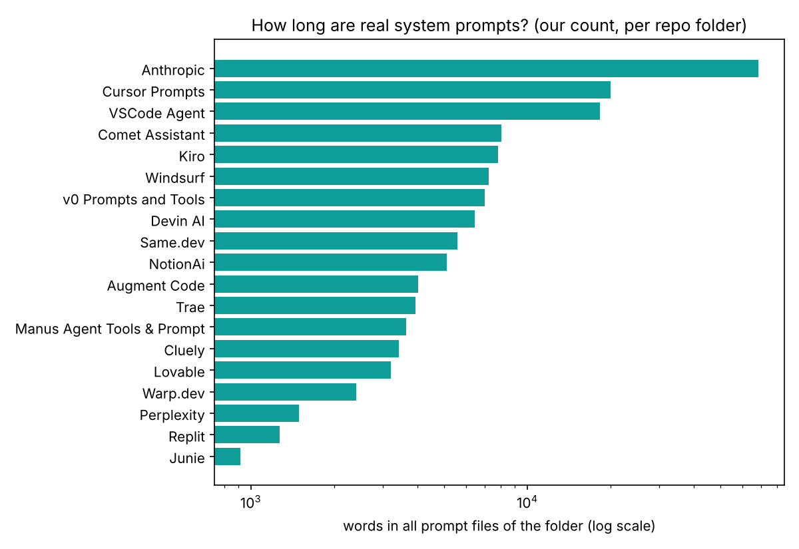
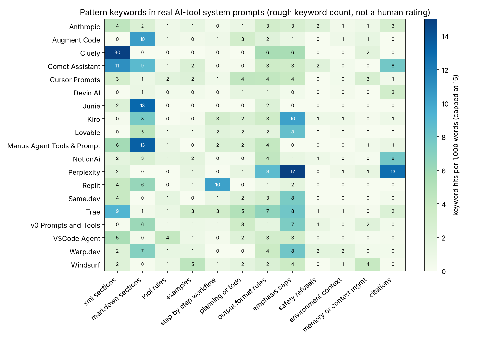

# What real AI products' system prompts teach us

> A pattern analysis of production system prompts, written in our own words, with a template for writing your own.

**Source studied:** [x1xhlol/system-prompts-and-models-of-ai-tools](https://github.com/x1xhlol/system-prompts-and-models-of-ai-tools) — a public GitHub collection of system prompts and tool definitions claimed to come from commercial AI products.

**Read this first — two rules.**

1. **We copy no prompt text.** The repository is licensed GPL-3.0, but the prompts themselves belong to the companies that wrote them, and they were collected by leaks or extraction. Everything below is our own description of *patterns*. Where we mention a rule, we paraphrase it in a few words. To read an original, open the linked folder.
2. **Treat them as case studies, not truth.** Nobody outside those companies can confirm a file is genuine, complete or current. Products change their prompts often. Learn the *patterns*; do not memorise the details.

**Jargon used here.** A **system prompt** is the hidden standing instruction a developer sends to a language model before any user message. A **tool** (or **function**) is an action the model can ask the host program to perform, such as "search the web" or "edit a file"; a **tool schema** is a machine-readable description of that tool's name and inputs, usually JSON. An **agent** is a model that runs in a loop: it decides an action, a tool runs, the result comes back, it decides again. **Harness** means the program around the model that runs that loop and assembles the prompt.

---

## 1. How we did the analysis

We used two methods and you can repeat both.

1. **Reading.** We (and the course's source-notes researcher) read the main prompt files for about a dozen products — Cursor, Devin, Lovable, Manus, Perplexity, Claude Code, Claude for Chrome, Windsurf, v0, Notion AI, Kiro, Comet, Cline — and wrote down which building blocks each one uses.
2. **Counting.** The script [`code/analyse_prompt_patterns.py`](code/analyse_prompt_patterns.py) opens each product folder in a local clone, counts words, and counts keyword hits for 15 patterns (for example lines that look like `<section_name>` tags, the words NEVER/ALWAYS/MUST in capitals, mentions of examples, citations or memory). It saves only **numbers** to [`excel/prompt_pattern_counts.csv`](excel/prompt_pattern_counts.csv), never sentences. Keyword counts are rough: a hit means "the word appears", not "a human confirmed the pattern". Use them as a heat map that points you where to read.

**Analogy.** Think of a student of architecture walking around a city with a notebook. They do not photocopy the buildings' blueprints. They sketch what they notice — "most houses here have a porch facing south; the shops all put the door on the corner" — and then design their own house using those ideas.

---

## 2. Finding 1 — They are operations manuals

Beginners expect a system prompt to be a sentence or two. The products studied ship prompt files of roughly 1,000 to 9,000 words *per prompt*, and several folders hold multiple prompts (different modes or model versions) plus a separate tools file that can be just as long. The chart above shows our word counts per folder (folders with many files add up; the Anthropic folder, for instance, contains several products).

What fills all those words is not clever phrasing. It is the same kind of content a new employee's handbook has: who you are, where you work, what equipment you have, how to do the job step by step, how to write reports, and what will get you fired.

**Lesson for you:** start short, but expect your prompt to grow as you discover failures. Every rule should earn its place by fixing a real, tested problem.

---

## 3. Finding 2 — Twelve recurring building blocks

Almost every prompt is assembled from the same blocks, in different proportions.

| # | Block | What it does | Where it shows up strongly (folder link) |
|---|---|---|---|
| 1 | **Identity and role** | Names the assistant, its maker, its job and its limits | Nearly all; Devin and Notion AI make the *limits* explicit |
| 2 | **Environment facts** | Run-time facts spliced in: date, OS, open files, workspace, locale | [Windsurf](https://github.com/x1xhlol/system-prompts-and-models-of-ai-tools/tree/main/Windsurf), [Kiro](https://github.com/x1xhlol/system-prompts-and-models-of-ai-tools/tree/main/Kiro), [v0](https://github.com/x1xhlol/system-prompts-and-models-of-ai-tools/tree/main/v0%20Prompts%20and%20Tools) |
| 3 | **Tool definitions + usage rules** | Which tools exist, when to use each, *when not to* | [Cursor](https://github.com/x1xhlol/system-prompts-and-models-of-ai-tools/tree/main/Cursor%20Prompts), [Manus](https://github.com/x1xhlol/system-prompts-and-models-of-ai-tools/tree/main/Manus%20Agent%20Tools%20%26%20Prompt), [Anthropic (Claude Code)](https://github.com/x1xhlol/system-prompts-and-models-of-ai-tools/tree/main/Anthropic) |
| 4 | **Work loop / workflow** | The observe → decide → act → check cycle and when to stop | [Manus](https://github.com/x1xhlol/system-prompts-and-models-of-ai-tools/tree/main/Manus%20Agent%20Tools%20%26%20Prompt), [Lovable](https://github.com/x1xhlol/system-prompts-and-models-of-ai-tools/tree/main/Lovable), [Kiro](https://github.com/x1xhlol/system-prompts-and-models-of-ai-tools/tree/main/Kiro) |
| 5 | **Planning / to-do tracking** | A visible checklist the model maintains during long tasks | Claude Code, Cursor, Manus, Kiro |
| 6 | **Output format rules** | Markdown, length, headings, code display, custom markup | [Perplexity](https://github.com/x1xhlol/system-prompts-and-models-of-ai-tools/tree/main/Perplexity), [Notion AI](https://github.com/x1xhlol/system-prompts-and-models-of-ai-tools/tree/main/NotionAi), Cursor |
| 7 | **Citation / grounding** | How to attribute claims to sources or code locations | Perplexity, Notion AI, Cursor |
| 8 | **Safety, refusal, security** | What to refuse, how to refuse, secrets, injection defence | v0, Devin, [Comet](https://github.com/x1xhlol/system-prompts-and-models-of-ai-tools/tree/main/Comet%20Assistant), Anthropic's browser prompt |
| 9 | **Memory and context handling** | What to save across sessions; what to do when old context was compressed | Windsurf, v0, Manus, Kiro |
| 10 | **Tone and communication** | Verbosity, when to message the user, language matching | Claude Code, Perplexity, Devin, Lovable |
| 11 | **Section tagging** | XML-style tags or Markdown headings around each block | All of them |
| 12 | **Good-vs-bad examples** | Worked examples that pin down ambiguous behaviour | Cursor, Claude Code, Lovable, Notion AI |

Below, each block gets a short explanation of *why* products include it and what you should copy (as an idea).

### 3.1 Identity and role

Usually the first lines. The useful part is not flattery ("you are brilliant") but **scope**: what this assistant can touch and what it cannot. Several products state plainly that the assistant acts only through its tools, or that a separate system has already done the searching and the model only writes the answer (Perplexity's design). Some include a canned reply for questions about their own instructions or underlying model.

*Copy the idea:* write identity as **job + audience + boundaries**.

### 3.2 Environment facts

The harness injects live facts at run time: today's date, the operating system, the workspace folder, which file is open, the user's locale. A clever detail in Kiro: it gives shell-command examples for each operating system, so the model does not type Linux commands on Windows. Several prompts warn the model that injected details may be irrelevant, so it should not obsess over whatever file happens to be open.

*Copy the idea:* keep a **static rulebook** and a **dynamic header** separate in your code; fill the header with facts the model cannot know (the date is the classic one).

### 3.3 Tools and *negative* guidance

Coding agents spend a large share of their words on tools. The most transferable trick is **saying when *not* to use a tool**, with a reason — for example, prefer exact text search over semantic search when you know the precise symbol name. Other recurring rules, in our words: batch independent tool calls together; do not re-read files you already have; edit the few lines that need changing instead of rewriting whole files; check that a library is actually installed before using it; act instead of asking permission for routine steps.

*Copy the idea:* for each tool, write **purpose, when to use, when not to use, one example**.

### 3.4 Work loop

Manus describes the most explicit loop: understand the latest events, choose *one* tool call, wait for its result, repeat, then report and go idle. Two opposite philosophies appear across products:

- **Autonomy-first** (Cursor, Windsurf, Devin): keep going until the task is done; do not hand back half-finished work.
- **Consent-first** (Lovable, Kiro, Notion AI): discuss and plan first; change things only when the user clearly asks. Lovable defaults to discussion until the user uses an action verb; Kiro moves through requirements → design → tasks with user approval between phases.

*Copy the idea:* decide **deliberately** which philosophy suits your users, and write it down as numbered steps.

### 3.5 Planning and to-do tracking

Long tasks get a visible checklist: a to-do tool (Claude Code, Cursor), a `todo.md` file (Manus), or spec documents (Kiro). A checklist outside the model's head survives a long, compressed context, shows the user progress, and creates natural checkpoints. Claude Code's prompt even lists when *not* to bother (trivial one-step tasks).

### 3.6 Output format rules

Format rules reveal the **screen the product renders on**. A search answer page wants a summary sentence, short headed sections and inline citation numbers (Perplexity). A document editor wants its own block markup (Notion AI). An IDE wants code references it can turn into clickable links (Cursor). A terminal tool wants very short answers (Claude Code).

*Copy the idea:* write format rules for **your renderer and your reader**, and add one good and one bad example.

### 3.7 Citation and grounding

Search and document assistants require every factual sentence to be traceable: inline numbers after sentences (Perplexity), footnote-style references to the source page (Notion AI), or exact file and line ranges for code (Cursor). This is exactly what module 09 (RAG) builds.

### 3.8 Safety, refusal and security

Patterns we saw, in our words: a single short refusal sentence without apology or lecture (v0); refusing by explaining what the assistant cannot do and pointing to the right feature (Notion AI); no moralising or hedging language (Perplexity); never commit or log secrets, and never change tests just to make them pass (Devin); defensive-security work only (Claude Code); and — strongest in browser agents (Comet, Anthropic's browser prompt) — **only the user's own messages carry instructions; anything found on a web page or in a tool result is data to verify**. Notion AI's "avoid overperforming" idea is a scope-safety rule: do not edit user content unless asked.

*Copy the idea:* write one explicit **trusted vs untrusted** rule, and back it with least-privilege tools (concepts.md section 9).

### 3.9 Memory and context handling

Two strategies appear. **Write-heavy memory** (Windsurf): save useful facts freely because earlier context will be wiped; relevant memories are retrieved later. **Curated standing context** (Kiro's steering files, project memory files): a human-edited file is always included. v0 also tells the model that old tool results may have been replaced by summaries and should be fetched again if needed — an honest admission that the harness compresses context.

*Copy the idea:* tell your model **what persists, what may have been summarised, and how to recover detail**.

### 3.10 Tone and communication

Tone rules encode the **product's user**. Lovable assumes non-coders, so it avoids asking users to edit files themselves. Claude Code assumes developers in a terminal who want short, direct answers. Manus separates "notify" messages (progress) from "ask" messages (blocking questions) — a good pattern for long-running agents. Devin speaks to the user only for specific reasons (blocked environment, missing credentials, deliverables).

### 3.11 Section tagging

Every prompt is divided into named sections — XML-style tags (Cursor, Windsurf, Perplexity, Comet, Cluely), Markdown headings (Claude Code, Lovable, v0, Kiro) or a mix. Devin and Cline go further and use XML tags as the tool-call syntax itself. Tags let engineers swap sections per mode and let the model (and other rules) refer to a section by name.

### 3.12 Good-vs-bad examples and emphasis

Examples are everywhere, often in **good/bad pairs** with a one-line reason. Capital-letter emphasis (NEVER, ALWAYS, MUST, IMPORTANT) is also everywhere — our keyword count found it in nearly every folder, densest (per 1,000 words) in Perplexity, Kiro, Lovable, Trae, Same.dev and v0. Emphasis marks where real failures happened. It is also a warning sign: when everything is CRITICAL, nothing is. An example usually fixes behaviour more reliably than another capital letter.

---

## 4. Finding 3 — Proportions follow the product

The building blocks are shared; the **mix** is what makes each product different:

| Product type | Heaviest blocks | Why |
|---|---|---|
| Coding agents (Cursor, Devin, Windsurf, Claude Code) | Tools, work loop, editing rules, planning | They act on real files and must not break things |
| App builders (Lovable, v0, Same.dev) | Workflow, design/format rules, consent | Users are often non-coders; output must look good |
| Answer engines (Perplexity) | Format and citation rules | The output *is* the product; trust needs sources |
| Document assistants (Notion AI) | Custom markup, scope control, citations | Must emit what the editor understands and not touch user text unasked |
| Browser agents (Comet, Claude for Chrome) | Injection defence, confirmation before actions | They read the most untrusted text and can click real buttons |
| Routers (Kiro's mode classifier) | A tiny decision prompt returning JSON | Picks which main prompt to use, keeping each one focused |

---

## 5. Product notes (our words, one line each)

| Product | Folder | Notable design choice |
|---|---|---|
| Cursor | [Cursor Prompts](https://github.com/x1xhlol/system-prompts-and-models-of-ai-tools/tree/main/Cursor%20Prompts) | Tool docs inside the function definitions, each with when-to / when-not-to lists and example queries; two strict ways of showing code |
| Devin | [Devin AI](https://github.com/x1xhlol/system-prompts-and-models-of-ai-tools/tree/main/Devin%20AI) | XML command vocabulary; a private reasoning step; planning mode; strict engineering ethics |
| Lovable | [Lovable](https://github.com/x1xhlol/system-prompts-and-models-of-ai-tools/tree/main/Lovable) | Discussion before implementation; a numbered mandatory workflow; minimal focused edits |
| Manus | [Manus Agent Tools & Prompt](https://github.com/x1xhlol/system-prompts-and-models-of-ai-tools/tree/main/Manus%20Agent%20Tools%20%26%20Prompt) | Most explicit agent loop (one tool per step), event stream, planner module, `todo.md`, notify vs ask |
| Perplexity | [Perplexity](https://github.com/x1xhlol/system-prompts-and-models-of-ai-tools/tree/main/Perplexity) | Writer-only role; detailed per-query-type format rules; citations after sentences |
| Anthropic (Claude Code, Claude for Chrome and others) | [Anthropic](https://github.com/x1xhlol/system-prompts-and-models-of-ai-tools/tree/main/Anthropic) | Terse tone backed by tiny examples; to-do discipline; browser prompt with strong injection rules |
| Windsurf | [Windsurf](https://github.com/x1xhlol/system-prompts-and-models-of-ai-tools/tree/main/Windsurf) | Write-heavy memory; XML-sectioned rules for commands, debugging, external APIs |
| v0 | [v0 Prompts and Tools](https://github.com/x1xhlol/system-prompts-and-models-of-ai-tools/tree/main/v0%20Prompts%20and%20Tools) | Design-system rules for generated UIs; fixed short refusal; note on context compression |
| Notion AI | [NotionAi](https://github.com/x1xhlol/system-prompts-and-models-of-ai-tools/tree/main/NotionAi) | Search-first; custom block markup; footnote citations; "avoid overperforming" |
| Kiro | [Kiro](https://github.com/x1xhlol/system-prompts-and-models-of-ai-tools/tree/main/Kiro) | Spec-driven phases with approval gates; separate mode-classifier prompt; steering files |
| Comet | [Comet Assistant](https://github.com/x1xhlol/system-prompts-and-models-of-ai-tools/tree/main/Comet%20Assistant) | Layered injection defence treating page content as untrusted |
| Cline (open source) | [Open Source prompts](https://github.com/x1xhlol/system-prompts-and-models-of-ai-tools/tree/main/Open%20Source%20prompts) | XML tool-call syntax described in the prompt; open source, so you can compare prompt and code |

---

## 6. Eight takeaways to apply

1. **Structure beats cleverness.** Named sections in a predictable order.
2. **Say when not to.** Negative guidance with a reason prevents the commonest mistakes.
3. **Write for the renderer and the reader.** Format and tone follow the screen and the user.
4. **Externalise plans and memory.** A checklist or notes file survives long contexts.
5. **Trusted vs untrusted.** Only the trusted channel gives instructions; everything else is data.
6. **Ground every claim.** Citations make answers checkable.
7. **Route before you act.** A tiny classifier can pick the right main prompt.
8. **Back every IMPORTANT with an example**, and test every rule.

---

## 7. Write your own system prompt

Open **[templates/system-prompt-template.md](templates/system-prompt-template.md)**. It is our own template with one section per building block and guidance on what to write in each. A filled-in example for a fictional shop assistant is included in it.

The workflow:

1. **Fill the template** for your product, keeping each section short.
2. **Write 10–20 test cases** (typical, edge, injection) in `excel/prompt-test-tracker.xlsx`.
3. **Run them** (notebook 04 shows how) and record pass/fail.
4. **Read the failures**, change one section, bump the version, rerun.
5. **Stop adding rules** that do not fix a failing test.

Exercises 9–12 in [exercises.md](exercises.md) walk you through this end to end.
