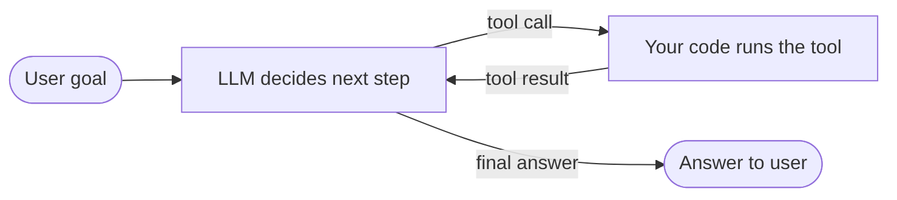
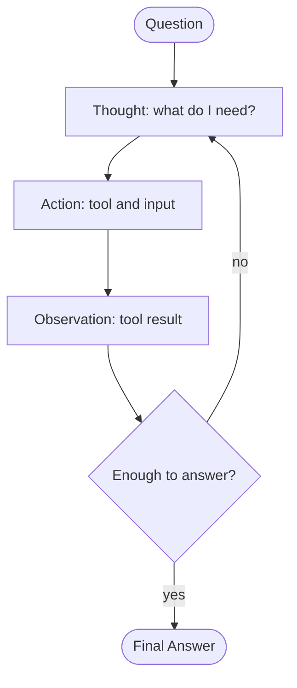
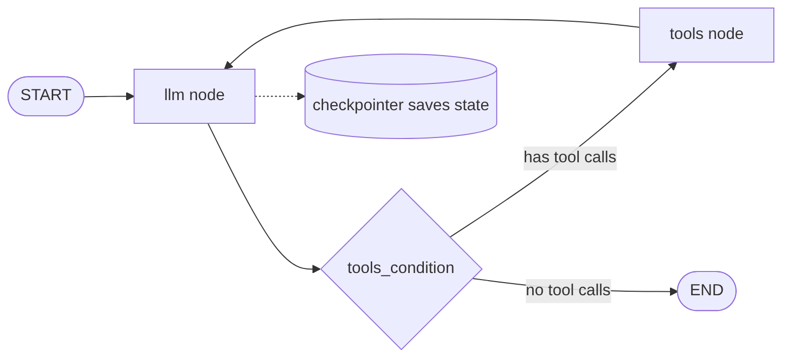
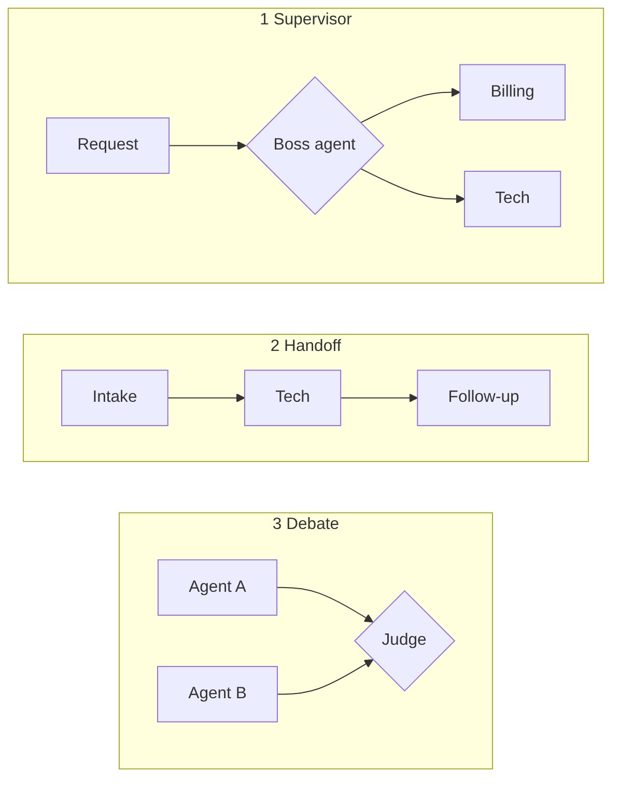
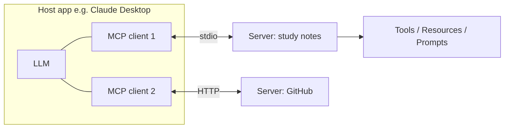
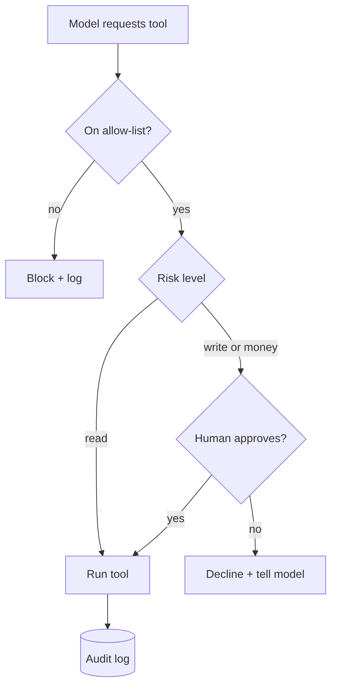

<!-- nav:start -->
> [🏠 Course home](../README.md) · [🗺️ Roadmap](../ROADMAP.md) · [⬅️ 09 RAG (Retrieval-Augmented Generation)](../09-rag/README.md) · [11 AI Automation ➡️](../11-ai-automation/README.md)  
> **🦾 Module 10 · Agentic AI** · [📋 Module overview](README.md)  
> [📖 Lesson](concepts.md) · [📄 PDF handout](pdf/10-agentic-ai-handout.pdf) · [🎞️ Slides](slides/10-agentic-ai.pptx) · [📓 Notebooks](notebooks/) · [✍️ Exercises](exercises.md) · [✅ Solutions](solutions/) · [🧑‍🏫 Trainer notes](trainer-notes.md) · [🔗 Resources](resources.md)
<!-- nav:end -->

# Module 10 — Agentic AI: concepts

> Read this from top to bottom once before you teach. Every new word is **bolded** and explained the first time it appears. The notebooks then let you *see* each idea running.

---

## 1. What is an agent?

Until now in the course, a **large language model (LLM)** — a program trained to predict the next piece of text — has worked like a very clever answering machine. You send a message, it sends one reply, and that is the end.

An **agent** is an LLM that is allowed to *do things*, not only talk, and that keeps going until a goal is reached. The simplest useful definition is:

> **agent = LLM + tools + a loop**

- **LLM** — the "brain" that reads the situation and decides what to do next.
- **Tools** — normal functions in your code (search the web, read a file, run a calculation, send an email) that the LLM may ask you to run.
- **Loop** — your program repeats "ask the LLM → run the tool it asked for → show it the result" until the LLM says it is finished.

**Analogy: a new intern with a phone.** A plain chatbot is like an expert you can only send one letter to. An agent is like an intern sitting at a desk with a phone, a calculator and a filing cabinet. You give the intern a goal ("find out which supplier is cheapest and draft an email"). The intern thinks, makes a call, writes down what they heard, thinks again, opens a file, and keeps going until the job is done. The intern never leaves the desk: they only *ask* the receptionist (your code) to make calls. That matters for safety, as we will see.



### What makes something "agentic"?

People use the word loosely. A helpful way to think about it is a sliding scale of how much the LLM controls:

| Level | Who decides the steps? | Example |
|---|---|---|
| Plain LLM call | You | "Summarise this text." |
| Chain / workflow | You, in fixed order | Summarise → translate → email. Always the same steps. |
| Router | LLM picks one branch | "Is this a billing or a tech question?" |
| Agent | LLM picks the next step, again and again | "Fix this bug" — it reads files, runs tests, edits code, until tests pass. |

A **workflow** (fixed steps that you designed) is predictable and cheap. An **agent** (steps chosen by the model at run time) is flexible but less predictable and more expensive. A good engineer uses the least agentic design that solves the problem. Module 11 returns to this idea.

### Words you will hear

- **Prompt** — the text you send to the model.
- **System prompt** — a special first message that sets the model's role and rules ("You are a support agent. Never promise refunds.").
- **Token** — a chunk of text (roughly ¾ of a word) that models read and are billed by.
- **Context window** — the maximum amount of text (in tokens) the model can see at once. Everything the agent "remembers" during a task must fit here.
- **Step / turn / iteration** — one trip around the loop.

---

## 2. Tool use (function calling)

### The key idea: the model never runs your code

**Tool use**, also called **function calling**, is how the model asks you to run a function. The model does not run anything. It writes a small, structured message that says, in effect: *"please call `get_weather` with `city = "Taipei"`."* Your program reads that message, runs the real Python function, and sends the result back as a new message. Then the model continues.

**Analogy: ordering at a restaurant.** The menu lists dishes and what you can customise ("burger — choose: medium or well-done"). You (the model) do not walk into the kitchen. You fill in the order slip. The kitchen (your code) cooks it and brings it back. The menu is the **tool definition**; the order slip is the **tool call**; the plate is the **tool result**.

### Describing a tool with JSON Schema

To put a tool on the "menu", you describe it with three things:

1. a **name** (`get_weather`),
2. a **description** in plain English (the model reads this to decide *when* to use the tool — write it carefully!),
3. a **JSON Schema** for its inputs.

**JSON** is a text format for data that looks like Python dictionaries and lists: `{"city": "Taipei"}`. **JSON Schema** is a standard way to describe what shape some JSON must have: which fields exist, their types, which are required, and which values are allowed.

```json
{
  "type": "object",
  "properties": {
    "city": {"type": "string", "description": "City name, e.g. Taipei"},
    "unit": {"type": "string", "enum": ["celsius", "fahrenheit"]}
  },
  "required": ["city"]
}
```

Read it aloud: "the input is an object; it has a `city` that is text and a `unit` that must be either celsius or fahrenheit; `city` is required."

### OpenAI vs Anthropic formats, side by side

Both companies accept the same JSON Schema. They only wrap it differently.

| | OpenAI (Chat Completions) | Anthropic (Messages API) |
|---|---|---|
| Tool definition | `{"type": "function", "function": {"name", "description", "parameters": SCHEMA}}` | `{"name", "description", "input_schema": SCHEMA}` |
| How the model asks | `message.tool_calls[i]` with `function.name` and `function.arguments` | a content block `{"type": "tool_use", "id", "name", "input"}` and `stop_reason == "tool_use"` |
| Arguments arrive as | a JSON **string** → you must `json.loads()` it | a Python **dict** already |
| How you send the result | a message with `role: "tool"` and `tool_call_id` | a **user** message containing `{"type": "tool_result", "tool_use_id", "content"}` |

OpenAI's newer **Responses API** flattens the definition slightly (`{"type": "function", "name": ..., "parameters": ...}`). The full working code for both, guarded so it only calls the real APIs when a key exists, is in [`code/tool_formats.py`](code/tool_formats.py) and in notebook 01.

> Model names and exact API details change every few months. As of late 2026, always check the official pages: [OpenAI function calling](https://platform.openai.com/docs/guides/function-calling) and [Anthropic tool use](https://platform.claude.com/docs/en/agents-and-tools/tool-use/overview).

### Writing good tools

- **One job per tool.** `search_orders` and `refund_order` beats one giant `manage_orders`.
- **Descriptions are prompts.** Say when to use it and when *not* to.
- **Return useful errors.** "Error: city not found, try the English name" lets the model recover; a Python crash does not.
- **Keep outputs short.** Every tool result goes into the context window and costs tokens.
- **Validate inputs.** The model can send wrong or even malicious arguments. Check them before acting.

---

## 3. The ReAct loop

**ReAct** stands for **Re**ason + **Act**. It is a pattern (from a 2022 research paper) where the model writes its reasoning *between* actions. Each round has three parts:

- **Thought** — "I need the height of Taipei 101 first."
- **Action** — `search_notes[taipei 101 height]`
- **Observation** — written by *your code*: "Taipei 101 is 508 metres tall."

The loop repeats until the model writes **Final Answer**.



**Analogy: a detective's notebook.** A detective writes "I suspect the butler. Next I'll check the kitchen." They check, write down what they found, and reason again. Writing the thinking down keeps them on track and lets someone else follow how they reached the conclusion.

### The loop in plain Python

The whole thing is short. This is the heart of [`code/react_agent.py`](code/react_agent.py):

```python
for step in range(max_steps):          # safety limit
    reply = llm(transcript)            # 1. ask for next step
    transcript += reply
    if "Final Answer:" in reply:       # 2. done?
        return answer
    name, arg = parse_action(reply)    # 3. which tool?
    observation = TOOLS[name](arg)     # 4. run it
    transcript += f"Observation: {observation}"   # 5. feed back
```

In notebook 02 the LLM is a **scripted fake LLM** — an object that returns pre-written replies one at a time. This is a teaching trick: it runs with no internet and no API key, and the output is the same every time, so students can watch every step. The loop code is real; replacing the fake with a real model changes one line.

### Text ReAct vs native tool calling

The original ReAct used plain text ("Action: tool[input]") that your code parses with **regular expressions** (patterns for finding text). Modern models have **native tool calling** (section 2): the model returns structured tool calls, so there is nothing to parse and fewer mistakes. The *loop* is identical. Learn the text version to understand the idea; use native tool calling in real projects.

### What goes wrong in loops

- **Infinite loops** — the model keeps calling the same tool. Fix: `max_steps`, and detect repeated identical calls.
- **Hallucinated tools** — the model asks for a tool that does not exist. Fix: return a clear error listing the real tools.
- **Bad arguments** — fix: validate, and return a helpful error message.
- **Context overflow** — long tasks fill the window. Fix: summarise old steps or trim tool outputs.

---

## 4. LangGraph: agents as graphs

Writing the loop by hand is great for learning. In real projects you also want: saving progress, pausing for a human, retrying, branching, streaming each step to a UI. **LangGraph** is a Python library (from the LangChain team) that gives you these by describing your agent as a **graph**.

A **graph** here means boxes connected by arrows — like a flowchart.

| LangGraph word | Plain meaning | Analogy (a board game) |
|---|---|---|
| **State** | A dictionary that carries all the data (e.g. the list of messages) | The game board |
| **Node** | A Python function: receives state, returns an *update* | A square where something happens |
| **Edge** | A fixed arrow: after node A, always go to B | A straight path |
| **Conditional edge** | An arrow whose destination is chosen by a function at run time | A fork where you roll a die |
| `START` / `END` | Special entry and exit points | Start square, finish square |
| **Reducer** | A rule for merging a node's update into the state (e.g. *append* to a list instead of replacing it) | "Add your points to the score" |
| **Compile** | Turn the description into a runnable app | Setting up the board before playing |
| **Checkpointer** | Saves the state after every step | Saving your game |
| **Thread** | One saved conversation, named by a `thread_id` | One save slot |



### The minimal pattern (checked on langgraph 1.2)

```python
from langgraph.graph import StateGraph, START, END, MessagesState
from langgraph.prebuilt import ToolNode, tools_condition
from langgraph.checkpoint.memory import InMemorySaver

graph = StateGraph(MessagesState)              # state = {"messages": [...]}
graph.add_node("llm", call_model)              # the brain
graph.add_node("tools", ToolNode(tools))       # runs requested tool calls
graph.add_edge(START, "llm")
graph.add_conditional_edges("llm", tools_condition)  # tool calls? -> "tools" else END
graph.add_edge("tools", "llm")                 # loop back
app = graph.compile(checkpointer=InMemorySaver())
app.invoke({"messages": [("user", "Weather in Taipei?")]},
           {"configurable": {"thread_id": "chat-1"}})
```

Notice this is the *same loop* as section 3, drawn as a graph. `MessagesState` already has a reducer that appends new messages instead of overwriting them. `ToolNode` and `tools_condition` are ready-made helpers.

### Memory with a checkpointer

When you compile with a **checkpointer**, LangGraph saves the state after each node. If you call `invoke` again with the same `thread_id`, the old messages are still there: the agent "remembers" the conversation. `InMemorySaver` keeps saves in RAM (lost when the program stops). For real apps, use a database-backed saver such as the SQLite or Postgres checkpointers (separate `langgraph-checkpoint-*` packages). You can inspect the saved state with `app.get_state(config)`.

### Human-in-the-loop in LangGraph

Inside a node you can call `interrupt({...})`. The graph **pauses**, saves its state, and returns. Later, a human answers, and you resume with `app.invoke(Command(resume="yes"), config)`. The node continues as if `interrupt` had returned `"yes"`. Notebook 03 shows this running. It needs a checkpointer, because the paused state must be saved somewhere.

### Streaming

`app.stream(inputs, config, stream_mode="updates")` yields one update per node as it runs. This is how chat UIs show "Searching… Reading… Answering…".

---

## 5. CrewAI: roles, tasks and crews

**CrewAI** is another popular framework. Where LangGraph thinks in *graphs*, CrewAI thinks in *teams of people*.

- **Agent** — a worker with a **role** ("Research Analyst"), a **goal** and a **backstory**. These three are turned into the agent's system prompt.
- **Task** — a piece of work: a description, the **expected output**, and the agent responsible.
- **Crew** — the team: agents + tasks + a **process**.
- **Process** — `sequential` (tasks run in order, each seeing earlier outputs) or `hierarchical` (a manager agent assigns work).
- **kickoff** — starts the crew; `inputs` fill `{placeholders}` in descriptions.

**Analogy: a film crew.** The director (process) has a writer, a camera operator and an editor (agents). Each has a job description (role/goal/backstory) and a list of shots to deliver (tasks). The editor's work starts with what the camera operator delivered (task context).

CrewAI is **not installed** in our shared course machine because it is a large framework with many dependencies. [`code/crewai_example.py`](code/crewai_example.py) shows real CrewAI code with every line explained; run it in its own virtual environment. Notebook 04 rebuilds the same role/task/crew idea in about 40 lines of plain Python, which is the best way to see that there is no magic: each agent is a system prompt plus an LLM call, and a crew is a loop over tasks that passes outputs forward.

### Which framework?

| You want… | Reach for |
|---|---|
| To understand agents | Plain Python loop (notebook 02) |
| Fine control, branching, pausing, saving | LangGraph |
| A fast prototype of a "team" of role-based agents | CrewAI |
| To stay close to one provider | The provider's own agent SDK (e.g. OpenAI Agents SDK, Claude Agent SDK) |

The Excel file `excel/agent-framework-comparison.xlsx` compares more options. Frameworks change fast — check each project's docs before choosing.

---

## 6. Multi-agent patterns

Sometimes one agent with twenty tools gets confused. Splitting the work between several **specialist agents** — each with a short system prompt and only the tools it needs — can make each one more reliable. It also costs more and adds coordination problems, so only do it when one agent clearly struggles.



1. **Supervisor (orchestrator–worker).** One "boss" agent reads the request and routes it to a worker (billing, tech, general), then may combine results. *Analogy: a hospital receptionist who sends you to the right doctor.*
2. **Handoff.** Agent A does its part, then passes control *and the context* to agent B. *Analogy: a relay race baton.* Watch out for ping-pong (A → B → A → B…): set a maximum number of hops.
3. **Debate / critic.** Two agents propose answers or one writes and another critiques; a **judge** picks or merges. *Analogy: a moot court.* Good for quality; expensive (many LLM calls).

Other names you may meet: **planner–executor** (one agent writes a plan, another carries out the steps), **reflection** (an agent checks its own work), **swarm** (agents hand off freely). All are built from the same parts: prompts, tools, a loop, and shared state. See [`code/multi_agent_patterns.py`](code/multi_agent_patterns.py).

---

## 7. Memory

An LLM does not remember anything between calls. Everything it "knows" about this conversation must be sent again in the prompt. "Memory" in agents means *what we choose to put back into the prompt*.

| Type | What it is | Analogy | How it's built |
|---|---|---|---|
| **Short-term memory** | The recent conversation and tool results in this task | A sticky note with the last few lines | A list of messages, trimmed to the last N, or summarised |
| **Long-term memory** | Facts kept across days and sessions ("user prefers Telugu") | A filing cabinet with an index | A **vector store**: facts turned into embeddings, found by similarity |
| **Working state** | Structured data for the current task (plan, to-do list) | A whiteboard | Fields in the LangGraph state |

An **embedding** is a list of numbers that captures the meaning of a text, so similar meanings give nearby lists (module 06). A **vector store** keeps many embeddings and quickly finds the ones closest to a query (module 09). Long-term memory is really RAG over the agent's own notes.

Practical rules:
- Decide *what* is worth remembering (stable facts and preferences, not every message).
- Let users see and delete what is remembered (privacy).
- Trim or summarise short-term memory before the context window fills.

See [`code/agent_memory.py`](code/agent_memory.py) and notebook 04.

---

## 8. The Model Context Protocol (MCP)

### The problem MCP solves

Imagine 10 AI apps (Claude Desktop, VS Code, Cursor, your own chatbot…) and 10 tools (GitHub, Google Drive, a database, Slack…). Without a standard, someone must write 10 × 10 = 100 custom connectors. **MCP**, the **Model Context Protocol**, is an open standard (introduced by Anthropic in late 2024, now used across the industry) that defines *one* way for AI apps to talk to tool providers. Now each app implements MCP once and each tool implements MCP once: 10 + 10 connectors.

**Analogy: USB-C.** Before USB, every device had its own plug. With one standard socket, any device works with any computer. MCP is a USB-C port for AI apps.

A **protocol** is an agreed set of rules for how two programs exchange messages. MCP messages use **JSON-RPC** — a simple format where each message is JSON saying "call method X with these parameters" and the reply carries the result.

### The parts



- **Host** — the AI application the user sees (Claude Desktop, VS Code with an AI extension, Claude Code, Cursor).
- **Client** — a connector inside the host. Each client keeps one connection to one server.
- **Server** — a small program that offers capabilities. It could wrap GitHub, your files, a database, or our study notes.
- **Transport** — how messages travel. **stdio** (standard input/output): the host starts the server as a child process on your computer and they talk through its input and output streams — simple and local. **Streamable HTTP**: the server runs as a web service, possibly remote.

A server offers three kinds of things:

| Primitive | Who controls it | Example | Analogy |
|---|---|---|---|
| **Tools** | The **model** decides to call them | `search_notes(keyword)`, `create_issue(...)` | Buttons the assistant may press |
| **Resources** | The **app** attaches them as read-only context | `notes://index`, a file, a DB schema | Documents handed to the assistant |
| **Prompts** | The **user** picks them (often as a slash-command) | `quiz_me(topic)` | Recipe cards |

MCP also defines extra features (sampling, elicitation, roots, notifications) you can learn later; tools, resources and prompts are the core.

### A minimal server in Python

The official Python SDK is the `mcp` package. In version 2.x the high-level class is `MCPServer` (in 1.x it was called `FastMCP`). Decorators turn ordinary functions into MCP capabilities, reading type hints and docstrings to build JSON Schemas automatically:

```python
from mcp.server.mcpserver import MCPServer   # mcp 1.x: from mcp.server.fastmcp import FastMCP
mcp = MCPServer("study-helper")

@mcp.tool()
def add(a: float, b: float) -> float:
    """Add two numbers and return the sum."""
    return a + b

@mcp.resource("notes://{topic}")
def note_by_topic(topic: str) -> str:
    return NOTES.get(topic, "No such note")

@mcp.prompt()
def quiz_me(topic: str) -> str:
    return f"Ask me 3 quiz questions about {topic}."

if __name__ == "__main__":
    mcp.run()        # stdio transport by default
```

The full version is [`code/mcp_server.py`](code/mcp_server.py); [`code/mcp_client.py`](code/mcp_client.py) starts it and calls its tools exactly like a host would. Notebook 04 connects to it in-memory.

> **Golden rule for stdio servers:** never `print()` to standard output — that channel carries the protocol messages. Log to standard error (`print(..., file=sys.stderr)`).

### Connecting to Claude Desktop

1. Install Claude Desktop and Python, then `pip install mcp` (use the full path to that Python below).
2. Open Claude Desktop → **Settings → Developer → Edit Config**. This opens `claude_desktop_config.json` (macOS: `~/Library/Application Support/Claude/`, Windows: `%APPDATA%\Claude\`, Linux: `~/.config/Claude/`). Use **absolute** (full) paths in it, not relative ones.
3. Add your server:

```json
{
  "mcpServers": {
    "study-helper": {
      "command": "/full/path/to/python",
      "args": ["/full/path/to/10-agentic-ai/code/mcp_server.py"]
    }
  }
}
```

4. Fully quit and restart Claude Desktop. The server appears under the connectors menu in the chat box; Claude asks your permission before using its tools. If it does not appear, read the logs (`mcp*.log`, in `~/Library/Logs/Claude` on macOS or `%APPDATA%\Claude\logs` on Windows) — your server's error messages (stderr) are saved there.

### Connecting to VS Code

VS Code (with GitHub Copilot's agent mode) has changed its MCP setup more than once. As of late 2026 there are two formats you may meet:

- **Newer:** a file `.mcp.json` at the root of your project, using the same `mcpServers` shape as Claude Desktop above.
- **Older (still common in tutorials):** `.vscode/mcp.json` with a top-level `servers` key and a `type`:

```json
{
  "servers": {
    "study-helper": {
      "type": "stdio",
      "command": "python",
      "args": ["${workspaceFolder}/10-agentic-ai/code/mcp_server.py"]
    }
  }
}
```

The easiest route is the Command Palette (Ctrl/Cmd+Shift+P) → **MCP: Add Server**, which walks you through it, then **MCP: List Servers** to start or stop it. Use agent mode in the chat to let the model call your tools. Claude Code uses one command: `claude mcp add study-helper -- python /path/to/mcp_server.py`. Because these menus and file names change between releases, check the current pages: [MCP docs](https://modelcontextprotocol.io), [Connect Claude Desktop to local servers](https://modelcontextprotocol.io/docs/develop/connect-local-servers) and [VS Code MCP configuration reference](https://code.visualstudio.com/docs/agents/reference/mcp-configuration).

**Debugging tip:** the **MCP Inspector** (`npx @modelcontextprotocol/inspector python mcp_server.py`) opens a web page where you can list and call your server's tools by hand.

### MCP security

An MCP server runs with *your* permissions. Only install servers you trust (read the code or use official ones). A malicious server, or a malicious document read through a server, can contain hidden instructions — this is **prompt injection** (text that tries to hijack the model's instructions; module 08). Keep write/delete tools behind approval, and give servers the minimum access they need.

---

## 9. Safety and human-in-the-loop

Agents *act*, so mistakes are no longer just wrong words — they can be sent emails, deleted files or spent money. Safety is designed in from the start.



**Analogy: a bank's two-signature rule.** A teller can look up your balance alone, but a large transfer needs a manager's signature. Agents get the same rule: reading is automatic, risky actions need a human.

The main guard rails:

1. **Least privilege** — give the agent only the tools and permissions the task needs. A research agent needs no "delete" tool.
2. **Allow-lists** — the code only runs tools on an approved list, whatever the model asks.
3. **Risk levels** — label each tool read / write / money / irreversible. Auto-run reads; require approval for the rest.
4. **Human-in-the-loop (HITL)** — the agent pauses and a person approves, edits or rejects the action (LangGraph `interrupt`, or an approval button in your UI).
5. **Budgets and limits** — maximum steps, maximum tool calls, maximum spend, timeouts.
6. **Input and output validation** — check tool arguments (types, ranges, file paths) before acting.
7. **Sandboxing** — run code-executing tools in an isolated container, not on your laptop.
8. **Prompt-injection awareness** — treat everything a tool returns (web pages, emails, files) as *data*, not instructions.
9. **Audit logs and tracing** — record every step so you can see what happened and why (module 14 covers tracing tools).
10. **Evaluation** — test agents on a fixed set of tasks before and after every change.

See [`code/hitl_guard.py`](code/hitl_guard.py) and the HITL section of notebook 03.

---

## 10. Putting it together

A realistic agent you might build at work:

1. A **LangGraph** graph with an `llm` node and a `tools` node.
2. Tools come from **MCP servers** (GitHub, your database), so the same tools also work in Claude Desktop and VS Code.
3. A **checkpointer** gives short-term memory per conversation; a **vector store** gives long-term memory of user preferences.
4. Risky tools trigger an `interrupt` for **human approval**; every step is **logged**.
5. When the task grows, a **supervisor** routes to specialist sub-graphs.

## Key terms (quick reference)

| Term | One-line meaning |
|---|---|
| Agent | LLM + tools + loop, working towards a goal |
| Tool / function calling | The model asks your code to run a function by writing a structured call |
| JSON Schema | A standard description of what a JSON object must look like |
| ReAct | Thought → Action → Observation, repeated |
| LangGraph | Library for building agents as state graphs with saving and pausing |
| Node / edge / conditional edge | Function / fixed arrow / arrow chosen at run time |
| Checkpointer / thread | Saves state after each step / one saved conversation |
| CrewAI | Framework of role-based agents, tasks and crews |
| Supervisor / handoff / debate | Routing boss / passing the baton / argue then judge |
| Short-term / long-term memory | Recent messages / facts in a vector store |
| MCP | Open protocol connecting AI apps (hosts) to tool servers |
| Host / client / server | The AI app / its connector / the tool provider |
| Tools / resources / prompts | Model-called actions / app-attached data / user-picked templates |
| HITL | A human approves risky steps |

Next: open `notebooks/01-tools-and-function-calling.ipynb`.

<!-- nav:start -->
---
[🏠 Course home](../README.md) · [🗺️ Roadmap](../ROADMAP.md) · [⬅️ 09 RAG (Retrieval-Augmented Generation)](../09-rag/README.md) · [11 AI Automation ➡️](../11-ai-automation/README.md)
<!-- nav:end -->
