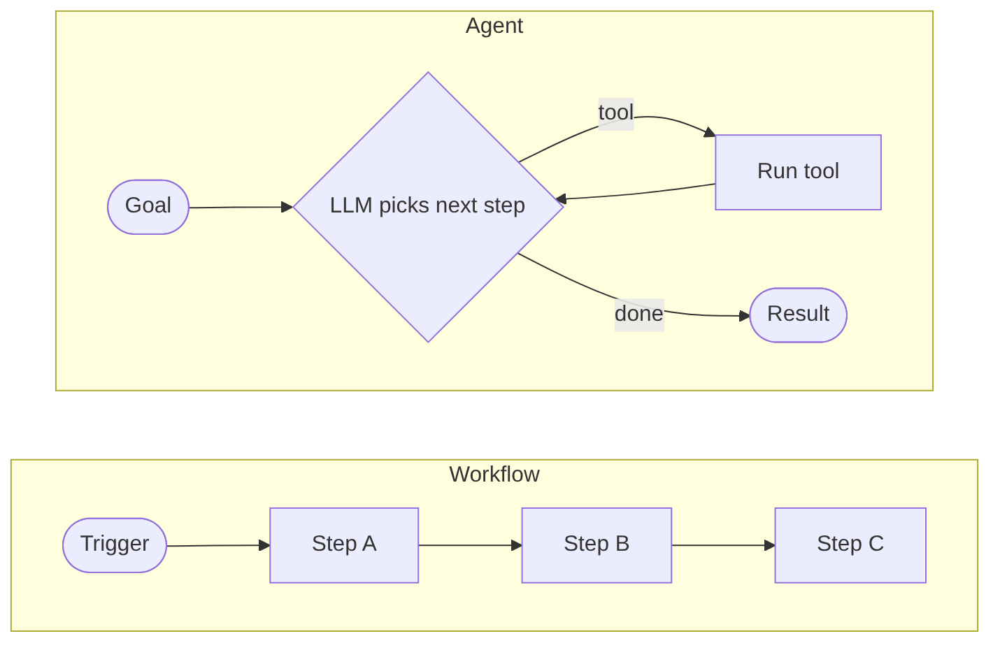
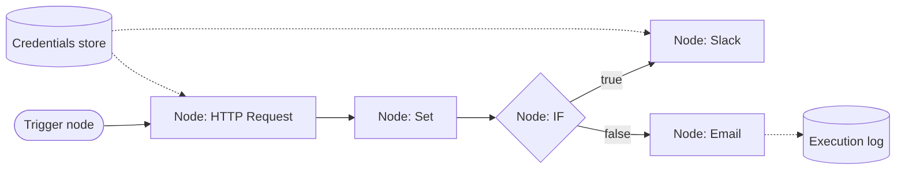
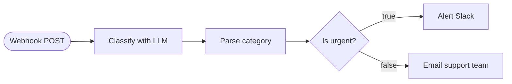
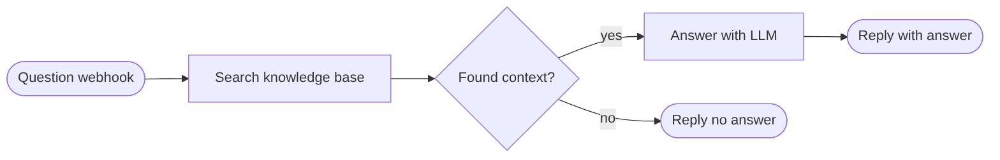
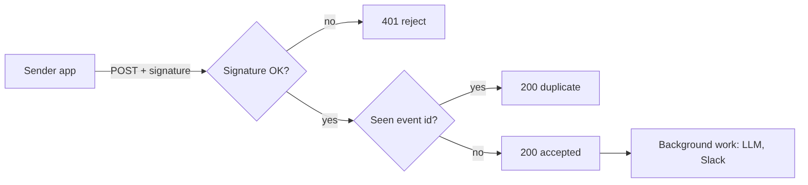
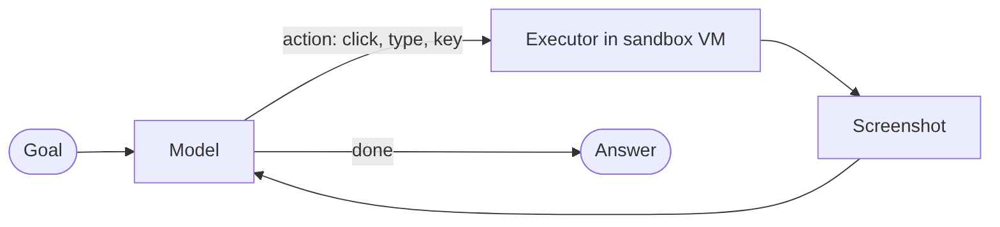
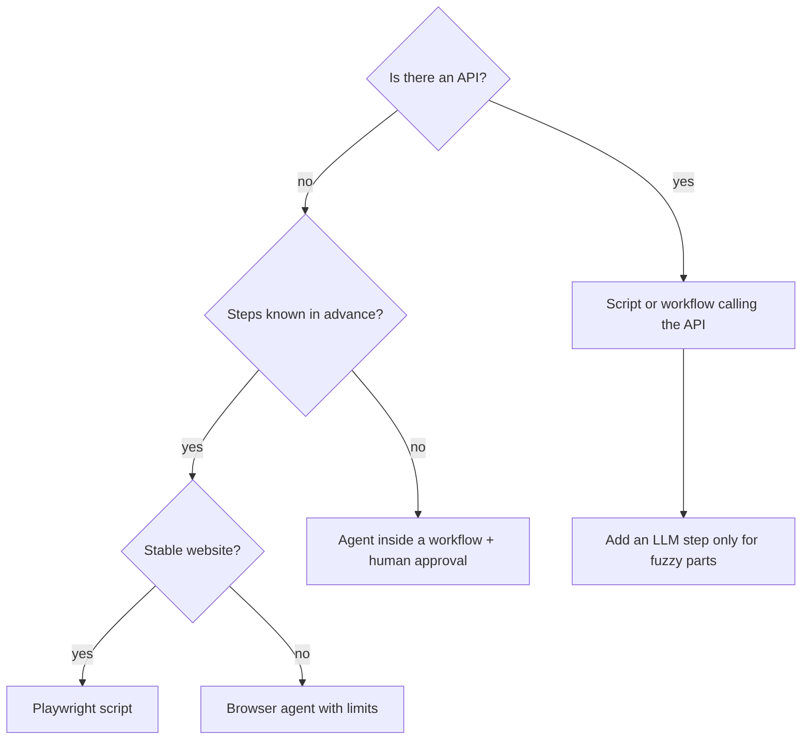

# Module 11 — AI automation: concepts

> Read once, top to bottom, before teaching. New words are **bolded** and explained the first time they appear. The notebooks let you run each idea offline; the `workflows/` folder holds three n8n workflows you can import.

---

## 1. Automation vs agents

**Automation** means a computer does a job without a person doing each step. A **workflow** is an automation with fixed steps that a person designed: "when X happens, do A, then B, then C". It does the same thing every time.

In module 10 we built **agents**: an LLM (large language model) that *chooses* its own next step, in a loop, until a goal is met.

**Analogy: a train vs a taxi.** A train (workflow) runs on fixed tracks. It is cheap per passenger, always on time, and you know exactly where it goes — but it cannot go anywhere without tracks. A taxi (agent) can take you anywhere, finding its own route — but it costs more, takes longer to plan, and the driver can take a wrong turn. Most daily journeys are best served by trains; taxis are for the unusual trips.



The important insight of this module: **an LLM can be one step inside a workflow without being in control.** "Classify this email with an LLM, then route it with a normal if-statement" is still a predictable workflow. The model does the fuzzy part (understanding language); the workflow does the rest.

| | Workflow / automation | Agent |
|---|---|---|
| Who decides the steps? | The designer, in advance | The LLM, at run time |
| Same input → same path? | Yes | Not always |
| Cost per run | Low (0–2 LLM calls) | Higher (many LLM calls) |
| Speed | Seconds | Seconds to minutes |
| Easy to debug and audit? | Yes — look at the diagram | Harder — read the trace |
| Handles surprises? | Only the ones you planned for | Often, yes |
| Best for | Repeated, well-understood processes | Open-ended tasks with unknown steps |

### The spectrum

1. **Plain script / workflow** — no AI. "Every night copy new orders into the spreadsheet."
2. **Workflow with an AI step** — one LLM call for the fuzzy bit. "Summarise each new article, then save it."
3. **Workflow with an AI router** — the LLM picks a branch. "Is this ticket urgent, billing or general?"
4. **Workflow that calls an agent** for one sub-task. "If the ticket is technical, let an agent search the docs and draft a reply for a human to approve."
5. **Fully autonomous agent** — the LLM runs the whole show.

Most business value today sits at levels 2–4. Start low; move up only when the lower level genuinely fails.

---

## 2. Vocabulary of automation

- **Trigger** — the event that starts a workflow. Examples: a schedule ("every day at 8am"), a webhook (another app calls your URL), a new email, a form submission, a new row in a sheet.
- **Action** — a step that does something: send a message, call an API, write a row.
- **API (Application Programming Interface)** — a way for programs to talk to each other, usually by sending HTTP requests with JSON data.
- **HTTP request** — a message sent over the web. The **method** says the intent: `GET` (read) and `POST` (send/create) are the two you will use most. The **status code** in the reply says how it went: `200` OK, `401` not authorised, `404` not found, `422` bad data, `429` too many requests, `500` server error.
- **Polling** — checking again and again ("any new emails yet?"). Simple but wasteful and slow.
- **Webhook** — the other system calls *you* when something happens. Efficient and instant. More in section 5.
- **Idempotent** — doing it twice has the same effect as doing it once. Important because webhooks and retries can deliver the same event twice.
- **Retry with backoff** — on failure, try again after waiting longer each time (1s, 2s, 4s…), so a struggling server can recover.
- **Credentials** — the keys, tokens or passwords a workflow uses to access other services. Store them in a secure place (a credential store or environment variables), never inside the workflow file.

---

## 3. n8n from zero

**n8n** (say "n-eight-n", short for "nodemation") is a **visual workflow automation tool**. You build workflows by dragging boxes onto a canvas and connecting them with lines, a bit like drawing a flowchart that actually runs. It is popular with AI engineers because it has hundreds of integrations (Slack, Gmail, Google Sheets, databases, HTTP), built-in AI/LLM nodes, and you can **self-host** it (run it on your own computer or server) for free. Its licence is "fair-code" (the Sustainable Use License): free to self-host for your own use; check the terms before reselling it as a service.

**Analogy: LEGO for business processes.** Each brick (node) does one thing. You snap bricks together so data flows from one to the next.

### The parts of n8n



| Word | Meaning | Analogy |
|---|---|---|
| **Workflow** | A saved canvas of connected nodes | A recipe |
| **Node** | One step. Has a **type** (e.g. "HTTP Request", "Slack", "IF") and **parameters** (its settings) | One instruction in the recipe |
| **Trigger node** | The first node; starts the workflow (Schedule Trigger, Webhook, Gmail Trigger, Form Trigger, Manual Trigger) | The oven timer going off |
| **Connection** | A line from one node's output to the next node's input | Passing the bowl to the next cook |
| **Item** | One record of data flowing through (n8n data is a *list of items*, each holding JSON). Most nodes run **once per item** | One cookie on the tray |
| **Expression** | A small piece of JavaScript inside `{{ }}` that reads data from earlier nodes, e.g. `{{ $json.email }}` | "Use the flour from step 2" |
| **Credentials** | Saved logins/API keys, stored encrypted by n8n and *referenced* by nodes by name | The key cupboard |
| **Execution** | One run of the workflow. n8n keeps a log of each, showing every node's input and output | The kitchen's order history |
| **Active / inactive** | Whether triggers listen automatically (production) or only when you click "Test" | Shop open / closed |

**Expressions you will see in our workflows:**

- `{{ $json.body.subject }}` — field `subject` inside the `body` of the current item (a webhook puts the POST data under `body`).
- `{{ $('Webhook').item.json.body.email }}` — reach back to an earlier node *by name*.
- `{{ $now.toFormat('yyyy-MM-dd') }}` — today's date.
- `{{ JSON.stringify({...}) }}` — build a JSON text, used for API request bodies.

### Running n8n

You have three options. As of late 2026 check the [n8n docs](https://docs.n8n.io) for the current commands, versions and pricing.

**1. Docker (recommended for self-hosting).** **Docker** runs software inside a **container** — a sealed box that has everything the program needs, so it behaves the same on every computer. With Docker Desktop installed:

```bash
docker volume create n8n_data
docker run -it --rm --name n8n -p 5678:5678 \
  -v n8n_data:/home/node/.n8n docker.n8n.io/n8nio/n8n
```

- `-p 5678:5678` makes n8n reachable at `http://localhost:5678` in your browser.
- `-v n8n_data:/home/node/.n8n` keeps your workflows and credentials in a **volume** (saved storage) so they survive restarts.
- The first visit asks you to create an owner account (local to your machine).

**2. npx (quick try, needs Node.js).** `npx n8n` downloads and starts n8n in one command. Good for a first look; Docker is better for anything that should keep running.

**3. n8n Cloud.** A paid hosted service run by the n8n company: no install, a public URL for webhooks out of the box, and a free trial. Easiest for non-technical teams.

### Importing our workflows

1. Open n8n → **Workflows → Create / Import** (or open a blank workflow and use the **⋯ menu → Import from File**). You can also copy the JSON text and paste it straight onto the canvas.
2. Choose a file from `11-ai-automation/workflows/`.
3. Nodes that need logins show a warning. Open each, choose **Create new credential**, and enter your own key. The files contain only placeholders (`REPLACE_WITH_YOUR_CREDENTIAL_ID`).
4. Click **Test workflow** (or **Execute workflow**) to run it once while watching each node's output.
5. When happy, toggle the workflow to **Active**.

### How a workflow file is built

A workflow export is plain JSON with three main parts:

```json
{
  "name": "01 Support ticket triage",
  "nodes": [
    {"id": "…", "name": "Webhook", "type": "n8n-nodes-base.webhook",
     "typeVersion": 2, "position": [0, 300],
     "parameters": {"httpMethod": "POST", "path": "support-ticket"}}
  ],
  "connections": {
    "Webhook": {"main": [[{"node": "Classify with LLM", "type": "main", "index": 0}]]}
  }
}
```

- `type` names the node kind (`n8n-nodes-base.*` are the built-in nodes); `typeVersion` is the version of that node's settings format.
- `connections` is keyed by the **source node's name**. `main` is a list of **outputs**; an IF node has two (index 0 = true, index 1 = false). Each output lists the nodes it feeds.
- `credentials` (when present) refer to a saved credential **by id and name** — never the secret itself.

`code/validate_workflows.py` and notebook 03 check these rules automatically.

---

## 4. Our three workflows, node by node

The LLM steps use n8n's generic **HTTP Request** node calling an OpenAI-compatible chat API, because that works in every n8n version and shows exactly what is sent. n8n also has dedicated AI nodes (an "AI Agent" node, "OpenAI"/"Anthropic" chat model nodes, vector-store nodes) that do the same with less typing — once you understand the HTTP version, those are easy. The model name `gpt-5-mini` is a placeholder; check your provider's model list.

**Setting up the LLM credential:** in n8n create a **Header Auth** credential with *Name* `Authorization` and *Value* `Bearer your-key-here`. For Anthropic's API instead, you would change the URL to `https://api.anthropic.com/v1/messages`, send headers `x-api-key` and `anthropic-version`, and reshape the body (`max_tokens`, `messages`) — module 07 shows that format.

### Workflow 01 — Support ticket triage (`01-webhook-ticket-triage.json`)

*Goal:* when a support ticket arrives, an LLM decides if it is urgent. Urgent tickets alert Slack; the rest are emailed to the team.



| # | Node (type) | What it does | Key settings |
|---|---|---|---|
| 1 | **Webhook** (`webhook`) | Gives the workflow a URL. When a form or app POSTs a ticket JSON (`email`, `subject`, `message`), the workflow starts | Method `POST`, path `support-ticket`, respond "immediately" so the sender isn't kept waiting |
| 2 | **Classify with LLM** (`httpRequest`) | Sends the subject and message to the chat API with a system prompt: "reply only with JSON: category urgent/billing/general + reason". `response_format: json_object` asks the model for valid JSON | URL of the chat endpoint, Header Auth credential, JSON body built with an expression |
| 3 | **Parse category** (`set`) | Pulls `category` and `reason` out of the model's JSON reply, and copies `email` and `subject` from the Webhook node, into a clean item | Four assignments using expressions |
| 4 | **Is urgent?** (`if`) | Checks `category == "urgent"`. Output 0 (true) → Slack; output 1 (false) → email | String "equals" condition |
| 5 | **Alert Slack** (`slack`) | Posts a message to `#support-urgent` | Slack credential, channel name, message text with expressions |
| 6 | **Email support team** (`emailSend`) | Emails the ticket to `support@example.com` | SMTP credential, from/to, subject, body |

*Test it:* activate, then send a POST to the **Test URL** shown in the Webhook node (e.g. with `code/send_test_webhook.py` and `TARGET_URL=…`).

### Workflow 02 — Daily RSS digest to Google Sheets (`02-rss-digest-to-sheets.json`)

*Goal:* every morning, read a news feed, summarise the top five items with an LLM, and append them to a spreadsheet. **RSS** is a standard XML format websites use to publish a list of their latest articles.

| # | Node (type) | What it does |
|---|---|---|
| 1 | **Every morning 8am** (`scheduleTrigger`) | Starts the workflow daily at 08:00 (uses the n8n instance's time zone, set in workflow settings) |
| 2 | **Read RSS feed** (`rssFeedRead`) | Downloads the feed and outputs **one item per article** (`title`, `link`, `contentSnippet`, `pubDate`) |
| 3 | **Keep first 5** (`limit`) | Passes on only the first 5 items — this caps LLM cost |
| 4 | **Summarise with LLM** (`httpRequest`) | Runs once *per item*: asks the model for a one-sentence summary |
| 5 | **Shape row** (`set`) | Builds the row: `date`, `title`, `summary`, `link`. Uses `$('Keep first 5').item` to fetch the matching article for each summary |
| 6 | **Append to Google Sheet** (`googleSheets`) | Appends each item as a new row. "Auto-map" matches field names to the sheet's header row, so row 1 must be `date, title, summary, link` |

Google Sheets needs an OAuth credential (you sign in with Google once inside n8n). `code/python_automation.py` does the same job in plain Python, for comparison.

### Workflow 03 — RAG answer bot (`03-rag-answer-webhook.json`)

*Goal:* a question arrives (from a web form, chat widget or Slack bot) and is answered **only** from your documents — **RAG**, retrieval-augmented generation, from module 09.



| # | Node (type) | What it does |
|---|---|---|
| 1 | **Question webhook** (`webhook`) | Receives `{"question": "..."}`. Response mode **"Using 'Respond to Webhook' node"** keeps the caller waiting until the answer is ready |
| 2 | **Search knowledge base** (`httpRequest`) | POSTs the question to our own search API (`/search` in `code/webhook_receiver.py`), which returns the best matching passages as `context` |
| 3 | **Found context?** (`if`) | Is `context.length > 0`? |
| 4 | **Answer with LLM** (`httpRequest`) | Sends context + question with the instruction "answer only from the context, otherwise say you don't know" |
| 5 | **Reply with answer** (`respondToWebhook`) | Returns `{"answer": ..., "sources": [...]}` to the caller |
| 6 | **Reply no answer** (`respondToWebhook`) | The false branch: a polite "not found" message — no LLM call, no made-up answer |

*Networking note:* if n8n runs in Docker and the search API on your laptop, the URL `http://host.docker.internal:8000/search` reaches your laptop from inside the container (Docker Desktop on Mac/Windows; on Linux add `--add-host=host.docker.internal:host-gateway` to `docker run`). With `npx n8n`, use `http://127.0.0.1:8000/search`. To answer from a **Form** instead, replace node 1 with n8n's **Form Trigger** node; to answer in Slack, use a Slack Trigger and finish with a Slack node.

### Good habits in n8n

- **Name nodes clearly** — expressions refer to them by name.
- **Pin test data** — n8n lets you "pin" a node's output so you can rebuild later steps without re-triggering.
- **Error workflow** — in workflow settings choose an error workflow that alerts you when a run fails.
- **Retry on fail** — node settings include retries with waits; turn them on for HTTP calls.
- **Limit LLM calls** — put Limit/Filter nodes *before* AI nodes.
- **Export and version** — download workflows as JSON and commit them to Git (with no secrets inside).

---

## 5. Webhooks with a FastAPI receiver

A **webhook** is an HTTP POST that another system sends to *your* URL when an event happens. **Analogy: a doorbell.** Instead of opening the door every minute to check for visitors (polling), you wait until the bell rings.



**FastAPI** is a Python web framework for building APIs quickly; **uvicorn** is the server program that runs a FastAPI app. `code/webhook_receiver.py` shows a receiver that follows the four rules of reliable webhooks:

1. **Verify the sender.** A public URL can be called by anyone. Senders such as Stripe and GitHub sign each request: they compute an **HMAC** (a fingerprint made from the request body plus a shared secret) and put it in a header. The receiver recomputes it and compares with `hmac.compare_digest` (a comparison that takes the same time whether or not the strings match, so attackers learn nothing from timing). Wrong signature → `401`.
2. **Validate the data.** A **Pydantic** model describes the expected JSON; bad or missing fields are rejected with `422` ("unprocessable data").
3. **Be idempotent.** Senders retry when they don't get a quick `2xx` reply, so the same event may arrive twice. Store each `event_id` and skip ones you have seen.
4. **Reply fast, work later.** Return `200` within a second or two; do slow work (LLM calls, emails) in a **background task** or a job queue.

```python
@app.post("/webhook/ticket")
async def receive_ticket(request: Request, background: BackgroundTasks,
                         x_signature: str = Header(default="")):
    body = await request.body()
    if not hmac.compare_digest(sign(body), x_signature):
        raise HTTPException(401, "bad signature")
    ticket = Ticket.model_validate_json(body)
    if ticket.event_id in SEEN_EVENT_IDS:
        return {"status": "duplicate"}
    SEEN_EVENT_IDS.add(ticket.event_id)
    background.add_task(notify, classify(ticket), ticket)
    return {"status": "accepted"}
```

**Testing locally.** `uvicorn webhook_receiver:app --port 8000`, then `python send_test_webhook.py`. Notebook 02 uses FastAPI's **TestClient**, which calls the app in memory — no server, no network. To let an outside service reach your laptop during development, a **tunnel** tool (such as ngrok or Cloudflare Tunnel) gives you a temporary public URL.

**n8n and FastAPI together.** They fit both ways: n8n can *receive* webhooks (Webhook node) and *send* them (HTTP Request node to your FastAPI). A common design is "n8n for the plumbing, Python for the clever bits".

---

## 6. Python automation

Sometimes a 40-line script beats any tool. `code/python_automation.py` does the RSS digest in Python:

- **`httpx`** — makes HTTP requests. Always set a **timeout** (otherwise a hung server hangs your script forever) and call `raise_for_status()` so `4xx/5xx` replies become errors you can handle.
- **Retry with exponential backoff** — wrap the request in a loop: on failure wait 1s, 2s, 4s, then give up gracefully (log, alert, or use a fallback).
- **`schedule`** — a tiny library to run a function at set times *inside* a running Python program: `schedule.every().day.at("08:00").do(job)`, then loop on `schedule.run_pending()`. Simple, but if the program stops, so does the schedule.
- **cron** — the operating system's scheduler on Linux/macOS (Windows has Task Scheduler). A line like `0 8 * * * python /path/job.py` runs the script at 08:00 daily, even after reboots. **Cloud schedulers** (GitHub Actions on a schedule, cloud functions) do the same without your own server.
- **Logging** — print errors to standard error or a log file; an automation nobody watches must tell you when it fails.

| Choose n8n when… | Choose Python when… |
|---|---|
| Non-developers will maintain it | It's logic-heavy (parsing, maths, ML) |
| You need many app integrations quickly | You need full control, tests, code review |
| You want a visual run history | It must run inside your existing codebase |
| | Scale or cost matters (no per-execution fees) |

Many teams use both.

---

## 7. Browser agents

Some systems have no API: an old government portal, a supplier website, an internal tool. Then the only way in is the **user interface** — the screens a person clicks.

### Step 1: classic browser automation with Playwright

**Playwright** is a library (from Microsoft) that controls a real browser from code: open a page, find elements, type, click, read text, take screenshots. It is **deterministic** — the same script does the same thing every time. It can run **headless** (no visible window), which is how it runs on servers.

```python
from playwright.sync_api import sync_playwright
with sync_playwright() as p:
    browser = p.chromium.launch(headless=True)
    page = browser.new_page()
    page.goto("https://example.com")
    page.get_by_label("Search").fill("mug")
    page.get_by_role("button", name="Search").click()
    print(page.locator("#results").inner_text())
```

- A **selector / locator** is how you point at an element. Prefer user-facing locators (`get_by_role`, `get_by_label`, `get_by_text`) over fragile CSS paths like `div > div:nth-child(3)`.
- Playwright **auto-waits** for elements to be ready before acting, which removes most "element not found" errors.
- Setup: `pip install playwright` then `playwright install chromium`. See `code/playwright_basics.py`.

*Weakness:* when the website's layout changes, the script breaks and someone must fix the selectors.

### Step 2: browser agents

A **browser agent** puts an LLM on top of browser control. You give a goal in English ("find the three top stories and their points"). The agent reads the page (a simplified text version of its structure, and/or a screenshot), decides the next action (click this link, type in that box), does it, looks again — the module 10 agent loop, with browser actions as tools.

**browser-use** is a popular open-source Python library for this. Its core is an `Agent(task=..., llm=...)` that you `await agent.run()`. See `code/browser_use_agent.py` (not installed in the course environment; the library's API changes quickly, so check its docs).

**Analogy:** Playwright is a player piano — it plays the exact notes punched in the roll. A browser agent is a pianist reading sheet music — they can cope with a slightly different piano, but they are slower, more expensive, and occasionally hit a wrong note.

---

## 8. Computer-use agents

A **computer-use agent** goes one step further: it controls a **whole desktop**, not only a browser. The model receives **screenshots** and replies with mouse and keyboard **actions** ("left-click at x=40, y=300", "type 'weather taipei'", "press Return"). Your code performs the action on a real screen and sends a new screenshot back.



Anthropic offers this as **computer use** — a special tool you pass to the Messages API. As of late 2026 the current tool type is `computer_toolset_20260801`, which gives the model member actions such as `screenshot`, `left_click`, `type`, `key`, `scroll`, `zoom` and `wait`; older versions needed a beta header. Names and supported models change, so always check the [official computer-use page](https://platform.claude.com/docs/en/agents-and-tools/tool-use/computer-use-tool). OpenAI and Google offer similar tools.

`code/computer_use_agent.py` runs a **simulated** loop (scripted model + fake screen) so you can read the control flow safely; with a key and `--real` it sends one request and prints the requested actions **without executing them**.

**Safety is not optional here.** The agent can do anything a person at that computer could do.

- Run it only inside an isolated **virtual machine** or **container** (Anthropic publishes a Docker reference implementation) — never on your everyday laptop.
- No saved passwords, logged-in accounts or personal files in that machine.
- Cap the steps; keep a human watching; require confirmation for purchases, sending messages or deleting anything.
- Treat everything on screen as untrusted: a web page can show text crafted to hijack the agent (**prompt injection**).

### Cost and reliability

Every step sends a screenshot (images cost many tokens) and waits for the model. A task a person does in 30 seconds may take the agent several minutes and many calls. Accuracy on long tasks is improving but is not perfect.

---

## 9. When automation beats agents (and when it doesn't)



Ask these questions in order:

1. **Is there an API?** If yes, call it from a script or an n8n HTTP node. This is the fastest, cheapest, most reliable option — always prefer it over clicking through a UI.
2. **Are the steps known in advance?** If yes, build a **workflow**. Add an LLM step only for the fuzzy part (classify, extract, summarise, draft).
3. **Must you go through a website?** If the site is stable, write a **Playwright** script. Use a **browser agent** only if layouts change often, the task varies each time, or it is a one-off.
4. **Is it open-ended?** ("Research these 20 companies and fill in this table", "fix this failing test".) Then an **agent** earns its cost — ideally *inside* a workflow, with human approval on risky steps.

**Rules of thumb**

- High volume + repeatable → automation. 10,000 invoices a month should not each cost a dozen LLM calls and two minutes.
- Mistakes are expensive or irreversible → automation with a human approval step.
- Needs judgement on messy language → add an AI step, not necessarily an agent.
- Low volume, high variety → an agent can be worth it.
- Measure: track time saved, error rate, and cost per run (see `excel/automation-ideas-roi.xlsx`).

### Estimating return on investment (ROI)

**ROI** compares what you gain with what you spend. For an automation:

- **Hours saved per month** = runs per month × minutes saved per run ÷ 60.
- **Value saved** = hours saved × hourly cost of the person's time.
- **Running cost** = runs × (LLM cost per run + tool/hosting cost per run) + fixed monthly fees.
- **Monthly net benefit** = value saved − running cost − maintenance hours × hourly cost.
- **Payback period** = build cost ÷ monthly net benefit (in months).

The Excel calculator does this with live formulas; plug in your own numbers. LLM prices change often — as of late 2026 check the providers' pricing pages and module 07's cost calculator.

---

## Key terms (quick reference)

| Term | One-line meaning |
|---|---|
| Workflow | Fixed, designed steps that run automatically |
| Agent | An LLM choosing its own next steps in a loop |
| Trigger / action | What starts a workflow / a step that does something |
| n8n | Visual, self-hostable workflow automation tool |
| Node / connection / item | One step / data path between steps / one record of data |
| Expression | `{{ … }}` JavaScript that reads data from earlier nodes |
| Credentials | Saved, encrypted logins referenced by nodes |
| Execution | One logged run of a workflow |
| Webhook | Another system POSTs to your URL when an event happens |
| HMAC signature | Fingerprint proving a webhook came from someone with the shared secret |
| Idempotent | Safe to do twice |
| Backoff | Waiting longer between each retry |
| Playwright | Library to script a real browser |
| Browser agent | LLM driving a browser towards a goal |
| Computer use | LLM driving a whole desktop via screenshots and mouse/keyboard actions |
| ROI / payback | Gain vs cost / months until the build cost is earned back |

Next: open `notebooks/01-automation-vs-agents-python.ipynb`.
