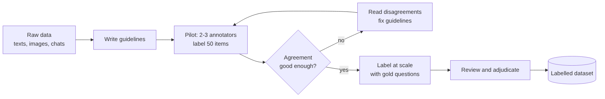
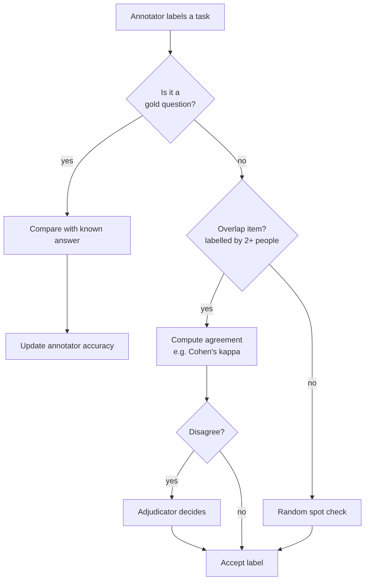
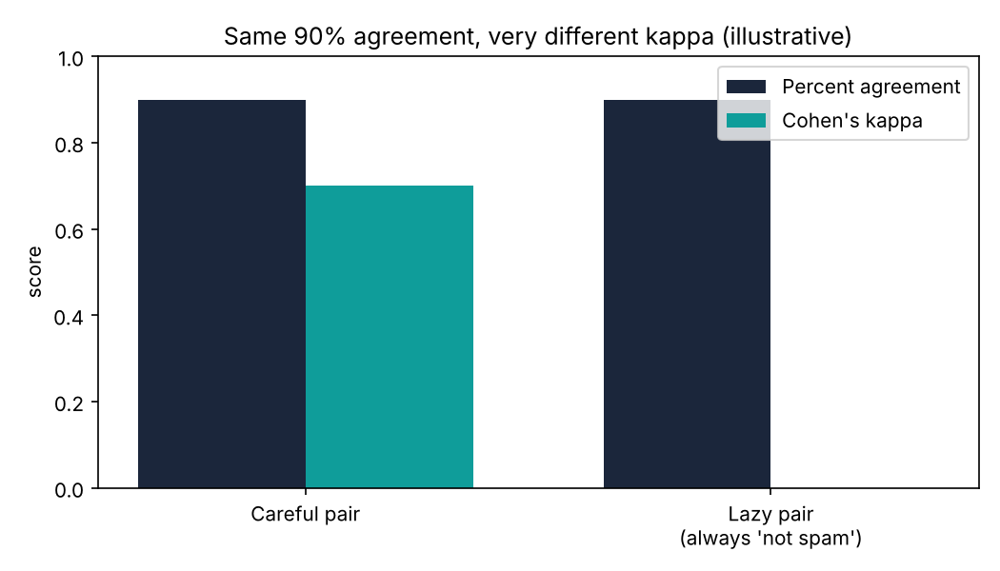
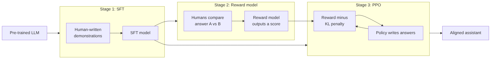
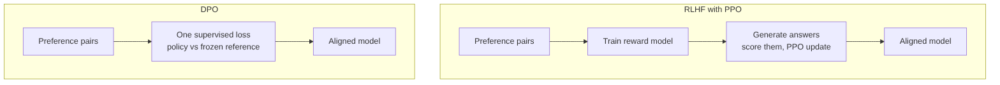
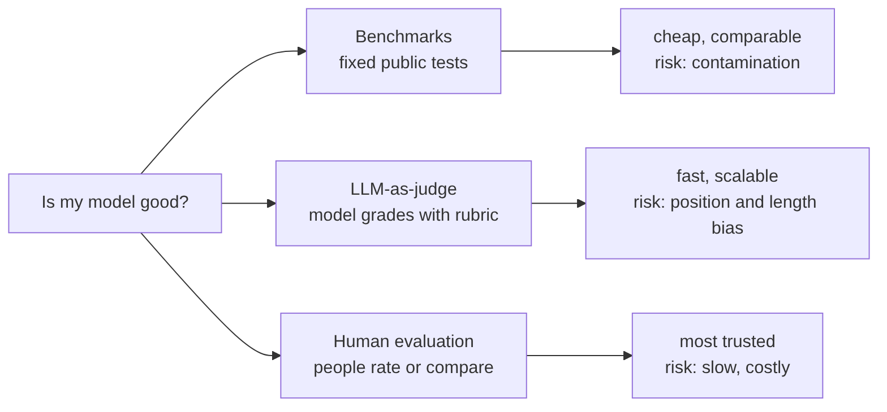

# Module 12 - Data Annotation, RLHF and Evaluations

> Read this file top to bottom before you teach. Every new word is in **bold** the first time it appears, followed by a plain-English meaning.

## 1. Why labelled data matters

A **model** is a program that learned its behaviour from examples instead of being written rule by rule. **Training** is the process of showing a model many examples so it can adjust itself. A **label** is the "right answer" attached to an example, such as "spam" on an email or "positive" on a review. **Labelled data** is a collection of examples that each carry a label. **Annotation** (also called **labelling**) is the human work of adding those labels. An **annotator** is the person who does it.

**Analogy - the cookbook.** Imagine teaching a new cook only by letting them taste dishes. If every dish they taste was cooked well, they learn good cooking. If a third of the dishes were burnt but labelled "perfect", they learn to burn food. The model is the new cook. The labels are the tasting notes. Bad notes produce a bad cook, no matter how talented the cook is.

That is the famous rule **"garbage in, garbage out"**: a model can never be more reliable than the labels it learned from. Three facts make labels especially important for modern AI:

1. **Large language models (LLMs)** - programs like ChatGPT or Claude that predict text one piece at a time - are first trained on huge piles of internet text with no human labels. That step is called **pre-training**. It gives knowledge but not good manners.
2. To turn a raw pre-trained model into a helpful assistant, companies use **human-written demonstrations** (example conversations) and **human preferences** (which of two answers is better). Both are annotation.
3. To check if a model is good, you need **evaluation data** - examples with known correct answers or human judgements. That is annotation too.

So annotation sits at the start (training data), the middle (preference data for alignment) and the end (evaluation) of every AI project. **Alignment** means making a model behave the way people intend: helpful, honest and harmless.

## 2. Annotation types

Different tasks need different kinds of labels. Learn these six; they cover almost every job listing.

| Type | What the annotator does | Example | Typical use |
|---|---|---|---|
| **Classification** | Picks one (or several) categories for a whole item | "Is this review positive, negative or neutral?" | Sentiment, spam, topic, toxicity filters |
| **Named entity recognition (NER)** | Highlights spans of text and tags them | Mark "Hyderabad" as LOCATION, "Infosys" as ORGANISATION | Information extraction, search |
| **Bounding boxes** | Draws a rectangle around each object in an image | Box every car and pedestrian | Object detection for cameras, drones, self-driving |
| **Segmentation** | Paints the exact pixels of each object | Outline a tumour on a scan | Medical imaging, robotics |
| **Ranking** | Orders several answers from best to worst | Rank 4 chatbot replies | Search quality, reward models |
| **Preference pairs** | Sees two answers to the same prompt and picks the better one | "Response A or B?" plus a reason | RLHF and DPO (sections 6-7) |

Two more you will meet in AI trainer jobs:

- **Demonstration writing (SFT data)** - the annotator writes the ideal answer to a prompt from scratch. **SFT** stands for **supervised fine-tuning**: training a model to copy good example answers.
- **Rubric grading** - the annotator scores an answer against a checklist (for example "factually correct: yes/no", "follows the instruction: 1-5").

**Analogy - school marking.** Classification is a multiple-choice test. NER is underlining key words in a paragraph. Bounding boxes are circling things in a picture. Ranking is putting essays in order. Preference pairs are "which of these two essays is better?". Demonstrations are writing the model answer for the answer key.



## 3. Annotation tools - what each is good for

You can label data in a spreadsheet, but proper tools save time and catch mistakes. A **labelling interface** is the screen an annotator works in. Here are the tools you must know by name (all checked as of late 2026 - always confirm features on the official page linked in `resources.md`).

| Tool | Licence / cost | Best at | Notes for a beginner |
|---|---|---|---|
| **Label Studio** | Open source (community edition) + paid enterprise | Almost every data type: text, images, audio, video, time series | The "Swiss army knife". You describe the interface in a small XML-like config. Good first choice. |
| **Argilla** | Open source, integrates with Hugging Face | LLM data: preference pairs, rating answers, SFT review | Built for the RLHF/DPO era. Datasets can be pushed to the Hugging Face Hub. |
| **CVAT** (Computer Vision Annotation Tool) | Open source + hosted cloud | Images and video: boxes, polygons, tracking objects across frames | The standard for computer vision teams. |
| **doccano** | Open source | Simple text tasks: classification, NER, sequence-to-sequence | Very easy to install and learn; fewer features. |
| **Prodigy** | Paid licence (from the makers of spaCy) | Fast text annotation with **active learning** | **Active learning** = the model picks the examples it is least sure about so humans label the most useful ones first. |

**How to choose (rule of thumb):**
- Images or video → CVAT (or Label Studio).
- Chatbot answers, preferences, ratings → Argilla (or Label Studio).
- Quick NER or classification for a class project → doccano.
- A small expert team that wants maximum speed and can pay → Prodigy.
- Many data types in one place → Label Studio.

The big AI companies also use private in-house tools. AI trainer platforms (section 10) give you their own browser-based interface, so you rarely install anything for those jobs - but knowing the open tools makes you a stronger candidate and lets you run your own projects.

## 4. Writing annotation guidelines

**Annotation guidelines** are the written rulebook annotators follow. Without them, two careful people will label the same item differently because each brings their own idea of "positive" or "toxic".

**Analogy - the referee's rulebook.** Two referees without a rulebook will disagree about what counts as a foul. With a clear rulebook and video examples of edge cases, they agree almost every time.

A good guideline document has these parts (the Excel template `excel/annotation-toolkit.xlsx` has a sheet for each):

1. **Purpose** - one paragraph on why the data is being collected. People make better edge-case decisions when they know the goal.
2. **Label definitions** - each label, a one-sentence definition, and what it is *not*.
3. **Positive and negative examples** - at least two clear examples per label, plus "looks like X but is actually Y" examples.
4. **Edge cases** - the hard ones: sarcasm, mixed sentiment, missing context, offensive but quoted text. Give the decision and the reason.
5. **Decision tree** - an ordered list of questions ("Is it about the product? If no → NEUTRAL").
6. **What to do when unsure** - a "flag/skip" option and how to leave a comment.
7. **Version history** - guidelines change as you discover new edge cases; date every change.

Guidelines are never finished on the first try. The normal cycle is: write draft → pilot on 50 items with 2-3 annotators → measure agreement → read the disagreements → fix the guidelines → repeat.

## 5. Quality control

**Quality control (QC)** is how you know your labels can be trusted. The main techniques:

- **Gold questions** (also called **honeypots** or **test questions**) - items whose correct label is already known, mixed secretly into the work. If an annotator gets too many gold questions wrong, their work is reviewed or removed. AI trainer platforms use these constantly - it is how they decide whether to keep giving you work.
- **Overlap / redundancy** - send the same item to 2 or more annotators and compare.
- **Adjudication** - an expert (the **adjudicator**) decides the final label when annotators disagree.
- **Majority vote** - with 3+ annotators, take the most common label.
- **Spot checks / audits** - a reviewer re-labels a random sample.
- **Inter-annotator agreement (IAA)** - a number that says how much annotators agree beyond luck.



### 5.1 Why raw percent agreement is not enough

Suppose two annotators label 100 emails as spam or not spam, and they agree on 90. "90% agreement" sounds great. But if 95% of emails are not spam, two annotators who both lazily click "not spam" every time would agree about 90% of the time too. We need a number that removes **chance agreement** - the agreement you would expect from random guessing with the same habits.



### 5.2 Cohen's kappa, by hand

**Cohen's kappa** (written κ, the Greek letter kappa) measures agreement between exactly two annotators, corrected for chance:

```
kappa = (p_o - p_e) / (1 - p_e)
```

- **p_o** (observed agreement) = fraction of items where the two annotators gave the same label.
- **p_e** (expected agreement) = the agreement we would expect by chance, given how often each annotator uses each label.

**Worked example.** Annotators A and B label 10 reviews as POS or NEG.

| Item | 1 | 2 | 3 | 4 | 5 | 6 | 7 | 8 | 9 | 10 |
|---|---|---|---|---|---|---|---|---|---|---|
| A | POS | POS | NEG | POS | NEG | POS | POS | NEG | POS | POS |
| B | POS | NEG | NEG | POS | NEG | POS | POS | POS | POS | POS |

Step 1 - observed agreement. They agree on items 1, 3, 4, 5, 6, 7, 9, 10 = 8 of 10, so **p_o = 0.8**.

Step 2 - how often each annotator uses each label.
- A: POS 7 times, NEG 3 times → P_A(POS) = 0.7, P_A(NEG) = 0.3
- B: POS 7 times, NEG 3 times → P_B(POS) = 0.7, P_B(NEG) = 0.3

(They use POS equally often overall, but on *different* items - that is where the disagreements are.)

Step 3 - chance agreement. If both guessed independently with those habits, the chance they both say POS is 0.7 × 0.7 = 0.49, and both say NEG is 0.3 × 0.3 = 0.09. So **p_e = 0.49 + 0.09 = 0.58**.

Step 4 - kappa = (0.8 - 0.58) / (1 - 0.58) = 0.22 / 0.42 = **0.52**.

So "80% agreement" is really only moderate agreement once luck is removed. In Python, scikit-learn computes the same number:

```python
from sklearn.metrics import cohen_kappa_score
a = ["POS","POS","NEG","POS","NEG","POS","POS","NEG","POS","POS"]
b = ["POS","NEG","NEG","POS","NEG","POS","POS","POS","POS","POS"]
print(round(cohen_kappa_score(a, b), 2))   # 0.52
```

**How to read kappa** (a common rough guide - the Landis and Koch scale; treat it as a guide, not law):

| Kappa | Rough meaning |
|---|---|
| below 0 | worse than chance - something is broken (swapped labels?) |
| 0.00-0.20 | slight |
| 0.21-0.40 | fair |
| 0.41-0.60 | moderate |
| 0.61-0.80 | substantial |
| 0.81-1.00 | almost perfect |

Many teams aim for at least about 0.7 before scaling up a project. Related measures you may see: **Fleiss' kappa** (more than two annotators, each item rated by the same number of people) and **Krippendorff's alpha** (handles missing ratings and ordered scales). **Weighted kappa** gives partial credit when labels are ordered (a 4 vs a 5 is a smaller disagreement than a 1 vs a 5).

Notebook `01-annotation-and-kappa.ipynb` runs this end to end, and `excel/annotation-toolkit.xlsx` has a kappa calculator built from Excel formulas.

## 6. RLHF - Reinforcement Learning from Human Feedback

**RLHF** is the recipe that turned raw language models into helpful assistants. It was made famous by OpenAI's InstructGPT paper (2022) and is described in many open resources (see `resources.md`, which points to the community list *awesome-RLHF*).

First some words:
- **Reinforcement learning (RL)** - a way of training where a program (the **agent** or **policy**) tries actions, gets a score called a **reward**, and slowly learns to choose actions that earn more reward. Like training a dog with treats.
- **Policy** - in LLM language, the model being trained. Its "action" is the text it writes.
- **Reward model (RM)** - a second model that reads a prompt and an answer and outputs a single number: "how much would a human like this?".

**Analogy - the cooking competition.**
1. **SFT stage = cooking school.** The new cook copies recipes from expert chefs (human-written demonstrations).
2. **Reward model stage = training a food critic.** Humans taste pairs of dishes and say which they prefer. A critic learns to predict those preferences, so we no longer need humans to taste every dish.
3. **PPO stage = practice with the critic.** The cook makes many dishes, the critic scores them, and the cook adjusts towards higher scores - while a "don't change too much" rule stops the cook from making strange dishes that only fool the critic.



### 6.1 Stage 1 - Supervised fine-tuning (SFT)

Humans write high-quality answers to thousands of prompts. The pre-trained model is trained to imitate them. This teaches format and tone ("be an assistant, answer the question"). Module 13 shows how to do SFT yourself.

### 6.2 Stage 2 - Training the reward model

1. Take a prompt. Let the SFT model write 2 or more answers.
2. Annotators compare them: "A is better than B". This creates **preference pairs**: (prompt, **chosen** answer, **rejected** answer).
3. Train a reward model so that `reward(chosen) > reward(rejected)` for as many pairs as possible.

The standard loss (the **Bradley-Terry** model) is:

```
loss = -log( sigmoid( r_chosen - r_rejected ) )
```

A **loss** is a number that measures how wrong the model is; training pushes it down. **Sigmoid** is a function that squashes any number into the range 0 to 1, so `sigmoid(r_chosen - r_rejected)` reads as "the probability the model thinks chosen beats rejected". If the reward model gives the chosen answer a much higher score, that probability is near 1 and the loss is near 0. If it scores them the wrong way round, the loss is large.

Notebook `02-reward-model.ipynb` trains a tiny reward model on synthetic preference pairs with exactly this loss.

### 6.3 Stage 3 - PPO with a KL penalty

**PPO (Proximal Policy Optimization)** is a reinforcement-learning algorithm. "Proximal" means "nearby": it updates the policy in small, safe steps. In RLHF:

1. The policy writes an answer to a prompt.
2. The reward model scores it.
3. A **KL penalty** is subtracted. **KL divergence** (Kullback-Leibler divergence) measures how different two probability distributions are. Here it measures how far the policy's writing has drifted from the original SFT model (the **reference model**). The penalty stops **reward hacking** - when the policy finds tricks that score high with the reward model but are not actually good (for example very long, flattering answers).
4. PPO updates the policy to raise `reward - beta × KL`. **Beta** (β) is a dial: bigger beta means "stay closer to the reference".

PPO needs four models in memory at once (policy, reference, reward model, and a **value model** that predicts future reward), is sensitive to settings, and is expensive. That pain led to DPO.

## 7. DPO - Direct Preference Optimization, and why it is simpler

**DPO** (Rafailov et al., 2023) showed you can skip the separate reward model and the RL loop. You train the policy directly on preference pairs with one simple loss.

**Analogy.** RLHF is hiring a food critic and then practising against the critic. DPO is giving the cook the pile of "this dish beat that dish" notes and saying: "make the winning dishes more likely and the losing ones less likely, but don't drift far from your cooking-school style."

The DPO loss for one pair:

```
loss = -log sigmoid( beta * [ (log pi(chosen) - log ref(chosen)) - (log pi(rejected) - log ref(rejected)) ] )
```

In words:
- **log pi(y)** = the **log-probability** the policy gives to answer y. A **log-probability** is the logarithm of a probability; it is negative, and closer to 0 means "more likely".
- **log ref(y)** = the same for the frozen reference model (usually the SFT model).
- `log pi(chosen) - log ref(chosen)` = how much more the policy likes the chosen answer than the reference does. Call it the **implicit reward** of the chosen answer.
- The loss is small when the policy has raised the chosen answer *more* than the rejected one, compared with the reference.

**Toy numbers.** Suppose beta = 0.1 and:

| | policy log-prob | reference log-prob | difference |
|---|---|---|---|
| chosen | -12.0 | -14.0 | +2.0 |
| rejected | -15.0 | -13.0 | -2.0 |

Margin = 2.0 - (-2.0) = 4.0. Times beta = 0.4. sigmoid(0.4) ≈ 0.599. Loss = -log(0.599) ≈ **0.513**. If the policy had not changed at all (policy = reference), the margin would be 0, sigmoid(0) = 0.5, and the loss would be -log(0.5) ≈ 0.693. So training lowered the loss from 0.693 to 0.513 by preferring the chosen answer. Notebook `03-dpo-loss-demo.ipynb` computes this in PyTorch and shows the gradient.



**Why DPO is simpler:**

| | RLHF with PPO | DPO |
|---|---|---|
| Separate reward model | Yes, trained first | No (the reward is implicit) |
| Models in memory during training | 4 (policy, reference, reward, value) | 2 (policy, frozen reference) |
| Generates new text during training | Yes (slow) | No - uses fixed pairs |
| Stability | Sensitive to many settings | Behaves like normal supervised training |
| Main dial | many | beta |

DPO is now a common default for open models. Variants you may read about: **IPO**, **KTO** (works with simple thumbs-up/down labels instead of pairs), **ORPO** and **SimPO** (no reference model). Hugging Face's **TRL** library (Transformer Reinforcement Learning) implements SFT, reward modelling, PPO-style methods and DPO. RL is still used: for example, reasoning models are often trained with RL on tasks that can be checked automatically (maths answers, code that passes tests).

## 8. Preference data format

Preference data is usually stored as **JSONL** (JSON Lines: one JSON object per line). The common layout used by TRL and many Hugging Face datasets:

```json
{"prompt": "Explain what a CPU is in one sentence.",
 "chosen": "A CPU is the chip that carries out a computer's instructions, like the brain of the machine.",
 "rejected": "CPU stands for something about computers."}
```

There is also a **conversational** version where `prompt`, `chosen` and `rejected` are lists of chat messages (`{"role": "user", "content": ...}`). Good preference data:

- has the **same prompt** for both answers (only the answer differs);
- covers many topics and difficulty levels;
- includes **close calls**, not only "great vs terrible" (easy pairs teach little);
- records *why* the annotator chose (a short reason helps auditing);
- avoids bias toward longer answers just because they are longer.

## 9. Evaluations ("evals")

An **eval** is a repeatable test that measures how good a model is at something. Without evals, "the new model feels better" is just a guess.

**Analogy - exams.** A benchmark is a public national exam. An LLM-as-judge is a teaching assistant marking with the teacher's answer key. Human evaluation is the head examiner marking by hand: slow and expensive, but the most trusted.



### 9.1 Benchmarks

A **benchmark** is a fixed, public set of questions with answers, used to compare models. Examples you will hear about: **MMLU** (multiple-choice questions across many subjects), **GSM8K** (school maths word problems), **HumanEval** (write Python functions that pass tests), **TruthfulQA** (resisting common misconceptions). Benchmarks are cheap and comparable, but they get **saturated** (top models all score near 100%) and **contaminated** (the questions leak into training data, so a high score may mean memorising). Benchmark names and leaderboards change fast - check the current state on the official pages.

### 9.2 LLM-as-judge

**LLM-as-judge** means asking a strong LLM to grade another model's answer, usually against a rubric, or to pick the better of two answers (**pairwise comparison**). It is fast and cheap enough to run on every change. Known weaknesses you must control for:

- **Position bias** - the judge prefers whichever answer is shown first. Fix: run each comparison twice with the order swapped.
- **Verbosity bias** - the judge prefers longer answers. Fix: tell the judge length is not a virtue; check correlation with length.
- **Self-preference** - a judge may prefer answers written by its own model family.
- Always check the judge against a sample of human labels (compute agreement - kappa again!).

### 9.3 Human evaluation

Humans rate or compare answers. It is the gold standard for subjective qualities (helpfulness, tone, safety) and for checking the automatic evals. It is slow and costs money, so use it on a sample. Much AI trainer work (section 10) is human evaluation.

### 9.4 Designing a rubric

A **rubric** is a scoring guide with named criteria and clear levels. A good rubric:

1. Has 3-6 **criteria** that matter for the task (for example: correctness, instruction following, completeness, safety, clarity).
2. Defines each **level** with observable behaviour, not feelings. "5 = every factual claim is correct and verifiable" beats "5 = excellent".
3. Uses **binary checks** (yes/no) where possible - they produce higher agreement than 1-10 scales.
4. Says how to combine criteria (for example: any safety failure = overall fail).
5. Includes a worked example for each level.
6. Is tested for agreement between two graders before use.

Notebook `04-evals-rubric-and-judge.ipynb` builds a rubric, scores answers with an offline judge stand-in (and the real Claude call when an API key is present), and demonstrates position-bias checking.

## 10. AI trainer and data annotator jobs

AI companies need large amounts of human feedback, so a whole job market exists around it. Titles include **AI trainer**, **AI tutor**, **data annotator**, **rater**, **evaluator**, **RLHF writer** and **domain expert** (for example "AI trainer - Python" or "AI trainer - chemistry").

### 10.1 What the work looks like day to day

A typical session on a platform:

1. Log in, open the task queue, and read the project's guidelines (often 10-40 pages - read them fully; most failures come from skipping this).
2. Each **task** shows a prompt and one or more model answers. You might: rate each answer on a rubric; pick the better of two and write a justification; rewrite a weak answer into an ideal one; write a tricky prompt that makes the model fail (**red-teaming** or **adversarial prompting**); check code by running it; fact-check claims with sources.
3. A timer suggests how long a task should take. Quality is checked by reviewers and gold questions.
4. Projects start and stop without warning. Work can be plentiful one week and empty the next.

Coding and STEM (science, technology, engineering, maths) projects usually pay more than general writing projects, and need you to pass a subject test. Typical skills checked: careful reading, clear written English, following rules exactly, fact-checking, and for coding projects, reading and debugging code.

### 10.2 Platforms

Platforms that appear in the course's curated list (as of late 2026 - companies, names and requirements change, so check each one yourself): **Mercor** (all domains, strong on software experts), **Micro1** (very wide range of domains), **Turing** (coding, STEM, languages), **SME Careers** (languages, STEM, design), **Alignerr** (expert-level RLHF work), **Ethos** (business experts), **Rex** and **Vetto** (specialist domains), and **Mindrift** (run by Toloka; most open to generalists). You will also see names such as Outlier, DataAnnotation, Appen and Prolific in job adverts. Most platforms screen you with an automated (often AI-run) interview plus a skills test, then match you to projects.

`resources.md` links to independent review pages for these platforms rather than sign-up pages, because many "join here" links on the web carry **referral codes** (the person sharing the link earns money when you sign up). Find each platform's official site yourself. The tracker in `excel/ai-trainer-job-tracker.xlsx` lets you log where you applied, which test you took and what happened.

**Pay:** it varies widely by platform, country, project and subject expertise - check current listings rather than trusting any number online, including in this course. Specialist domains (coding, maths, medicine, law, finance) usually pay more than generalist tasks. Be careful of scams: a real platform never asks you to pay a "training fee" to start work, buy equipment from them, or share bank passwords. Be careful where you upload identity documents.

### 10.3 How to pass qualification tests

Almost every platform gives an unpaid **assessment** first. Tips that work:

1. **Read every instruction twice.** Many tests are partly a check that you read the rules (for example, a required justification length).
2. **Do it in one quiet sitting** with no distractions; some tests are timed and cannot be paused.
3. **Write justifications that point to evidence.** Not "A is better", but "A is better because it answers both parts of the question and B gives the wrong year (1947, not 1950)".
4. **Fact-check** every factual claim in the answers you rate. Assume the model might be confidently wrong.
5. **For coding tests,** run the code mentally or for real, check edge cases (empty input, negative numbers), and comment on readability as well as correctness.
6. **Be consistent** - apply the rubric the same way to every task. Reviewers compare you to gold answers.
7. **Grammar and spelling count.** Write clean, plain English.
8. **Never use an AI tool to write your answers** unless the instructions allow it - platforms detect this and remove accounts.
9. Practise with this module's exercises: rubric scoring, preference justifications, and kappa all mirror real tasks.

## 11. Recap

- Labels are the tasting notes a model learns from; quality matters more than quantity.
- Annotation types: classification, NER, boxes, segmentation, ranking, preference pairs, demonstrations, rubric grades.
- Tools: Label Studio (everything), Argilla (LLM feedback), CVAT (vision), doccano (simple text), Prodigy (fast, paid, active learning).
- Quality: guidelines → pilot → agreement → fix → repeat. Cohen's kappa = (p_o - p_e) / (1 - p_e).
- RLHF = SFT → reward model (Bradley-Terry loss) → PPO with a KL penalty.
- DPO trains directly on preference pairs with one loss and two models - simpler and more stable.
- Evals: benchmarks (cheap, can be contaminated), LLM-as-judge (fast, biased - control for it), human evals (gold standard, slow). Rubrics need observable criteria.
- AI trainer jobs: careful reading, clear justifications, fact-checking, and passing qualification tests.
