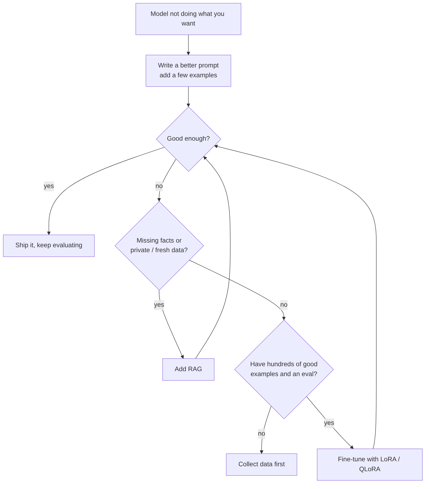
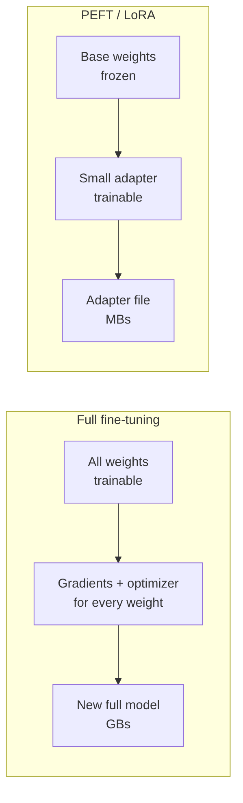
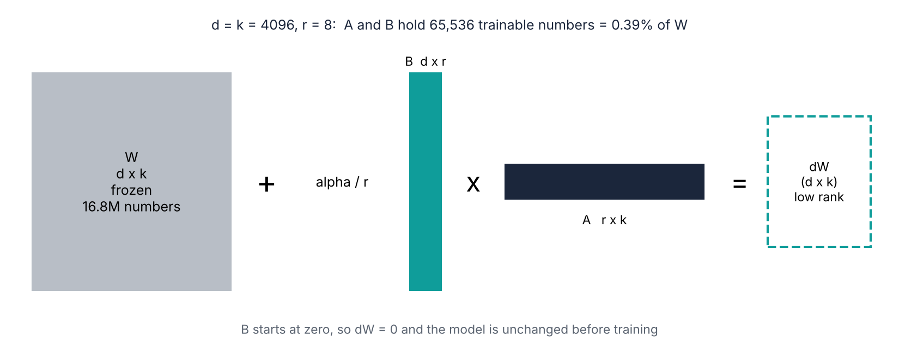
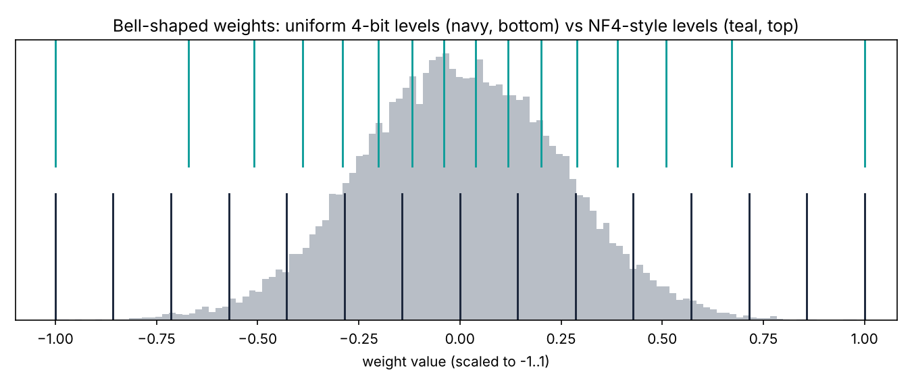
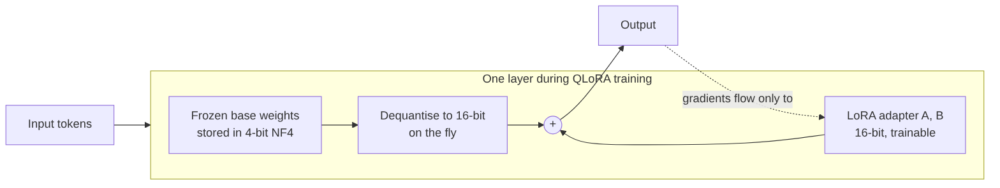
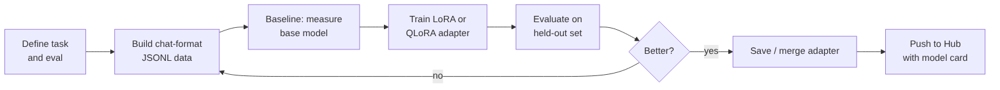

# Module 13 - Fine-tuning LLMs: SFT, LoRA and QLoRA

> Read this file top to bottom before you teach. Every new word is in **bold** the first time it appears, followed by a plain-English meaning.

## 1. What fine-tuning is

A **large language model (LLM)** is a program that predicts the next piece of text. It learned by reading a huge amount of text during **pre-training**. The model's knowledge lives in its **weights** (also called **parameters**): millions or billions of numbers that were adjusted during training.

**Fine-tuning** means taking a model that is already trained and training it a little more on your own, much smaller dataset, so it changes its behaviour in a specific way.

**Analogy - the new employee.** Pre-training is a university degree: broad knowledge, not specific to your company. Fine-tuning is a two-week on-the-job training: the employee keeps everything they learned at university but now writes emails in your company's style and follows your procedures. You do not send them back to school for four years.

What fine-tuning is good at:
- **Style and tone** - always answer like our brand, always be brief, always sound formal.
- **Format** - always output valid JSON with these fields; always follow this template.
- **Narrow skills** - classify support tickets into our 40 categories; extract fields from our invoices.
- **Making a small model act like a big one** on one task - cheaper and faster to run.

What fine-tuning is *not* good at:
- **Adding reliable new facts.** A fine-tuned model may *sound* like it knows your product catalogue but still invent details. You will see this in notebook 03: after training, the tiny model uses the right greeting but makes up facts. For facts, use **RAG** (module 09).

## 2. Prompting vs RAG vs fine-tuning - which one?

Three ways to make an LLM do what you want:

| | **Prompt engineering** | **RAG** (retrieval-augmented generation) | **Fine-tuning** |
|---|---|---|---|
| What changes | The instructions you send | The information you send (retrieved documents) | The model's weights |
| Good for | Most tasks; first thing to try | Facts, private documents, fresh information, citations | Style, format, narrow skills, smaller/cheaper models |
| Cost to start | Minutes | Days (build a search index) | Days to weeks (data + training + evaluation) |
| Update facts | Edit the prompt | Update the documents | Retrain |
| Analogy | Giving the employee clear written instructions | Giving them a filing cabinet to look things up | Training them until the habit is automatic |

**Rule of thumb:** start with prompting. If the model lacks knowledge, add RAG. If it has the knowledge but keeps getting the *behaviour* wrong even with good prompts and examples - or you need a smaller, faster, cheaper model - consider fine-tuning. Many real systems combine RAG *and* a fine-tuned model.



Questions to ask before fine-tuning:
1. Have I tried a strong prompt with a few examples (**few-shot prompting**)?
2. Is the problem missing *facts* (→ RAG) or wrong *behaviour* (→ maybe fine-tune)?
3. Do I have at least a few hundred high-quality examples - or can I create them?
4. Do I have an **evaluation** (a repeatable test, see module 12) to prove the fine-tuned model is better?

## 3. Supervised fine-tuning (SFT) and the data it needs

**Supervised fine-tuning (SFT)** means training on example input-output pairs: "when you see this, write that". It is stage 1 of the RLHF recipe from module 12.

### 3.1 The chat format

Modern datasets use the **chat format** (also called **conversational format**): a list of **messages**, each with a **role** and **content**.

```json
{"messages": [
  {"role": "system", "content": "You are the friendly assistant for Chai Corner, a small tea shop."},
  {"role": "user", "content": "Do you have Wi-Fi?"},
  {"role": "assistant", "content": "Chai Corner here! Yes, free Wi-Fi. The password is printed on your receipt. Have a warm day!"}
]}
```

- **system** - background instructions that apply to the whole chat.
- **user** - what the person typed.
- **assistant** - what the model should reply. This is what we train the model to produce.

Each example sits on one line of a **JSONL** file (JSON Lines: one JSON object per line). This module's dataset is `data/chai_corner_train.jsonl` (48 examples) and `data/chai_corner_test.jsonl` (12 held-out examples), created by `code/make_sft_dataset.py`.

### 3.2 Chat templates

A model does not see JSON. It sees one long string of **tokens** (words or pieces of words). A **chat template** is the recipe that turns the list of messages into that string, using **special tokens** that mark where each message starts and ends. For SmolLM2 it looks roughly like this:

```
<|im_start|>system
You are the friendly assistant for Chai Corner...<|im_end|>
<|im_start|>user
Do you have Wi-Fi?<|im_end|>
<|im_start|>assistant
Chai Corner here! Yes, free Wi-Fi...<|im_end|>
```

Every model family has its own template, and it is stored with the model's **tokenizer** (the tool that splits text into tokens). Always use `tokenizer.apply_chat_template(messages)` rather than building the string yourself - using the wrong template is one of the most common reasons a fine-tune performs badly.

### 3.3 Train only on the answer (loss masking)

During SFT we usually want the model to learn to write the *assistant's* reply, not to memorise the user's question. So we set the **labels** (the target tokens) of the prompt part to a special value, `-100`, which means "ignore this position when computing the loss". This is called **loss masking** or **completion-only training**. Notebook 03 does it by hand; libraries such as TRL do it with a setting (`assistant_only_loss` or `completion_only_loss` in `SFTConfig`).

### 3.4 What good SFT data looks like

- **Quality beats quantity.** A few hundred to a few thousand clean, consistent examples often beat 100,000 messy ones (the LIMA paper made this point with about 1,000 examples).
- **Consistent** - the same kind of question always gets the same style of answer.
- **Covers the real inputs** - include the messy, short, misspelled questions real users send.
- **Held-out test set** - keep 10-20% aside that the model never trains on, so you can measure honestly.
- **No secrets or personal data** - the model can memorise and repeat training data.

## 4. Full fine-tuning vs parameter-efficient fine-tuning (PEFT)

**Full fine-tuning** updates *every* weight in the model. **Parameter-efficient fine-tuning (PEFT)** freezes the original weights and trains only a small number of new ones.

**Analogy - editing a textbook.** Full fine-tuning is reprinting the whole 1,000-page book with your changes. PEFT is adding a thin booklet of sticky notes: the book stays the same, the notes change how you read it. You can keep several booklets (one per task) and swap them.

Why full fine-tuning is expensive - the memory bill. During training a GPU must hold, for *every* trainable weight:
- the weight itself,
- its **gradient** (the direction each weight should move),
- the **optimizer state** - the popular **Adam** optimizer keeps two extra running averages per weight.

A common rough estimate for full fine-tuning with mixed precision and Adam is about **16 bytes per parameter** before counting **activations** (the intermediate results saved during the forward pass). For a 7-billion-parameter model that is around 112 GB - more than any single consumer GPU. With PEFT, only a tiny fraction of weights have gradients and optimizer states, so the bill drops dramatically. The `excel/gpu-memory-estimator.xlsx` sheet does this arithmetic with formulas, and section 6 adds quantisation.



| | Full fine-tuning | PEFT (LoRA) |
|---|---|---|
| Weights trained | 100% | often 0.1%-1% |
| GPU memory | very high | much lower |
| Saved file | full model copy (GBs) | small **adapter** (MBs) |
| Risk of **catastrophic forgetting** (losing old skills) | higher | lower |
| Quality | best possible | usually close to full for most tasks |

An **adapter** is the small set of extra trained weights that sits on top of a frozen base model.

## 5. LoRA - Low-Rank Adaptation, explained visually

**LoRA** (Hu et al., 2021) is the most popular PEFT method.

### 5.1 The idea in one sentence

Instead of changing a big weight matrix W directly, LoRA learns the *change* ΔW as the product of two thin matrices, B × A, and adds it on.

### 5.2 Some words first

- A **matrix** is a grid of numbers. A layer in a neural network is mostly a matrix W of shape d × k (d rows, k columns).
- A **linear layer** computes `output = W × input`.
- The **rank** of a matrix is, informally, how many independent "directions" of information it contains. A 4096 × 4096 matrix can have rank up to 4096. A **low-rank** matrix has only a few independent directions, so it can be written as the product of two thin matrices.

**Analogy - a recipe card.** A full matrix is like a giant table listing the exact amount of every ingredient for every one of 4,096 dishes. A low-rank matrix says: "every dish is a mix of 8 base sauces" - you only need a table of dishes-to-sauces (4096 × 8) and sauces-to-ingredients (8 × 4096). Much smaller, and for a small *adjustment* to an existing menu, 8 sauces is usually enough.

### 5.3 The maths

For a frozen weight matrix W of shape d × k:

```
original:   h = W x
with LoRA:  h = W x + (alpha / r) * B A x
```

- **A** has shape r × k, **B** has shape d × r, and r (the **rank**) is small, like 4, 8, 16 or 64.
- B A has shape d × k - the same as W - so it can be added.
- **alpha** (`lora_alpha`) is a scaling number; the update is multiplied by alpha / r. People often set alpha to r or 2r.
- **Initialisation:** A starts with small random numbers and B starts at **all zeros**, so at the start B A = 0 and the model behaves exactly like the original. Training then grows B A from nothing.
- Only A and B are trained. W never changes.

**Count the savings.** Take one attention matrix with d = k = 4096 and r = 8:
- W has 4096 × 4096 = **16,777,216** numbers (frozen).
- A has 8 × 4096 = 32,768 and B has 4096 × 8 = 32,768, so LoRA trains **65,536** numbers - about **0.39%** of W.



### 5.4 Merging

After training, you can compute W' = W + (alpha/r) B A once and replace W with W'. The model is then a normal model again - no extra computation at inference time. This is called **merging** the adapter (`merge_and_unload()` in the `peft` library). Or you can keep the adapter separate and load different adapters for different tasks on the same base model.

### 5.5 Settings you will see

| Setting (`peft.LoraConfig`) | What it means | Typical starting value |
|---|---|---|
| `r` | rank of A and B | 8 or 16 |
| `lora_alpha` | scaling numerator | r or 2r |
| `lora_dropout` | randomly zero some inputs during training to reduce **overfitting** (memorising the training data) | 0.05 |
| `target_modules` | which layers get adapters | attention projections `q_proj`, `k_proj`, `v_proj`, `o_proj`; sometimes also MLP layers, or `"all-linear"` |
| `task_type` | the kind of model | `"CAUSAL_LM"` for chat/text-generation models |

Notebook `01-lora-from-scratch.ipynb` builds a LoRA layer in about 20 lines of PyTorch, proves the parameter counts, trains it, and merges it. Notebook `03-lora-finetune-cpu.ipynb` uses the real `peft` library on a 135-million-parameter chat model on a CPU.

## 6. Quantisation and QLoRA

### 6.1 Quantisation

**Quantisation** means storing numbers with fewer bits. A **bit** is a 0 or 1; more bits = more possible values = more precision.

| Format | Bits per weight | Bytes per weight | 7B model weights |
|---|---|---|---|
| float32 (FP32) | 32 | 4 | ~28 GB |
| bfloat16 / float16 | 16 | 2 | ~14 GB |
| int8 | 8 | 1 | ~7 GB |
| 4-bit (e.g. NF4) | 4 | 0.5 | ~3.5 GB |

**Analogy - rounding prices.** Writing every price as ₹123.4567 is precise but takes space. Rounding to ₹123 loses a little detail but is good enough for most decisions. Quantisation rounds every weight to one of a small set of allowed values.

How basic 4-bit quantisation works (**absmax** quantisation):
1. Take a block of weights (for example 64 numbers).
2. Find the largest absolute value in the block, call it m. The **scale** is m / 7.
3. Divide each weight by the scale and round to the nearest whole number between -7 and 7. Store those small integers (4 bits each) plus the one scale number.
4. To use a weight, multiply back: weight ≈ integer × scale. This is **dequantisation**.

Doing this in small **blocks** limits damage from **outliers** (unusually large weights) - one huge value only affects its own block.

**NF4 (4-bit NormalFloat)** is a smarter set of 16 allowed values used by QLoRA. Neural network weights are roughly bell-shaped (a **normal distribution**: most values near zero, few large ones), so NF4 places more of its 16 levels near zero where most weights are.


 Notebook `02-quantisation-explained.ipynb` shows absmax and NF4-style quantisation on real numbers and measures the error.

### 6.2 QLoRA

**QLoRA** (Dettmers et al., 2023) combines the two ideas:

1. Load the frozen base model in **4-bit** (NF4) - the big saving.
2. Add LoRA adapters in 16-bit and train only them.
3. During each forward pass, 4-bit weights are dequantised to 16-bit on the fly for the maths, then thrown away.
4. Extra tricks: **double quantisation** (quantising the scale numbers too, to save a bit more memory) and **paged optimizers** (moving optimizer memory to normal RAM when the GPU is full).

The result: a model that needs ~14 GB just to *load* in 16-bit can be *fine-tuned* in roughly a third or less of that. A free Colab **T4 GPU** (16 GB) can QLoRA-train small and mid-sized models. Notebook `04-qlora-colab-only.ipynb` does this with Hugging Face `transformers`, `peft`, `trl` and `bitsandbytes` (the library that provides 4-bit layers on NVIDIA GPUs).



### 6.3 Rough GPU memory estimates

These are rough rules of thumb for planning, not guarantees (activations depend on sequence length and batch size):

| Method | Memory per model parameter (approx.) | 1B model | 7B model |
|---|---|---|---|
| Inference in 16-bit | 2 bytes | ~2 GB | ~14 GB |
| Full fine-tune (16-bit + Adam) | ~16 bytes | ~16 GB | ~112 GB |
| LoRA (16-bit frozen base) | ~2 bytes + small adapter | ~2-3 GB | ~15-16 GB |
| QLoRA (4-bit frozen base) | ~0.5-0.6 bytes + small adapter | ~1 GB | ~4-5 GB |

Add activations and some framework overhead on top. `excel/gpu-memory-estimator.xlsx` lets you plug in your own numbers.

## 7. The Hugging Face toolkit

- **`transformers`** - loads models and tokenizers (`AutoModelForCausalLM`, `AutoTokenizer`), and contains the generic `Trainer`.
- **`peft`** - adds LoRA and other adapters: `LoraConfig`, `get_peft_model`, `PeftModel.from_pretrained`, `merge_and_unload`.
- **`trl`** (Transformer Reinforcement Learning) - ready-made trainers: `SFTTrainer` + `SFTConfig` for supervised fine-tuning, `DPOTrainer` for preference tuning (module 12), and others.
- **`bitsandbytes`** - 4-bit and 8-bit layers; used through `BitsAndBytesConfig` in `transformers`. Needs an NVIDIA GPU.
- **`datasets`** - loads and processes datasets (`load_dataset("json", data_files=...)`).
- **`accelerate`** - handles devices and mixed precision behind the scenes.

These libraries change fast. Argument names do get renamed (for example, TRL's `max_seq_length` became `max_length`). Our notebooks were checked against transformers 5.23, peft 0.22 and trl 1.18 (late 2026); the Colab notebook pins those versions. If you upgrade, check the official docs.



A typical `trl` SFT run looks like this (full version in notebook 04):

```python
from peft import LoraConfig
from trl import SFTConfig, SFTTrainer

peft_config = LoraConfig(r=16, lora_alpha=32, lora_dropout=0.05,
                         target_modules="all-linear", task_type="CAUSAL_LM")
args = SFTConfig(output_dir="out", num_train_epochs=3, per_device_train_batch_size=4,
                 learning_rate=2e-4, max_length=512, assistant_only_loss=False)
trainer = SFTTrainer(model=model, args=args, train_dataset=train_ds,
                     processing_class=tokenizer, peft_config=peft_config)
trainer.train()
```

### Key training settings

- **Learning rate** - how big each update step is. LoRA commonly uses around 1e-4 to 2e-4 (larger than full fine-tuning). Too high → loss jumps around or the model breaks; too low → nothing changes.
- **Epoch** - one full pass over the training data. Small datasets often use 1-3 epochs; more risks overfitting.
- **Batch size** - how many examples are processed together. **Gradient accumulation** adds up gradients over several small batches to act like one big batch when memory is short.
- **Max length** - longer examples are cut (**truncated**). Set it to cover your real examples.
- **Gradient checkpointing** - saves memory by recomputing some activations instead of storing them; slower but lets bigger models fit.

## 8. Evaluating the result

Never trust a fine-tune because the training loss went down. **Training loss** only says the model fits the training data - it could be memorising. Check:

1. **Held-out loss** - loss on the test examples the model never saw. If training loss falls but held-out loss rises, you are **overfitting**.
2. **Task metric before vs after** - something you actually care about, measured on the same test set before and after. In notebook 03 it is "percentage of answers in the Chai Corner house style" (0% → most).
3. **Read the outputs** - look at 10-20 real generations. In notebook 03 you will see correct style but invented facts - a lesson no number shows.
4. **Regression check** - make sure general skills did not break (ask a few unrelated questions, compare with the base model).
5. **LLM-as-judge or human eval** for open-ended quality (module 12).

## 9. Merging and sharing adapters

After training you have three options:

1. **Save only the adapter** - `model.save_pretrained("my-adapter")` writes a few MB (`adapter_config.json` + `adapter_model.safetensors`). Anyone with the same base model can load it with `PeftModel.from_pretrained(base_model, "my-adapter")`.
2. **Merge** - `merged = model.merge_and_unload()` folds B A into W and returns a normal `transformers` model. Save it with `merged.save_pretrained(...)`. Bigger file, but no `peft` needed to run it. (For QLoRA, merge into a 16-bit copy of the base model, not the 4-bit one.)
3. **Share on the Hugging Face Hub** - `model.push_to_hub("your-username/chai-corner-lora")`. You need a free account and an **access token** stored in the environment variable `HF_TOKEN` (never in code). Our notebooks only push if that variable exists. Add a **model card** (README) that says what base model, data and settings you used, and the model's limitations.

**Licences matter.** The base model's licence also applies to your fine-tune. Check it before sharing or using commercially.

## 10. Common pitfalls

- Fine-tuning to add facts (use RAG).
- Wrong or missing chat template.
- No held-out test set, or testing on training examples.
- Learning rate far too high (loss explodes) or too low (nothing changes).
- Too many epochs on a tiny dataset (memorisation).
- Forgetting to set a **pad token** (a filler token used to make sequences the same length) for models that do not have one.
- Running out of GPU memory: reduce batch size, use gradient accumulation, shorten max length, enable gradient checkpointing, or switch to QLoRA.
- Pushing a token or private data to a public repo.

## 11. Recap

- Fine-tuning changes the weights; prompting changes instructions; RAG changes the information. Try prompt → RAG → fine-tune.
- SFT data is chat-format JSONL; use the model's chat template; mask the prompt from the loss.
- Full fine-tuning trains everything (~16 bytes/parameter); PEFT trains a small adapter.
- LoRA: h = Wx + (alpha/r)·BAx with B starting at zero; r = 8 on a 4096×4096 layer trains 0.39% of it.
- Quantisation stores weights in fewer bits; QLoRA = 4-bit NF4 frozen base + 16-bit LoRA adapters.
- Evaluate with held-out loss, a before/after task metric, and by reading outputs.
- Save the adapter, merge if you want a standalone model, push to the Hub only with a token from the environment.
