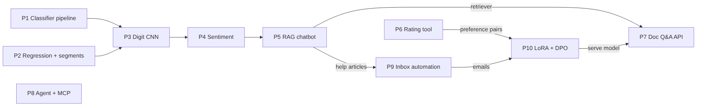

<!-- nav:start -->
> [🏠 Course home](../README.md) · [🗺️ Roadmap](../ROADMAP.md) · [⬅️ 14 Deployment & LLMOps](../14-deployment-and-llmops/README.md) · [16 Careers ➡️](../16-careers/README.md)  
> **🏗️ Module 15 · Projects**  
> 
<!-- nav:end -->

# 15 — Projects

Ten portfolio projects, from beginner to advanced. Each one is a small, real system you can run, explain in an interview, and extend. They were picked from ideas in the source repositories (mainly source 6; see [SOURCES.md](../SOURCES.md)). **We reimplemented every one ourselves on small offline data**, so nothing needs to be downloaded except a few small Hugging Face models.

| # | Project | Level | Do it after | What you build | Key tech |
|---|---|---|---|---|---|
| P1 | [ML classifier pipeline](p01-ml-classifier-pipeline/) | Beginner | 04 | Compares 4 classifiers with cross-validation and a metrics report on wine/iris/breast-cancer | scikit-learn |
| P2 | [Regression & segmentation](p02-regression-and-segmentation/) | Beginner | 04 | Regression with hand-written gradient descent, plus K-means customer segments | NumPy, scikit-learn |
| P3 | [Digit recogniser CNN](p03-digit-recognizer-cnn/) | Beginner→Int. | 05 | MLP vs CNN on 8×8 digits, with early stopping and augmentation | PyTorch |
| P4 | [Sentiment: classic vs neural](p04-sentiment-classic-vs-neural/) | Intermediate | 06 | TF-IDF vs a neural net vs pretrained transformers, compared honestly | scikit-learn, PyTorch, HF |
| P5 | [RAG course chatbot](p05-rag-course-chatbot/) | Intermediate | 09 | Chatbot over this repo's notes, with citations, follow-up rewriting and evaluation | sentence-transformers, FAISS, Gradio |
| P6 | [Response-rating tool](p06-response-rating-tool/) | Intermediate | 12 | Pairwise rating app → preference JSONL → LLM-judge agreement (kappa) | Streamlit, scikit-learn |
| P7 | [Document Q&A API](p07-doc-qa-api/) | Int.→Adv. | 09 + 14 | PDF policy Q&A with hybrid search, page citations and refusals, served by FastAPI | pypdf, BM25, FAISS, FastAPI, Docker |
| P8 | [Data-analyst agent + MCP](p08-data-analyst-agent-mcp/) | Advanced | 10 | Tool-using agent over SQLite with a read-only guard; the same tools exposed as an MCP server | tool calling, SQLite, MCP |
| P9 | [Support-inbox automation](p09-support-inbox-automation/) | Advanced | 11 | Email triage with structured extraction, routing and a human-approval queue; Python version and n8n version | Pydantic, FastAPI, n8n |
| P10 | [Fine-tune: LoRA SFT + DPO](p10-finetune-lora-dpo/) | Advanced | 13 | LoRA-tunes a small model to output strict JSON, then runs DPO; compared with prompting | Transformers, PEFT, TRL |

## Every project contains
- `README.md`: what it does, an architecture diagram, setup for **Colab and local**, how each file works, **how to explain it in an interview**, and credits
- `requirements.txt` with pinned versions, and `.env.example` (placeholders only, never real keys)
- working code, sample data (with the seeded script that generates it), and tests
- `colab_quickstart.ipynb` with an Open-in-Colab badge

## LLM providers
Projects that use an LLM default to `LLM_PROVIDER=local`, a tiny Hugging Face model, so they run with no key. Copy `.env.example` to `.env` to switch to `ollama`, `anthropic` or `openai`. The tiny local model is weak on purpose: where its answers are poor, the README says so honestly and offers a rule-based or extractive fallback.

## Assessment tip for trainers
Grade projects with the **"How to explain it in an interview"** section of each README. Ask students to give the 60-second pitch and answer two of the listed questions.

<!-- nav:start -->
---
[🏠 Course home](../README.md) · [🗺️ Roadmap](../ROADMAP.md) · [⬅️ 14 Deployment & LLMOps](../14-deployment-and-llmops/README.md) · [16 Careers ➡️](../16-careers/README.md)
<!-- nav:end -->
