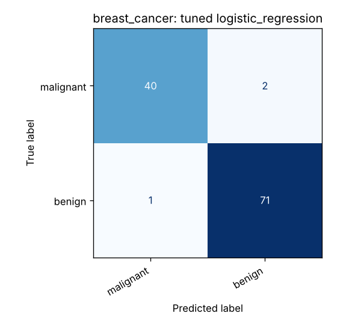

# Report: breast_cancer

Rows: 569 (train 455, test 114), features: 30, classes: malignant, benign

## 5-fold cross-validation on the training set

| model               |   cv_accuracy_mean |   cv_accuracy_std |   cv_f1_macro_mean |
|:--------------------|-------------------:|------------------:|-------------------:|
| logistic_regression |              0.978 |             0.010 |              0.976 |
| random_forest       |              0.963 |             0.018 |              0.960 |
| knn                 |              0.963 |             0.011 |              0.960 |
| decision_tree       |              0.916 |             0.018 |              0.912 |

## Tuned winner: logistic_regression

Best settings: `{'model__C': 0.1}` (CV F1-macro 0.981)

## Hidden test set (used once)

Accuracy 0.974, F1-macro 0.972

```
              precision    recall  f1-score   support

   malignant      0.976     0.952     0.964        42
      benign      0.973     0.986     0.979        72

    accuracy                          0.974       114
   macro avg      0.974     0.969     0.972       114
weighted avg      0.974     0.974     0.974       114
```



## Which mistakes matter?

Missed cancers (false negatives): 2. False alarms (false positives): 1. In screening, a false negative is far more costly, so we would accept more false alarms to push false negatives toward zero (e.g. by lowering the decision threshold).
