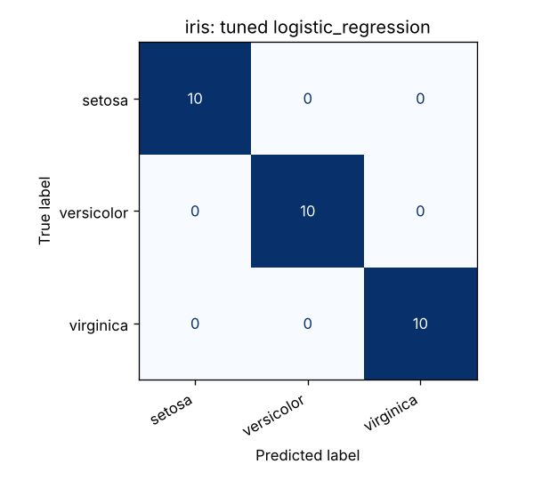

# Report: iris

Rows: 150 (train 120, test 30), features: 4, classes: setosa, versicolor, virginica

## 5-fold cross-validation on the training set

| model               |   cv_accuracy_mean |   cv_accuracy_std |   cv_f1_macro_mean |
|:--------------------|-------------------:|------------------:|-------------------:|
| logistic_regression |              0.958 |             0.026 |              0.958 |
| knn                 |              0.958 |             0.026 |              0.958 |
| decision_tree       |              0.950 |             0.017 |              0.950 |
| random_forest       |              0.950 |             0.031 |              0.949 |

## Tuned winner: logistic_regression

Best settings: `{'model__C': 10}` (CV F1-macro 0.966)

## Hidden test set (used once)

Accuracy 1.000, F1-macro 1.000

```
              precision    recall  f1-score   support

      setosa      1.000     1.000     1.000        10
  versicolor      1.000     1.000     1.000        10
   virginica      1.000     1.000     1.000        10

    accuracy                          1.000        30
   macro avg      1.000     1.000     1.000        30
weighted avg      1.000     1.000     1.000        30
```


