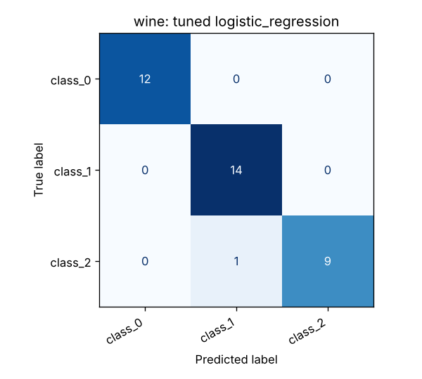

# Report: wine

Rows: 178 (train 142, test 36), features: 13, classes: class_0, class_1, class_2

## 5-fold cross-validation on the training set

| model               |   cv_accuracy_mean |   cv_accuracy_std |   cv_f1_macro_mean |
|:--------------------|-------------------:|------------------:|-------------------:|
| logistic_regression |              0.979 |             0.028 |              0.980 |
| random_forest       |              0.979 |             0.028 |              0.979 |
| knn                 |              0.951 |             0.035 |              0.951 |
| decision_tree       |              0.902 |             0.059 |              0.905 |

## Tuned winner: logistic_regression

Best settings: `{'model__C': 1}` (CV F1-macro 0.980)

## Hidden test set (used once)

Accuracy 0.972, F1-macro 0.971

```
              precision    recall  f1-score   support

     class_0      1.000     1.000     1.000        12
     class_1      0.933     1.000     0.966        14
     class_2      1.000     0.900     0.947        10

    accuracy                          0.972        36
   macro avg      0.978     0.967     0.971        36
weighted avg      0.974     0.972     0.972        36
```


