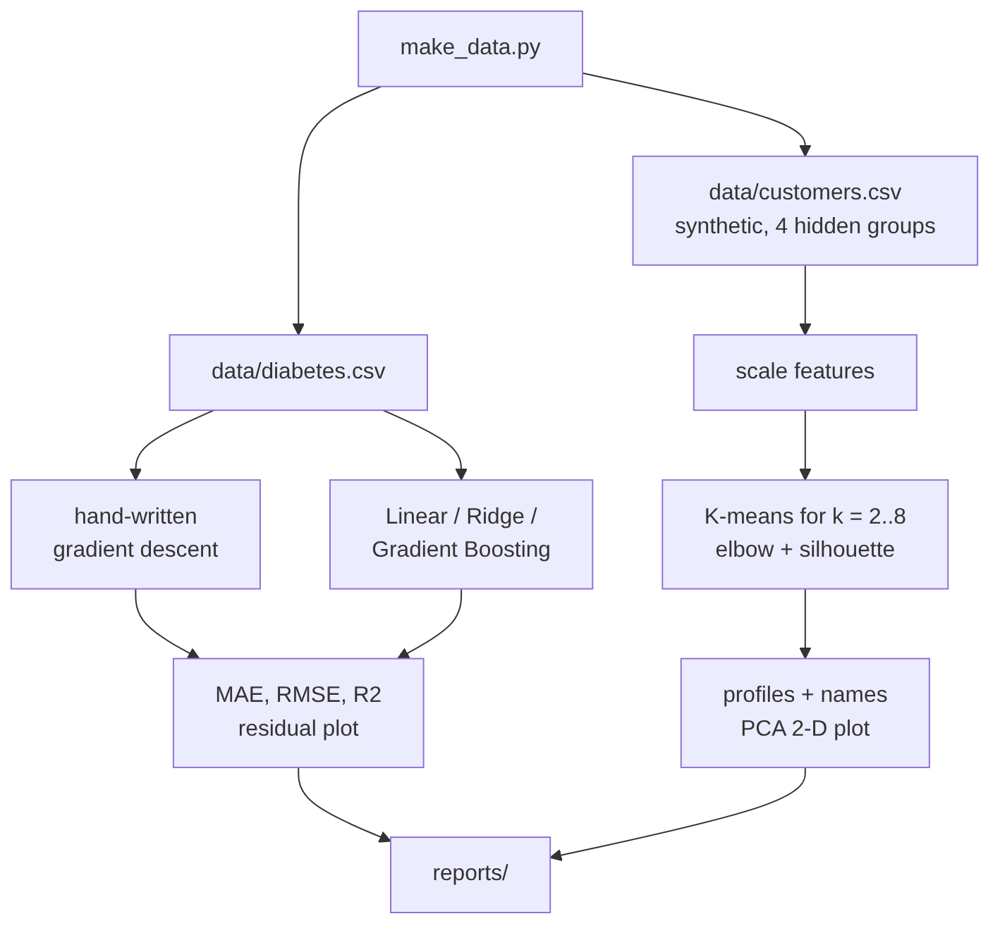

<!-- nav:start -->
> [🏠 Course home](../../README.md) · [🏗️ All projects](../README.md) · [⬅️ P01 ML classifier pipeline](../p01-ml-classifier-pipeline/README.md) · [P03 Digit recogniser (CNN) ➡️](../p03-digit-recognizer-cnn/README.md)  
> **P02 · Regression & customer segmentation** · 🟢 Beginner · best after module 04 · [▶️ Open in Colab](https://colab.research.google.com/github/vvvvvivekkk/AI-Engineer/blob/main/15-projects/p02-regression-and-segmentation/colab_quickstart.ipynb)
<!-- nav:end -->

# P2 - Regression (with hand-written gradient descent) and customer segmentation

**Level:** Beginner · **Modules used:** 03 (math intuition), 04 (machine learning) · **Runs on:** any CPU or free Colab, about 15 seconds

## What it does

Two small, classic machine-learning jobs in one project:

**Part A - Regression.** **Regression** means predicting a number. Here: how much a patient's diabetes progresses in a year, from 10 measurements (age, BMI, blood pressure, six blood tests...). We train:
- our own **gradient descent** written with NumPy (no library does the learning for us);
- scikit-learn's **LinearRegression** (the exact answer, found with algebra);
- **Ridge** (linear regression that is penalised for large weights, which reduces **overfitting** - memorising the training data instead of learning patterns);
- **GradientBoostingRegressor** (many small decision trees, each correcting the mistakes of the ones before it);
- a **baseline** that always predicts the average. Every real model must beat it.

We compare them with **MAE** (mean absolute error - the average miss), **RMSE** (root mean squared error - like MAE but big misses count extra) and **R²** (the share of the variation the model explains; 1 is perfect, 0 is "no better than the average"). We also plot **residuals** (true value minus prediction) to look for patterns the model missed.

**Part B - Segmentation.** We invent 600 shop customers (spend, visits, days since last visit) that secretly belong to 4 groups, then ask **K-means** to find groups without telling it the answers. This is **unsupervised learning** (learning without labels). We pick the number of groups *k* with the **elbow method** and the **silhouette score**, draw the customers in 2-D with **PCA** (principal component analysis - squeezing many columns into 2 while keeping as much spread as possible), and give each segment a plain name ("loyal big spenders", "occasional", "at risk", "lost").

Typical output:

| model | MAE | RMSE | R² |
|---|---|---|---|
| our_gradient_descent | 42.80 | 53.85 | 0.45 |
| linear_regression | 42.79 | 53.85 | 0.45 |
| ridge(alpha=1) | 42.81 | 53.78 | 0.45 |
| gradient_boosting | 42.70 | 52.67 | 0.48 |
| baseline_mean | 64.01 | 73.22 | -0.01 |

Our hand-written gradient descent ends within 0.004 of scikit-learn's weights. K-means picks k = 4 and matches the hidden groups almost perfectly (adjusted Rand index 0.996). R² of about 0.45 is normal for this dataset: 10 measurements cannot fully explain how a disease develops.

## Architecture



Analogies:
- **Gradient descent** is walking down a foggy hill: you can't see the valley, but you can feel which way the ground slopes, so you take small steps downhill. The "height" is the error; the "position" is the model's weights.
- **K-means** is placing k ice-cream vans in a park: each visitor walks to the nearest van, then each van moves to the middle of its crowd, and you repeat until no van moves.

## Setup

### Option A - Google Colab

1. Open `colab_quickstart.ipynb` on GitHub and click **Open in Colab**.
2. **Runtime → Run all.** It clones the repo, installs `requirements.txt`, makes the data, runs both parts, shows the charts and runs the tests.

### Option B - your own computer

```bash
git clone https://github.com/vvvvvivekkk/AI-Engineer.git
cd AI-Engineer/15-projects/p02-regression-and-segmentation
python -m venv .venv
source .venv/bin/activate            # Windows: .venv\Scripts\activate
pip install -r requirements.txt
cp .env.example .env                 # no secrets needed; kept for a consistent layout
python make_data.py                  # optional - the CSVs are already in data/
python main.py                       # both parts
python main.py --part regression     # or --part segmentation
python -m pytest -q
```

Outputs land in `reports/`: `regression.png`, `regression_scores.csv`, `segmentation.png`, `segment_profiles.csv`, `customers_with_segments.csv`.

## How each file works

### `make_data.py`
- `make_diabetes()` saves scikit-learn's bundled diabetes dataset (442 patients). Its features are already centred and scaled by scikit-learn.
- `make_customers()` uses `make_blobs` (a scikit-learn helper that scatters points around chosen centres) with a fixed **seed** (a starting number for the random generator, so the "random" data is identical every run). Each column has its own realistic spread. It adds `avg_basket` (spend per visit) and keeps the true group in `hidden_segment` only so we can check our answer.

### `src/gradient_descent.py`
`fit_gradient_descent(X, y, lr, epochs)` - starts with all weights at zero, then repeats: predict (`X @ w + b`), measure the mean squared error, compute the **gradient** (the direction that increases the error the fastest), and step the opposite way by `lr` (the **learning rate**, the step size). Returns the weights, the bias and the loss after every **epoch** (one full pass over the data). `predict()` applies the learned line.

### `src/regression.py`
`run(out_dir)` splits the data 80/20, **scales** the features (mean 0, spread 1 - gradient descent struggles when columns have very different ranges), trains our GD plus the three scikit-learn models and the mean baseline, scores everything on the test set, checks how close our weights are to scikit-learn's, and saves a two-panel chart: the loss curve and the residual plot of the best model.

### `src/segmentation.py`
- `choose_k()` fits K-means for k = 2..8 and records **inertia** (total squared distance from each customer to its group centre) and the average **silhouette** (−1 to +1: how much closer a customer is to its own group than to the next one).
- `name_segment()` turns a segment's averages into a business name with simple, explainable rules.
- `run()` scales the features, picks the k with the best silhouette, fits the final model, builds a profile table, computes the **adjusted Rand index** (agreement with the hidden groups, 1 = perfect; only possible because the data is synthetic) and saves the elbow, silhouette and PCA charts.

### `main.py`
Command-line runner. `--part` chooses regression, segmentation or both; `--out` changes the output folder. Prints the tables and writes CSVs and charts.

### `tests/test_p02.py`
1. GD recovers a known line (y = 3·x1 − 2·x2 + 5) exactly. 2. All models beat the mean baseline and GD matches scikit-learn. 3. Segmentation finds k = 4 with high agreement.

### `build.py`, `requirements.txt`, `.env.example`
`build.py` regenerates the diagram and Colab notebook. `requirements.txt` pins exact versions. `.env.example` is a placeholder - this project needs no keys.

## How to explain it in an interview

**60-second pitch.** "This project has two parts. First, regression on the diabetes dataset: I implemented linear regression with gradient descent in NumPy and showed it converges to the same weights as scikit-learn's closed-form solution, then compared Ridge and gradient boosting against a mean baseline using MAE, RMSE and R², with a residual plot. Boosting was slightly best, R² about 0.48. Second, customer segmentation: I generated a seeded synthetic customer table, scaled it, chose k for K-means using the elbow and silhouette methods, visualised the clusters with PCA, and translated the clusters into business segments like 'at risk' and 'lost'. Because the data is synthetic I could measure recovery: adjusted Rand 0.996."

**Design decisions and trade-offs**
- *Write GD by hand* - slower than a library, but it proves you understand what "training" means; the test compares it to the exact answer.
- *Always include a baseline* - a model with R² 0.45 sounds weak until you see the baseline at 0.
- *Scale before K-means* - K-means uses distances; unscaled dollars (hundreds) would drown out visits (single digits).
- *Drop `avg_basket` from clustering* - it is a ratio with a long tail and mostly repeats spend and visits; including it split clusters on outliers.
- *Silhouette to pick k* - more objective than eyeballing an elbow, but it can prefer fewer, rounder clusters; we show both charts.

**Five likely questions**
1. *Why does gradient descent need scaled features?* - With very different ranges, the error surface is a long narrow valley; one learning rate is too big for one direction and too small for another, so it zig-zags or diverges.
2. *What happens if the learning rate is too high or too low?* - Too high: the loss bounces or explodes. Too low: it creeps and needs many more epochs.
3. *Ridge vs plain linear regression?* - Ridge adds a penalty on the size of the weights (alpha times sum of squared weights). It helps when features are correlated or data is small; here the gain is tiny because the problem is small and stable.
4. *How do you evaluate clustering without labels?* - Internal measures (silhouette, inertia), stability across seeds, and most importantly whether the segments are useful and actionable for the business.
5. *Limitations of K-means?* - You must choose k; it assumes round, similar-sized clusters; it is sensitive to scaling and outliers; results depend on the starting points (we use `n_init=10` restarts).

## Credits (original ideas)

- "10 Machine Learning Projects on Regression with Python" - Aman Kharwal (source 6): https://amankharwal.medium.com/10-machine-learning-projects-on-regression-with-python-e5494615a0d0
- "All Unsupervised Machine Learning Algorithms Explained" - Aman Kharwal (source 6): https://amankharwal.medium.com/all-unsupervised-machine-learning-algorithms-explained-aecf1ba95d8b
- Diabetes dataset: Efron et al. (2004), bundled with scikit-learn - https://scikit-learn.org/stable/datasets/toy_dataset.html#diabetes-dataset

Our own code on bundled and synthetic offline data.

## What to try next

1. Add **mini-batch** gradient descent (update on 32 rows at a time) and compare loss curves.
2. Try learning rates 0.001, 0.01, 0.5 and plot the curves on one chart.
3. Tune Ridge's `alpha` with `RidgeCV`, and boosting's settings with `GridSearchCV`.
4. Put `avg_basket` back into segmentation (maybe after a log transform) and see how the clusters change.
5. Try `DBSCAN` or `AgglomerativeClustering` on the same customers and compare silhouettes.

<!-- nav:start -->
---
[🏠 Course home](../../README.md) · [🏗️ All projects](../README.md) · [⬅️ P01 ML classifier pipeline](../p01-ml-classifier-pipeline/README.md) · [P03 Digit recogniser (CNN) ➡️](../p03-digit-recognizer-cnn/README.md)
<!-- nav:end -->
