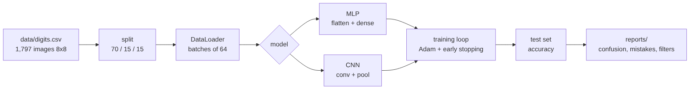

<!-- nav:start -->
> [🏠 Course home](../../README.md) · [🏗️ All projects](../README.md) · [⬅️ P02 Regression & customer segmentation](../p02-regression-and-segmentation/README.md) · [P04 Sentiment: classic vs neural ➡️](../p04-sentiment-classic-vs-neural/README.md)  
> **P03 · Digit recogniser (CNN)** · 🟢→🟡 · best after module 05 · [▶️ Open in Colab](https://colab.research.google.com/github/vvvvvivekkk/AI-Engineer/blob/main/15-projects/p03-digit-recognizer-cnn/colab_quickstart.ipynb)
<!-- nav:end -->

# P3 - Handwritten digit recogniser: MLP vs CNN in PyTorch

**Level:** Beginner → Intermediate · **Module used:** 05 (deep learning) · **Runs on:** CPU in about 2 minutes (no GPU needed), or free Colab

## What it does

The computer looks at tiny 8×8 pictures of handwritten digits and says which digit (0-9) each one is. We train two **neural networks** (models made of layers of simple maths units whose weights are learned from examples) in **PyTorch** (a popular Python library for deep learning):

1. an **MLP** (multi-layer perceptron) - flattens the picture into 64 numbers and uses fully-connected layers. It does not know which pixels are neighbours.
2. a small **CNN** (convolutional neural network) - slides little 3×3 **filters** (pattern detectors for edges and curves) over the picture, then **pools** (shrinks the picture, keeping the strongest signals).

The project shows the full training workflow: a **training / validation / test split**, a hand-written **training loop**, **early stopping** (stop when the validation score stops improving), **dropout** (randomly switching units off during training so the network can't rely on any single one), a **confusion matrix**, the **misclassified digits**, the CNN's **learned filters**, and optional **data augmentation** (training on slightly shifted, slightly noisy copies of the images).

Results on the 270 hidden test images (seeded, so you should see the same):

| model | parameters | test accuracy | wrong |
|---|---|---|---|
| MLP | 9,610 | 0.970 | 8 |
| CNN | 38,282 | 0.978 | 6 |
| CNN + augmentation (`--augment`) | 38,282 | 0.993 | 2 |

Honest note: the plain CNN only beats the MLP by 2 images here, because 8×8 pictures are so small that "where pixels sit" carries less information than in real photos. With augmentation the CNN pulls clearly ahead - shifting the digits by a pixel breaks the MLP's "memorise exact positions" habit but the CNN's filters handle it naturally.

## Architecture



Analogy: the MLP reads a page as one long line of letters with the line breaks removed. The CNN looks at the page through a small magnifying glass that it slides across, so it notices strokes wherever they are.

## Setup

### Option A - Google Colab
1. Open `colab_quickstart.ipynb` on GitHub and click **Open in Colab**.
2. **Runtime → Run all.** A GPU is not needed (the default CPU runtime is fine). The notebook clones the repo, installs the packages (keeping Colab's own PyTorch), trains both models and shows the charts.

### Option B - your own computer
```bash
git clone https://github.com/vvvvvivekkk/AI-Engineer.git
cd AI-Engineer/15-projects/p03-digit-recognizer-cnn
python -m venv .venv
source .venv/bin/activate                     # Windows: .venv\Scripts\activate
# CPU-only PyTorch is much smaller to download:
pip install torch==2.15.0 --index-url https://download.pytorch.org/whl/cpu
pip install -r requirements.txt
cp .env.example .env                          # no secrets needed
python make_data.py                           # optional - data/digits.csv is committed
python main.py                                # MLP + CNN
python main.py --model cnn --augment          # CNN with augmentation
python main.py --epochs 5                     # quick smoke test
python -m pytest -q
```
Outputs: `reports/` (charts + `summary.json`) and `models/mlp.pt`, `models/cnn.pt` (the learned weights).

## How each file works

### `make_data.py`
Saves scikit-learn's bundled digits (1,797 images; no internet) as `data/digits.csv`: 64 pixel columns `p0..p63` (brightness 0-16) and a `label` column.

### `src/data.py`
- `load_arrays()` reads the CSV, divides by 16 so pixels are between 0 and 1, and reshapes each row to `(1, 8, 8)` - 1 **channel** (greyscale), 8 rows, 8 columns.
- `split()` makes a 70 / 15 / 15 train / validation / test split, **stratified** (same mix of digits in each part).
- `augment()` shifts each image by up to one pixel and adds a little random noise. It groups images by shift so it runs fast.
- `loader()` wraps arrays in a PyTorch **DataLoader**, which serves shuffled **batches** (groups of 64 images).

### `src/models.py`
`MLP` (64 → 128 → 10 with ReLU and dropout) and `SmallCNN` (two 3×3 conv layers with 16 and 32 filters, a 2×2 max-pool, then 512 → 64 → 10). **ReLU** is an activation that keeps positive values and turns negatives into 0. The 10 outputs are **logits** (raw scores, one per digit). `count_params()` counts learned numbers.

### `src/train.py`
- `run_epoch()` - one pass over the data: **forward** (predict), **loss** (cross-entropy - large when the correct digit got a low score), **backward** (`loss.backward()` computes gradients by **backpropagation**), **step** (the **Adam** optimiser nudges each weight). With no optimiser it only evaluates.
- `fit()` - repeats epochs, tracks train/validation loss and accuracy, keeps a copy of the best weights, stops after `patience` epochs without improvement, and restores the best weights.
- `predict()` - picks the digit with the highest score.

### `src/evaluate.py`
`plot_curves` (train vs validation loss; a widening gap means **overfitting**), `plot_confusion`, `plot_misclassified` (each wrong image labelled "true→predicted"), `plot_filters` (the CNN's 16 first-layer filters).

### `main.py`
Command-line runner: `--model mlp|cnn|both`, `--epochs`, `--patience`, `--augment`, `--out`. Seeds everything, trains, evaluates on the test set, saves charts, weights and `summary.json`.

### `tests/test_p03.py`
Data shapes and split sizes, both models output 10 scores, augmentation keeps shape and range, and a 5-epoch CNN already scores above 85%.

### `build.py`, `requirements.txt`, `.env.example`
Diagram + notebook generator, pinned versions (torch pinned as `2.15.0`; the CPU wheel was used here), and a placeholder settings file.

## How to explain it in an interview

**60-second pitch.** "I built a digit classifier in PyTorch and compared an MLP with a small CNN on the 8×8 digits dataset. I wrote the training loop myself - forward pass, cross-entropy, backprop, Adam - with a stratified train/validation/test split and early stopping that restores the best weights. The MLP got 97.0% and the CNN 97.8%; with simple augmentation, one-pixel shifts plus noise, the CNN reached 99.3%, two errors out of 270. I analysed the confusion matrix and misclassified images, and visualised the learned filters. Everything is seeded and tested."

**Design decisions and trade-offs**
- *Validation set separate from test set* - early stopping uses validation; the test set stays untouched so the final number is honest.
- *Early stopping + dropout* instead of a fixed epoch count - less overfitting, less guesswork.
- *Tiny CNN* - 38k parameters train on CPU in about a minute. A deeper network would not help on 8×8 images.
- *Own augmentation code* instead of torchvision - one fewer dependency and the idea is visible in 10 lines; torchvision transforms are the standard choice for real images.

**Five likely questions**
1. *Why does a CNN suit images?* - Weight sharing: the same filter is applied everywhere, so a pattern is recognised in any position, with far fewer weights than a dense layer on large images.
2. *What does `model.train()` vs `model.eval()` change?* - It turns dropout (and batch-norm updates) on or off. Forgetting `eval()` makes predictions noisy.
3. *Why `optimizer.zero_grad()`?* - PyTorch adds new gradients to old ones; without clearing, each step uses a running sum and training goes wrong.
4. *How do you know you're overfitting?* - Training loss keeps falling while validation loss rises; the loss-curve chart shows this, and early stopping reacts to it.
5. *Which digits get confused, and why?* - Typically 1/7, 3/8, 4/9 - shapes that differ by a few pixels; at 8×8 resolution some are ambiguous even to humans.

## Credits (original ideas)
- "Digit Recogniser" listed in source 8's `Projects/Projects.md`, linking to CNN-from-Scratch by aashish-ak: https://github.com/aashish-ak/CNN-from-Scratch
- "8 Neural Network Projects Solved and Explained" (source 6): https://medium.datadriveninvestor.com/8-neural-networks-projects-solved-and-explained-a4f142bc10c
- Data: UCI Optical Recognition of Handwritten Digits, bundled with scikit-learn.

Our own PyTorch reimplementation on bundled offline data.

## What to try next
1. Upscale the images to 16×16 (`torch.nn.functional.interpolate`) and add a third conv layer.
2. Add `nn.BatchNorm2d` after each convolution and compare training speed.
3. Export the CNN to **ONNX** (an open model format) with `torch.onnx.export` (needs `pip install onnx`) and run it with `onnxruntime`.
4. Draw your own digit in an 8×8 grid and classify it.
5. Train with a learning-rate scheduler (`torch.optim.lr_scheduler.ReduceLROnPlateau`).

<!-- nav:start -->
---
[🏠 Course home](../../README.md) · [🏗️ All projects](../README.md) · [⬅️ P02 Regression & customer segmentation](../p02-regression-and-segmentation/README.md) · [P04 Sentiment: classic vs neural ➡️](../p04-sentiment-classic-vs-neural/README.md)
<!-- nav:end -->
