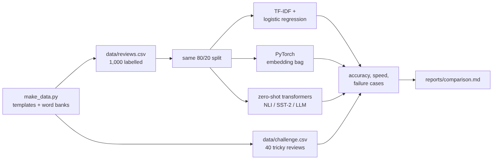

# P4 - Review sentiment: classic vs neural vs zero-shot transformers

**Level:** Intermediate · **Modules used:** 05 (deep learning), 06 (NLP and transformers) · **Runs on:** CPU in about 5 minutes (first run downloads two small models), or free Colab

## What it does

**Sentiment analysis** means deciding whether a piece of text is positive or negative. This project solves the same sentiment task three ways and compares them fairly - same training data, same test set, same metrics:

1. **TF-IDF + logistic regression** (classic machine learning). **TF-IDF** turns each review into numbers: one per word or word pair, weighted up when the word is frequent in this review but rare across all reviews. **Logistic regression** then learns one weight per word.
2. **A tiny PyTorch neural network** (an **embedding bag**, like fastText). Every word gets a learned vector of 32 numbers (an **embedding** - a list of numbers standing for the word's meaning). The model averages the vectors of a review and makes a decision from the average. It learns everything from our 800 training reviews.
3. **Zero-shot pretrained transformers.** **Zero-shot** means the model sees zero labelled examples from our data. A **transformer** is the network design behind modern language models. Three options:
   - `nli` (default) - a 25 MB **natural language inference** model (it answers "does sentence A imply sentence B?"). We ask whether the review implies "The sentiment of this review is positive/negative." Never trained on sentiment labels at all.
   - `sst2` - DistilBERT already fine-tuned on movie-review sentiment (SST-2). It has seen sentiment labels, but never our product reviews: a realistic "use a pretrained model off the shelf".
   - `llm` - asks a chat model "positive or negative?" through `src/llm.py` (local SmolLM2 by default, or Ollama / Claude / OpenAI via `.env`).

The data is synthetic: 1,000 reviews generated from templates, including negations ("not bad" is positive) and contrasts ("good design, but overall: awful battery"). About 4% of labels are flipped on purpose to mimic real annotation mistakes, so about 96% is the best any model can score on the test set. A second, hand-written **challenge set** of 40 reviews uses sarcasm, words the templates never use, tricky negation and mixed opinions.

### Results (seeded; timings depend on your machine)

| model | test accuracy | challenge accuracy | speed per review |
|---|---|---|---|
| TF-IDF + logistic regression | 0.890 | 0.550 | ~0.2 ms |
| embedding-bag neural net | 0.835 | 0.575 | ~0.1 ms |
| zero-shot NLI (25 MB) | 0.895 | 0.725 | ~250-900 ms |
| pretrained SST-2 DistilBERT | 0.945 | 0.775 | ~90-200 ms |

An honest reading of these numbers:
- **On text that looks like the training data, the classic model is excellent value.** It is hundreds to thousands of times faster than the transformers and nearly as accurate. It also trains in a fraction of a second.
- **On unfamiliar text, the trained-from-scratch models collapse.** The neural net had never seen about 65% of the words in the challenge set. It falls back to predicting "negative" for everything, so its 0.575 equals the always-negative baseline (23 of 40 challenge reviews are negative). Its perfect score on sarcasm is an accident of that, not understanding. The report shows this in the column `challenge_share_predicted_positive`.
- **Pretrained models generalise** to new words ("flawlessly", "shoddy") because they learned language from huge amounts of other text. This is the main lesson: *why pretrained models matter*.
- **Sarcasm beats everyone here.** "Oh wonderful, it stopped working after two days" fools all models most of the time. The small local LLM (SmolLM2-360M) scored 0.65 on the challenge set when we tried it, while saying "positive" for 31 of 40 reviews. That's too weak to rely on, so it is not run by default. A larger hosted model is the fair LLM comparison.
- The neural net is the weakest model on the template test set too: with only 800 short reviews, a model that learns its own word vectors has little to learn from. Neural nets shine with much more data.

## Architecture



Analogy: TF-IDF is a student who memorised which words appear in good and bad reviews from one textbook. The embedding-bag net is a student who built their own mini-dictionary from the same textbook. The pretrained transformer is a well-read adult who has never seen the textbook but has read millions of other books. On textbook questions, all do fine. On new questions, the well-read adult wins.

## Setup

### Option A - Google Colab
1. Open `colab_quickstart.ipynb` on GitHub and click **Open in Colab**.
2. **Runtime → Run all.** CPU runtime is fine (a GPU makes the transformer steps faster but is not needed).

### Option B - your own computer
```bash
git clone https://github.com/vvvvvivekkk/AI-Engineer.git
cd AI-Engineer/15-projects/p04-sentiment-classic-vs-neural
python -m venv .venv
source .venv/bin/activate                     # Windows: .venv\Scripts\activate
pip install torch==2.15.0 --index-url https://download.pytorch.org/whl/cpu   # small CPU build
pip install -r requirements.txt
cp .env.example .env                          # defaults work with no keys
python make_data.py                           # optional - CSVs are committed
python main.py                                # classic + neural + nli + sst2
python main.py --zero-shot none               # fast, no downloads
python main.py --zero-shot llm                # chat model from LLM_PROVIDER in .env
python -m pytest -q
```
To use a hosted model for the `llm` method, set `LLM_PROVIDER=anthropic` (or `openai`) and your key in `.env`. For Ollama, install it, run `ollama pull llama3.2:1b`, and set `LLM_PROVIDER=ollama`.

## How each file works

### `make_data.py`
Builds `data/reviews.csv` from word banks (products, aspects, positive/negative adjectives and verbs) and sentence templates. Some templates use negation to flip meaning; 20% of reviews are "X, but overall: Y" contrasts where the last clause decides. Exactly 500/500 positive/negative before ~4% label flipping (marked in `label_flipped`). It also writes the 40 hand-written `data/challenge.csv` reviews with a `kind` column.

### `src/data.py`
`load_split()` - one fixed, stratified 80/20 split used by every model. `load_challenge()` - the tricky set.

### `src/classic.py`
`build()` returns a Pipeline: `TfidfVectorizer(ngram_range=(1, 2))` (single words and word pairs, so "not perfect" is one feature) + `LogisticRegression`. `top_words()` lists the features with the largest positive and negative weights - an easy way to explain the model. Look at them: some are odd, like "at all", because of how the templates were written. That is the model learning a shortcut in the data, a common real-world problem.

### `src/neural.py`
`tokenize()` (lowercase words plus word pairs like `not_bad`), `Vocab` (token → id; rare or unseen tokens → `<unk>`), `BagModel` (`nn.EmbeddingBag` + a linear layer), and `NeuralSentiment` with scikit-learn-style `fit` / `predict`, trained with Adam in mini-batches of 32. `unknown_rate()` measures how many words the model has never seen.

### `src/zero_shot.py`
`classify(texts, method)` for `nli`, `sst2` or `llm`, using Hugging Face `pipeline` objects that are loaded once and cached.

### `src/llm.py`
`generate(prompt)` for four providers chosen by `LLM_PROVIDER`: `local` (Hugging Face SmolLM2-360M-Instruct on CPU), `ollama`, `anthropic`, `openai`. Hosted calls use plain HTTP via `httpx`. A missing key raises a clear `LLMConfigError`.

### `main.py`
Trains models 1 and 2, runs the selected zero-shot methods, and measures accuracy, F1, challenge accuracy per kind, training time and milliseconds per review. Writes `reports/comparison.md` / `.csv`, `challenge_predictions.csv` (every model's answer on every tricky review - read it!) and `accuracy.png`.

### `tests/test_p04.py`
Balanced split, tokeniser adds pairs, both trained models beat 75-80%, the NLI model gets two obvious reviews right, and a missing API key gives a clear error.

### `build.py`, `requirements.txt`, `.env.example`
Diagram and notebook generator, pinned versions, and settings with placeholders only.

## How to explain it in an interview

**60-second pitch.** "I compared three generations of NLP on one sentiment task: TF-IDF with logistic regression, a small PyTorch embedding-bag network, and pretrained transformers used zero-shot - an NLI model and an SST-2 DistilBERT. I built a seeded synthetic dataset with negations and 4% label noise, plus a hand-written challenge set with sarcasm and unseen vocabulary. In-distribution, TF-IDF got 89% at 0.2 milliseconds per review, while DistilBERT got 94.5% at about 90 milliseconds. On the challenge set the from-scratch models dropped to roughly the majority baseline, because 65% of the words were new to them, while the pretrained models held 72-78%. Sarcasm fooled everything. My takeaway: start with a cheap baseline, and pay for pretrained models when the input distribution is open-ended."

**Design decisions and trade-offs**
- *Same split for every model*, plus a separate out-of-distribution set - otherwise comparisons are meaningless.
- *Word pairs (bigrams)* in both trained models - a cheap way to capture "not good" without sequence models.
- *Deliberate label noise* - it sets an honest ceiling and stops anyone celebrating a fake 100%.
- *An NLI model for zero-shot* - tiny and truly label-free. SST-2 shows the "pretrained for a similar task" option. LLM prompting is optional because the small local model is weak.
- *Report speed alongside accuracy* - in production, a 400× slower model needs to earn its cost.

**Five likely questions**
1. *Why did the neural net do worse than logistic regression?* - Tiny data (800 short reviews) and it learns embeddings from scratch; linear models on TF-IDF are hard to beat at this size.
2. *What does zero-shot classification with NLI actually do?* - It turns each label into a hypothesis sentence and scores how strongly the review "entails" it; the label with the higher entailment probability wins.
3. *How would you improve sarcasm handling?* - Collect labelled sarcastic examples and fine-tune a pretrained model on them, or use a larger instruction-tuned LLM with a few examples in the prompt; then measure on a held-out sarcasm set.
4. *Your TF-IDF top features include "at all" - is that a problem?* - Yes: it is a **spurious correlation** (a pattern that predicts the label in this data for the wrong reason - here a template artefact). Real data has similar shortcuts; inspect features and test on out-of-distribution data.
5. *Which would you deploy?* - Depends on the constraints. For high volume and familiar text: TF-IDF (cheap, explainable). For open-ended customer text: a fine-tuned small transformer, maybe with TF-IDF as a fast first pass.

## Credits (original ideas)
- "6 Sentiment Analysis Projects with Python" - Aman Kharwal (source 6): https://amankharwal.medium.com/6-sentiment-analysis-projects-with-python-1fdd3d43d90f
- "Spam/Ham classification model" (source 8): https://github.com/suleka96/RNN-and-ML-models/blob/master/LSTM_Enron.py
- Models: [MoritzLaurer/xtremedistil-l6-h256-zeroshot-v1.1-all-33](https://huggingface.co/MoritzLaurer/xtremedistil-l6-h256-zeroshot-v1.1-all-33), [distilbert-base-uncased-finetuned-sst-2-english](https://huggingface.co/distilbert/distilbert-base-uncased-finetuned-sst-2-english), [SmolLM2-360M-Instruct](https://huggingface.co/HuggingFaceTB/SmolLM2-360M-Instruct).

Our own reimplementation on synthetic offline data.

## What to try next
1. Replace the embedding bag with an `nn.LSTM` (reads words in order) and see if negation handling improves.
2. Fine-tune the SST-2 DistilBERT on our 800 training reviews for 1-2 epochs and re-check both test sets.
3. Add 10 sarcastic examples to the training data and see which models improve on the challenge set.
4. Run `--zero-shot llm` with a hosted model and compare cost per 1,000 reviews.
5. Turn it into a spam detector: add spammy templates ("WIN a FREE prize, click now") as a third class.
