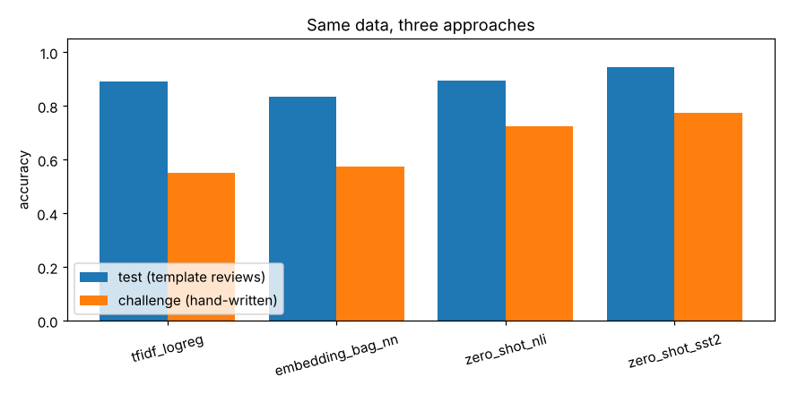

# Sentiment comparison

Test set: 200 template reviews (8 have deliberately flipped labels, so the best possible accuracy is about 0.960). Challenge set: 40 hand-written tricky reviews.

| model            |   test_accuracy |   test_f1 |   challenge_accuracy |   train_seconds |   ms_per_review |   challenge_share_predicted_positive |   ch_mixed |   ch_negation |   ch_sarcasm |   ch_unseen_words |
|:-----------------|----------------:|----------:|---------------------:|----------------:|----------------:|-------------------------------------:|-----------:|--------------:|-------------:|------------------:|
| tfidf_logreg     |           0.89  |     0.89  |                0.55  |           0.059 |           0.104 |                                0.725 |      0.75  |           0.7 |        0.125 |               0.5 |
| embedding_bag_nn |           0.835 |     0.827 |                0.575 |          32.789 |           0.119 |                                0     |      0.5   |           0.4 |        1     |               0.5 |
| zero_shot_nli    |           0.895 |     0.889 |                0.725 |           0     |         271.663 |                                0.55  |      0.917 |           0.7 |        0.125 |               1   |
| zero_shot_sst2   |           0.945 |     0.944 |                0.775 |           0     |         191.544 |                                0.6   |      0.833 |           0.9 |        0.25  |               1   |

## What the TF-IDF model relies on

- strongest positive signals: awful at, lovely, would buy, all, at all, at, worried, was
- strongest negative signals: sadly, sadly the, not perfect, overall sadly, not reliable, cannot, cannot recommend, awful

The neural model had never seen 65% of the words in the challenge set (vs 0% on the test set).

