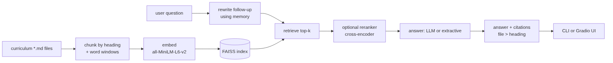

# P5 - RAG chatbot over this course's own notes

**Level:** Intermediate · **Modules used:** 07 (LLMs), 08 (prompting), 09 (RAG) · **Runs on:** CPU with no API key (first run downloads small Hugging Face models), or free Colab

## What it does

A chat assistant that answers questions about this curriculum, **citing the file and heading** each answer comes from. It uses **RAG** (retrieval-augmented generation): first *retrieve* the most relevant passages from our own notes, then *generate* an answer from only those passages. Think of an open-book exam: the model looks things up instead of answering from memory.

Features:
- **Indexes whatever markdown exists** in the repo at run time (`**/*.md`), so it grows as modules are added. A fixed set of 8 small sample docs in `data/sample_docs/` keeps tests and evaluation repeatable.
- **Chunking by heading** (cutting each file into small pieces, one per section, with overlapping word windows for long sections). Each chunk remembers its heading path for citations, e.g. `09-rag/concepts.md > Chunking`.
- **Embeddings** (lists of 384 numbers that capture meaning) from `sentence-transformers/all-MiniLM-L6-v2`, stored in **FAISS** (a fast "find the nearest vectors" library). **Chroma** (a small vector database) is an optional swap - see below.
- **Short conversation memory** and **follow-up rewriting**: "how do I evaluate it?" after "What is RAG?" is searched as "how do I evaluate it (RAG)?".
- An optional **reranker** (a cross-encoder model that reads the question and a chunk together for a more accurate relevance score).
- **Refusal**: if no chunk is a good match, it says "I could not find that in the course notes" instead of guessing.
- Two answer modes: `llm` (a language model writes the answer from numbered sources; default provider = a local SmolLM2-360M, or Ollama / Claude / OpenAI via `.env`) and `extractive` (no LLM: quotes the best-matching sentences with `[n]` tags - instant, deterministic and always faithful).
- **Evaluation** on a 32-question FAQ (24 direct + 8 paraphrased) with reference answers: hit@1, hit@4, **MRR** (mean reciprocal rank), and a word-overlap answer score, across two chunk sizes with the reranker off and on.
- A command-line chat and a **Gradio** web UI (`app.py`).

### Honest notes on quality
- **Retrieval is the strong part.** Results from `python main.py eval` on the sample docs (32 questions; a hit = right file *and* right section):

  | chunk words | reranker | hit@1 | hit@4 | MRR | paraphrase hit@1 | paraphrase MRR |
  |---|---|---|---|---|---|---|
  | 40 | off | 0.938 | 1.000 | 0.953 | 0.750 | 0.812 |
  | 40 | on | 0.969 | 0.969 | 0.969 | 0.875 | 0.875 |
  | 180 | off | 0.875 | 1.000 | 0.927 | 0.500 | 0.708 |
  | 180 | on | 0.969 | 0.969 | 0.969 | 0.875 | 0.875 |

  Direct questions are easy (they share words with the notes). The 8 **paraphrased** questions ("My model scores 99% on training data but 60% on new data...") are where settings matter: smaller chunks help, and the reranker lifts paraphrase hit@1 from 0.50 to 0.875 at 180 words. The sample docs are small and cleanly sectioned, so the full repo will score lower. Word-overlap answer F1 is only about 0.33-0.35, because extractive answers quote whole sentences while the references are short summaries - a rough metric, not a quality verdict.
- **The tiny local LLM is the weak part.** SmolLM2-360M writes fluent summaries but often forgets inline `[n]` citations and sometimes adds a claim that is not in the sources (in one test it said RAG is "faster than a traditional model" - not in the notes). That is why the numbered **Sources** list is always printed under the answer, and why `extractive` mode exists as a deterministic fallback. Use `LLM_PROVIDER=ollama|anthropic|openai` for properly cited answers.
- **Rule-based rewriting is crude.** It appends the previous topic when a question contains a pronoun or is very short. It is predictable and testable, but it can fire on a question that was actually standalone. `REWRITE_MODE=llm` is better with a capable model.
- On a laptop CPU an `llm` answer takes roughly 10-60 seconds with the local model; extractive answers take well under a second after the models load.

## Architecture



## Setup

### Option A - Google Colab
1. Open `colab_quickstart.ipynb` on GitHub and click **Open in Colab**.
2. **Runtime → Run all.** It clones the repo, installs packages (keeping Colab's torch), builds the index over the whole curriculum, asks questions in both modes, runs the evaluation and tests, and finally starts the Gradio UI with a public link.

### Option B - your own computer
```bash
git clone https://github.com/vvvvvivekkk/AI-Engineer.git
cd AI-Engineer/15-projects/p05-rag-course-chatbot
python -m venv .venv
source .venv/bin/activate                      # Windows: .venv\Scripts\activate
pip install torch==2.15.0 --index-url https://download.pytorch.org/whl/cpu   # small CPU build
pip install -r requirements.txt
cp .env.example .env                           # defaults need no key

python main.py index                           # embed every *.md in the repo
python main.py ask "What is RAG?"              # one question (ANSWER_MODE from .env, default llm)
python main.py ask "What is RAG?" --mode extractive --rerank
python main.py chat                            # interactive, with memory ('reset', 'exit')
python main.py eval                            # writes reports/eval.md
python app.py                                  # web UI at http://127.0.0.1:7860
python -m pytest -q
```
Use `--docs sample` to work with the 8 sample files only, or `--docs /some/folder` for your own notes. The index is saved in `index/` (not committed); run `python main.py index` again after the notes change.

**Using Chroma instead of FAISS (optional).** `pip install chromadb`, then replace `VectorIndex` with roughly:
```python
import chromadb
col = chromadb.Client().create_collection("notes", metadata={"hnsw:space": "cosine"})
col.add(ids=[str(c.id) for c in chunks], documents=[c.text for c in chunks],
        embeddings=embed([c.text for c in chunks]).tolist(),
        metadatas=[{"source": c.source, "heading": c.heading} for c in chunks])
res = col.query(query_embeddings=embed([question]).tolist(), n_results=4)
```
Chroma stores the text and metadata with the vectors and can persist to disk. FAISS is a lower-level, very fast search library, so we keep the text in `chunks.json` ourselves.

## How each file works

### `src/config.py`
Reads every setting from environment variables / `.env` with safe defaults: which docs, chunk size and overlap, models, top-k, the "not found" threshold (`MIN_SCORE`), answer and rewrite modes, memory length, index folder.

### `src/ingest.py`
- `find_markdown()` - all `*.md` under the docs root, sorted, skipping `.git`, virtual envs, `node_modules` and this project's sample copies (to avoid duplicates).
- `split_sections()` - walks the file line by line, keeps a stack of headings (`#`, `##`...) to build the heading path, and ignores `#` lines inside code blocks.
- `window()` - cuts long sections into word windows with overlap.
- `chunk_markdown()` / `load_chunks()` - produce `Chunk(source, heading, text, id)` objects; fall back to the sample docs if no markdown is found.

### `src/index.py`
`embed()` turns texts into normalised vectors (length 1, so inner product = **cosine similarity**, a score of how closely two vectors point the same way). `VectorIndex.build()` embeds "heading + text" for every chunk into a `faiss.IndexFlatIP` (exact search; fine up to hundreds of thousands of chunks). `save()`/`load()` keep the index on disk; `get_index()` loads or builds it.

### `src/retriever.py`
`retrieve()` gets the top-k chunks. With `rerank=True` it fetches 4×k candidates and reorders them with the `cross-encoder/ms-marco-MiniLM-L-6-v2` reranker.

### `src/rewrite.py`
`looks_like_follow_up()` (pronouns like "it/they", openers like "and..."/"what about...", or ≤ 3 words), `topic_of()` (content words of the previous question), `rewrite_rules()` and `rewrite_llm()`. LLM failures fall back to the rules.

### `src/llm.py`
`generate(prompt, system)` for `local` (Hugging Face `text-generation` pipeline with SmolLM2-360M-Instruct), `ollama`, `anthropic` and `openai` (plain HTTPS via `httpx`). A missing key raises a clear `LLMConfigError`; the chatbot then falls back to an extractive answer.

### `src/chat.py`
`RAGChatbot.ask()` = rewrite → retrieve → refuse if the best score < `MIN_SCORE` → drop chunks far below the best (`RELEVANCE_GAP`) → answer (`llm_answer` with a "use only these numbered sources, cite them, say you don't know otherwise" prompt, or `extractive_answer`, which embeds every sentence of the retrieved chunks and keeps the 3 most similar to the question) → store the turn in memory (last 3). `Answer.formatted()` adds the numbered sources.

### `src/evaluate.py`
Loads `data/faq.jsonl` (question, reference answer, expected file and section). A hit means the right file *and* the right section. Computes hit@1, hit@4, MRR and an answer word-overlap F1 for 40-word vs 180-word chunks, with and without the reranker.

### `main.py`
CLI with `index`, `ask`, `chat`, `eval` and options `--docs`, `--mode`, `--rerank`, `--rebuild`. Keeps separate index folders for `repo` and `sample`.

### `app.py`
A Gradio `ChatInterface`. A new conversation in the UI clears the bot's memory. Set `GRADIO_SHARE=true` for a public link (useful in Colab).

### `data/`
`sample_docs/` - 8 short notes written for this project, summarising modules 00, 01, 04, 05, 06, 07/08, 09 and 10. `faq.jsonl` - 32 evaluation questions (24 direct, 8 paraphrased with `kind: paraphrase`) with reference answers and expected sections.

### `tests/test_p05.py`
Heading paths and code-block handling, window overlap, citations, rewrite rules, retrieval of the right section for three questions, end-to-end chat (cites, rewrites a follow-up, refuses an off-topic question), FAQ format, and the missing-key error. Uses extractive mode, so the tests are deterministic.

### `build.py`, `requirements.txt`, `.env.example`, `.gitignore`
Diagram + notebook generator, pinned versions, settings with placeholders only, and `.gitignore` for the local `index/` folder and `.env`.

## How to explain it in an interview

**60-second pitch.** "I built a RAG chatbot over our course's markdown notes. Ingestion splits files by heading into overlapping chunks that keep their heading path, so every answer can cite file and section. Chunks are embedded with MiniLM and searched with FAISS; an optional cross-encoder reranks candidates. The chat keeps short memory and rewrites follow-ups into standalone queries before retrieval, and it refuses when the best match is below a similarity threshold. Answers come from a pluggable LLM - a local 360M model by default, or Ollama, Claude or OpenAI - with an extractive fallback that's deterministic and always faithful. I built a 32-question FAQ, including paraphrased questions, to measure hit@k, MRR and answer overlap across chunk sizes and reranking, and wrote pytest tests that run offline."

**Design decisions and trade-offs**
- *Chunk by heading* - natural topic boundaries and free citations; the cost is uneven chunk sizes, handled with word windows.
- *FAISS flat index* - exact and simple at this scale; switch to an approximate index (IVF/HNSW) or a vector DB (Chroma, Qdrant) for millions of chunks or metadata filters.
- *Similarity threshold for refusals* - stops confident nonsense on off-topic questions; the cost is occasional false refusals, tunable with `MIN_SCORE`.
- *Extractive fallback* - less fluent, but zero hallucination and no model needed; the honest choice when the only local LLM is tiny.
- *Rules-based rewriting by default* - predictable and testable; an LLM rewriter is smarter but adds latency and can drift.

**Five likely questions**
1. *How do you pick chunk size?* - Measure it. Small chunks match precisely but lose context; large ones keep context but dilute the embedding. We compare 40 vs 180 words on the FAQ with hit@k and MRR; on paraphrased questions the smaller chunks win without a reranker. We keep heading-based boundaries either way.
2. *Why a reranker if you already have embeddings?* - A bi-encoder embeds question and chunk separately (fast, approximate). A cross-encoder reads them together (slow, more accurate). Use both: retrieve 16 cheaply, rerank to 4.
3. *How do you reduce hallucination?* - Retrieve good context, instruct "only from sources, cite, say you don't know", refuse below a threshold, show sources to the user, and evaluate faithfulness. Extractive mode removes it entirely.
4. *How do follow-up questions work?* - Memory keeps the last few turns; before retrieval the follow-up is rewritten into a standalone query (rules or LLM), because the retriever does not see the chat history.
5. *How would you evaluate this properly at scale?* - A golden set of questions with expected sources (retrieval: hit@k, MRR, recall@k) and reference answers (faithfulness and correctness, via human rating or an LLM judge checked against humans), run on every change like a test suite.

## Credits (original ideas)
- "4 Chatbot Projects with Python" - Aman Kharwal (source 6): https://amankharwal.medium.com/4-chatbot-projects-with-python-5b32fd84af37
- Awesome-Chatbot (source 6): https://github.com/fendouai/Awesome-Chatbot
- RAG Techniques - Nir Diamant (source 9): https://github.com/NirDiamant/RAG_Techniques
- Models: [all-MiniLM-L6-v2](https://huggingface.co/sentence-transformers/all-MiniLM-L6-v2), [ms-marco-MiniLM-L-6-v2](https://huggingface.co/cross-encoder/ms-marco-MiniLM-L-6-v2), [SmolLM2-360M-Instruct](https://huggingface.co/HuggingFaceTB/SmolLM2-360M-Instruct). Libraries: [FAISS](https://github.com/facebookresearch/faiss), [Gradio](https://www.gradio.app/), optional [Chroma](https://www.trychroma.com/).

Our own implementation; the sample docs and FAQ are written for this repo.

## What to try next
1. Add **hybrid search**: combine BM25 keyword scores (`rank_bm25`) with vector scores using reciprocal rank fusion (this is what P7 does).
2. Write 10 harder, paraphrased FAQ questions (no shared keywords) and re-run `main.py eval`.
3. Swap FAISS for Chroma with metadata filters ("only search module 09").
4. Add an LLM-as-judge faithfulness check: does every sentence of the answer appear in the sources?
5. Stream the LLM answer token by token in the Gradio UI.
