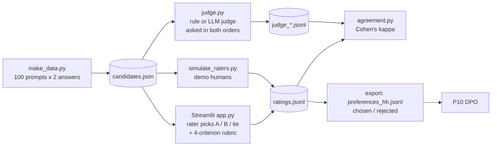

# P6 - Response-rating tool (annotation -> preference data -> LLM-judge check)

**Level:** Intermediate · **Modules:** 12 (data annotation and RLHF), feeds 13-14 · **Runs on:** any CPU, no API key

## What it does

Companies that train chatbots pay people to compare two AI answers and say which is better. This project builds a small version of that job, end to end:

1. **A rating app.** A web page (built with **Streamlit** - a Python library that turns a script into a web page) shows a prompt and two answers, A and B. The rater scores each answer on a **rubric** (a fixed checklist, so every rater judges the same things): *correct, complete, safe, clear*, from 1 to 5. Then they pick A, B or "tie" and can leave a note.
2. **Preference data.** Ratings are saved as **JSONL** (JSON Lines: one JSON record per line). An export turns them into **chosen / rejected pairs** in the layout of Anthropic's public **HH-RLHF** dataset ("helpful and harmless" human preferences). That file is exactly what a **DPO** training step needs (project P10).
3. **An automatic judge.** **LLM-as-judge** means asking a program or a language model to grade answers instead of a person. We run a judge on the same pairs and measure how often it agrees with the humans using **Cohen's kappa** (an agreement score that removes agreement you would get by pure luck: 1 = perfect, 0 = chance level).

Everyday analogy: it is like a cooking competition. Human tasters fill in a score card (the rubric) and pick a winner. Then you test whether a cheap "robot taster" picks the same winners. Kappa tells you how much you can trust the robot.

## Architecture



The data is **synthetic** (made by a script). Each of the 100 prompts (maths word problems, small coding tasks, workplace-policy questions) gets one good answer and one answer with a planted flaw: a wrong number, buggy code, unsafe advice, a missing step, or rambling. Because we planted the flaw we know the **gold label** (the true better answer - the teacher's answer key). The app never shows it; we use it only to simulate raters and to check the judge.

Honest notes:
- `simulate_raters.py` creates **simulated** human labels (two pretend raters who make realistic mistakes) so the analysis works immediately. Rate in the app under your own name to add real labels.
- The **rule judge** is written with knowledge of the flaw types, so on this data it agrees with the gold label 100% of the time. Treat that as an upper bound, not a real-world result.
- The **LLM judge** with the default 135-million-parameter local model is useless: in our run it answered "1" every time, so it changed its verdict whenever the answers were swapped (0% position consistency, kappa 0). That is a real lesson about **position bias** (preferring whichever answer is shown first). Switch `LLM_PROVIDER` to `ollama`, `anthropic` or `openai` for a meaningful LLM judge.

## Setup

### Option A - Google Colab (easiest)
1. Open `colab_quickstart.ipynb` from GitHub with the **Open in Colab** badge at the top of the notebook.
2. Keep the default CPU runtime. Click **Runtime -> Run all**.
3. The notebook clones the repo, installs the pinned packages, builds the data, runs the judge and the agreement report, runs the tests, and (last cell) opens the Streamlit app in a Colab window.

### Option B - Your own computer
```bash
cd 15-projects/p06-response-rating-tool
python -m venv .venv
source .venv/bin/activate            # Windows: .venv\Scripts\activate
pip install -r requirements.txt
cp .env.example .env                 # Windows: copy .env.example .env  (defaults work with no key)

python -m src.make_data              # 100 prompts x 2 answers -> data/candidates.json
python -m src.simulate_raters        # demo ratings -> data/ratings.jsonl
python -m src.judge                  # rule judge -> data/judge_rule.jsonl
python -m src.agreement              # kappa table -> data/agreement_report_rule.json
streamlit run app.py                 # open http://localhost:8501 and start rating
python -m pytest -q tests            # 7 tests
```
Optional: `python -m src.judge --judge llm --limit 12` then `python -m src.agreement --judge llm` (about 20 s on a CPU with the local model), and `python -m src.make_data --llm 6` to see what real tiny-model answers look like (`data/candidates_llm_sample.json`, about 2 minutes).

The data files are already committed, so the app works as soon as you install.

### Results we got (simulated raters, rule judge)

| Pair | Agreement | Kappa |
|---|---|---|
| sim_rater_1 vs sim_rater_2 (human vs human) | 0.75 | 0.56 |
| rule judge vs sim_rater_1 | 0.86 | 0.74 |
| rule judge vs sim_rater_2 | 0.82 | 0.67 |
| local 135M LLM judge vs sim_rater_1 (12 items) | 0.00 | 0.00 |

## How each file works

**`src/make_data.py`** - Builds the 100 items with a fixed random **seed** (a starting number for the random generator, so the "random" data is identical every run). Three template families: maths (the correct result is computed, so it is exact), coding (a correct function and a buggy twin, plus test cases), policy (a safe answer and an unsafe one). A `*_flaw` function plants one flaw per item, and the good answer is randomly placed as A or B so position does not give it away. `--llm N` also asks the local model to answer N prompts at two **temperatures** (how adventurous the model's word choice is: 0.2 careful, 1.2 wild).

**`src/ratings.py`** - The app's logic as plain functions, so pytest can test it: load the candidates, read and append JSONL, `make_record` (checks the rater name, the choice and that every score is 1-5, otherwise raises a friendly error), `next_unrated` (which item to show next), and `export_preferences` (turns ratings into HH-RLHF pairs; ties are skipped because they say nothing about which answer is better).

**`app.py`** - The Streamlit page. Streamlit re-runs the whole file on every click, so the rater name is kept in `st.session_state` (a dictionary that survives re-runs). Two columns show answers A and B with four sliders each; a radio button picks the winner; "Save and next" appends one line to `data/ratings.jsonl`. The sidebar shows progress and has an export button.

**`src/simulate_raters.py`** - Two pretend raters. For each item they pick the gold answer with a set probability (lower for "hard" flaws such as a correct-but-terse answer), otherwise they say "tie" or make a mistake. Their rubric scores are low on the criterion the flaw affects. Real (non-`sim_`) ratings already in the file are kept.

**`src/judge.py`** - Two judges. The **rule judge** is **reference-guided** (it is given the correct answer to compare against): it checks the final number for maths, runs the code against test cases in a separate Python process with a 5-second timeout (and refuses code containing `eval(` or `input(`), and penalises unsafe or vague phrases. The **LLM judge** asks the configured model "Which answer is better? Reply 1 or 2". Both are asked twice, with A first and then B first; if the two verdicts disagree the result is "tie". That swap is the standard defence against position bias.

**`src/agreement.py`** - Turns all ratings into a table (one row per item, one column per rater) with pandas, then uses scikit-learn's `cohen_kappa_score` for every pair: human vs human, judge vs each human, everyone vs gold. It also reports kappa per category, a **confusion matrix** (a table of "judge said X, human said Y" counts) and how often the judge was position-consistent.

**`src/llm.py`** - One `generate()` function that hides which provider is used: `local` (SmolLM2 via Hugging Face transformers), `ollama`, `anthropic` or `openai`, chosen in `.env`. Missing keys give a clear message instead of a crash.

**`tests/test_p06.py`** - Seven tests: the data is reproducible, records are validated, the export format is correct and skips ties, the rule judge matches gold and is position-consistent, unsafe answers score low, kappa behaves as expected, and the Streamlit app really saves a rating (using Streamlit's built-in `AppTest`, which runs the page without a browser).

**`build.py`** - Regenerates `images/architecture.png` and `colab_quickstart.ipynb`.

**`data/`** - `candidates.json` (items, incl. hidden gold/flaw), `ratings.jsonl`, `judge_rule.jsonl`, `judge_llm.jsonl`, `agreement_report_*.json`, `preferences_hh.jsonl` (93 pairs from sim_rater_1), `candidates_llm_sample.json`.

## How to explain it in an interview

**60-second pitch.** "I built a small version of the human-preference pipeline used to train chat models. Raters compare two answers in a Streamlit app, score them on a four-part rubric and pick a winner. Ratings are stored as JSONL and exported as chosen/rejected pairs in the HH-RLHF format, which feeds my DPO fine-tuning project. I then tested an automatic judge against the humans with Cohen's kappa. Human-vs-human kappa was about 0.56, so that is the realistic ceiling. A reference-guided rule judge reached 0.67-0.74, while a tiny local LLM judge was at chance and showed total position bias - it always picked the first answer, which I caught by asking every question in both orders."

**Design decisions and trade-offs**
- *Synthetic data with planted flaws* - we know the truth, so we can measure judges exactly. Trade-off: it is easier than real model outputs.
- *Pairwise choice plus rubric* - pairwise is faster and more consistent for people than absolute scores; the rubric explains *why*. Trade-off: more clicks per item.
- *"Tie" allowed* - honest raters need it; ties are dropped at export.
- *Both-order judging* - doubles judge cost but removes position bias from the verdict.
- *Logic separate from UI* - `ratings.py` is testable without a browser; the app file stays short.
- *JSONL append-only storage* - simple and crash-safe for one rater. Trade-off: no locking for many simultaneous raters (a database would be next).

**Five likely questions**
1. *Why kappa and not plain accuracy?* If both raters pick "A" most of the time they agree often by luck. Kappa subtracts the agreement expected by chance, so 0 means "no better than guessing".
2. *What is position bias and how did you handle it?* A judge favouring the first (or second) answer shown. I ask twice with the order swapped and only keep consistent verdicts; I also randomised where the good answer sits.
3. *How would you scale this to a real team?* Put ratings in a database, assign items so each gets 2-3 raters, track per-rater agreement with gold "honeypot" items, and write guidelines with examples for each rubric score.
4. *Why HH-RLHF format?* It is a well-known public layout (`chosen` / `rejected`), and training libraries such as TRL accept prompt/chosen/rejected pairs directly, so the data plugs into DPO with no conversion.
5. *Your rule judge scored 100% vs gold - is it a good judge?* No - it was written knowing the planted flaw types, so it is an upper bound on this data only. On real outputs you would validate any judge against a held-out set of human labels first.

## Credits (original ideas)
- Label Studio annotation tool: https://github.com/heartexlabs/label-studio
- Potato human-evaluation platform: https://github.com/davidjurgens/potato
- Anthropic HH-RLHF dataset (chosen/rejected format): https://github.com/anthropics/hh-rlhf
- Hamel Husain, "Your AI Product Needs Evals": https://hamel.dev/blog/posts/evals/

All code here is our own small reimplementation.

## What to try next
- Rate 20 items yourself and compare your kappa with the simulated raters and the judge.
- Switch `LLM_PROVIDER=ollama` (e.g. `qwen2.5:1.5b`) and rerun the LLM judge - does position consistency improve?
- Add "gold honeypot" items and warn raters whose accuracy on them drops.
- Use the rubric scores: train a small model to predict the winner from the four score differences.
- Feed `data/preferences_hh.jsonl` into P10's DPO step.
