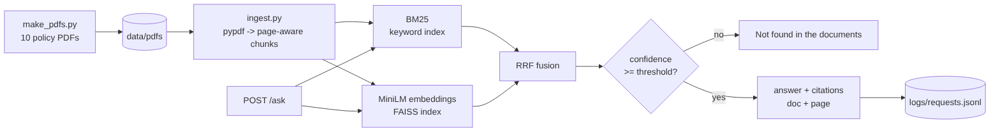
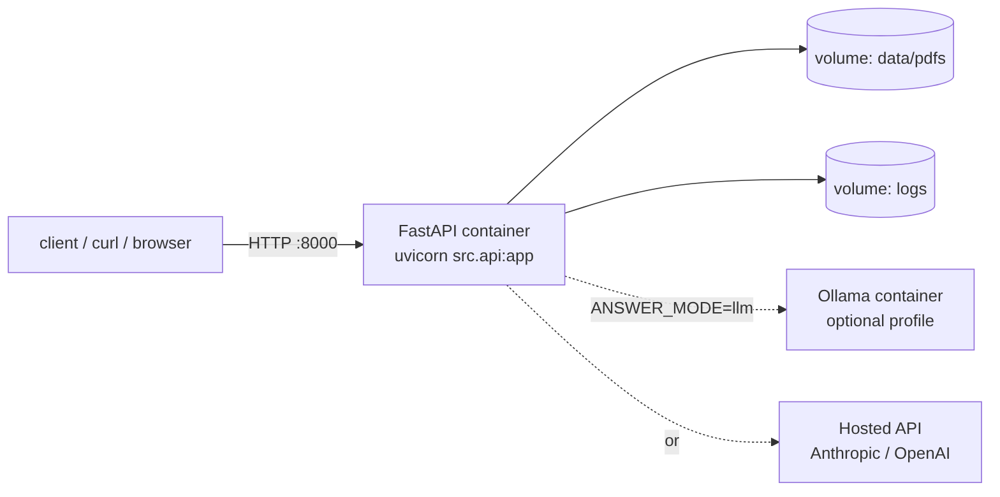

<!-- nav:start -->
> [🏠 Course home](../../README.md) · [🏗️ All projects](../README.md) · [⬅️ P06 Response-rating & eval tool](../p06-response-rating-tool/README.md) · [P08 Data-analyst agent + MCP server ➡️](../p08-data-analyst-agent-mcp/README.md)  
> **P07 · Document Q&A API (FastAPI + Docker)** · 🟡→🔴 · best after module 09 + 14 · [▶️ Open in Colab](https://colab.research.google.com/github/vvvvvivekkk/AI-Engineer/blob/main/15-projects/p07-doc-qa-api/colab_quickstart.ipynb)
<!-- nav:end -->

# P7 - Document Q&A with citations, shipped as an API

**Level:** Intermediate -> Advanced · **Modules:** 09 (RAG), 14 (deployment) · **Runs on:** any CPU, no API key

## What it does

A web service that answers questions about a folder of PDF policy documents (for an invented company, "Northwind Labs"). Every answer quotes its source as **document + page number**. If the documents do not contain the answer, it says **"Not found in the documents."** instead of making something up.

This is **RAG** (retrieval-augmented generation): first *retrieve* the relevant text, then *generate* an answer from it. Analogy: an open-book exam. The student (the model) is only allowed to answer from pages they can point to.

What is inside:
- 10 generated policy PDFs (leave, expenses, security, onboarding, remote work, travel, code of conduct, IT equipment, data privacy, performance reviews) and a **golden set** of 43 questions (38 with a known answer page, 5 with no answer).
- **Hybrid retrieval**: **BM25** keyword search (good at exact words like "VPN") plus **vector search** with sentence embeddings (good at meaning: "time off" ~ "leave"), merged with **RRF** (reciprocal rank fusion: each list gives a chunk 1/(60+rank) points and the points are added).
- A **confidence check** that refuses to answer when the best match is weak.
- A **FastAPI** service with `/health`, `/ingest`, `/ask`, JSON request logs (simple **tracing**), a pytest suite, a `Dockerfile` and `docker-compose.yml`.

## Architecture





Results on the golden set (`python -m src.evaluate`, saved in `data/eval_report.json`):

| Retrieval mode | Recall@1 | Recall@3 | MRR@3 |
|---|---|---|---|
| BM25 only | 0.947 | 0.974 | 0.961 |
| Vectors only | 0.974 | 1.000 | 0.987 |
| **Hybrid (RRF)** | **1.000** | **1.000** | **1.000** |

Answers: 100% of answerable questions answered with the correct page cited first; 4 of 5 unanswerable questions correctly refused (the Wi-Fi-password question slips through because the security policy talks about passwords). Honest caveats: the documents are short and tidy, so these numbers are much higher than on real company documents, and the confidence threshold (0.33) was tuned on this same golden set. A real project would tune it on separate questions.

## Setup

### Option A - Google Colab
1. Open `colab_quickstart.ipynb` with the **Open in Colab** badge at its top. The default CPU runtime is enough.
2. **Runtime -> Run all.** It clones the repo, installs packages, builds the PDFs, runs the evaluation, starts the API in the background, asks it questions over HTTP and runs the tests.
3. Docker does not run in Colab - use your own machine for that part.

### Option B - Your own computer
```bash
cd 15-projects/p07-doc-qa-api
python -m venv .venv
source .venv/bin/activate            # Windows: .venv\Scripts\activate
pip install -r requirements.txt
cp .env.example .env                 # defaults work with no key

python -m src.make_pdfs              # 10 PDFs + data/golden.json (already committed)
python -m src.evaluate               # retrieval + answer metrics
uvicorn src.api:app --port 8000      # then open http://localhost:8000/docs
python -m pytest -q tests            # 7 tests
```
Ask from a second terminal:
```bash
curl -X POST localhost:8000/ask -H "Content-Type: application/json" \
     -d '{"question": "How quickly must a lost device be reported?"}'
curl -X POST localhost:8000/ingest -F "file=@my-new-policy.pdf"     # add a PDF and re-index
```

### Option C - Docker
Install Docker Desktop, then:
```bash
cp .env.example .env
docker compose up --build            # API on http://localhost:8000
docker compose --profile ollama up --build   # also start Ollama for ANSWER_MODE=llm
```
Note: the Docker files were written carefully but **could not be built in the environment where this project was made** (no Docker there). Please run `docker compose up --build` once and report any problem.

### Answer modes
- `ANSWER_MODE=extractive` (default): quotes the 1-2 best-matching sentences with `[file.pdf p.N]` tags. Fast, never invents facts, no model needed.
- `ANSWER_MODE=llm`: sends the retrieved chunks to the LLM chosen by `LLM_PROVIDER` (`local`, `ollama`, `anthropic`, `openai`) with an instruction to answer only from them. With the local SmolLM2-360M model it answered "The probation period is 6 months." correctly in our test, but small models are unreliable; use a larger model for real use.

## How each file works

**`src/make_pdfs.py`** - Holds the policy text as Python data (sections with a heading, a body and, usually, a question about it). It draws the PDFs with **reportlab** (a PDF-drawing library), two sections per page, so it knows which page each fact is on and writes `data/golden.json`. `invariant=1` keeps the PDFs byte-identical between runs.

**`src/ingest.py`** - Reads each PDF page with **pypdf**, drops the repeated page header, turns short heading lines into their own sentences, then cuts each page into **chunks** of about 60 words with a 15-word **overlap** (repeated words between neighbouring chunks, so a sentence cut in half still appears whole somewhere). A chunk never crosses a page, so every chunk has exactly one page number for citations.

**`src/retrieval.py`** - `HybridIndex` builds two indexes over the same chunks: BM25 (via `rank_bm25`, after lower-casing and removing filler words) and a **FAISS** index of 384-number **embeddings** from `all-MiniLM-L6-v2` (normalised, so the inner product equals **cosine similarity** - how closely two meanings point the same way). `search()` runs both, keeps the top 20 of each, adds up RRF points and returns the top k with all three scores so you can see why a chunk won.

**`src/answer.py`** - Computes a **confidence** score for the top chunk (half cosine similarity, half "what share of the question's words appear in it"). Below `CONF_THRESHOLD` it returns "Not found". Otherwise it builds an extractive or LLM answer and a de-duplicated list of citations.

**`src/evaluate.py`** - Measures **Recall@k** (did the right page make the top k?), **MRR** (mean reciprocal rank: 1 for rank 1, 1/2 for rank 2...), refusal accuracy, **citation accuracy** and a **faithfulness** proxy (share of answer words that appear in the cited chunks; a real project would use an LLM grader such as DeepEval or RAGAS).

**`src/api.py`** - The FastAPI app. A **lifespan** function builds the index once at start-up. **Pydantic** models (`AskRequest`, `AskResponse`) validate input - a 2-letter question returns HTTP 422 automatically. `/ingest` accepts an optional PDF upload (only `.pdf`, and `Path(...).name` blocks path tricks like `../../`), then re-indexes. Each `/ask` gets a `trace_id` and one JSON line in `logs/requests.jsonl` with latency and cited pages.

**`src/llm.py`** - The shared provider switch (`local`, `ollama`, `anthropic`, `openai`) used in `ANSWER_MODE=llm`. Missing keys produce a clear message.

**`tests/test_api.py`** - Uses FastAPI's **TestClient** (calls the app in-process, no real server). Checks `/health`, a correct answer with the right page, a refusal, input validation, the trace log, upload + rejection of non-PDFs, and the chunk overlap. The tests copy the PDFs to a temporary folder so uploads never change `data/`.

**`Dockerfile`** - Recipe for a **container image** (a sealed box holding Python, the packages, the code and the model, so it runs the same everywhere). Installs CPU-only PyTorch first (much smaller), caches the pip layer, pre-downloads the embedding model, runs as a non-root user and defines a **health check**.

**`docker-compose.yml`** - Starts the API with mounted folders for PDFs and logs, plus an optional Ollama service under the `ollama` **profile** (only started when asked).

**`build.py`** - Regenerates the two diagrams and the Colab notebook.

## How to explain it in an interview

**60-second pitch.** "I built a document Q&A service over company policy PDFs. PDFs are parsed with pypdf into page-aware chunks, then searched two ways - BM25 for exact keywords and MiniLM embeddings in FAISS for meaning - and the two rankings are merged with reciprocal rank fusion. A confidence gate returns 'not found' when the best evidence is weak, and every answer cites document and page. It is a FastAPI service with ingest, ask and health endpoints, request tracing to JSON logs, a TestClient test suite and a Dockerfile. On a 43-question golden set, hybrid search beat either method alone - Recall@1 went from 0.95 and 0.97 to 1.0 - and it correctly refused 4 of 5 unanswerable questions."

**Design decisions and trade-offs**
- *Hybrid instead of vectors only* - embeddings miss exact codes and numbers; BM25 misses synonyms. RRF needs no score calibration. Cost: two indexes.
- *Chunks never cross pages* - exact page citations, at the cost of sometimes splitting a section across pages.
- *Extractive answers by default* - zero hallucination and no GPU; the trade-off is less fluent answers.
- *Confidence gate* - fewer made-up answers, but some real questions get refused if the threshold is too high.
- *Index in memory, rebuilt on /ingest* - simple and fast for tens of documents; for thousands you would use a persistent vector database (Qdrant, pgvector) and incremental updates.
- *JSON-lines tracing* - no extra service to run; Langfuse or OpenTelemetry would add dashboards.

**Five likely questions**
1. *Why reciprocal rank fusion instead of adding scores?* BM25 scores and cosine similarities are on different scales; ranks are comparable. RRF is robust and has one constant (60).
2. *How do you stop hallucination?* Retrieval first, answer only from retrieved text, a confidence threshold that returns "not found", citations so users can check, and a faithfulness metric in evaluation.
3. *How would you evaluate it in production?* A golden set run in CI (fail the build if Recall@k drops), logged traces sampled for human review, user feedback buttons, and an LLM grader for faithfulness on a sample.
4. *What changes for 100,000 documents?* A persistent vector DB with metadata filters, background ingestion jobs, better chunking (by headings), a **reranker** (a model that re-scores the top 20 more carefully), caching and horizontal scaling behind a load balancer.
5. *Why Docker?* The same image runs on a laptop, a server or the cloud, with pinned packages and the model baked in - no "works on my machine".

## Credits (original ideas)
- PrivateGPT: https://github.com/imartinez/privateGPT
- LocalGPT: https://github.com/PromtEngineer/localGPT
- Delveta production RAG pipeline: https://github.com/Eric-LLMs/Delveta
- Deep Learning in Production: https://github.com/The-AI-Summer/Deep-Learning-In-Production

All code here is our own small reimplementation.

## What to try next
- Add a cross-encoder **reranker** (e.g. `cross-encoder/ms-marco-MiniLM-L-6-v2`) on the top 10 and compare MRR.
- Write 20 new golden questions that use synonyms ("vacation", "time off") and see where BM25 fails.
- Tune `CONF_THRESHOLD` on a separate question set and plot refusals vs wrong answers.
- Replace FAISS with Qdrant or Chroma so the index survives restarts.
- Serve your fine-tuned model from P10 through Ollama and set `ANSWER_MODE=llm`.

<!-- nav:start -->
---
[🏠 Course home](../../README.md) · [🏗️ All projects](../README.md) · [⬅️ P06 Response-rating & eval tool](../p06-response-rating-tool/README.md) · [P08 Data-analyst agent + MCP server ➡️](../p08-data-analyst-agent-mcp/README.md)
<!-- nav:end -->
