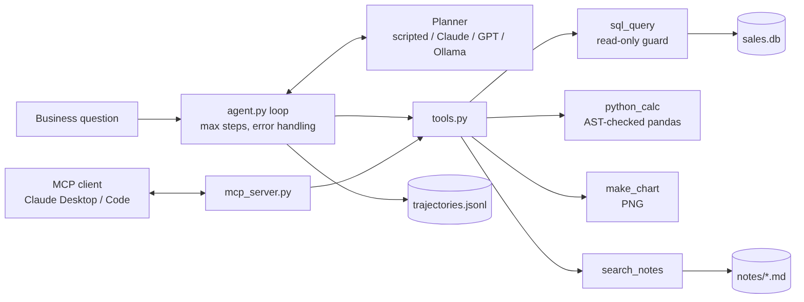
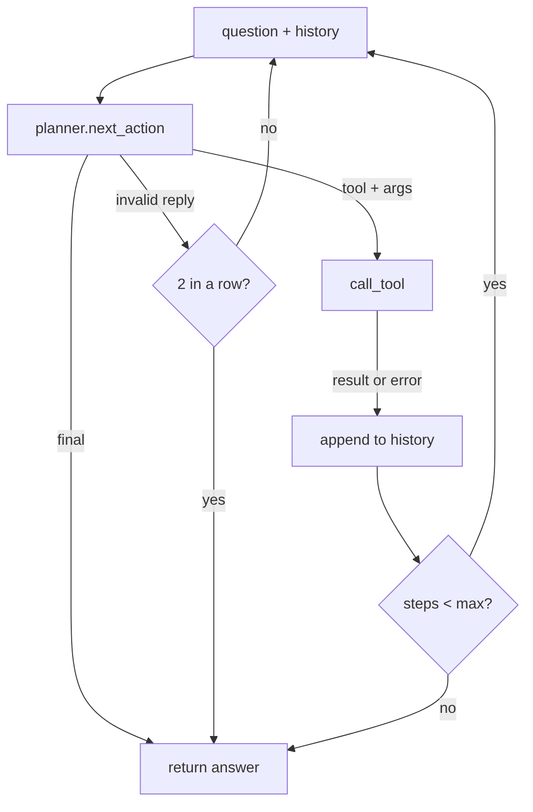

# P8 - Tool-using data-analyst agent with an MCP server

**Level:** Advanced · **Module:** 10 (agentic AI) · **Runs on:** any CPU, no API key (deterministic planner by default)

## What it does

You ask a business question in plain English - *"Which region's revenue fell most last quarter, and why?"* - and an **agent** answers it by calling tools, one step at a time:

- `get_schema` - which tables and columns exist
- `sql_query` - run one **read-only** SQL query on a SQLite sales database
- `python_calc` - a pandas calculation on the last query result (in a restricted sandbox)
- `make_chart` - save a line or bar chart as a PNG
- `search_notes` - search internal notes that explain business events

An **agent** is a program where a planner (usually a language model) chooses the next action, sees the result, and chooses again until it can answer. This "think, act, observe, repeat" pattern is called **ReAct**. Analogy: a detective who asks one question at a time and lets each answer shape the next question.

The same five tools are also served through **MCP** (Model Context Protocol, an open standard that works like "USB for AI tools"), so Claude Desktop, Claude Code or any MCP client can use them directly.

**SQLite** is a complete database stored in one file. Ours (`data/sales.db`, ~11,500 orders for 2025) is synthetic and contains three planted anomalies for the agent to discover:
1. North's revenue falls 21% from Q3 to Q4 because the Smart Kettle supplier failed an audit (and kettle bundles paused).
2. South gave ~50% discounts in August because a staff promo code leaked.
3. West has 40 duplicate orders on 14 July from a checkout retry bug.

## Architecture



The loop in `agent.py`:



### About the planners (honest note)
- **Scripted planner (default with `LLM_PROVIDER=local`)** - deterministic rules for the 5 question types in `data/tasks.json`. It makes every demo and test repeatable, but it cannot answer new kinds of questions.
- **LLM planners** - `anthropic` and `openai` use their native **tool calling** (you send tool JSON schemas, the model replies with a structured tool request); `ollama` uses Ollama's tool calling (needs a tool-capable model such as `qwen2.5:1.5b`); any other text model uses a JSON-prompt planner. These code paths are written to the providers' documented formats but **could not be run here (no API keys / no Ollama)**. Please test them with your own key.
- The tiny local SmolLM2 models cannot plan. We tried the JSON planner with SmolLM2-135M on "What were the top 3 products by revenue in 2025?": twice in a row it wrote a block of made-up pandas code (querying a `sales` table that does not exist) instead of a JSON tool call, so the loop stopped with "did not return a valid action twice in a row". Each attempt took over a minute on the shared CPU. That is the reason the scripted fallback exists - and a good demonstration of why agents need capable models.

## Setup

### Option A - Google Colab
1. Open `colab_quickstart.ipynb` with the **Open in Colab** badge. CPU runtime is fine.
2. **Runtime -> Run all.** It builds the database, runs the agent, runs the 5 tasks, shows the chart, checks the MCP server and runs the tests.
3. Optional: add an `ANTHROPIC_API_KEY` in Colab **Secrets** (key icon) to run the last cell with Claude as the planner.

### Option B - Your own computer
```bash
cd 15-projects/p08-data-analyst-agent-mcp
python -m venv .venv
source .venv/bin/activate            # Windows: .venv\Scripts\activate
pip install -r requirements.txt
cp .env.example .env

python -m src.make_db                                   # data/sales.db + data/notes/ (already committed)
python -m src.agent "Which region's revenue fell most last quarter, and why?"
python -m src.run_tasks                                 # the 5 test tasks
python -m src.mcp_check                                 # MCP: list + call tools (in-process and stdio)
python -m pytest -q tests                               # 17 tests
```
With a key: set `LLM_PROVIDER=anthropic` and `ANTHROPIC_API_KEY=...` in `.env`, then `python -m src.run_tasks` uses Claude.

### Connect the MCP server to Claude Desktop or Claude Code
Copy `mcp_config.example.json` into your client's MCP settings (for Claude Desktop: *Settings -> Developer -> Edit Config*), replace the `cwd` with the absolute path of this folder, and use the Python from your venv as `command`. Restart the client; the five tools appear. For Claude Code: `claude mcp add data-analyst -- python -m src.mcp_server` run from this folder.

## How each file works

**`src/make_db.py`** - Creates `regions`, `products` and `orders` tables and fills 365 days of orders with NumPy random numbers from a fixed **seed** (same data every run). The three anomalies are planted with simple `if` rules, and four Markdown notes explaining them are written to `data/notes/`.

**`src/tools.py`** - The tool functions plus a registry `TOOLS` with a description and a **JSON schema** (a precise description of each argument) for every tool. Safety is layered:
- *SQL guard:* one statement only, must start with `SELECT`/`WITH`, a block-list of write/admin words, the file is opened with `mode=ro` (read-only), and an SQLite **authorizer** (a callback SQLite asks before every operation) denies anything that is not a read. Any one layer stops a `DROP TABLE`.
- *python_calc:* the input must be a single expression; Python's `ast` module (which turns code into a tree we can inspect) rejects unknown names, `_private`/dunder attributes, lambdas and assignments, and `eval` runs with no built-ins. This is a teaching sandbox, not a security boundary.
- `call_tool` turns every failure into `{"error": ...}` so the agent can read it and try again instead of crashing.

**`src/planners.py`** - All planners share one method, `next_action(question, history)`, returning `{"tool", "args"}` or `{"final"}`. `ScriptedPlanner` classifies the question by keywords and follows a playbook whose later steps use earlier results (e.g. the worst region found by `python_calc` goes into the next SQL query). `AnthropicPlanner`, `OpenAIPlanner` and `OllamaPlanner` replay the history in each provider's message format; `JsonPlanner` works with any text model. `get_planner()` picks one from `.env`.

**`src/agent.py`** - The loop: ask the planner, run the tool, append the result, repeat. It enforces `max_steps`, survives tool errors, gives up after two unreadable model replies in a row, and appends the full **trajectory** (every step and result) to `logs/trajectories.jsonl`.

**`src/run_tasks.py`** + **`data/tasks.json`** - Five test tasks, each with the expected tool sequence and facts the answer must contain. The scripted planner must match the sequence exactly; an LLM planner only needs to use the expected tools (a good model may take another valid path). This is a tiny version of **trajectory evaluation**.

**`src/mcp_server.py`** - Wraps the same functions with `@mcp.tool` on an `MCPServer` from the official MCP Python SDK **2.x** (in SDK 1.x this class was called `FastMCP`). Tool errors are raised as the SDK's `ToolError`, so clients see the message (e.g. "Only SELECT ... allowed").

**`src/mcp_check.py`** - Connects the SDK's `Client` to the server in-process and as a real stdio subprocess, lists the tools, runs a query and shows that a write is rejected.

**`src/llm.py`** - The shared provider switch used by the JSON planner.

**`tests/test_p08.py`** - 17 tests: the guard blocks six kinds of writes and allows reads, the database refuses writes even without the text guard, the calc sandbox rejects imports/dunders/statements, all 5 tasks produce the exact expected tool sequence and facts, the loop stops at `max_steps` and survives errors, invalid replies end cleanly, and the MCP server lists 5 tools and returns errors properly.

**`build.py`** - Regenerates the two diagrams and the Colab notebook.

## How to explain it in an interview

**60-second pitch.** "I built a data-analyst agent from scratch: a small loop where a planner picks one tool at a time - read-only SQL, a sandboxed pandas calculation, charts and a notes search - over a synthetic sales database with planted anomalies. For 'which region fell most last quarter and why', it reads the schema, compares Q3 and Q4 by region, computes the percentage change, drills into products for the worst region and finds the ops note explaining the kettle supplier failure. The loop has a step limit, turns tool errors into observations, and logs every trajectory. SQL is protected by three independent layers. I wrote five test tasks with expected tool sequences, and exposed the same tools through an MCP server, so Claude Desktop can use them too."

**Design decisions and trade-offs**
- *Hand-written loop instead of a framework* - every line is visible and testable; frameworks such as LangGraph add state persistence and branching when you need them.
- *Layered SQL safety* - a regex alone can be tricked; read-only file mode plus an authorizer makes writes impossible even if the text check fails. Trade-off: some harmless queries containing a `;` inside a string are refused.
- *Deterministic scripted planner* - repeatable tests and a no-key demo; cannot generalise.
- *Errors as observations* - the model can self-correct (fix a column name) instead of crashing.
- *One tool layer, two front-ends* - the agent and the MCP server share `tools.py`, so behaviour and safety are identical.
- *Result truncation* - tool results are cut to ~1,500 characters before going back to a model, to save tokens; the model may miss rows, so queries should aggregate.

**Five likely questions**
1. *How do you stop the agent from damaging the database?* Read-only connection, an SQLite authorizer that denies writes, a single-statement SELECT-only text check, and row limits. Ideally, also a database user with read-only rights.
2. *What happens if a tool fails or the model loops?* Failures return an error message as the observation; `max_steps` caps the loop; two unparseable replies in a row stop it. Every step is logged for debugging.
3. *How do you evaluate an agent?* Fixed tasks with expected tool sequences (trajectory checks) and required facts in the final answer, run in CI; plus cost, latency and step counts per task.
4. *What is MCP and why use it?* A standard protocol between AI clients and tool servers. Write the server once and any MCP client can use it, with tool schemas discovered automatically.
5. *Why not let the model write any Python?* Arbitrary code can read files, call the network or delete data. Here only single pandas expressions are allowed; for real use I would run code in an isolated container with no network.

## Credits (original ideas)
- Eric-LLMs, minimal ReAct agent with Excel/pandas tools: https://github.com/Eric-LLMs/LLMs-Lab/tree/main/Agent/Agent_Project
- FastMCP: https://github.com/jlowin/fastmcp
- BambooAI natural-language data analysis: https://github.com/pgalko/BambooAI
- Model Context Protocol Python SDK: https://github.com/modelcontextprotocol/python-sdk

All code here is our own small reimplementation.

## What to try next
- Run `python -m src.run_tasks` with `LLM_PROVIDER=anthropic` or `ollama` and compare the tool paths with the scripted ones.
- Add a sixth task ("Which category grew most in Q3?") and write its expected tool sequence first.
- Add a `final_answer` check: ask a second model whether the answer is supported by the trajectory.
- Rebuild the loop in LangGraph with a human-approval step before any chart is saved.
- Serve the MCP server over HTTP (`mcp.run("streamable-http")`) and connect from another machine.
