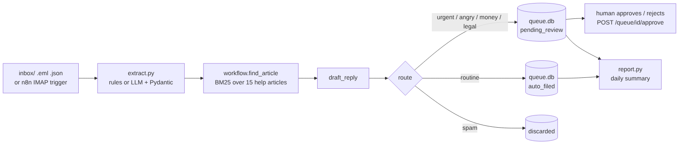
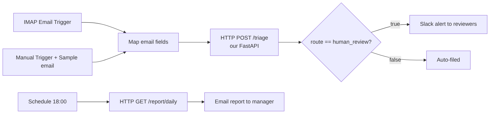

<!-- nav:start -->
> [🏠 Course home](../../README.md) · [🏗️ All projects](../README.md) · [⬅️ P08 Data-analyst agent + MCP server](../p08-data-analyst-agent-mcp/README.md) · [P10 Fine-tune: LoRA SFT + DPO ➡️](../p10-finetune-lora-dpo/README.md)  
> **P09 · Support-inbox automation** · 🔴 Advanced · best after module 11 · [▶️ Open in Colab](https://colab.research.google.com/github/vvvvvivekkk/AI-Engineer/blob/main/15-projects/p09-support-inbox-automation/colab_quickstart.ipynb)
<!-- nav:end -->

# P9 - AI automation: support-inbox triage with human approval

**Level:** Advanced · **Module:** 11 (AI automation) · **Runs on:** any CPU, no API key

## What it does

A small online shop ("GadgetCo") gets about 40 support emails a day. This project automates the boring part and keeps a person in charge of the risky part:

1. **Extract** - turn each email into a structured **ticket**: customer, order id, product, one or more **intents** (what they want: refund, delivery status, damaged item...), urgency, sentiment, summary. The shape is fixed by a **Pydantic** schema (a Python class that checks every field's type and allowed values, like a paper form with required boxes and drop-down menus).
2. **Retrieve** - find the best help-centre article for the issue (BM25 keyword search over 15 Markdown articles).
3. **Draft** - write a polite reply from the article.
4. **Route** - decide where it goes:
   - `human_review` - urgent, angry, legal threat, safety issue, money involved, several intents or missing order id -> waits in an **approval queue** (a table in an SQLite database) until a person approves or rejects it
   - `auto` - routine (e.g. a setup question) -> filed automatically with its draft
   - `discard` - spam
5. **Report** - a one-page daily summary for the manager.

It is built **twice**: as a plain Python pipeline, and as an **n8n** workflow (n8n is a visual automation tool where you connect boxes like "email arrives" -> "call a web address" -> "post to Slack"). The n8n version calls the same logic through a **FastAPI** web endpoint.

**Human-in-the-loop** means risky actions wait for a person. Analogy: a junior assistant sorts the post and writes draft replies, but the manager signs anything involving money, lawyers or safety.

## Architecture





**Data:** 200 synthetic emails over five days (`data/emails.jsonl`), each with its true labels, plus 12 of them as real `.eml` files in `data/inbox/`. Deliberate edge cases: 15 with two intents, 26 angry, 11 legal/chargeback threats, 5 safety issues, 21 forwarded threads quoting an *old* order id, 27 signatures with phone numbers, 16 spam, 13 very short, 5 Hinglish (Hindi + English), and many without an order id.

**Results with the rule-based extractor** (`python -m src.pipeline --fresh`): intents exactly right 99%, urgency 100%, order id 100%, product 100%, route 100%; 109 emails to human review, 75 auto-filed, 16 spam. Honest note: the extractor's rules were written for these templates, so real emails would score lower. The two misses are emails that praise a product and complain about billing in the same message - the rules drop "feedback" when there is also a complaint.

**LLM extraction** (`--method llm`) asks the model for JSON, validates it with Pydantic, sends the validation error back for one retry ("retry with feedback", the idea behind the Instructor library), and falls back to the rules if it still fails. In our test with the tiny local SmolLM2-135M model (`--method llm --limit 2`), both emails failed validation twice and used the rules fallback (the pipeline reports this as `rules_fallback`). Use `LLM_PROVIDER=ollama/anthropic/openai` for real LLM extraction.

## Setup

### Option A - Google Colab
1. Open `colab_quickstart.ipynb` via its **Open in Colab** badge. CPU runtime is fine.
2. **Runtime -> Run all.** It generates the data, runs the pipeline and the inbox watcher, lets you approve a ticket through the API, prints the daily report, lists the n8n nodes and runs the tests.

### Option B - Your own computer (Python version)
```bash
cd 15-projects/p09-support-inbox-automation
python -m venv .venv
source .venv/bin/activate            # Windows: .venv\Scripts\activate
pip install -r requirements.txt
cp .env.example .env

python -m src.make_emails            # 200 emails + 12 .eml files (already committed)
python -m src.make_articles          # 15 help articles (already committed)
python -m src.pipeline --fresh       # process all emails into data/queue.db
python -m src.pipeline --inbox data/inbox      # process a folder of .eml/.json files
python -m src.report --date 2026-11-20         # reports/daily_summary_2026-11-20.md
uvicorn src.api:app --port 8000                # API + docs at http://localhost:8000/docs
python -m pytest -q tests                      # 8 tests
```

### Option C - The n8n version
n8n could **not** be run where this project was built, so the workflow was generated and checked by a test (valid structure, node types, connections, placeholder credentials, URLs and body fields that match the API) but never executed. Please import it once and report problems.
1. Start the API: `uvicorn src.api:app --host 0.0.0.0 --port 8000`.
2. Start n8n with Docker: `docker run -it --rm -p 5678:5678 --add-host=host.docker.internal:host-gateway -v n8n_data:/home/node/.n8n docker.n8n.io/n8nio/n8n` and open http://localhost:5678.
3. **Workflows -> Import from File** -> `n8n/support_triage_workflow.json`.
4. Create your own credentials (IMAP mailbox, Slack bot, SMTP) and select them in the three nodes that show a warning. The file only contains placeholders.
5. Click **Execute workflow** on the *Manual Trigger (test)* path first: it sends a sample "damaged and smoking" email to `/triage` and should take the Slack (human approval) branch.
6. Field names from the IMAP node (`textPlain`, `date`) can differ between n8n versions - check the node's output and adjust *Map email fields* if needed.

**Python vs n8n - which to use?**

| | Python pipeline | n8n workflow |
|---|---|---|
| Reliability | Unit-tested end to end; retries and idempotency in code | Visual run history and built-in retries per node; logic still lives in the API |
| Maintainability | Needs a developer; versioned in git | Non-developers can rewire triggers and alerts; JSON diffs are hard to review |
| Integrations | You write each one | Hundreds of ready nodes (Gmail, Slack, Sheets...) |
| Best for | The "thinking" (extraction, routing rules) | The "plumbing" (triggers, notifications, schedules) |

That is why the n8n workflow does the plumbing and calls Python for the thinking.

## How each file works

**`src/make_emails.py`** - Writes emails from sentence templates per intent and records the true labels at the same time. Random choices (seeded, so the file is identical every run) add the edge cases. A final check makes sure labels only mention an order id or product that really appears in the text. Also saves 12 emails as standard `.eml` files.

**`src/make_articles.py`** - The 15 help-centre articles as Markdown.

**`src/schema.py`** - `Ticket` (the extraction target) and `Email` (the API input). Fields use `Literal[...]` (only listed values allowed), a **regex** pattern for order ids (`ORD-` + 5 digits; a regex is a small text-matching pattern language), `min_length` for intents and a custom validator that rejects unknown product names - a common LLM mistake.

**`src/extract.py`** - `rule_extract`: removes quoted lines (`>`) so old order ids are ignored, reads name and address from the `From` header, finds the order id with a regex, matches keywords for intents, uses capital letters / angry words for sentiment, and words like "lawyer", "sparks" or long delays for urgency. `llm_extract`: prompt with the JSON schema -> validate -> one retry with the error -> rules fallback. It returns which method was used, so you can count fallbacks.

**`src/workflow.py`** - `find_article` (BM25 search; safety words always pick the safety article), `draft_reply` (template; optional LLM), and `route`, which returns the route **and the reasons**, so reviewers see why an email was flagged.

**`src/queue_db.py`** - The SQLite approval queue. `email_id` is `UNIQUE`, so delivering the same email twice does not create two tickets (**idempotency**: doing something twice has the same effect as doing it once - essential when n8n retries). `decide` only works on `pending_review` tickets and records reviewer, note, time and an optional edited draft.

**`src/pipeline.py`** - Glues the steps together for one email (`process`), reads either `emails.jsonl` or an inbox folder of `.eml`/`.json` files, and prints accuracy when true labels exist.

**`src/report.py`** - Builds the daily Markdown summary from the queue: counts by intent, urgency, product and route reason, and the top urgent items still waiting.

**`src/api.py`** - FastAPI endpoints: `/triage` (used by n8n), `/queue`, `/queue/{id}/approve`, `/queue/{id}/reject` (404 if unknown, 409 if already decided) and `/report/daily`.

**`src/make_n8n.py`** -> **`n8n/support_triage_workflow.json`** - Generates the n8n workflow: IMAP trigger (or a manual test trigger with a sample email) -> map fields -> HTTP POST `/triage` -> IF `route == human_review` -> Slack alert, else no action; plus a daily 18:00 schedule -> GET `/report/daily` -> email to the manager.

**`src/llm.py`** - The shared provider switch (`local`, `ollama`, `anthropic`, `openai`).

**`tests/`** - Schema validation, the edge cases (two intents + quoted old order, angry + legal threat, spam, phone number not taken as an order id), auto-filing, ≥95% intent accuracy on the dataset, the full API flow (triage -> idempotent re-delivery -> approve -> 409 on second approval -> report), and consistency of the n8n JSON with the API. The tests use a temporary queue database.

**`build.py`** - Regenerates the n8n JSON, the two diagrams and the Colab notebook.

## How to explain it in an interview

**60-second pitch.** "I automated a support inbox. Each email is turned into a validated Pydantic ticket - intents, order id, urgency, sentiment - by a rule-based extractor with an optional LLM extractor that retries with the validation error and falls back to rules. The system retrieves a help article, drafts a reply and routes it: anything urgent, angry, legal, safety-related or involving money goes into an SQLite approval queue for a human, routine mail is auto-filed and spam is discarded, with the reasons stored. It is exposed through FastAPI, and I built an n8n workflow that does the plumbing - IMAP trigger, Slack alert for approvals, a daily report email - while calling the API for the decisions. On 200 synthetic emails with deliberate edge cases the extractor got 99% of intents and 100% of routes right."

**Design decisions and trade-offs**
- *Rules first, LLM optional* - rules are free, fast and predictable; an LLM handles phrasing the rules never saw. Validation + fallback gives the best of both.
- *Schema-validated output* - downstream code can trust every field; invalid LLM output is caught immediately.
- *Route reasons stored* - reviewers trust and audit the system; rules are easy to tune.
- *Idempotent queue* - safe against duplicate deliveries and retries.
- *n8n for plumbing, Python for logic* - non-developers can change alerts and schedules, while the tricky logic stays tested in code. Trade-off: two systems to run.
- *Conservative routing* - many emails go to humans (109/200). Safer at first; loosen the rules as trust grows.

**Five likely questions**
1. *How do you make LLM extraction reliable?* A strict schema, validation, retry with the error message, a deterministic fallback, and measuring the fallback rate and field accuracy on a labelled set.
2. *Why keep a human in the loop?* Refunds, legal threats and safety issues have real cost if wrong. The system drafts; a person approves. Every decision is logged for audit.
3. *What happens if the same email arrives twice?* The unique `email_id` makes the insert a no-op and returns the existing ticket.
4. *When would you choose n8n over pure Python?* When the work is mostly connecting services and the people maintaining it are not developers. For complex logic and tests, Python.
5. *How would you measure success in production?* Time to first response, share auto-filed, reviewer edit rate on drafts (how often people change the draft), wrong-route rate from reviewer feedback, and customer satisfaction.

## Credits (original ideas)
- Automate the Boring Stuff with Python: https://automatetheboringstuff.com/
- 12-Factor Agents (humans in the loop, own your control flow): https://github.com/humanlayer/12-factor-agents
- Flowise: https://github.com/FlowiseAI/Flowise · Dify: https://github.com/langgenius/dify
- n8n: https://n8n.io

All code here is our own small reimplementation.

## What to try next
- Run `python -m src.pipeline --method llm --limit 20` with `LLM_PROVIDER=ollama` and compare accuracy and fallback rate with the rules.
- Replace BM25 article search with P5's embedding retriever.
- Add an "edit rate" metric: compare approved drafts with the original drafts.
- Add a Gmail node instead of IMAP and a Google Sheets log in the n8n workflow.
- Use the 200 labelled emails as extra training data for P10's fine-tuning.

<!-- nav:start -->
---
[🏠 Course home](../../README.md) · [🏗️ All projects](../README.md) · [⬅️ P08 Data-analyst agent + MCP server](../p08-data-analyst-agent-mcp/README.md) · [P10 Fine-tune: LoRA SFT + DPO ➡️](../p10-finetune-lora-dpo/README.md)
<!-- nav:end -->
