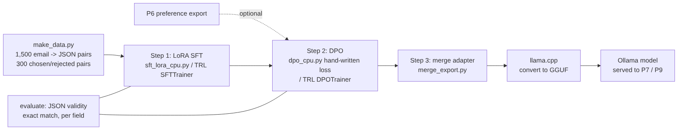
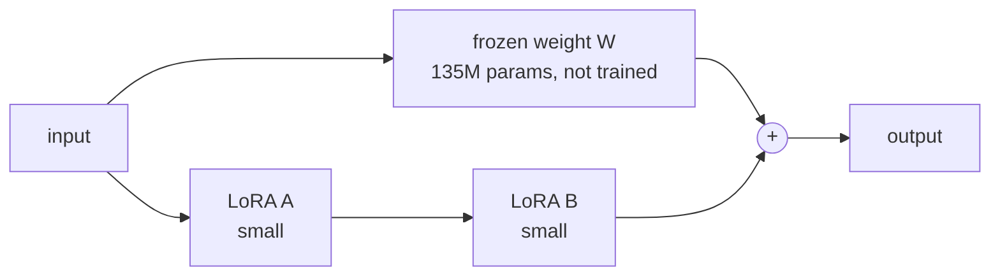

<!-- nav:start -->
> [🏠 Course home](../../README.md) · [🏗️ All projects](../README.md) · [⬅️ P09 Support-inbox automation](../p09-support-inbox-automation/README.md)  
> **P10 · Fine-tune: LoRA SFT + DPO** · 🔴 Advanced · best after module 13 · [▶️ Open in Colab](https://colab.research.google.com/github/vvvvvivekkk/AI-Engineer/blob/main/15-projects/p10-finetune-lora-dpo/colab_quickstart.ipynb)
<!-- nav:end -->

# P10 - Fine-tune a small model: LoRA SFT, then DPO

**Level:** Advanced · **Module:** 13 (fine-tuning) · **Runs on:** CPU (small demo) or a free Colab T4 GPU (full TRL recipe)

## What it does

Takes a tiny open chat model, **SmolLM2-135M-Instruct**, and teaches it one narrow job: read a messy customer-support email (like the ones in P9) and reply with **strict JSON** - exactly the keys `order_id`, `product`, `intent`, `urgency`, nothing else.

```text
email:  "hey\nI want a refund for my HomeCam 360 (ORD-23452).\nThank you,\nJack"
target: {"order_id": "ORD-23452", "product": "HomeCam 360", "intent": "refund", "urgency": "medium"}
```

Three steps:
1. **SFT with LoRA.** **Supervised fine-tuning** (SFT) means showing the model many input -> correct-output examples. **LoRA** (low-rank adaptation) freezes the original weights and trains small extra matrices instead (here 1.8 M trainable parameters, about 1.35% of the model). Analogy: adding sticky notes to a textbook instead of rewriting it.
2. **DPO.** **Direct preference optimisation** shows the model pairs of answers to the same email - a *chosen* (correct) one and a *rejected* one with a typical mistake (wrong intent, invented order id, chatty text around the JSON, markdown fences, broken JSON) - and nudges it to prefer the chosen one. Analogy: a driving instructor who says "that turn was better than this one" instead of giving marks out of 10.
3. **Merge and export.** Fold the adapter back into the model, convert it to **GGUF** (the single-file format used by llama.cpp and Ollama) and serve it with **Ollama**, so P7 or P9 could call it.

Throughout, we compare the fine-tuned model with **prompting** the same base model (giving it one worked example in the prompt, called **few-shot** prompting), using two strict metrics:
- **JSON validity** - the output parses as JSON and has exactly the four keys
- **exact match** - all four values are right (plus accuracy per field)

## Architecture



How LoRA adds a small trainable path next to a frozen weight:



## Results

These are the numbers from the CPU runs in the build environment (`data/results_sft.json`, `data/results_dpo.json`). The test set here is only **10 emails** because CPU generation is slow, so one email = 10 percentage points. Treat them as a demonstration, not a benchmark.

| Model | Valid JSON | Exact match | order_id | product | intent | urgency |
|---|---|---|---|---|---|---|
| Base model, few-shot prompt | 90% | 0% | 30% | 40% | 0% | 40% |
| After LoRA SFT (30 steps, 400 examples, no example in prompt) | 90%\* | 40% | 60% | 80% | 80% | 70% |
| SFT model, re-measured with a 48-token limit | 100% | 40% | 60% | 90% | 90% | 70% |
| After DPO (30 steps, 64 pairs, beta 0.1) | 100% | 30% | 90% | 80% | 70% | 60% |

\* one answer was cut off by the 40-token output limit used in that run; the limit is now 48.

What this shows:
- **Prompting alone fails on the content.** In an earlier run with `--zero-shot` (20 emails), the base model never produced valid JSON without an example. With one example it copies the format but also copies the example's values (it often answered `ORD-55555`) and invents intents such as "disconnected".
- **SFT fixes the format and most fields** in about 9 minutes of CPU training (training loss 0.52 -> 0.03). Its main remaining mistake is *inventing* an order id when the email has none.
- **DPO fixed exactly that mistake** (order_id 60% -> 90%) because one family of rejected answers was "invented order id". But with only 30 steps, a high learning rate and strong margins it pushed too hard elsewhere: intent and urgency got slightly worse (for example it wrote "technical_issue" instead of "technical_support"), so exact match fell from 40% to 30%. On 40 held-out pairs, the implicit-reward accuracy was 93%, while the share of pairs where the chosen answer had the higher raw likelihood went from 100% to 95% - a known DPO effect: it widens the *gap* to the reference, not necessarily the raw likelihood. Lower learning rate, more pairs and more steps (the GPU notebook) are the usual fixes.
- Timings on the shared 2-core build machine (other jobs running): SFT ~15 min in total, DPO ~35 min in total. On an idle laptop expect roughly a third of that.

## Setup

### Option A - Google Colab, CPU (quick demo)
Open `colab_quickstart.ipynb` with its **Open in Colab** badge and **Run all**. It builds the data and runs SFT, DPO and the merge in *quick mode* (very few steps), then the tests. Expect about 10 minutes. The numbers will be weak - it is a demo of the mechanics.

### Option B - Google Colab, T4 GPU (the real recipe with TRL)
Open `colab_gpu_trl-colab-only.ipynb`, choose **Runtime -> Change runtime type -> T4 GPU**, and **Run all** (about 10-20 minutes). It measures the base model, runs TRL's `SFTTrainer` (300 steps) and `DPOTrainer` (100 steps) on SmolLM2-360M-Instruct with LoRA, merges, converts to GGUF with llama.cpp and downloads the file. This notebook needs a GPU, so it was **not executed** in the build environment; its training code (`src/trl_train.py`) was checked there with `python -m src.trl_train --smoke` (2 steps of SFT and DPO on CPU) against the installed TRL version.

### Option C - Your own computer
```bash
cd 15-projects/p10-finetune-lora-dpo
python -m venv .venv
source .venv/bin/activate            # Windows: .venv\Scripts\activate
pip install -r requirements.txt
cp .env.example .env

python -m src.make_data              # datasets (already committed)
python -m src.sft_lora_cpu           # step 1: ~5 min on an idle 2-core CPU (30 steps, 10 test emails)
python -m src.dpo_cpu                # step 2: hand-written DPO, a few minutes
python -m src.merge_export           # step 3: merged model + Ollama Modelfile in outputs/
python -m pytest -q tests            # 6 fast tests (no training)
python -m src.trl_train --smoke      # optional: 2-step check of the TRL code on CPU
```
With an NVIDIA GPU: `python -m src.trl_train --gpu`.

Use P6's human preference data instead of the generated pairs: `python -m src.make_data --from-p6 ../p06-response-rating-tool/data/preferences_hh.jsonl` then `python -m src.dpo_cpu --pairs data/dpo_from_p6.jsonl` (different task - maths/coding/policy answers - so this only demonstrates the format plugs in).

### From adapter to Ollama (GGUF export)
These steps need llama.cpp and Ollama, which were **not available** in the build environment, so they are documented but were not run there. `python -m src.merge_export` prints them with the right paths.
```bash
python -m src.merge_export                                   # -> outputs/merged-model + outputs/Modelfile
git clone https://github.com/ggml-org/llama.cpp
pip install -r llama.cpp/requirements.txt
python llama.cpp/convert_hf_to_gguf.py outputs/merged-model --outfile outputs/ticket-extractor-q8_0.gguf --outtype q8_0
cd outputs && ollama create ticket-extractor -f Modelfile
ollama run ticket-extractor "Hi, my FitBand Pro (ORD-12345) arrived broken."
```
`q8_0` keeps 8 bits per weight (about half the size of 16-bit, almost no quality loss). For smaller files, llama.cpp's `llama-quantize` tool can make 4-bit versions such as `Q4_K_M`. To use the model from P7, set `LLM_PROVIDER=ollama` and `OLLAMA_MODEL=ticket-extractor`.

## How each file works

**`src/make_data.py`** - Writes 1,500 unique emails from templates (6 intents, 5 products, 75% with an order id, 20% urgent add-ons such as threats or "it started smoking", distractor phone numbers) together with the exact target JSON. Splits 1,350 / 150 with no overlap. Builds 300 DPO pairs in TRL's conversational format (`prompt` / `chosen` / `rejected` message lists), each rejected answer carrying one named mistake. `--from-p6` converts P6's HH-RLHF export into the same format.

**`src/common.py`** - Shared helpers: loading the model, `encode_sft` (applies the model's **chat template** - its expected text layout - and sets the prompt positions of the labels to -100 so only the answer is learned), padding a batch, greedy generation (always pick the most likely next **token**; repeatable), and the strict scorer.

**`src/sft_lora_cpu.py`** - Step 1 by hand, on CPU. Measures few-shot prompting first (`--zero-shot` also measures prompting without an example), adds LoRA (`r=16`, `alpha=32`) to the attention projections with `peft`, and trains with AdamW, a short warm-up and gradient clipping on a 400-example subset (CPUs are slow). Saves the adapter (a few MB) to `outputs/` and the metrics and loss curve to `data/results_sft.json`.

**`src/dpo_cpu.py`** - Step 2 by hand. `dpo_loss` is the whole algorithm in two lines: `margin = (policy_chosen - ref_chosen) - (policy_rejected - ref_rejected)` and `loss = -logsigmoid(beta * margin)`. `seq_logps` adds up the log-probabilities of the answer tokens. The **reference** model is the SFT model before DPO; since it never changes, its log-probabilities are computed once up front, so only one model is in memory. Reports, on 40 held-out pairs, how often the chosen answer is more likely before and after, the **implicit reward accuracy**, and a JSON check on test emails; writes `data/results_dpo.json`.

**`src/merge_export.py`** - Merges the newest adapter into the base weights (`merge_and_unload`), saves a normal Hugging Face model to `outputs/merged-model`, writes an Ollama `Modelfile`, and prints the GGUF commands.

**`src/trl_train.py`** - The same two steps with TRL: `SFTTrainer` on a prompt/completion dataset with `completion_only_loss=True` and LoRA on all linear layers; merge; then `DPOTrainer` with a new LoRA adapter via `peft_config` (so TRL uses the adapter-free model, i.e. the SFT model, as the reference). Written for TRL 1.18 (for example, `DPOConfig` no longer takes `max_prompt_length`). `--smoke` runs 2 steps of each on CPU.

**`colab_gpu_trl-colab-only.ipynb`** - The T4 notebook described above. **`colab_quickstart.ipynb`** - the CPU quick demo.

**`tests/test_p10.py`** - Dataset sizes and no train/test leakage, rejected answers really are wrong, the scorer rejects markdown fences and extra keys, the DPO loss matches the formula (margin 0 gives log 2; raising the chosen log-probability lowers the loss), prompt tokens are masked, and the generator is reproducible.

**`data/`** - `sft_train.jsonl`, `sft_test.jsonl`, `dpo_train.jsonl`, `dpo_test.jsonl`, `dpo_from_p6.jsonl`, and the metrics: `results_sft.json` / `results_dpo.json` (the default runs in the table above) and `results_sft_quick.json` / `results_dpo_quick.json` (the notebook's quick mode: 15 SFT steps, 6 DPO steps, 4-5 test emails - very noisy; in our run quick DPO even broke the JSON format on 2 of 4 emails, a reminder that a few aggressive DPO steps can damage what SFT taught).

**`build.py`** - Regenerates the diagrams and both notebooks.

## How to explain it in an interview

**60-second pitch.** "I fine-tuned a 135-million-parameter model to turn support emails into strict JSON. I generated 1,500 email-to-JSON pairs with exact labels and 300 preference pairs where the rejected answer has a realistic mistake. Step one was LoRA SFT with PEFT - only about 1% of the weights train. Step two was DPO: I implemented the loss by hand in PyTorch with precomputed reference log-probabilities, and also wrote the TRL SFTTrainer/DPOTrainer version for a Colab T4. I measured JSON validity and exact match against few-shot prompting of the same base model, then merged the adapter and documented the GGUF export so Ollama can serve it."

**Design decisions and trade-offs**
- *Synthetic data with exact labels* - perfect for measuring; the risk is a model that only knows the templates. Mixing in real labelled emails is the fix.
- *LoRA instead of full fine-tuning* - far less memory and a tiny file per task; can underfit compared with full fine-tuning on big changes.
- *SFT before DPO* - SFT teaches the format; DPO then sharpens choices between near-misses. DPO alone on a base model that cannot yet produce the format learns little.
- *Precomputed reference log-probs* - halves memory; only valid because the reference is frozen.
- *Strict metrics* - an answer wrapped in markdown fences counts as invalid, because a program reading it would break.
- *Tiny CPU runs vs GPU runs* - the CPU demo proves the mechanics on any laptop; real quality needs the GPU notebook (more steps, bigger model).

**Five likely questions**
1. *When would you fine-tune instead of prompting?* When you need a fixed format or style at high volume, low latency or low cost, or offline/private deployment - and prompting a small model is not reliable enough. Try prompting and RAG first.
2. *What does DPO optimise, and what is beta?* It raises the chosen answer's likelihood relative to the rejected one, measured against a frozen reference so the model does not drift. Beta sets how strongly; larger beta means a stronger push away from the reference.
3. *Why mask the prompt tokens with -100?* So the loss only rewards producing the answer. Otherwise the model also learns to reproduce emails, which wastes capacity.
4. *What can go wrong?* Overfitting to templates, catastrophic forgetting of general skills, data leakage between train and test, and evaluation that is too lenient (for example, counting fenced JSON as valid).
5. *How do you serve it?* Merge the adapter, convert to GGUF, optionally quantise, create an Ollama model with a Modelfile (system prompt, temperature 0), and call it from the API like any other provider.

## Credits (original ideas)
- Maxime Labonne, LLM Course: https://github.com/mlabonne/llm-course
- Unsloth: https://github.com/unslothai/unsloth
- Hugging Face TRL: https://github.com/huggingface/trl
- RLHF in Notebooks: https://github.com/ash80/RLHF_in_notebooks
- Hugging Face fine-tuning guide: https://huggingface.co/docs/transformers/training
- DPO paper (Rafailov et al., 2023): https://arxiv.org/abs/2305.18290

All code here is our own small reimplementation.

## What to try next
- Run the T4 notebook with `Qwen/Qwen2.5-0.5B-Instruct` and compare with SmolLM2-360M.
- Train SFT on all 1,350 examples for one full epoch on the GPU and plot exact match against steps.
- Add P9's 200 labelled emails as a harder test set (different wording from the training templates).
- Try `loss_type="ipo"` in `DPOConfig` and compare with standard DPO.
- Serve the GGUF model through Ollama and plug it into P9 as `EXTRACT_METHOD=llm` with `LLM_PROVIDER=ollama`.

<!-- nav:start -->
---
[🏠 Course home](../../README.md) · [🏗️ All projects](../README.md) · [⬅️ P09 Support-inbox automation](../p09-support-inbox-automation/README.md)
<!-- nav:end -->
