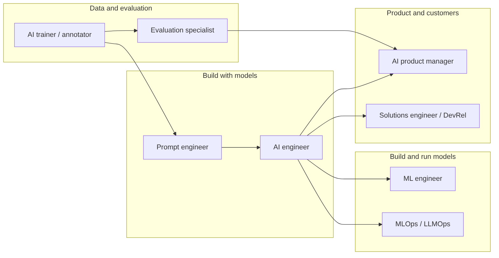
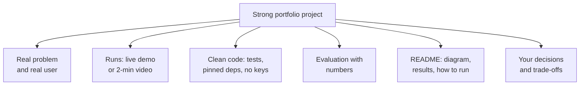
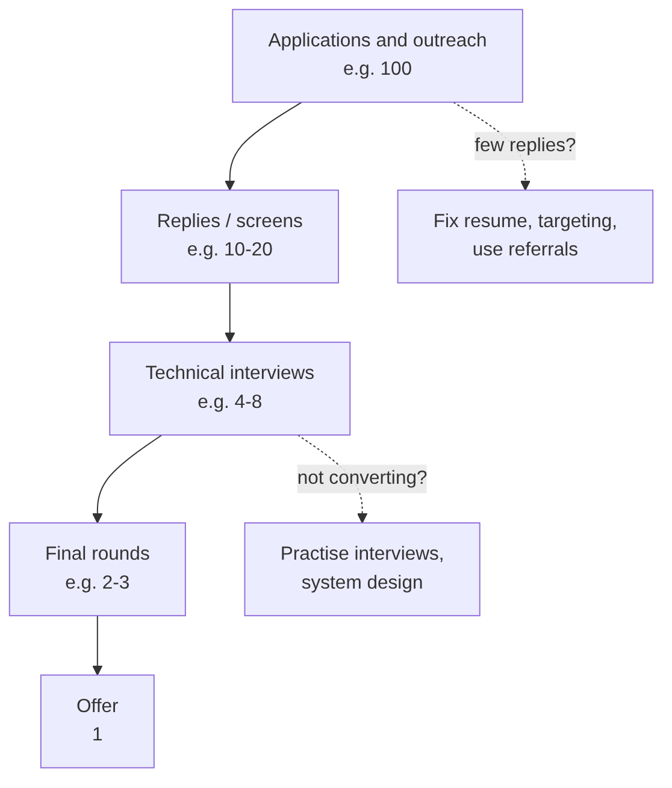
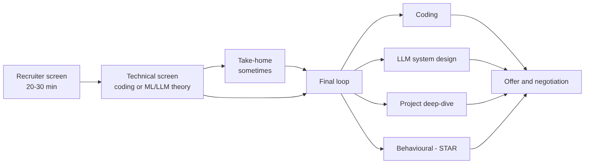
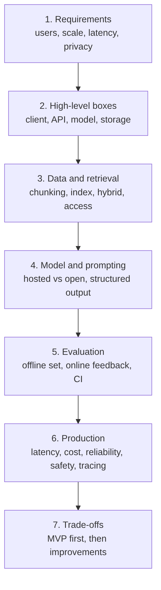

<!-- nav:start -->
> [🏠 Course home](../README.md) · [🗺️ Roadmap](../ROADMAP.md) · [⬅️ 15 Projects](../15-projects/README.md)  
> **💼 Module 16 · Careers** · [📋 Module overview](README.md)  
> [📖 Lesson](concepts.md) · [📄 PDF handout](pdf/16-careers-handout.pdf) · [🎞️ Slides](slides/16-careers.pptx) · [📓 Notebooks](notebooks/) · [✍️ Exercises](exercises.md) · [✅ Solutions](solutions/) · [🧑‍🏫 Trainer notes](trainer-notes.md) · [🔗 Resources](resources.md)
<!-- nav:end -->

# Module 16 — Careers in AI

> **Goal of this lesson:** understand the main AI job roles and what people in them actually do all day, see which skills each role needs, build a portfolio that proves those skills, write a resume and LinkedIn profile that get past the first filter, find openings (including AI-trainer work), and prepare for every common interview round. Templates, a skills matrix, a 137-question interview bank and three offline notebooks support each step.

---

## 0. How to use this module

Earlier modules taught *skills*. This one turns skills into *a job*. Think of it as the difference between learning to cook and getting hired in a restaurant kitchen: the chef wants to taste something you made (portfolio), read a short summary of where you have worked (resume), and watch you cook under pressure (interview).

Work through it in this order:

1. Read sections 1–2 and pick one or two **target roles**.
2. Do the skills self-assessment (notebook 03 / `excel/skills-matrix.xlsx`) to find your gaps.
3. Build or polish **two or three portfolio projects** for those roles (section 3, and module 15).
4. Write your resume and LinkedIn using `templates/` (sections 4–5); check keywords with notebook 01.
5. Start applying and tracking (section 6, `excel/job-search-tracker.xlsx`).
6. Practise interviews with the question bank and notebook 02 (section 7).

A note on facts that change: job titles, platforms, tools and pay move fast in AI. Wherever this module would need a number that changes (salaries, pay rates, model names) it gives you a place to check instead. Pay in particular **varies hugely by country, city, company and experience**, so always research your own market (section 8).

---

## 1. The AI job landscape

### 1.1 One field, many jobs

"Working in AI" covers very different jobs. A useful map has three layers:

- **Data and evaluation work** — creating, labelling and judging the data that trains and tests models.
- **Building with models** — taking existing models (often through an API) and turning them into useful products: chatbots, search, agents, automations.
- **Building and running models** — training, fine-tuning, serving and monitoring models themselves.

Around these sit **product and customer-facing roles** that decide *what* to build and help customers succeed with it.

The arrows in the diagram are common moves. Many people start in data/evaluation work or as a junior software or AI engineer, then specialise. Nobody needs to start at the "top"; most careers zig-zag.

### 1.2 Some words you will see in job adverts

| Term | Meaning |
|---|---|
| **JD** (job description) | the advert text listing duties and requirements |
| **IC** (individual contributor) | someone who does hands-on work rather than managing people |
| **Junior / mid / senior** | rough experience levels (often 0–2, 2–5, 5+ years, but every company differs) |
| **Full-stack** | works on both the user-facing part (front-end) and the server part (back-end) |
| **Production** | the live system real users depend on (as opposed to a demo or notebook) |
| **Stakeholder** | anyone affected by or deciding about your work (manager, client, other teams) |
| **Contract / freelance** | paid per project or hour, not a permanent employee |
| **Remote / hybrid / on-site** | where you work: from home, partly at the office, or fully at the office |

---

## 2. The roles in detail

For each role: what it is, a realistic day, core skills, how people get in, and which modules of this course prepare you.

### 2.1 AI trainer / data annotator

**What it is.** An **AI trainer** (also called rater, data annotator, AI tutor or evaluator) creates and judges the data that teaches models to behave well. This is the human side of **RLHF** ("reinforcement learning from human feedback", module 12): models learn from people's judgements of which answers are better.

**A typical day** (usually remote, task-based, often freelance):
- Log in to a platform, pick tasks from an active project.
- Read a prompt and two model answers; rate each against a **rubric** (a written list of criteria such as accuracy, instruction-following, safety, style) and choose the better one, with a written justification.
- Write an ideal "gold" answer to a hard prompt.
- Check model-written code by running it and noting bugs.
- **Red-team**: try to make the model fail (trick questions, conflicting instructions) and document what happened.
- Take a short quality test when a new project opens.

**Core skills:** careful reading, clear writing, fact-checking, following detailed guidelines consistently, and — for the better-paid work — real domain expertise (coding, maths, law, medicine, finance, a second language).

**Getting in:** apply to platforms, pass an assessment (often an AI-run interview plus a skills test), keep quality high to be offered more projects. Work comes in bursts; many people use it as **side income while studying** or as a bridge into AI. Section 6.3 lists platforms and scam warnings.

**Course modules:** 07, 08, 12 (annotation, rubrics, kappa, RLHF), plus your domain knowledge.

### 2.2 Prompt engineer

**What it is.** Designs, tests and maintains the instructions (prompts) and context that make LLMs do a job reliably. As of late 2026, stand-alone "prompt engineer" titles are less common than in 2023; the skill has largely been absorbed into AI engineer, AI product and applied-AI roles. It still matters a lot — it is just usually one part of a broader job.

**A typical day:**
- Rewrite a system prompt to fix a failure seen in user logs.
- Build a test set of tricky inputs and run old vs new prompt versions against it.
- Design few-shot examples and output formats (JSON schemas).
- Work with domain experts (lawyers, support staff) to capture their rules in prompts.
- Write documentation of prompt versions and why they changed.

**Core skills:** precise writing, understanding of how LLMs behave (module 07–08), evaluation design, basic Python to automate tests, domain knowledge.

**Getting in:** usually by being the person on a team (support, content, operations, engineering) who becomes great at making AI tools work, then moving into AI engineering or AI product roles.

**Course modules:** 07, 08, 09, 14 (evals).

### 2.3 AI engineer (applied AI / LLM engineer)

**What it is.** A software engineer who builds products on top of AI models — mostly existing foundation models used through APIs or open-weight models — and makes them reliable in production. This is the role this course is mainly aimed at.

**A typical day:**
- Morning stand-up: a short daily team meeting about progress and blockers.
- Build a feature: e.g. add document upload to a RAG assistant (chunking, embeddings, vector DB).
- Debug a bad answer from a trace in Langfuse: retrieval missed the right chunk → change chunking, add hybrid search.
- Write an eval and add it to CI.
- Review a teammate's pull request.
- Discuss with product: "can the agent book meetings safely?" → design human approval.

**Core skills:** strong Python, APIs (FastAPI), Git, LLM APIs and prompting, RAG, agents and tool calling, evaluation, deployment basics (Docker, cloud), monitoring and cost control, communication.

**Getting in:** a portfolio of deployed LLM apps (section 3) is the single strongest signal. Many come from software engineering, data science or a strong student project record.

**Course modules:** essentially all, especially 07–11 and 14–15.

### 2.4 ML engineer

**What it is.** Builds, trains, evaluates and deploys machine-learning models — classic ML (fraud scores, recommendations, forecasting) and deep learning — and the data pipelines around them. Compared with AI engineers, ML engineers more often train their own models and care deeply about data, features and model metrics.

**A typical day:**
- Investigate why a fraud model's recall dropped last week (data drift? a broken feature?).
- Write a feature pipeline in SQL/pandas, retrain with scikit-learn or PyTorch, compare against the current model with cross-validation.
- Fine-tune a small model for a classification task.
- Package the model for serving and set up monitoring.
- Read a paper and decide whether its technique is worth trying.

**Core skills:** Python, SQL, statistics, ML and DL fundamentals, PyTorch, experiment tracking, data pipelines, model serving, plus math intuition.

**Getting in:** Kaggle-style projects with honest evaluation, research or internship experience, or moving over from data science or software engineering. Some companies expect a degree in CS, maths or similar.

**Course modules:** 02–06, 12–14.

### 2.5 MLOps / LLMOps engineer (and platform engineer)

**What it is.** Makes model-based systems run reliably at scale: infrastructure, deployment pipelines, serving, monitoring, cost and security. **MLOps** does this for classic ML; **LLMOps** adds LLM-specific concerns (token cost, prompt versioning, tracing, guardrails, GPU serving with tools like vLLM).

**A typical day:**
- Set up GPU autoscaling for a vLLM deployment.
- Build a CI/CD pipeline that runs tests and evals then deploys a new container.
- Add Langfuse tracing and a cost dashboard; set alerts.
- Investigate a latency spike (p95 doubled) — provider issue or a prompt that grew?
- Rotate secrets and review access permissions.

**Core skills:** Linux, Docker, cloud (AWS/GCP/Azure), Kubernetes basics, CI/CD, monitoring tools, Python, networking basics, security habits, understanding of model serving.

**Getting in:** usually from DevOps, backend or data engineering, or as an AI engineer who loves the infrastructure side.

**Course modules:** 00, 14, plus 13 for serving fine-tuned models.

### 2.6 AI product roles

Several roles focus on *what* to build and on customers rather than writing most of the code:

- **AI product manager (PM)** — decides which AI features to build and why, writes requirements, defines success metrics and evals with the team, balances quality, cost and risk, and talks to users. Needs product sense, enough technical depth to judge feasibility, and data literacy.
- **Solutions engineer / forward-deployed engineer** — works with customers to make an AI product succeed in their environment: demos, prototypes, integrations, workshops. Part engineer, part consultant.
- **Developer advocate / developer relations (DevRel)** — teaches developers to use an AI platform through tutorials, talks, sample apps and community work. Needs strong communication and solid coding.
- **AI trainer lead / evaluation specialist** — designs rubrics and evaluation programmes, manages annotator quality.

**Course modules:** 07–10 for technical depth, 12 and 14 for evaluation, plus the communication practice in this module.

### 2.7 Comparing the roles at a glance

| Role | Mostly works on | Main tools | Entry barrier | Typical background |
|---|---|---|---|---|
| AI trainer / annotator | rating, writing, checking model outputs | annotation platforms, docs, spreadsheets | low–medium (higher for expert work) | any degree; domain experts |
| Prompt engineer | prompts, context, evals | LLM consoles, Python scripts, eval tools | medium | writing, domain, some code |
| AI engineer | LLM apps: RAG, agents, APIs | Python, FastAPI, LLM APIs, vector DBs, LangGraph | medium–high | software / data / strong projects |
| ML engineer | training and deploying models | Python, SQL, scikit-learn, PyTorch | high | CS / maths / data science |
| MLOps / LLMOps | infrastructure, serving, monitoring | Docker, Kubernetes, cloud, CI/CD, vLLM, Langfuse | high | DevOps / backend |
| AI product (PM, solutions, DevRel) | what to build, customers, teaching | docs, prototypes, analytics | medium–high | product / engineering / consulting |

The full **skills matrix** — 22 skills × 6 roles with the level each role needs (0 = not needed, 1 = awareness, 2 = working knowledge, 3 = strong) and the module that teaches it — is in `excel/skills-matrix.xlsx`. Its second sheet is a self-assessment that calculates your gap for each role automatically.

---

## 3. Building a portfolio that gets interviews

### 3.1 Why a portfolio beats certificates

Recruiters see hundreds of applications listing the same courses. A **portfolio** — a public collection of things you have built — is proof you can do the work. For AI engineering in particular, one well-built, deployed project that solves a real problem says more than five certificates.

Analogy: a photographer is hired from their photos, not from a list of camera courses they attended.

### 3.2 What makes a strong project

1. **A real problem and user.** "Ask questions about your university's exam regulations" beats "chat with a PDF".
2. **It runs.** A live demo link (Hugging Face Space, Streamlit Community Cloud, a small cloud server) or at least a 2-minute video.
3. **Engineering quality.** Clear structure, `requirements.txt` with pinned versions, `.env.example`, tests, no keys in the code.
4. **Evaluation.** A small test set and numbers: "retrieval hit rate 0.86 → 0.93 after adding hybrid search". This is what separates engineers from tutorial-followers.
5. **A great README** (template: `templates/project-readme-template.md`): what it does, a screenshot/GIF, an architecture diagram, how to run it, results, limitations and next steps.
6. **Your own decisions.** Explain trade-offs you made (why FAISS not a hosted DB; why this chunk size). Interviewers will ask.

**How many?** Two or three strong projects aimed at your target role beat ten unfinished ones. Module 15 has ten project specs from beginner to advanced; a good set for an AI-engineer target is: one RAG app with evaluation, one agent with tools and human approval, and one deployed service with monitoring.

**Using AI tools to build projects** is normal now, but you must understand every line: interviewers will ask you to explain or modify your code live. If you cannot explain it, rewrite it until you can.

### 3.3 Your GitHub profile

**GitHub** is where most technical recruiters look first.
- **Profile README**: create a repository with the same name as your username; its README appears on your profile. Put a two-line intro, your focus ("I build RAG and agent systems"), links to your 3 best projects and your LinkedIn/blog.
- **Pin** your best 4–6 repositories.
- Each pinned repo has a description, topics (tags), a README and ideally a live link.
- Commit regularly with clear messages; delete or archive half-finished experiments, or label them clearly.
- Contributing to open source (even documentation fixes) shows you can work in someone else's codebase. Google Summer of Code and Outreachy are paid, mentored programmes for this (see resources).

### 3.4 Demos and writing

- **Demo video**: 1–3 minutes, show the problem, the app working, one technical insight. Link it at the top of the README.
- **Blog posts**: write what you learned — "How I cut my RAG bot's wrong answers by half". Writing proves understanding and communication, and gets shared on LinkedIn. Platforms: your own site (GitHub Pages), Medium, Hashnode, dev.to, LinkedIn articles.
- **Hackathons** (Devpost, MLH, local events) give deadlines, teammates and prizes to mention on a resume.
- **Kaggle** competitions give a public, ranked record for ML roles.

---

## 4. The resume (CV)

### 4.1 What it is for

A **resume** (called a **CV** in many countries) is a one-page summary designed to get you an interview — not to tell your life story. A recruiter often spends well under a minute on the first look. Many companies first pass resumes through an **ATS** ("Applicant Tracking System" — software that stores applications and lets recruiters search and filter them by keywords). So your resume must be **easy to scan for humans and easy to parse for software**.

### 4.2 Structure (one page for students and early-career)

1. **Header**: name, city/country (and work authorisation if relevant), email, phone, LinkedIn, GitHub, portfolio link.
2. **Summary** (optional, 2 lines): target role + your strongest proof. "AI engineer focused on RAG and agents; built and deployed 3 LLM apps with evaluation and monitoring."
3. **Skills**: grouped — Languages, ML/AI, LLM tooling, Deployment, Tools. Only list what you can discuss in an interview.
4. **Projects** (for students this often comes before experience): 2–4 projects, each with a one-line description, tech, and 2–3 bullets with results, plus links.
5. **Experience**: jobs, internships, freelance, AI-trainer work, teaching — with impact bullets.
6. **Education**: degree, institution, dates, relevant coursework or grades if strong.
7. **Achievements** (optional): hackathon placings, publications, open-source contributions, certifications.

The template is in `templates/resume-template.md`.

### 4.3 Writing strong bullets

Use the formula **action verb + what you did + how + measurable result**:

- Weak: "Worked on a chatbot."
- Strong: "Built a RAG assistant over 1,200 university policy pages (FastAPI, FAISS, BM25 hybrid search); raised retrieval hit rate from 0.71 to 0.89 on a 60-question eval set."

If you have no business numbers, use technical ones: accuracy, latency, cost per request, number of users or documents, time saved, test coverage.

### 4.4 Keywords and the ATS

Read the job description and make sure the skills it asks for — and you really have — appear in your resume *using the same words* ("LangGraph", "vector database", "Docker", "evaluation"). Notebook 01 builds a **keyword matcher** that compares your resume with a JD and lists missing terms. Rules:

- Never add skills you do not have — interviews will expose it.
- Use a simple layout: one column, standard headings, no text inside images, export as PDF (unless asked for Word).
- Tailor the top third of the resume (summary, skills, first project) for each important application.

### 4.5 Common resume mistakes

- Two or more pages as a student; dense paragraphs instead of bullets.
- Listing every tool you have ever touched ("expert in 40 technologies").
- No links, or links to empty GitHub repos.
- Responsibilities instead of results ("responsible for testing").
- Spelling errors, inconsistent dates, unprofessional email address.
- A photo, date of birth or other personal details where local norms do not expect them (norms differ by country — check yours).

---

## 5. LinkedIn and networking

**LinkedIn** is the main professional network and job platform worldwide. Recruiters search it like a database, so your profile works for you while you sleep.

### 5.1 Profile checklist

- **Photo**: clear, friendly, plain background.
- **Headline** (the line under your name — the most important field for search): role + focus + proof. "AI Engineer | RAG, Agents, LLMOps | Built 3 deployed LLM apps". Templates in `templates/linkedin-templates.md`.
- **About**: 3 short paragraphs — what you do, proof (projects, results), what you are looking for, plus keywords.
- **Featured**: pin your best project demo, blog post or GitHub.
- **Experience and Projects**: same impact bullets as your resume.
- **Skills**: add the top 10–15 relevant skills.
- **Open to work**: set your target roles and locations (you can make it visible to recruiters only).

### 5.2 Networking without being awkward

**Networking** simply means building professional relationships. Most good opportunities come through people.

- **Post** about what you build and learn, once a week is plenty: a short lesson, a demo GIF, a link to your write-up.
- **Comment** thoughtfully on posts by engineers at companies you like.
- **Reach out** with short, specific messages (templates in `templates/outreach-messages.md`): who you are, why them specifically, one small ask (a 15-minute chat, feedback on a project, whether their team hires juniors). Never send a resume with no context.
- Ask for **referrals** only after a genuine conversation — a referral from an employee often moves your application to the top of the pile.
- Join communities: local meetups, hackathons, Discord/Slack groups around open-source AI tools, university clubs.

---

## 6. Finding openings

### 6.1 The job-search funnel

Job searching is a numbers game with a funnel: many applications → fewer replies → fewer interviews → an offer. Track every application in `excel/job-search-tracker.xlsx` (it calculates your reply and interview rates). If replies are low, fix your resume and targeting; if interviews do not convert, practise interviews.

Mix your channels: **cold applications** (lowest conversion), **referrals** and **direct outreach to hiring managers** (much higher), **recruiters**, and **inbound** from your content and portfolio.

### 6.2 Where to look

- **General job boards**: LinkedIn Jobs, Indeed, Glassdoor, company career pages.
- **Country-specific boards**: e.g. Internshala and Naukri in India; check what is popular in your country.
- **Startup jobs**: Y Combinator's Work at a Startup, Wellfound (formerly AngelList Talent).
- **Internships and programmes**: Google STEP, Google Summer of Code, Outreachy, MLH Fellowship.
- **Hackathons and competitions**: Devpost, MLH, Kaggle — prizes and visibility lead to interviews.
- **Freelance platforms**: Upwork, Fiverr, Toptal and regional platforms, for paid project experience.

Links are in `resources.md` and the "Job boards & platforms" sheet of the tracker workbook.

### 6.3 AI-trainer platforms (side income and a bridge into AI)

Several companies hire remote AI trainers and expert evaluators. Platforms named in our source catalogue include **Mercor, Micro1, Turing, SME Careers, Alignerr, Ethos, Rex, Vetto and Mindrift (Toloka)**. They differ in which domains they want (coding, STEM, languages, law, healthcare, writing) and how they screen people (often an AI-run interview plus a test).

How to approach them:
1. Read independent reviews and the platform comparison first (links in `resources.md`; we link to review pages, not referral links).
2. Find each platform's **official site yourself** and apply there.
3. Prepare like a job interview: rubric-based rating is the core skill tested (practise with module 12).
4. Keep quality very high on early tasks — it decides whether you get more projects.
5. Expect uneven work: projects open and close; many people use two or three platforms.

**Pay:** reported rates vary enormously by platform, project, domain expertise and country, and are not guaranteed. Check current listings on the aggregator job board and each platform's own terms instead of trusting any single number.

**Scam red flags** — walk away if you see any:
- They ask you to **pay** (registration, training, equipment, "verification").
- Payment only in gift cards or crypto; cheques you must "forward" money from.
- Contact only through personal messaging accounts, no official domain email.
- Pressure to decide immediately; job offers without any assessment.
- Requests for bank passwords or OTPs. (ID checks on legitimate platforms happen through their official site.)

---

## 7. Interview preparation

### 7.1 The typical interview loop

1. **Recruiter screen** (20–30 min): background, motivation, logistics. Have your 60-second "tell me about yourself" ready.
2. **Technical screen**: a coding exercise (Python, data structures — LeetCode-style easy/medium problems are still common), or ML/LLM theory questions.
3. **Take-home assignment** (sometimes): build a small RAG app or analysis in a few hours. Treat it like a portfolio project: README, tests, evaluation, clear trade-offs.
4. **Onsite / final loop** (several interviews, often virtual): deeper coding, **ML or LLM system design**, a project deep-dive, and **behavioural** interviews.
5. **Offer**: compare total package, learning, team and growth; you can politely negotiate.

### 7.2 Technical questions

The question bank (`interview-question-bank.md`, `excel/interview-question-bank.xlsx`) has **137 questions with model answers** across Python, machine learning, deep learning, LLMs, RAG, agents, LLM system design, LLMOps, AI-trainer work and behavioural questions, tagged junior / mid / senior. Notebook 02 runs a mock quiz from it and self-scores your typed answers.

How to answer a technical question well:
1. **Clarify** if the question is vague.
2. **Give the one-sentence answer first**, then explain.
3. **Use an example** ("For a cancer test, recall matters more…").
4. **Mention trade-offs** and when you would choose differently.
5. **Admit gaps honestly**: "I haven't used X, but I'd expect it to work like Y because…" beats bluffing.

### 7.3 LLM system design interviews

A **system design interview** asks you to design a whole system on a whiteboard in 30–45 minutes, e.g. "design a support chatbot over our help centre". There is no single right answer; they assess structure, trade-offs and communication.

Use this framework:

1. **Requirements** (5 min): users, use cases, scale (requests per day), latency target, languages, privacy rules, budget. Write them down.
2. **High-level design**: draw boxes — client, API, retrieval, model, storage, monitoring.
3. **Data and retrieval**: ingestion, chunking, embeddings, vector DB, hybrid search, reranking, freshness, access control.
4. **Model choice and prompting**: hosted vs open model, size vs cost, structured output, tool use.
5. **Evaluation**: offline test set, metrics (hit rate, faithfulness), online feedback, CI gates.
6. **Production concerns**: latency (streaming, caching), cost (routing, caching), reliability (retries, fallbacks), safety (guardrails, injection), observability (tracing, dashboards).
7. **Trade-offs and next steps**: what you would build first (an MVP — minimum viable product), what you would add later.

Practise with the 10 system-design questions in the bank, timing yourself and drawing the diagram.

### 7.4 Behavioural interviews and STAR

**Behavioural** questions ("tell me about a time…") check how you work with people and handle problems. Answer with **STAR**:

- **Situation** — the context, briefly.
- **Task** — your responsibility.
- **Action** — what *you* did (most of the answer, with specifics).
- **Result** — the outcome, ideally measurable, and what you learned.

Prepare 6–8 stories in advance using `templates/star-story-worksheet.md`: a project you are proud of, a failure, a conflict, learning something fast, a tight deadline, helping a teammate, a time you used data to decide. Each story can answer several questions.

### 7.5 Questions to ask them

Always have 2–3: "What would success look like in the first 90 days?", "How does the team evaluate AI features before shipping?", "What is the biggest technical challenge right now?", "How do code reviews and mentoring work here?"

### 7.6 On the day

- Test your camera, microphone and internet; have water and a notepad.
- For coding rounds, **think aloud** — interviewers grade your reasoning, not only the final code.
- Run through your own projects the night before: architecture, numbers, trade-offs, what you would improve.
- Send a short thank-you note afterwards mentioning something specific you discussed.

---

## 8. Salaries and offers

Pay for AI roles **varies by country, city, company size, sector, role and experience**, and changes year to year. This course deliberately gives no salary figures. To research your market:

- **Levels.fyi** (strongest for tech companies, levels and total compensation) — https://www.levels.fyi
- **Glassdoor** salaries — https://www.glassdoor.com/Salaries/index.htm
- **LinkedIn Salary** — https://www.linkedin.com/salary/
- **AmbitionBox** (India) — https://www.ambitionbox.com/salaries
- Your country's official labour statistics office, and recruiters in your city.

When comparing offers, look at the **total package**: base salary, bonus, equity (shares), benefits (health, learning budget), remote flexibility, visa support, and — early in your career — how much you will learn and who will mentor you.

---

## 9. A 90-day plan

| Days | Focus | Output |
|---|---|---|
| 1–30 | Pick target role(s); self-assessment; finish or polish 2 projects; write resume + LinkedIn | Skills gap list, 2 deployed projects with READMEs, resume v1, profile complete |
| 31–60 | Apply 5–10 times a week (tailored); 2–3 outreach messages a week; 1 blog post; 3 mock interviews | Tracker with 40+ applications, first screens, a published post |
| 61–90 | Third project or open-source contribution; system-design practice; iterate resume based on reply rates | Interviews, feedback loop, ideally offers |

Consistency beats intensity: an hour every day for 90 days outperforms a frantic week.

---

## Key words (glossary)

| Term | Meaning |
|---|---|
| AI trainer / rater | person who writes, rates and checks data used to train and evaluate models |
| Rubric | written criteria used to judge a response consistently |
| AI engineer | builds products on top of AI models and runs them in production |
| ML engineer | trains, evaluates and deploys ML models and their data pipelines |
| MLOps / LLMOps | practices and roles that keep model-based systems running reliably |
| Portfolio | public collection of projects that proves your skills |
| ATS | Applicant Tracking System: software that stores and keyword-filters applications |
| JD | job description |
| STAR | Situation, Task, Action, Result — structure for behavioural answers |
| System design interview | designing a whole system aloud, judged on structure and trade-offs |
| Referral | an employee recommending you for a role |
| Total compensation | salary + bonus + equity + benefits |

<!-- nav:start -->
---
[🏠 Course home](../README.md) · [🗺️ Roadmap](../ROADMAP.md) · [⬅️ 15 Projects](../15-projects/README.md)
<!-- nav:end -->
