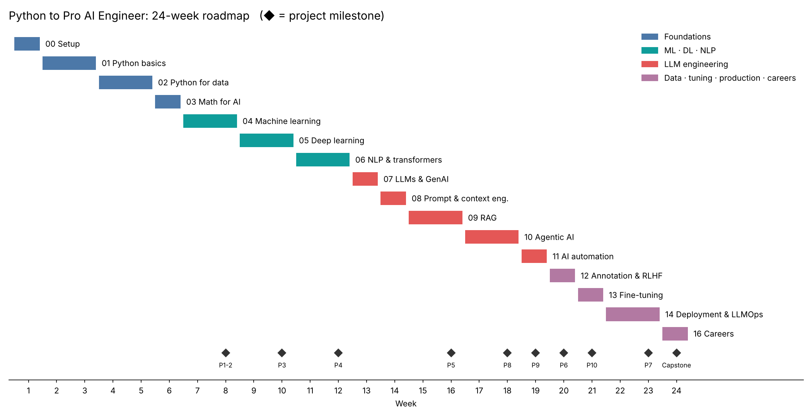

# Python to Pro — AI Engineer Curriculum

A complete, free, beginner-first course that takes someone from **"I have never written Python"** to **"I can build, evaluate and deploy LLM apps, RAG systems and agents"** in about **24 weeks**.

It is written for **trainers who are learning the material themselves** and then teaching it. Every module explains things at true beginner level, defines each piece of jargon the first time it appears, and ships everything needed to teach a session: slides, a printable handout, runnable notebooks, exercises with solutions, and a session plan.



## How to use this repo

| If you are… | Start here |
|---|---|
| A **trainer** learning the course | [TRAINER-GUIDE.md](TRAINER-GUIDE.md), then [00-setup](00-setup/) |
| A **student** | [ROADMAP.md](ROADMAP.md) and follow it week by week |
| Looking for **links** | [RESOURCES-MASTER.xlsx](RESOURCES-MASTER.xlsx) (every resource by module, type, level, free/paid) |
| Curious **where the material came from** | [SOURCES.md](SOURCES.md) |
| Wondering **how it was planned** | [PLAN.md](PLAN.md) |

## Modules

| # | Module | You will learn to… | Weeks |
|---|---|---|---|
| 00 | [Setup](00-setup/) | Install Python, VS Code, Jupyter; use Colab, Git/GitHub, venv, pip, API keys and `.env`; choose between Colab, Jupyter and VS Code | 1 |
| 01 | [Python basics](01-python-basics/) | Write and debug real Python programs | 2–3 |
| 02 | [Python for data](02-python-for-data/) | Load, clean, analyse and chart data with NumPy, pandas, matplotlib, CSV and Excel | 4–5 |
| 03 | [Math for AI](03-math-for-ai/) | Understand vectors, matrices, probability and gradients by intuition | 6 |
| 04 | [Machine learning](04-machine-learning/) | Train and evaluate models with scikit-learn | 7–8 |
| 05 | [Deep learning](05-deep-learning/) | Build and train neural networks and CNNs in PyTorch | 9–10 |
| 06 | [NLP & transformers](06-nlp-and-transformers/) | Understand tokens, embeddings and attention; use Hugging Face | 11–12 |
| 07 | [LLMs & GenAI](07-llms-and-genai/) | Explain how LLMs work; call the OpenAI, Anthropic and Gemini APIs; estimate cost; run local models with Ollama | 13 |
| 08 | [Prompt & context engineering](08-prompt-and-context-engineering/) | Design, test and defend prompts; learn from real AI-tool system-prompt patterns | 14 |
| 09 | [RAG](09-rag/) | Build and evaluate retrieval-augmented generation with chunking, vector DBs, hybrid search and reranking | 15–16 |
| 10 | [Agentic AI](10-agentic-ai/) | Build agents with tool calling, LangGraph, CrewAI, memory and MCP | 17–18 |
| 11 | [AI automation](11-ai-automation/) | Automate workflows with n8n and webhooks; use browser and computer-use agents | 19 |
| 12 | [Data annotation & RLHF](12-data-annotation-and-rlhf/) | Label data, measure agreement, understand RLHF/DPO and evals; get AI-trainer work | 20 |
| 13 | [Fine-tuning](13-fine-tuning/) | Fine-tune models with LoRA and QLoRA | 21 |
| 14 | [Deployment & LLMOps](14-deployment-and-llmops/) | Ship with FastAPI, Docker, Streamlit/Gradio, vLLM; monitor with Langfuse; add guardrails | 22–23 |
| 15 | [Projects](15-projects/) | Build 10 portfolio projects, beginner to advanced | throughout |
| 16 | [Careers](16-careers/) | Pick a role, build a portfolio, and prepare for interviews | 24 |

### What is inside every module

```
NN-module/
  README.md          goals, prerequisites, time estimate, which tool to use and why
  concepts.md        the lesson, in plain English with analogies and diagrams
  images/            diagrams (PNG + editable Mermaid source)
  notebooks/         runnable .ipynb with an "Open in Colab" badge
  code/              .py scripts commented line by line
  slides/            .pptx teaching deck with speaker notes
  pdf/               printable handout of concepts.md
  excel/             practice data / cheat sheets / trackers
  exercises.md       graded exercises      solutions/   worked answers
  trainer-notes.md   how to teach it, common mistakes, a 1–2 hour session plan
  resources.md       the best external links, each with one line on why it helps
  build.py           regenerates the slides, PDF, notebooks, images and Excel
```

## Projects

| # | Project | Level |
|---|---|---|
| P1 | [ML classifier pipeline](15-projects/p01-ml-classifier-pipeline/) | Beginner |
| P2 | [Regression & customer segmentation](15-projects/p02-regression-and-segmentation/) | Beginner |
| P3 | [Digit recogniser (CNN)](15-projects/p03-digit-recognizer-cnn/) | Beginner → Intermediate |
| P4 | [Sentiment: classic vs neural](15-projects/p04-sentiment-classic-vs-neural/) | Intermediate |
| P5 | [RAG chatbot over this course](15-projects/p05-rag-course-chatbot/) | Intermediate |
| P6 | [Response-rating & eval tool](15-projects/p06-response-rating-tool/) | Intermediate |
| P7 | [Document Q&A API (FastAPI + Docker)](15-projects/p07-doc-qa-api/) | Intermediate → Advanced |
| P8 | [Data-analyst agent + MCP server](15-projects/p08-data-analyst-agent-mcp/) | Advanced |
| P9 | [Support-inbox automation](15-projects/p09-support-inbox-automation/) | Advanced |
| P10 | [Fine-tune: LoRA SFT + DPO](15-projects/p10-finetune-lora-dpo/) | Advanced |

## Quick start

**Fastest (no install):** open any notebook and click its **Open in Colab** badge.

**Local:**
```bash
git clone https://github.com/vvvvvivekkk/AI-Engineer.git
cd AI-Engineer
python -m venv .venv
source .venv/bin/activate        # Windows: .venv\Scripts\activate
pip install -r requirements.txt
jupyter lab                      # or open the folder in VS Code
```

API keys are optional. Every notebook runs without them using small local models or clearly labelled offline stand-ins. To use real APIs, copy a `.env.example` to `.env` and add your keys. **Never commit `.env`.**

## For maintainers
- `python NN-module/build.py` regenerates a module's slides, PDF, notebooks, diagrams and Excel files.
- `python tools/check_module.py --all --run` checks every module against the standard and runs every notebook.
- `python tools/build_root.py` regenerates `images/roadmap.png` and `RESOURCES-MASTER.xlsx`.
- The rules for writing a module are in [tools/MODULE-STANDARD.md](tools/MODULE-STANDARD.md).

## Licence
Course material and code: [MIT](LICENSE). Linked third-party resources keep their own licences ([SOURCES.md](SOURCES.md)).
