<div align="center">

# 🚀 Python to Pro — AI Engineer

### From *"I've never written code"* to *"I build, evaluate and ship LLM apps, RAG systems and agents"* in 24 weeks

    

**[🗺️ Roadmap](ROADMAP.md)** · **[📚 Course book PDF](pdf/AI-Engineer-Course-Book.pdf)** · **[🧑‍🏫 Trainer guide](TRAINER-GUIDE.md)** · **[🏗️ Projects](15-projects/)** · **[🔗 All resources](RESOURCES-MASTER.xlsx)** · **[❓ FAQ](#-faq)**

</div>

---

## 👋 What is this?

A complete, free course for **trainers and students who are starting from zero**. Every lesson is written in plain English: each piece of jargon is **defined the first time it appears**, and every big idea comes with an **everyday analogy** and a **diagram**.

Each of the 17 modules gives you everything needed to **learn it alone** and then **teach it to others**:

| 📖 Lesson | 📄 PDF | 📓 Notebooks | 🎞️ Slides | ✍️ Practice | 🧑‍🏫 Teaching kit |
|:--:|:--:|:--:|:--:|:--:|:--:|
| `concepts.md`: plain-English lesson with analogies and diagrams | Printable handout with a clickable contents page | Run in Colab with one click, no install needed | `.pptx` deck with speaker notes | Exercises easy → hard, with full solutions | Session plan, common mistakes, check questions |

## 🧭 Start here

| I am… | Do this first | Then |
|---|---|---|
| 🧑‍🏫 **A trainer** learning to teach this | Read the [Trainer guide](TRAINER-GUIDE.md) | Work through [00 · Setup](00-setup/) as a student, then each module's `trainer-notes.md` |
| 🎓 **A student** | Open the [Roadmap](ROADMAP.md) | Follow it week by week, starting at [00 · Setup](00-setup/) |
| 📖 **Someone who prefers reading** | Download the [course book PDF](pdf/AI-Engineer-Course-Book.pdf) (295 pages) | Use the PDF's bookmarks panel to jump to any chapter |
| ⚡ **Already coding in Python** | Skim modules 01–02 | Jump to [04 · Machine Learning](04-machine-learning/) or [07 · LLMs](07-llms-and-genai/) |
| 🏷️ **Aiming at AI-trainer / annotation jobs** | Do 00 → 01 → 07 → 08 | Then [12 · Data annotation & RLHF](12-data-annotation-and-rlhf/) and [16 · Careers](16-careers/) |

## 🗺️ The learning path

```mermaid
flowchart LR
  subgraph P1["🧱 Part I · Foundations"]
    M00["00 Setup"] --> M01["01 Python"] --> M02["02 Data"] --> M03["03 Math"]
  end
  subgraph P2["🧠 Part II · ML, DL & NLP"]
    M04["04 ML"] --> M05["05 Deep learning"] --> M06["06 NLP"]
  end
  subgraph P3["🤖 Part III · LLM engineering"]
    M07["07 LLMs"] --> M08["08 Prompts"] --> M09["09 RAG"] --> M10["10 Agents"] --> M11["11 Automation"]
  end
  subgraph P4["🚀 Part IV · Production & careers"]
    M12["12 Annotation & RLHF"] --> M13["13 Fine-tuning"] --> M14["14 Deployment"] --> M16["16 Careers"]
  end
  M03 --> M04
  M06 --> M07
  M11 --> M12
```




<sub>Each bar is a module; ◆ marks a project milestone. Full week-by-week plan with checkpoints: **[ROADMAP.md](ROADMAP.md)**.</sub>

## 📚 Download the PDFs

| PDF | What's inside | Best for |
|---|---|---|
| 📕 **[Course book](pdf/AI-Engineer-Course-Book.pdf)** (295 pages) | Every lesson in one book, organised as **Parts → Chapters → Sections**, with clickable contents and bookmarks | Reading offline, printing, tablets |
| 🧑‍🏫 **[Trainer handbook](pdf/Trainer-Handbook.pdf)** | Trainer guide, roadmap, plan, and **every module's session plan** | The trainer team |
| 🏗️ **[Projects guide](pdf/Projects-Guide.pdf)** | All 10 project write-ups with architecture and interview prep | Portfolio building |
| 📄 **Module handouts** | One short PDF per module (links in each module card below) | Handing out in class |

> 💡 **Tip:** in any PDF, open your reader's **bookmarks / outline panel** (sidebar) to see the full hierarchy and jump around. Every link to a notebook or file opens it on GitHub.

## 📦 All modules

| # | Module | Week | In one sentence | Open |
|:--:|---|:--:|---|---|
| 00 | 🛠️ **[Setup](00-setup/)** | 1 | Install the tools every AI engineer uses: Python, VS Code, Jupyter, Google Colab, Git/GitHub, virtual environments, pip and safe API keys. | [📖](00-setup/concepts.md "Lesson") [📄](00-setup/pdf/00-setup-handout.pdf "PDF handout") [🎞️](00-setup/slides/00-setup.pptx "Slides") [📓](00-setup/notebooks/ "Notebooks") |
| 01 | 🐍 **[Python Basics](01-python-basics/)** | 2–3 | Write real programs: variables, strings, lists, dictionaries, if/else, loops, functions, errors, files and classes. | [📖](01-python-basics/concepts.md "Lesson") [📄](01-python-basics/pdf/01-python-basics-handout.pdf "PDF handout") [🎞️](01-python-basics/slides/01-python-basics.pptx "Slides") [📓](01-python-basics/notebooks/ "Notebooks") |
| 02 | 📊 **[Python for Data](02-python-for-data/)** | 4–5 | Load, clean, summarise and chart data with NumPy, pandas and matplotlib, and read and write CSV and Excel files. | [📖](02-python-for-data/concepts.md "Lesson") [📄](02-python-for-data/pdf/02-python-for-data-handout.pdf "PDF handout") [🎞️](02-python-for-data/slides/02-python-for-data.pptx "Slides") [📓](02-python-for-data/notebooks/ "Notebooks") |
| 03 | 📐 **[Math for AI](03-math-for-ai/)** | 6 | Intuition (no proofs) for vectors, dot products, matrices, probability, softmax, derivatives and gradient descent. | [📖](03-math-for-ai/concepts.md "Lesson") [📄](03-math-for-ai/pdf/03-math-for-ai-handout.pdf "PDF handout") [🎞️](03-math-for-ai/slides/03-math-for-ai.pptx "Slides") [📓](03-math-for-ai/notebooks/ "Notebooks") |
| 04 | 🎯 **[Machine Learning](04-machine-learning/)** | 7–8 | Teach computers from examples with scikit-learn: regression, classification, trees, clustering, metrics and cross-validation. | [📖](04-machine-learning/concepts.md "Lesson") [📄](04-machine-learning/pdf/04-machine-learning-handout.pdf "PDF handout") [🎞️](04-machine-learning/slides/04-machine-learning.pptx "Slides") [📓](04-machine-learning/notebooks/ "Notebooks") |
| 05 | 🧬 **[Deep Learning](05-deep-learning/)** | 9–10 | Build neural networks in PyTorch: neurons, layers, loss, backpropagation, the training loop and CNNs for images. | [📖](05-deep-learning/concepts.md "Lesson") [📄](05-deep-learning/pdf/05-deep-learning-handout.pdf "PDF handout") [🎞️](05-deep-learning/slides/05-deep-learning.pptx "Slides") [📓](05-deep-learning/notebooks/ "Notebooks") |
| 06 | 💬 **[NLP & Transformers](06-nlp-and-transformers/)** | 11–12 | How machines read text: tokens, embeddings, attention, the transformer, and Hugging Face models. | [📖](06-nlp-and-transformers/concepts.md "Lesson") [📄](06-nlp-and-transformers/pdf/06-nlp-and-transformers-handout.pdf "PDF handout") [🎞️](06-nlp-and-transformers/slides/06-nlp-and-transformers.pptx "Slides") [📓](06-nlp-and-transformers/notebooks/ "Notebooks") |
| 07 | ✨ **[LLMs & GenAI](07-llms-and-genai/)** | 13 | What LLMs really do (next-token prediction), sampling, context windows, calling OpenAI/Anthropic/Gemini APIs, cost, and local models with Ollama. | [📖](07-llms-and-genai/concepts.md "Lesson") [📄](07-llms-and-genai/pdf/07-llms-and-genai-handout.pdf "PDF handout") [🎞️](07-llms-and-genai/slides/07-llms-and-genai.pptx "Slides") [📓](07-llms-and-genai/notebooks/ "Notebooks") |
| 08 | 📝 **[Prompt & Context Engineering](08-prompt-and-context-engineering/)** | 14 | Write prompts that work and prove it: structure, examples, structured output, system prompts, context design, injection defence and lessons from real AI products. | [📖](08-prompt-and-context-engineering/concepts.md "Lesson") [📄](08-prompt-and-context-engineering/pdf/08-prompt-and-context-engineering-handout.pdf "PDF handout") [🎞️](08-prompt-and-context-engineering/slides/08-prompt-and-context-engineering.pptx "Slides") [📓](08-prompt-and-context-engineering/notebooks/ "Notebooks") |
| 09 | 🔎 **[RAG (Retrieval-Augmented Generation)](09-rag/)** | 15–16 | Let an LLM answer from your own documents: chunking, embeddings, vector databases, hybrid search, reranking, citations and evaluation. | [📖](09-rag/concepts.md "Lesson") [📄](09-rag/pdf/09-rag-handout.pdf "PDF handout") [🎞️](09-rag/slides/09-rag.pptx "Slides") [📓](09-rag/notebooks/ "Notebooks") |
| 10 | 🦾 **[Agentic AI](10-agentic-ai/)** | 17–18 | LLMs that take actions: tool calling, the ReAct loop, LangGraph, CrewAI, multi-agent teams, memory and the Model Context Protocol (MCP). | [📖](10-agentic-ai/concepts.md "Lesson") [📄](10-agentic-ai/pdf/10-agentic-ai-handout.pdf "PDF handout") [🎞️](10-agentic-ai/slides/10-agentic-ai.pptx "Slides") [📓](10-agentic-ai/notebooks/ "Notebooks") |
| 11 | ⚙️ **[AI Automation](11-ai-automation/)** | 19 | Automate business workflows with n8n, webhooks and Python, and learn when browser and computer-use agents are worth it. | [📖](11-ai-automation/concepts.md "Lesson") [📄](11-ai-automation/pdf/11-ai-automation-handout.pdf "PDF handout") [🎞️](11-ai-automation/slides/11-ai-automation.pptx "Slides") [📓](11-ai-automation/notebooks/ "Notebooks") |
| 12 | 🏷️ **[Data Annotation & RLHF](12-data-annotation-and-rlhf/)** | 20 | Create high-quality labelled data, measure agreement, understand RLHF and DPO, run evals, and get AI-trainer work. | [📖](12-data-annotation-and-rlhf/concepts.md "Lesson") [📄](12-data-annotation-and-rlhf/pdf/12-data-annotation-and-rlhf-handout.pdf "PDF handout") [🎞️](12-data-annotation-and-rlhf/slides/12-data-annotation-and-rlhf.pptx "Slides") [📓](12-data-annotation-and-rlhf/notebooks/ "Notebooks") |
| 13 | 🎛️ **[Fine-tuning (LoRA / QLoRA)](13-fine-tuning/)** | 21 | When and how to fine-tune: SFT datasets, LoRA, quantisation, QLoRA and evaluating the result. | [📖](13-fine-tuning/concepts.md "Lesson") [📄](13-fine-tuning/pdf/13-fine-tuning-handout.pdf "PDF handout") [🎞️](13-fine-tuning/slides/13-fine-tuning.pptx "Slides") [📓](13-fine-tuning/notebooks/ "Notebooks") |
| 14 | 🚢 **[Deployment & LLMOps](14-deployment-and-llmops/)** | 22–23 | Ship AI apps: FastAPI, Docker, Streamlit/Gradio, vLLM, Langfuse tracing, monitoring, guardrails, CI/CD and secrets. | [📖](14-deployment-and-llmops/concepts.md "Lesson") [📄](14-deployment-and-llmops/pdf/14-deployment-and-llmops-handout.pdf "PDF handout") [🎞️](14-deployment-and-llmops/slides/14-deployment-and-llmops.pptx "Slides") [📓](14-deployment-and-llmops/notebooks/ "Notebooks") |
| 15 | 🏗️ **[Projects](15-projects/)** | throughout | Ten portfolio projects from a beginner classifier to a fine-tuned model, each with an architecture diagram and interview guide. | [🏗️](15-projects/) |
| 16 | 💼 **[Careers](16-careers/)** | 24 | Pick a role (AI trainer, AI engineer, ML engineer and more), build a portfolio, write a resume, and prepare for interviews. | [📖](16-careers/concepts.md "Lesson") [📄](16-careers/pdf/16-careers-handout.pdf "PDF handout") [🎞️](16-careers/slides/16-careers.pptx "Slides") [📓](16-careers/notebooks/ "Notebooks") |

<sub>📖 lesson · 📄 PDF handout · 🎞️ slides · 📓 notebooks</sub>

## 🔍 Module details

Click a module to see **what it is, an everyday analogy, every topic (each links straight to that section of the lesson), and its notebooks.**

### 🧱 Part I · Foundations

*Get set up, learn Python, handle data and build maths intuition.*

<details>
<summary><b>🛠️ 00 · Setup</b> &nbsp;—&nbsp; <i>week 1</i></summary>


**What it is:** Install the tools every AI engineer uses: Python, VS Code, Jupyter, Google Colab, Git/GitHub, virtual environments, pip and safe API keys.

**Think of it like this:** Setting up a kitchen before you cook: stove, knives, fridge, and a locked drawer for the house keys.


**Topics you'll learn**

1. [The big picture: what are we installing and why?](00-setup/concepts.md#1-the-big-picture-what-are-we-installing-and-why)
2. [Installing Python](00-setup/concepts.md#2-installing-python)
3. [The terminal: talking to your computer in text](00-setup/concepts.md#3-the-terminal-talking-to-your-computer-in-text)
4. [VS Code: your code editor](00-setup/concepts.md#4-vs-code-your-code-editor)
5. [Notebooks: what a `.ipynb` file really is](00-setup/concepts.md#5-notebooks-what-a-ipynb-file-really-is)
6. [Google Colab: notebooks on Google's computers](00-setup/concepts.md#6-google-colab-notebooks-on-googles-computers)
7. [Which tool when? Colab vs Jupyter vs VS Code](00-setup/concepts.md#7-which-tool-when-colab-vs-jupyter-vs-vs-code)
8. [Git and GitHub, step by step](00-setup/concepts.md#8-git-and-github-step-by-step)
9. [Virtual environments: one spice rack per project](00-setup/concepts.md#9-virtual-environments-one-spice-rack-per-project)
10. [pip and requirements.txt](00-setup/concepts.md#10-pip-and-requirementstxt)
11. [API keys, environment variables and `.env`](00-setup/concepts.md#11-api-keys-environment-variables-and-env)
12. [Never commit keys (and what to do if you do)](00-setup/concepts.md#12-never-commit-keys-and-what-to-do-if-you-do)
13. [Putting it together: a fresh project in 10 commands](00-setup/concepts.md#13-putting-it-together-a-fresh-project-in-10-commands)

**Hands-on notebooks** (click ▶️ to run in your browser, no install)

- [Environment check](00-setup/notebooks/01-environment-check.ipynb) · [▶️ Colab](https://colab.research.google.com/github/vvvvvivekkk/AI-Engineer/blob/main/00-setup/notebooks/01-environment-check.ipynb)
- [Env files safely](00-setup/notebooks/02-env-files-safely.ipynb) · [▶️ Colab](https://colab.research.google.com/github/vvvvvivekkk/AI-Engineer/blob/main/00-setup/notebooks/02-env-files-safely.ipynb)
- [Colab and requirements](00-setup/notebooks/03-colab-and-requirements.ipynb) · [▶️ Colab](https://colab.research.google.com/github/vvvvvivekkk/AI-Engineer/blob/main/00-setup/notebooks/03-colab-and-requirements.ipynb)

**Open:** [📖 Lesson](00-setup/concepts.md) · [📄 PDF handout](00-setup/pdf/00-setup-handout.pdf) · [🎞️ Slides](00-setup/slides/00-setup.pptx) · [📓 Notebooks](00-setup/notebooks/) · [✍️ Exercises](00-setup/exercises.md) · [✅ Solutions](00-setup/solutions/) · [🧑‍🏫 Trainer notes](00-setup/trainer-notes.md) · [🔗 Resources](00-setup/resources.md)


</details>

<details>
<summary><b>🐍 01 · Python Basics</b> &nbsp;—&nbsp; <i>week 2–3</i></summary>


**What it is:** Write real programs: variables, strings, lists, dictionaries, if/else, loops, functions, errors, files and classes.

**Think of it like this:** Learning the alphabet and grammar of a new language before writing essays.


**Topics you'll learn**

1. [Programs, statements and `print`](01-python-basics/concepts.md#1-programs-statements-and-print)
2. [Values, types and variables](01-python-basics/concepts.md#2-values-types-and-variables)
3. [Strings and f-strings](01-python-basics/concepts.md#3-strings-and-f-strings)
4. [Collections: holding many values](01-python-basics/concepts.md#4-collections-holding-many-values)
5. [Making decisions: `if`, `elif`, `else`](01-python-basics/concepts.md#5-making-decisions-if-elif-else)
6. [Loops: doing things again and again](01-python-basics/concepts.md#6-loops-doing-things-again-and-again)
7. [List and dictionary comprehensions](01-python-basics/concepts.md#7-list-and-dictionary-comprehensions)
8. [Functions: reusable recipes](01-python-basics/concepts.md#8-functions-reusable-recipes)
9. [Errors, exceptions and `try` / `except`](01-python-basics/concepts.md#9-errors-exceptions-and-try--except)
10. [Reading a traceback](01-python-basics/concepts.md#10-reading-a-traceback)
11. [Files: reading and writing](01-python-basics/concepts.md#11-files-reading-and-writing)
12. [Modules and imports](01-python-basics/concepts.md#12-modules-and-imports)
13. [Classes and objects (a light introduction)](01-python-basics/concepts.md#13-classes-and-objects-a-light-introduction)
14. [Putting it together: a tiny program](01-python-basics/concepts.md#14-putting-it-together-a-tiny-program)
15. [Habits of good Python programmers](01-python-basics/concepts.md#15-habits-of-good-python-programmers)

**Hands-on notebooks** (click ▶️ to run in your browser, no install)

- [Basics](01-python-basics/notebooks/01-basics.ipynb) · [▶️ Colab](https://colab.research.google.com/github/vvvvvivekkk/AI-Engineer/blob/main/01-python-basics/notebooks/01-basics.ipynb)
- [Collections](01-python-basics/notebooks/02-collections.ipynb) · [▶️ Colab](https://colab.research.google.com/github/vvvvvivekkk/AI-Engineer/blob/main/01-python-basics/notebooks/02-collections.ipynb)
- [Functions errors files](01-python-basics/notebooks/03-functions-errors-files.ipynb) · [▶️ Colab](https://colab.research.google.com/github/vvvvvivekkk/AI-Engineer/blob/main/01-python-basics/notebooks/03-functions-errors-files.ipynb)
- [Mini project grade calculator](01-python-basics/notebooks/04-mini-project-grade-calculator.ipynb) · [▶️ Colab](https://colab.research.google.com/github/vvvvvivekkk/AI-Engineer/blob/main/01-python-basics/notebooks/04-mini-project-grade-calculator.ipynb)

**Open:** [📖 Lesson](01-python-basics/concepts.md) · [📄 PDF handout](01-python-basics/pdf/01-python-basics-handout.pdf) · [🎞️ Slides](01-python-basics/slides/01-python-basics.pptx) · [📓 Notebooks](01-python-basics/notebooks/) · [✍️ Exercises](01-python-basics/exercises.md) · [✅ Solutions](01-python-basics/solutions/) · [🧑‍🏫 Trainer notes](01-python-basics/trainer-notes.md) · [🔗 Resources](01-python-basics/resources.md)


</details>

<details>
<summary><b>📊 02 · Python for Data</b> &nbsp;—&nbsp; <i>week 4–5</i></summary>


**What it is:** Load, clean, summarise and chart data with NumPy, pandas and matplotlib, and read and write CSV and Excel files.

**Think of it like this:** Turning a messy pile of receipts into a tidy spreadsheet with charts.


**Topics you'll learn**

1. [Why AI engineers need data skills](02-python-for-data/concepts.md#1-why-ai-engineers-need-data-skills)
2. [NumPy: fast grids of numbers](02-python-for-data/concepts.md#2-numpy-fast-grids-of-numbers)
3. [pandas: tables you can program](02-python-for-data/concepts.md#3-pandas-tables-you-can-program)
4. [Cleaning messy data](02-python-for-data/concepts.md#4-cleaning-messy-data)
5. [Grouping: split, apply, combine](02-python-for-data/concepts.md#5-grouping-split-apply-combine)
6. [Merging: joining tables together](02-python-for-data/concepts.md#6-merging-joining-tables-together)
7. [Charts with matplotlib](02-python-for-data/concepts.md#7-charts-with-matplotlib)
8. [Excel in and out (pandas + openpyxl)](02-python-for-data/concepts.md#8-excel-in-and-out-pandas--openpyxl)
9. [Exploratory Data Analysis (EDA)](02-python-for-data/concepts.md#9-exploratory-data-analysis-eda)
10. [How this connects to AI](02-python-for-data/concepts.md#10-how-this-connects-to-ai)

**Hands-on notebooks** (click ▶️ to run in your browser, no install)

- [Numpy basics](02-python-for-data/notebooks/01-numpy-basics.ipynb) · [▶️ Colab](https://colab.research.google.com/github/vvvvvivekkk/AI-Engineer/blob/main/02-python-for-data/notebooks/01-numpy-basics.ipynb)
- [Pandas loading and cleaning](02-python-for-data/notebooks/02-pandas-loading-and-cleaning.ipynb) · [▶️ Colab](https://colab.research.google.com/github/vvvvvivekkk/AI-Engineer/blob/main/02-python-for-data/notebooks/02-pandas-loading-and-cleaning.ipynb)
- [Groupby merge excel](02-python-for-data/notebooks/03-groupby-merge-excel.ipynb) · [▶️ Colab](https://colab.research.google.com/github/vvvvvivekkk/AI-Engineer/blob/main/02-python-for-data/notebooks/03-groupby-merge-excel.ipynb)
- [Mini eda](02-python-for-data/notebooks/04-mini-eda.ipynb) · [▶️ Colab](https://colab.research.google.com/github/vvvvvivekkk/AI-Engineer/blob/main/02-python-for-data/notebooks/04-mini-eda.ipynb)

**Open:** [📖 Lesson](02-python-for-data/concepts.md) · [📄 PDF handout](02-python-for-data/pdf/02-python-for-data-handout.pdf) · [🎞️ Slides](02-python-for-data/slides/02-python-for-data.pptx) · [📓 Notebooks](02-python-for-data/notebooks/) · [✍️ Exercises](02-python-for-data/exercises.md) · [✅ Solutions](02-python-for-data/solutions/) · [🧑‍🏫 Trainer notes](02-python-for-data/trainer-notes.md) · [🔗 Resources](02-python-for-data/resources.md)


</details>

<details>
<summary><b>📐 03 · Math for AI</b> &nbsp;—&nbsp; <i>week 6</i></summary>


**What it is:** Intuition (no proofs) for vectors, dot products, matrices, probability, softmax, derivatives and gradient descent.

**Think of it like this:** Gradient descent is walking downhill in fog: feel the slope, take a small step, repeat.


**Topics you'll learn**

1. [Why a little maths goes a long way](03-math-for-ai/concepts.md#1-why-a-little-maths-goes-a-long-way)
2. [Vectors: lists of numbers that point somewhere](03-math-for-ai/concepts.md#2-vectors-lists-of-numbers-that-point-somewhere)
3. [The dot product: "multiply matching pairs, then add"](03-math-for-ai/concepts.md#3-the-dot-product-multiply-matching-pairs-then-add)
4. [Cosine similarity: comparing meaning](03-math-for-ai/concepts.md#4-cosine-similarity-comparing-meaning)
5. [Matrices: tables of numbers that can also move space](03-math-for-ai/concepts.md#5-matrices-tables-of-numbers-that-can-also-move-space)
6. [Probability: measuring uncertainty](03-math-for-ai/concepts.md#6-probability-measuring-uncertainty)
7. [Softmax: turning scores into probabilities](03-math-for-ai/concepts.md#7-softmax-turning-scores-into-probabilities)
8. [Derivatives: the slope of a curve](03-math-for-ai/concepts.md#8-derivatives-the-slope-of-a-curve)
9. [Loss functions: one number for "how wrong"](03-math-for-ai/concepts.md#9-loss-functions-one-number-for-how-wrong)
10. [Gradients and gradient descent: walking downhill](03-math-for-ai/concepts.md#10-gradients-and-gradient-descent-walking-downhill)

**Hands-on notebooks** (click ▶️ to run in your browser, no install)

- [Vectors and similarity](03-math-for-ai/notebooks/01-vectors-and-similarity.ipynb) · [▶️ Colab](https://colab.research.google.com/github/vvvvvivekkk/AI-Engineer/blob/main/03-math-for-ai/notebooks/01-vectors-and-similarity.ipynb)
- [Matrices](03-math-for-ai/notebooks/02-matrices.ipynb) · [▶️ Colab](https://colab.research.google.com/github/vvvvvivekkk/AI-Engineer/blob/main/03-math-for-ai/notebooks/02-matrices.ipynb)
- [Probability and softmax](03-math-for-ai/notebooks/03-probability-and-softmax.ipynb) · [▶️ Colab](https://colab.research.google.com/github/vvvvvivekkk/AI-Engineer/blob/main/03-math-for-ai/notebooks/03-probability-and-softmax.ipynb)
- [Derivatives and gradient descent](03-math-for-ai/notebooks/04-derivatives-and-gradient-descent.ipynb) · [▶️ Colab](https://colab.research.google.com/github/vvvvvivekkk/AI-Engineer/blob/main/03-math-for-ai/notebooks/04-derivatives-and-gradient-descent.ipynb)

**Open:** [📖 Lesson](03-math-for-ai/concepts.md) · [📄 PDF handout](03-math-for-ai/pdf/03-math-for-ai-handout.pdf) · [🎞️ Slides](03-math-for-ai/slides/03-math-for-ai.pptx) · [📓 Notebooks](03-math-for-ai/notebooks/) · [✍️ Exercises](03-math-for-ai/exercises.md) · [✅ Solutions](03-math-for-ai/solutions/) · [🧑‍🏫 Trainer notes](03-math-for-ai/trainer-notes.md) · [🔗 Resources](03-math-for-ai/resources.md)


</details>

### 🧠 Part II · Machine Learning, Deep Learning & NLP

*Train models, build neural networks and understand how machines read text.*

<details>
<summary><b>🎯 04 · Machine Learning</b> &nbsp;—&nbsp; <i>week 7–8</i></summary>


**What it is:** Teach computers from examples with scikit-learn: regression, classification, trees, clustering, metrics and cross-validation.

**Think of it like this:** A new employee learning used-car prices by studying 500 past sales.


**Topics you'll learn**

1. [What is machine learning?](04-machine-learning/concepts.md#1-what-is-machine-learning)
2. [Features and labels](04-machine-learning/concepts.md#2-features-and-labels)
3. [The two big families: supervised and unsupervised](04-machine-learning/concepts.md#3-the-two-big-families-supervised-and-unsupervised)
4. [Train/test split: never mark your own homework](04-machine-learning/concepts.md#4-traintest-split-never-mark-your-own-homework)
5. [Your first model: linear regression](04-machine-learning/concepts.md#5-your-first-model-linear-regression)
6. [Classification with logistic regression](04-machine-learning/concepts.md#6-classification-with-logistic-regression)
7. [Classification metrics, walked through with real numbers](04-machine-learning/concepts.md#7-classification-metrics-walked-through-with-real-numbers)
8. [Decision trees and random forests](04-machine-learning/concepts.md#8-decision-trees-and-random-forests)
9. [Unsupervised learning: k-means clustering](04-machine-learning/concepts.md#9-unsupervised-learning-k-means-clustering)
10. [Overfitting and underfitting](04-machine-learning/concepts.md#10-overfitting-and-underfitting)
11. [Feature scaling](04-machine-learning/concepts.md#11-feature-scaling)
12. [Cross-validation: a fairer exam](04-machine-learning/concepts.md#12-cross-validation-a-fairer-exam)
13. [Pipelines: tidy, leak-proof workflows](04-machine-learning/concepts.md#13-pipelines-tidy-leak-proof-workflows)
14. [Saving and loading a model with joblib](04-machine-learning/concepts.md#14-saving-and-loading-a-model-with-joblib)
15. [Putting it all together](04-machine-learning/concepts.md#15-putting-it-all-together)

**Hands-on notebooks** (click ▶️ to run in your browser, no install)

- [First model regression](04-machine-learning/notebooks/01-first-model-regression.ipynb) · [▶️ Colab](https://colab.research.google.com/github/vvvvvivekkk/AI-Engineer/blob/main/04-machine-learning/notebooks/01-first-model-regression.ipynb)
- [Classification and metrics](04-machine-learning/notebooks/02-classification-and-metrics.ipynb) · [▶️ Colab](https://colab.research.google.com/github/vvvvvivekkk/AI-Engineer/blob/main/04-machine-learning/notebooks/02-classification-and-metrics.ipynb)
- [Trees forests kmeans](04-machine-learning/notebooks/03-trees-forests-kmeans.ipynb) · [▶️ Colab](https://colab.research.google.com/github/vvvvvivekkk/AI-Engineer/blob/main/04-machine-learning/notebooks/03-trees-forests-kmeans.ipynb)
- [Overfitting cv pipelines](04-machine-learning/notebooks/04-overfitting-cv-pipelines.ipynb) · [▶️ Colab](https://colab.research.google.com/github/vvvvvivekkk/AI-Engineer/blob/main/04-machine-learning/notebooks/04-overfitting-cv-pipelines.ipynb)

**Open:** [📖 Lesson](04-machine-learning/concepts.md) · [📄 PDF handout](04-machine-learning/pdf/04-machine-learning-handout.pdf) · [🎞️ Slides](04-machine-learning/slides/04-machine-learning.pptx) · [📓 Notebooks](04-machine-learning/notebooks/) · [✍️ Exercises](04-machine-learning/exercises.md) · [✅ Solutions](04-machine-learning/solutions/) · [🧑‍🏫 Trainer notes](04-machine-learning/trainer-notes.md) · [🔗 Resources](04-machine-learning/resources.md)


</details>

<details>
<summary><b>🧬 05 · Deep Learning</b> &nbsp;—&nbsp; <i>week 9–10</i></summary>


**What it is:** Build neural networks in PyTorch: neurons, layers, loss, backpropagation, the training loop and CNNs for images.

**Think of it like this:** Each neuron is a tiny weighted vote; stack many layers and simple votes become smart decisions.


**Topics you'll learn**

1. [What is deep learning, and why does it matter?](05-deep-learning/concepts.md#1-what-is-deep-learning-and-why-does-it-matter)
2. [The neuron: a tiny weighted vote](05-deep-learning/concepts.md#2-the-neuron-a-tiny-weighted-vote)
3. [Activation functions: adding the bends](05-deep-learning/concepts.md#3-activation-functions-adding-the-bends)
4. [Layers and the multi-layer perceptron (MLP)](05-deep-learning/concepts.md#4-layers-and-the-multi-layer-perceptron-mlp)
5. [Loss: a single number for "how wrong"](05-deep-learning/concepts.md#5-loss-a-single-number-for-how-wrong)
6. [Gradient descent and backpropagation (the intuition)](05-deep-learning/concepts.md#6-gradient-descent-and-backpropagation-the-intuition)
7. [PyTorch basics](05-deep-learning/concepts.md#7-pytorch-basics)
8. [The training loop, line by line](05-deep-learning/concepts.md#8-the-training-loop-line-by-line)
9. [Convolutional neural networks (CNNs)](05-deep-learning/concepts.md#9-convolutional-neural-networks-cnns)
10. [Fighting overfitting in neural networks](05-deep-learning/concepts.md#10-fighting-overfitting-in-neural-networks)
11. [Saving and loading weights](05-deep-learning/concepts.md#11-saving-and-loading-weights)
12. [GPUs, devices and Google Colab](05-deep-learning/concepts.md#12-gpus-devices-and-google-colab)
13. [The big picture](05-deep-learning/concepts.md#13-the-big-picture)

**Hands-on notebooks** (click ▶️ to run in your browser, no install)

- [Tensors and autograd](05-deep-learning/notebooks/01-tensors-and-autograd.ipynb) · [▶️ Colab](https://colab.research.google.com/github/vvvvvivekkk/AI-Engineer/blob/main/05-deep-learning/notebooks/01-tensors-and-autograd.ipynb)
- [Mlp on digits](05-deep-learning/notebooks/02-mlp-on-digits.ipynb) · [▶️ Colab](https://colab.research.google.com/github/vvvvvivekkk/AI-Engineer/blob/main/05-deep-learning/notebooks/02-mlp-on-digits.ipynb)
- [Cnn on digits](05-deep-learning/notebooks/03-cnn-on-digits.ipynb) · [▶️ Colab](https://colab.research.google.com/github/vvvvvivekkk/AI-Engineer/blob/main/05-deep-learning/notebooks/03-cnn-on-digits.ipynb)
- [Overfitting dropout early stopping](05-deep-learning/notebooks/04-overfitting-dropout-early-stopping.ipynb) · [▶️ Colab](https://colab.research.google.com/github/vvvvvivekkk/AI-Engineer/blob/main/05-deep-learning/notebooks/04-overfitting-dropout-early-stopping.ipynb)

**Open:** [📖 Lesson](05-deep-learning/concepts.md) · [📄 PDF handout](05-deep-learning/pdf/05-deep-learning-handout.pdf) · [🎞️ Slides](05-deep-learning/slides/05-deep-learning.pptx) · [📓 Notebooks](05-deep-learning/notebooks/) · [✍️ Exercises](05-deep-learning/exercises.md) · [✅ Solutions](05-deep-learning/solutions/) · [🧑‍🏫 Trainer notes](05-deep-learning/trainer-notes.md) · [🔗 Resources](05-deep-learning/resources.md)


</details>

<details>
<summary><b>💬 06 · NLP & Transformers</b> &nbsp;—&nbsp; <i>week 11–12</i></summary>


**What it is:** How machines read text: tokens, embeddings, attention, the transformer, and Hugging Face models.

**Think of it like this:** Attention is a reader deciding which earlier words to look back at to understand the current one.


**Topics you'll learn**

1. [Text as data](06-nlp-and-transformers/concepts.md#1-text-as-data)
2. [Tokens and tokenisation](06-nlp-and-transformers/concepts.md#2-tokens-and-tokenisation)
3. [Embeddings and similarity](06-nlp-and-transformers/concepts.md#3-embeddings-and-similarity)
4. [From reading in order to paying attention](06-nlp-and-transformers/concepts.md#4-from-reading-in-order-to-paying-attention)
5. [Self-attention step by step](06-nlp-and-transformers/concepts.md#5-self-attention-step-by-step)
6. [The transformer block](06-nlp-and-transformers/concepts.md#6-the-transformer-block)
7. [Hugging Face: the toolbox](06-nlp-and-transformers/concepts.md#7-hugging-face-the-toolbox)
8. [Putting it together](06-nlp-and-transformers/concepts.md#8-putting-it-together)

**Hands-on notebooks** (click ▶️ to run in your browser, no install)

- [Tokens and embeddings](06-nlp-and-transformers/notebooks/01-tokens-and-embeddings.ipynb) · [▶️ Colab](https://colab.research.google.com/github/vvvvvivekkk/AI-Engineer/blob/main/06-nlp-and-transformers/notebooks/01-tokens-and-embeddings.ipynb)
- [Attention by hand](06-nlp-and-transformers/notebooks/02-attention-by-hand.ipynb) · [▶️ Colab](https://colab.research.google.com/github/vvvvvivekkk/AI-Engineer/blob/main/06-nlp-and-transformers/notebooks/02-attention-by-hand.ipynb)
- [Hugging face pipelines](06-nlp-and-transformers/notebooks/03-hugging-face-pipelines.ipynb) · [▶️ Colab](https://colab.research.google.com/github/vvvvvivekkk/AI-Engineer/blob/main/06-nlp-and-transformers/notebooks/03-hugging-face-pipelines.ipynb)

**Open:** [📖 Lesson](06-nlp-and-transformers/concepts.md) · [📄 PDF handout](06-nlp-and-transformers/pdf/06-nlp-and-transformers-handout.pdf) · [🎞️ Slides](06-nlp-and-transformers/slides/06-nlp-and-transformers.pptx) · [📓 Notebooks](06-nlp-and-transformers/notebooks/) · [✍️ Exercises](06-nlp-and-transformers/exercises.md) · [✅ Solutions](06-nlp-and-transformers/solutions/) · [🧑‍🏫 Trainer notes](06-nlp-and-transformers/trainer-notes.md) · [🔗 Resources](06-nlp-and-transformers/resources.md)


</details>

### 🤖 Part III · LLM & GenAI Engineering

*Use LLMs well: prompts, RAG, agents and automation.*

<details>
<summary><b>✨ 07 · LLMs & GenAI</b> &nbsp;—&nbsp; <i>week 13</i></summary>


**What it is:** What LLMs really do (next-token prediction), sampling, context windows, calling OpenAI/Anthropic/Gemini APIs, cost, and local models with Ollama.

**Think of it like this:** An extremely well-read autocomplete that predicts the next word, one word at a time.


**Topics you'll learn**

1. [What is an LLM?](07-llms-and-genai/concepts.md#1-what-is-an-llm)
2. [Next-token prediction](07-llms-and-genai/concepts.md#2-next-token-prediction)
3. [Sampling: temperature, top-k and top-p](07-llms-and-genai/concepts.md#3-sampling-temperature-top-k-and-top-p)
4. [The context window](07-llms-and-genai/concepts.md#4-the-context-window)
5. [How an LLM is trained (at a glance)](07-llms-and-genai/concepts.md#5-how-an-llm-is-trained-at-a-glance)
6. [Using LLMs through an API](07-llms-and-genai/concepts.md#6-using-llms-through-an-api)
7. [Tokens and cost](07-llms-and-genai/concepts.md#7-tokens-and-cost)
8. [Running models locally with Ollama](07-llms-and-genai/concepts.md#8-running-models-locally-with-ollama)
9. [Choosing a model](07-llms-and-genai/concepts.md#9-choosing-a-model)

**Hands-on notebooks** (click ▶️ to run in your browser, no install)

- [How llms work](07-llms-and-genai/notebooks/01-how-llms-work.ipynb) · [▶️ Colab](https://colab.research.google.com/github/vvvvvivekkk/AI-Engineer/blob/main/07-llms-and-genai/notebooks/01-how-llms-work.ipynb)
- [Calling llm apis](07-llms-and-genai/notebooks/02-calling-llm-apis.ipynb) · [▶️ Colab](https://colab.research.google.com/github/vvvvvivekkk/AI-Engineer/blob/main/07-llms-and-genai/notebooks/02-calling-llm-apis.ipynb)
- [Tokens cost and local models](07-llms-and-genai/notebooks/03-tokens-cost-and-local-models.ipynb) · [▶️ Colab](https://colab.research.google.com/github/vvvvvivekkk/AI-Engineer/blob/main/07-llms-and-genai/notebooks/03-tokens-cost-and-local-models.ipynb)

**Open:** [📖 Lesson](07-llms-and-genai/concepts.md) · [📄 PDF handout](07-llms-and-genai/pdf/07-llms-and-genai-handout.pdf) · [🎞️ Slides](07-llms-and-genai/slides/07-llms-and-genai.pptx) · [📓 Notebooks](07-llms-and-genai/notebooks/) · [✍️ Exercises](07-llms-and-genai/exercises.md) · [✅ Solutions](07-llms-and-genai/solutions/) · [🧑‍🏫 Trainer notes](07-llms-and-genai/trainer-notes.md) · [🔗 Resources](07-llms-and-genai/resources.md)


</details>

<details>
<summary><b>📝 08 · Prompt & Context Engineering</b> &nbsp;—&nbsp; <i>week 14</i></summary>


**What it is:** Write prompts that work and prove it: structure, examples, structured output, system prompts, context design, injection defence and lessons from real AI products.

**Think of it like this:** Briefing a smart new intern: clear role, task, examples and the format you want back.


**Topics you'll learn**

1. [What a prompt really is](08-prompt-and-context-engineering/concepts.md#1-what-a-prompt-really-is)
2. [The anatomy of a good prompt](08-prompt-and-context-engineering/concepts.md#2-the-anatomy-of-a-good-prompt)
3. [Zero-shot, one-shot and few-shot prompting](08-prompt-and-context-engineering/concepts.md#3-zero-shot-one-shot-and-few-shot-prompting)
4. [Reasoning prompts ("think step by step")](08-prompt-and-context-engineering/concepts.md#4-reasoning-prompts-think-step-by-step)
5. [Structured output: getting data, not prose](08-prompt-and-context-engineering/concepts.md#5-structured-output-getting-data-not-prose)
6. [System prompts](08-prompt-and-context-engineering/concepts.md#6-system-prompts)
7. [Prompt templates and versioning](08-prompt-and-context-engineering/concepts.md#7-prompt-templates-and-versioning)
8. [Context engineering](08-prompt-and-context-engineering/concepts.md#8-context-engineering)
9. [Prompt injection and how to defend against it](08-prompt-and-context-engineering/concepts.md#9-prompt-injection-and-how-to-defend-against-it)
10. [Evaluating prompts with a small test set](08-prompt-and-context-engineering/concepts.md#10-evaluating-prompts-with-a-small-test-set)
11. [What real AI products' system prompts teach us](08-prompt-and-context-engineering/concepts.md#11-what-real-ai-products-system-prompts-teach-us)
12. [Common mistakes (and fixes)](08-prompt-and-context-engineering/concepts.md#12-common-mistakes-and-fixes)

**Hands-on notebooks** (click ▶️ to run in your browser, no install)

- [Prompt anatomy and few shot](08-prompt-and-context-engineering/notebooks/01-prompt-anatomy-and-few-shot.ipynb) · [▶️ Colab](https://colab.research.google.com/github/vvvvvivekkk/AI-Engineer/blob/main/08-prompt-and-context-engineering/notebooks/01-prompt-anatomy-and-few-shot.ipynb)
- [Structured output and reasoning](08-prompt-and-context-engineering/notebooks/02-structured-output-and-reasoning.ipynb) · [▶️ Colab](https://colab.research.google.com/github/vvvvvivekkk/AI-Engineer/blob/main/08-prompt-and-context-engineering/notebooks/02-structured-output-and-reasoning.ipynb)
- [Context engineering](08-prompt-and-context-engineering/notebooks/03-context-engineering.ipynb) · [▶️ Colab](https://colab.research.google.com/github/vvvvvivekkk/AI-Engineer/blob/main/08-prompt-and-context-engineering/notebooks/03-context-engineering.ipynb)
- [Injection and prompt evaluation](08-prompt-and-context-engineering/notebooks/04-injection-and-prompt-evaluation.ipynb) · [▶️ Colab](https://colab.research.google.com/github/vvvvvivekkk/AI-Engineer/blob/main/08-prompt-and-context-engineering/notebooks/04-injection-and-prompt-evaluation.ipynb)

**Open:** [📖 Lesson](08-prompt-and-context-engineering/concepts.md) · [📄 PDF handout](08-prompt-and-context-engineering/pdf/08-prompt-and-context-engineering-handout.pdf) · [🎞️ Slides](08-prompt-and-context-engineering/slides/08-prompt-and-context-engineering.pptx) · [📓 Notebooks](08-prompt-and-context-engineering/notebooks/) · [✍️ Exercises](08-prompt-and-context-engineering/exercises.md) · [✅ Solutions](08-prompt-and-context-engineering/solutions/) · [🧑‍🏫 Trainer notes](08-prompt-and-context-engineering/trainer-notes.md) · [🔗 Resources](08-prompt-and-context-engineering/resources.md)


</details>

<details>
<summary><b>🔎 09 · RAG (Retrieval-Augmented Generation)</b> &nbsp;—&nbsp; <i>week 15–16</i></summary>


**What it is:** Let an LLM answer from your own documents: chunking, embeddings, vector databases, hybrid search, reranking, citations and evaluation.

**Think of it like this:** An open-book exam: a librarian finds the right pages, then the student writes the answer and cites them.


**Topics you'll learn**

1. [Why RAG?](09-rag/concepts.md#1-why-rag)
2. [Loading documents](09-rag/concepts.md#2-loading-documents)
3. [Chunking: cutting documents into passages](09-rag/concepts.md#3-chunking-cutting-documents-into-passages)
4. [Embeddings: meaning as numbers](09-rag/concepts.md#4-embeddings-meaning-as-numbers)
5. [Similarity search and vector databases](09-rag/concepts.md#5-similarity-search-and-vector-databases)
6. [Keyword search (BM25) and why it still matters](09-rag/concepts.md#6-keyword-search-bm25-and-why-it-still-matters)
7. [Hybrid search with Reciprocal Rank Fusion](09-rag/concepts.md#7-hybrid-search-with-reciprocal-rank-fusion)
8. [Reranking with a cross-encoder](09-rag/concepts.md#8-reranking-with-a-cross-encoder)
9. [Prompt assembly with citations](09-rag/concepts.md#9-prompt-assembly-with-citations)
10. [Generation](09-rag/concepts.md#10-generation)
11. [Evaluating RAG](09-rag/concepts.md#11-evaluating-rag)
12. [Common failure modes and fixes](09-rag/concepts.md#12-common-failure-modes-and-fixes)

**Hands-on notebooks** (click ▶️ to run in your browser, no install)

- [Loading and chunking](09-rag/notebooks/01-loading-and-chunking.ipynb) · [▶️ Colab](https://colab.research.google.com/github/vvvvvivekkk/AI-Engineer/blob/main/09-rag/notebooks/01-loading-and-chunking.ipynb)
- [Embeddings search hybrid rerank](09-rag/notebooks/02-embeddings-search-hybrid-rerank.ipynb) · [▶️ Colab](https://colab.research.google.com/github/vvvvvivekkk/AI-Engineer/blob/main/09-rag/notebooks/02-embeddings-search-hybrid-rerank.ipynb)
- [Generation and evaluation](09-rag/notebooks/03-generation-and-evaluation.ipynb) · [▶️ Colab](https://colab.research.google.com/github/vvvvvivekkk/AI-Engineer/blob/main/09-rag/notebooks/03-generation-and-evaluation.ipynb)

**Open:** [📖 Lesson](09-rag/concepts.md) · [📄 PDF handout](09-rag/pdf/09-rag-handout.pdf) · [🎞️ Slides](09-rag/slides/09-rag.pptx) · [📓 Notebooks](09-rag/notebooks/) · [✍️ Exercises](09-rag/exercises.md) · [✅ Solutions](09-rag/solutions/) · [🧑‍🏫 Trainer notes](09-rag/trainer-notes.md) · [🔗 Resources](09-rag/resources.md)


</details>

<details>
<summary><b>🦾 10 · Agentic AI</b> &nbsp;—&nbsp; <i>week 17–18</i></summary>


**What it is:** LLMs that take actions: tool calling, the ReAct loop, LangGraph, CrewAI, multi-agent teams, memory and the Model Context Protocol (MCP).

**Think of it like this:** An intern at a desk who decides each next step and asks the receptionist (your code) to make the calls.


**Topics you'll learn**

1. [What is an agent?](10-agentic-ai/concepts.md#1-what-is-an-agent)
2. [Tool use (function calling)](10-agentic-ai/concepts.md#2-tool-use-function-calling)
3. [The ReAct loop](10-agentic-ai/concepts.md#3-the-react-loop)
4. [LangGraph: agents as graphs](10-agentic-ai/concepts.md#4-langgraph-agents-as-graphs)
5. [CrewAI: roles, tasks and crews](10-agentic-ai/concepts.md#5-crewai-roles-tasks-and-crews)
6. [Multi-agent patterns](10-agentic-ai/concepts.md#6-multi-agent-patterns)
7. [Memory](10-agentic-ai/concepts.md#7-memory)
8. [The Model Context Protocol (MCP)](10-agentic-ai/concepts.md#8-the-model-context-protocol-mcp)
9. [Safety and human-in-the-loop](10-agentic-ai/concepts.md#9-safety-and-human-in-the-loop)
10. [Putting it together](10-agentic-ai/concepts.md#10-putting-it-together)

**Hands-on notebooks** (click ▶️ to run in your browser, no install)

- [Tools and function calling](10-agentic-ai/notebooks/01-tools-and-function-calling.ipynb) · [▶️ Colab](https://colab.research.google.com/github/vvvvvivekkk/AI-Engineer/blob/main/10-agentic-ai/notebooks/01-tools-and-function-calling.ipynb)
- [React loop from scratch](10-agentic-ai/notebooks/02-react-loop-from-scratch.ipynb) · [▶️ Colab](https://colab.research.google.com/github/vvvvvivekkk/AI-Engineer/blob/main/10-agentic-ai/notebooks/02-react-loop-from-scratch.ipynb)
- [Langgraph agents](10-agentic-ai/notebooks/03-langgraph-agents.ipynb) · [▶️ Colab](https://colab.research.google.com/github/vvvvvivekkk/AI-Engineer/blob/main/10-agentic-ai/notebooks/03-langgraph-agents.ipynb)
- [Multi agent memory mcp](10-agentic-ai/notebooks/04-multi-agent-memory-mcp.ipynb) · [▶️ Colab](https://colab.research.google.com/github/vvvvvivekkk/AI-Engineer/blob/main/10-agentic-ai/notebooks/04-multi-agent-memory-mcp.ipynb)

**Open:** [📖 Lesson](10-agentic-ai/concepts.md) · [📄 PDF handout](10-agentic-ai/pdf/10-agentic-ai-handout.pdf) · [🎞️ Slides](10-agentic-ai/slides/10-agentic-ai.pptx) · [📓 Notebooks](10-agentic-ai/notebooks/) · [✍️ Exercises](10-agentic-ai/exercises.md) · [✅ Solutions](10-agentic-ai/solutions/) · [🧑‍🏫 Trainer notes](10-agentic-ai/trainer-notes.md) · [🔗 Resources](10-agentic-ai/resources.md)


</details>

<details>
<summary><b>⚙️ 11 · AI Automation</b> &nbsp;—&nbsp; <i>week 19</i></summary>


**What it is:** Automate business workflows with n8n, webhooks and Python, and learn when browser and computer-use agents are worth it.

**Think of it like this:** A factory conveyor belt: fixed, reliable steps, with an AI worker at the stations that need judgement.


**Topics you'll learn**

1. [Automation vs agents](11-ai-automation/concepts.md#1-automation-vs-agents)
2. [Vocabulary of automation](11-ai-automation/concepts.md#2-vocabulary-of-automation)
3. [n8n from zero](11-ai-automation/concepts.md#3-n8n-from-zero)
4. [Our three workflows, node by node](11-ai-automation/concepts.md#4-our-three-workflows-node-by-node)
5. [Webhooks with a FastAPI receiver](11-ai-automation/concepts.md#5-webhooks-with-a-fastapi-receiver)
6. [Python automation](11-ai-automation/concepts.md#6-python-automation)
7. [Browser agents](11-ai-automation/concepts.md#7-browser-agents)
8. [Computer-use agents](11-ai-automation/concepts.md#8-computer-use-agents)
9. [When automation beats agents (and when it doesn't)](11-ai-automation/concepts.md#9-when-automation-beats-agents-and-when-it-doesnt)

**Hands-on notebooks** (click ▶️ to run in your browser, no install)

- [Automation vs agents python](11-ai-automation/notebooks/01-automation-vs-agents-python.ipynb) · [▶️ Colab](https://colab.research.google.com/github/vvvvvivekkk/AI-Engineer/blob/main/11-ai-automation/notebooks/01-automation-vs-agents-python.ipynb)
- [Webhooks fastapi offline](11-ai-automation/notebooks/02-webhooks-fastapi-offline.ipynb) · [▶️ Colab](https://colab.research.google.com/github/vvvvvivekkk/AI-Engineer/blob/main/11-ai-automation/notebooks/02-webhooks-fastapi-offline.ipynb)
- [N8n workflow json](11-ai-automation/notebooks/03-n8n-workflow-json.ipynb) · [▶️ Colab](https://colab.research.google.com/github/vvvvvivekkk/AI-Engineer/blob/main/11-ai-automation/notebooks/03-n8n-workflow-json.ipynb)
- [Browser and computer use offline](11-ai-automation/notebooks/04-browser-and-computer-use-offline.ipynb) · [▶️ Colab](https://colab.research.google.com/github/vvvvvivekkk/AI-Engineer/blob/main/11-ai-automation/notebooks/04-browser-and-computer-use-offline.ipynb)

**Open:** [📖 Lesson](11-ai-automation/concepts.md) · [📄 PDF handout](11-ai-automation/pdf/11-ai-automation-handout.pdf) · [🎞️ Slides](11-ai-automation/slides/11-ai-automation.pptx) · [📓 Notebooks](11-ai-automation/notebooks/) · [✍️ Exercises](11-ai-automation/exercises.md) · [✅ Solutions](11-ai-automation/solutions/) · [🧑‍🏫 Trainer notes](11-ai-automation/trainer-notes.md) · [🔗 Resources](11-ai-automation/resources.md)


</details>

### 🚀 Part IV · Data, Fine-tuning, Production & Careers

*Make models better, ship them safely and get hired.*

<details>
<summary><b>🏷️ 12 · Data Annotation & RLHF</b> &nbsp;—&nbsp; <i>week 20</i></summary>


**What it is:** Create high-quality labelled data, measure agreement, understand RLHF and DPO, run evals, and get AI-trainer work.

**Think of it like this:** Marking exam papers with a shared answer key so every marker grades the same way.


**Topics you'll learn**

1. [Why labelled data matters](12-data-annotation-and-rlhf/concepts.md#1-why-labelled-data-matters)
2. [Annotation types](12-data-annotation-and-rlhf/concepts.md#2-annotation-types)
3. [Annotation tools - what each is good for](12-data-annotation-and-rlhf/concepts.md#3-annotation-tools---what-each-is-good-for)
4. [Writing annotation guidelines](12-data-annotation-and-rlhf/concepts.md#4-writing-annotation-guidelines)
5. [Quality control](12-data-annotation-and-rlhf/concepts.md#5-quality-control)
6. [RLHF - Reinforcement Learning from Human Feedback](12-data-annotation-and-rlhf/concepts.md#6-rlhf---reinforcement-learning-from-human-feedback)
7. [DPO - Direct Preference Optimization, and why it is simpler](12-data-annotation-and-rlhf/concepts.md#7-dpo---direct-preference-optimization-and-why-it-is-simpler)
8. [Preference data format](12-data-annotation-and-rlhf/concepts.md#8-preference-data-format)
9. [Evaluations ("evals")](12-data-annotation-and-rlhf/concepts.md#9-evaluations-evals)
10. [AI trainer and data annotator jobs](12-data-annotation-and-rlhf/concepts.md#10-ai-trainer-and-data-annotator-jobs)

**Hands-on notebooks** (click ▶️ to run in your browser, no install)

- [Annotation and kappa](12-data-annotation-and-rlhf/notebooks/01-annotation-and-kappa.ipynb) · [▶️ Colab](https://colab.research.google.com/github/vvvvvivekkk/AI-Engineer/blob/main/12-data-annotation-and-rlhf/notebooks/01-annotation-and-kappa.ipynb)
- [Reward model](12-data-annotation-and-rlhf/notebooks/02-reward-model.ipynb) · [▶️ Colab](https://colab.research.google.com/github/vvvvvivekkk/AI-Engineer/blob/main/12-data-annotation-and-rlhf/notebooks/02-reward-model.ipynb)
- [Dpo loss demo](12-data-annotation-and-rlhf/notebooks/03-dpo-loss-demo.ipynb) · [▶️ Colab](https://colab.research.google.com/github/vvvvvivekkk/AI-Engineer/blob/main/12-data-annotation-and-rlhf/notebooks/03-dpo-loss-demo.ipynb)
- [Evals rubric and judge](12-data-annotation-and-rlhf/notebooks/04-evals-rubric-and-judge.ipynb) · [▶️ Colab](https://colab.research.google.com/github/vvvvvivekkk/AI-Engineer/blob/main/12-data-annotation-and-rlhf/notebooks/04-evals-rubric-and-judge.ipynb)

**Open:** [📖 Lesson](12-data-annotation-and-rlhf/concepts.md) · [📄 PDF handout](12-data-annotation-and-rlhf/pdf/12-data-annotation-and-rlhf-handout.pdf) · [🎞️ Slides](12-data-annotation-and-rlhf/slides/12-data-annotation-and-rlhf.pptx) · [📓 Notebooks](12-data-annotation-and-rlhf/notebooks/) · [✍️ Exercises](12-data-annotation-and-rlhf/exercises.md) · [✅ Solutions](12-data-annotation-and-rlhf/solutions/) · [🧑‍🏫 Trainer notes](12-data-annotation-and-rlhf/trainer-notes.md) · [🔗 Resources](12-data-annotation-and-rlhf/resources.md)


</details>

<details>
<summary><b>🎛️ 13 · Fine-tuning (LoRA / QLoRA)</b> &nbsp;—&nbsp; <i>week 21</i></summary>


**What it is:** When and how to fine-tune: SFT datasets, LoRA, quantisation, QLoRA and evaluating the result.

**Think of it like this:** LoRA is sticky notes on a textbook: you add small notes instead of reprinting the whole book.


**Topics you'll learn**

1. [What fine-tuning is](13-fine-tuning/concepts.md#1-what-fine-tuning-is)
2. [Prompting vs RAG vs fine-tuning - which one?](13-fine-tuning/concepts.md#2-prompting-vs-rag-vs-fine-tuning---which-one)
3. [Supervised fine-tuning (SFT) and the data it needs](13-fine-tuning/concepts.md#3-supervised-fine-tuning-sft-and-the-data-it-needs)
4. [Full fine-tuning vs parameter-efficient fine-tuning (PEFT)](13-fine-tuning/concepts.md#4-full-fine-tuning-vs-parameter-efficient-fine-tuning-peft)
5. [LoRA - Low-Rank Adaptation, explained visually](13-fine-tuning/concepts.md#5-lora---low-rank-adaptation-explained-visually)
6. [Quantisation and QLoRA](13-fine-tuning/concepts.md#6-quantisation-and-qlora)
7. [The Hugging Face toolkit](13-fine-tuning/concepts.md#7-the-hugging-face-toolkit)
8. [Evaluating the result](13-fine-tuning/concepts.md#8-evaluating-the-result)
9. [Merging and sharing adapters](13-fine-tuning/concepts.md#9-merging-and-sharing-adapters)
10. [Common pitfalls](13-fine-tuning/concepts.md#10-common-pitfalls)

**Hands-on notebooks** (click ▶️ to run in your browser, no install)

- [Lora from scratch](13-fine-tuning/notebooks/01-lora-from-scratch.ipynb) · [▶️ Colab](https://colab.research.google.com/github/vvvvvivekkk/AI-Engineer/blob/main/13-fine-tuning/notebooks/01-lora-from-scratch.ipynb)
- [Quantisation explained](13-fine-tuning/notebooks/02-quantisation-explained.ipynb) · [▶️ Colab](https://colab.research.google.com/github/vvvvvivekkk/AI-Engineer/blob/main/13-fine-tuning/notebooks/02-quantisation-explained.ipynb)
- [Lora finetune cpu](13-fine-tuning/notebooks/03-lora-finetune-cpu.ipynb) · [▶️ Colab](https://colab.research.google.com/github/vvvvvivekkk/AI-Engineer/blob/main/13-fine-tuning/notebooks/03-lora-finetune-cpu.ipynb)
- [Qlora (GPU, Colab only)](13-fine-tuning/notebooks/04-qlora-colab-only.ipynb) · [▶️ Colab](https://colab.research.google.com/github/vvvvvivekkk/AI-Engineer/blob/main/13-fine-tuning/notebooks/04-qlora-colab-only.ipynb)

**Open:** [📖 Lesson](13-fine-tuning/concepts.md) · [📄 PDF handout](13-fine-tuning/pdf/13-fine-tuning-handout.pdf) · [🎞️ Slides](13-fine-tuning/slides/13-fine-tuning.pptx) · [📓 Notebooks](13-fine-tuning/notebooks/) · [✍️ Exercises](13-fine-tuning/exercises.md) · [✅ Solutions](13-fine-tuning/solutions/) · [🧑‍🏫 Trainer notes](13-fine-tuning/trainer-notes.md) · [🔗 Resources](13-fine-tuning/resources.md)


</details>

<details>
<summary><b>🚢 14 · Deployment & LLMOps</b> &nbsp;—&nbsp; <i>week 22–23</i></summary>


**What it is:** Ship AI apps: FastAPI, Docker, Streamlit/Gradio, vLLM, Langfuse tracing, monitoring, guardrails, CI/CD and secrets.

**Think of it like this:** Opening a restaurant: a menu (API), a kitchen in a box (Docker), a doorman (guardrails) and a manager watching the numbers (monitoring).


**Topics you'll learn**

1. [The big picture: from "works on my laptop" to "works for everyone"](14-deployment-and-llmops/concepts.md#0-the-big-picture-from-works-on-my-laptop-to-works-for-everyone)
2. [APIs and HTTP — the menu of your restaurant](14-deployment-and-llmops/concepts.md#1-apis-and-http--the-menu-of-your-restaurant)
3. [FastAPI from zero](14-deployment-and-llmops/concepts.md#2-fastapi-from-zero)
4. [Docker from zero — the kitchen in a box](14-deployment-and-llmops/concepts.md#3-docker-from-zero--the-kitchen-in-a-box)
5. [Quick user interfaces: Streamlit and Gradio](14-deployment-and-llmops/concepts.md#4-quick-user-interfaces-streamlit-and-gradio)
6. [Serving open models with vLLM](14-deployment-and-llmops/concepts.md#5-serving-open-models-with-vllm)
7. [Observability with Langfuse](14-deployment-and-llmops/concepts.md#6-observability-with-langfuse)
8. [Monitoring — the four numbers that matter most](14-deployment-and-llmops/concepts.md#7-monitoring--the-four-numbers-that-matter-most)
9. [Guardrails — the doorman and the head chef](14-deployment-and-llmops/concepts.md#8-guardrails--the-doorman-and-the-head-chef)
10. [CI/CD — testing every change automatically](14-deployment-and-llmops/concepts.md#9-cicd--testing-every-change-automatically)
11. [Secrets management](14-deployment-and-llmops/concepts.md#10-secrets-management)
12. [Putting it all together — a launch checklist](14-deployment-and-llmops/concepts.md#11-putting-it-all-together--a-launch-checklist)

**Hands-on notebooks** (click ▶️ to run in your browser, no install)

- [Fastapi from zero](14-deployment-and-llmops/notebooks/01-fastapi-from-zero.ipynb) · [▶️ Colab](https://colab.research.google.com/github/vvvvvivekkk/AI-Engineer/blob/main/14-deployment-and-llmops/notebooks/01-fastapi-from-zero.ipynb)
- [Docker uis and serving](14-deployment-and-llmops/notebooks/02-docker-uis-and-serving.ipynb) · [▶️ Colab](https://colab.research.google.com/github/vvvvvivekkk/AI-Engineer/blob/main/14-deployment-and-llmops/notebooks/02-docker-uis-and-serving.ipynb)
- [Observability and monitoring](14-deployment-and-llmops/notebooks/03-observability-and-monitoring.ipynb) · [▶️ Colab](https://colab.research.google.com/github/vvvvvivekkk/AI-Engineer/blob/main/14-deployment-and-llmops/notebooks/03-observability-and-monitoring.ipynb)
- [Guardrails ci and secrets](14-deployment-and-llmops/notebooks/04-guardrails-ci-and-secrets.ipynb) · [▶️ Colab](https://colab.research.google.com/github/vvvvvivekkk/AI-Engineer/blob/main/14-deployment-and-llmops/notebooks/04-guardrails-ci-and-secrets.ipynb)

**Open:** [📖 Lesson](14-deployment-and-llmops/concepts.md) · [📄 PDF handout](14-deployment-and-llmops/pdf/14-deployment-and-llmops-handout.pdf) · [🎞️ Slides](14-deployment-and-llmops/slides/14-deployment-and-llmops.pptx) · [📓 Notebooks](14-deployment-and-llmops/notebooks/) · [✍️ Exercises](14-deployment-and-llmops/exercises.md) · [✅ Solutions](14-deployment-and-llmops/solutions/) · [🧑‍🏫 Trainer notes](14-deployment-and-llmops/trainer-notes.md) · [🔗 Resources](14-deployment-and-llmops/resources.md)


</details>

<details>
<summary><b>🏗️ 15 · Projects</b> &nbsp;—&nbsp; <i>week throughout</i></summary>


**What it is:** Ten portfolio projects from a beginner classifier to a fine-tuned model, each with an architecture diagram and interview guide.

**Think of it like this:** Practice matches: you learn the rules in class, but you become a player on the field.


**Projects**

- [P01 · ML classifier pipeline](15-projects/p01-ml-classifier-pipeline/) · 🟢 Beginner
- [P02 · Regression & customer segmentation](15-projects/p02-regression-and-segmentation/) · 🟢 Beginner
- [P03 · Digit recogniser (CNN)](15-projects/p03-digit-recognizer-cnn/) · 🟢→🟡
- [P04 · Sentiment: classic vs neural](15-projects/p04-sentiment-classic-vs-neural/) · 🟡 Intermediate
- [P05 · RAG chatbot over this course](15-projects/p05-rag-course-chatbot/) · 🟡 Intermediate
- [P06 · Response-rating & eval tool](15-projects/p06-response-rating-tool/) · 🟡 Intermediate
- [P07 · Document Q&A API (FastAPI + Docker)](15-projects/p07-doc-qa-api/) · 🟡→🔴
- [P08 · Data-analyst agent + MCP server](15-projects/p08-data-analyst-agent-mcp/) · 🔴 Advanced
- [P09 · Support-inbox automation](15-projects/p09-support-inbox-automation/) · 🔴 Advanced
- [P10 · Fine-tune: LoRA SFT + DPO](15-projects/p10-finetune-lora-dpo/) · 🔴 Advanced

</details>

<details>
<summary><b>💼 16 · Careers</b> &nbsp;—&nbsp; <i>week 24</i></summary>


**What it is:** Pick a role (AI trainer, AI engineer, ML engineer and more), build a portfolio, write a resume, and prepare for interviews.

**Think of it like this:** Packing your bag for the journey: proof of skills, a clear story, and practice answers.


**Topics you'll learn**

1. [How to use this module](16-careers/concepts.md#0-how-to-use-this-module)
2. [The AI job landscape](16-careers/concepts.md#1-the-ai-job-landscape)
3. [The roles in detail](16-careers/concepts.md#2-the-roles-in-detail)
4. [Building a portfolio that gets interviews](16-careers/concepts.md#3-building-a-portfolio-that-gets-interviews)
5. [The resume (CV)](16-careers/concepts.md#4-the-resume-cv)
6. [LinkedIn and networking](16-careers/concepts.md#5-linkedin-and-networking)
7. [Finding openings](16-careers/concepts.md#6-finding-openings)
8. [Interview preparation](16-careers/concepts.md#7-interview-preparation)
9. [Salaries and offers](16-careers/concepts.md#8-salaries-and-offers)
10. [A 90-day plan](16-careers/concepts.md#9-a-90-day-plan)

**Hands-on notebooks** (click ▶️ to run in your browser, no install)

- [Resume keyword matcher](16-careers/notebooks/01-resume-keyword-matcher.ipynb) · [▶️ Colab](https://colab.research.google.com/github/vvvvvivekkk/AI-Engineer/blob/main/16-careers/notebooks/01-resume-keyword-matcher.ipynb)
- [Mock interview quiz](16-careers/notebooks/02-mock-interview-quiz.ipynb) · [▶️ Colab](https://colab.research.google.com/github/vvvvvivekkk/AI-Engineer/blob/main/16-careers/notebooks/02-mock-interview-quiz.ipynb)
- [Skills gap self assessment](16-careers/notebooks/03-skills-gap-self-assessment.ipynb) · [▶️ Colab](https://colab.research.google.com/github/vvvvvivekkk/AI-Engineer/blob/main/16-careers/notebooks/03-skills-gap-self-assessment.ipynb)

**Open:** [📖 Lesson](16-careers/concepts.md) · [📄 PDF handout](16-careers/pdf/16-careers-handout.pdf) · [🎞️ Slides](16-careers/slides/16-careers.pptx) · [📓 Notebooks](16-careers/notebooks/) · [✍️ Exercises](16-careers/exercises.md) · [✅ Solutions](16-careers/solutions/) · [🧑‍🏫 Trainer notes](16-careers/trainer-notes.md) · [🔗 Resources](16-careers/resources.md)


</details>

## 🏗️ Projects

Ten portfolio projects that build on each other, from a beginner classifier to a fine-tuned model. Each has an **architecture diagram**, setup for **Colab and local**, a **file-by-file walkthrough** and a **"how to explain it in an interview"** section.

| # | Project | Level | Do it after |
|:--:|---|---|:--:|
| P01 | [ML classifier pipeline](15-projects/p01-ml-classifier-pipeline/) | 🟢 Beginner | module 04 |
| P02 | [Regression & customer segmentation](15-projects/p02-regression-and-segmentation/) | 🟢 Beginner | module 04 |
| P03 | [Digit recogniser (CNN)](15-projects/p03-digit-recognizer-cnn/) | 🟢→🟡 | module 05 |
| P04 | [Sentiment: classic vs neural](15-projects/p04-sentiment-classic-vs-neural/) | 🟡 Intermediate | module 06 |
| P05 | [RAG chatbot over this course](15-projects/p05-rag-course-chatbot/) | 🟡 Intermediate | module 09 |
| P06 | [Response-rating & eval tool](15-projects/p06-response-rating-tool/) | 🟡 Intermediate | module 12 |
| P07 | [Document Q&A API (FastAPI + Docker)](15-projects/p07-doc-qa-api/) | 🟡→🔴 | module 09 + 14 |
| P08 | [Data-analyst agent + MCP server](15-projects/p08-data-analyst-agent-mcp/) | 🔴 Advanced | module 10 |
| P09 | [Support-inbox automation](15-projects/p09-support-inbox-automation/) | 🔴 Advanced | module 11 |
| P10 | [Fine-tune: LoRA SFT + DPO](15-projects/p10-finetune-lora-dpo/) | 🔴 Advanced | module 13 |

<sub>🟢 beginner · 🟡 intermediate · 🔴 advanced. How the projects connect: [15-projects](15-projects/README.md)</sub>

## 🧑‍🎓 How to study one module (about 8–10 hours)

1. **Read** the module's `README.md`: goals, prerequisites, time and which tool to use.
2. **Learn** from `concepts.md` (or its PDF handout). Don't skip the analogies.
3. **Do** the notebooks in order. Press ▶️ **Colab**, then run each cell and read the text above it.
4. **Practise** with `exercises.md`. Try them before opening `solutions/`.
5. **Check** yourself against that week's checkpoint in the [Roadmap](ROADMAP.md).
6. **Teaching it?** Read `trainer-notes.md` and present from `slides/`.

## ⚡ Quick start

**Option A: no install (recommended to begin).** Click any **▶️ Colab** link above. It opens in Google Colab, then press *Runtime → Run all*.

**Option B: on your own computer**
```bash
git clone https://github.com/vvvvvivekkk/AI-Engineer.git
cd AI-Engineer
python -m venv .venv
source .venv/bin/activate        # Windows: .venv\Scripts\activate
pip install -r requirements.txt
jupyter lab                      # or open the folder in VS Code
```

## ❓ FAQ

<details><summary><b>Do I need to know programming or maths first?</b></summary>

No. Module 00 starts from installing Python, and module 03 teaches only the maths intuition you need, with pictures and no proofs.
</details>

<details><summary><b>Do I need a GPU or a powerful laptop?</b></summary>

No. Every notebook runs on an ordinary CPU or on free Google Colab. Only two optional fine-tuning notebooks need Colab's free T4 GPU, and they say so at the top.
</details>

<details><summary><b>Do I need paid API keys (OpenAI, Anthropic, Gemini)?</b></summary>

No. Every notebook runs without keys, using small free models or clearly labelled stand-ins. If you have a key, copy a `.env.example` to `.env` and add it, and the notebooks will use the real API. **Never commit `.env` to GitHub.**
</details>

<details><summary><b>How long does it take?</b></summary>

About 24 weeks at 8–10 hours a week. The [Roadmap](ROADMAP.md) also has a 12-week fast track, an 8-week AI-trainer track and a 36-week part-time plan.
</details>

<details><summary><b>I'm a trainer. How do we split the course across a team?</b></summary>

See the [Trainer guide](TRAINER-GUIDE.md). It covers team roles, a suggested split for 5 trainers, a 4-week ramp-up plan and how to run each week. Every module's session plan is collected in the [Trainer handbook PDF](pdf/Trainer-Handbook.pdf).
</details>

<details><summary><b>Where do the external links come from?</b></summary>

From nine curated open-source lists plus official documentation. Every resource is in [RESOURCES-MASTER.xlsx](RESOURCES-MASTER.xlsx) (filter by module, type, level and free/paid). Sources and licences are listed in [SOURCES.md](SOURCES.md).
</details>

## 🛠️ For maintainers

| Command | What it does |
|---|---|
| `python NN-module/build.py` | Rebuild one module's slides, notebooks, diagrams and Excel |
| `python tools/build_pdfs.py` | Rebuild the course book, trainer handbook, projects guide and all handouts |
| `python tools/build_readme.py` | Rebuild this README and the navigation bars on every page |
| `python tools/build_root.py` | Rebuild the roadmap image and `RESOURCES-MASTER.xlsx` |
| `python tools/check_module.py --all --run` | Check every module against the standard and run every notebook |

Rules for writing a module: [tools/MODULE-STANDARD.md](tools/MODULE-STANDARD.md) · Plan: [PLAN.md](PLAN.md)

## 📜 Licence

Course material and code: [MIT](LICENSE). Linked third-party resources keep their own licences ([SOURCES.md](SOURCES.md)).

<div align="center"><sub>70 notebooks · 16 slide decks · 30 PDFs · 17 modules · 10 projects</sub></div>
