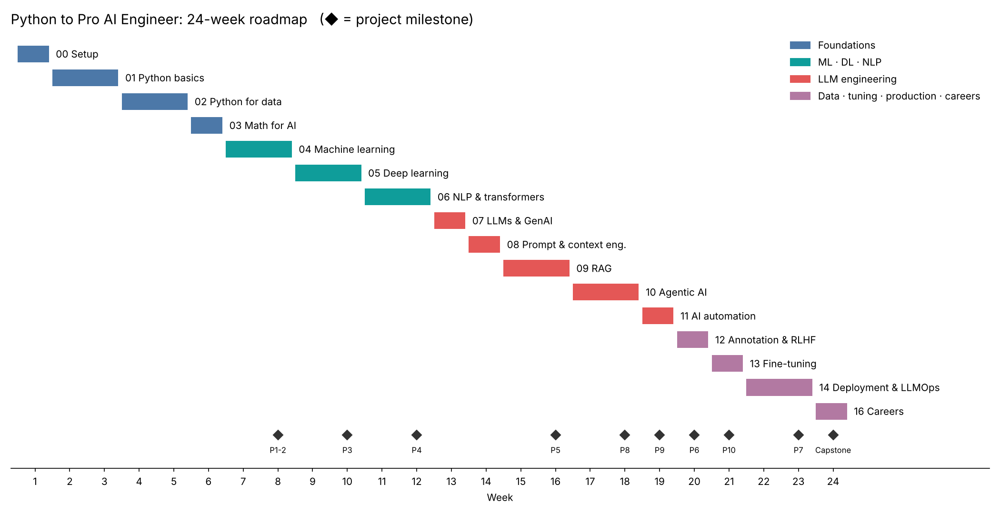

# ROADMAP — 24 weeks from Python beginner to AI Engineer

**How to read this:** each week lists the module, what to study, what to build, and a checkpoint (something you should be able to do by Friday). Plan on **8–10 hours a week**: about 2 hours of reading `concepts.md`, 3–4 hours working through the notebooks, 2–3 hours on exercises, and 1 hour on the project work for that phase.

Trainers: a cohort session for each week is 1–2 hours. Every module's `trainer-notes.md` has the session plan.

## Phase 1 — Foundations (weeks 1–6)

| Week | Module | Study | Build | Checkpoint |
|---|---|---|---|---|
| 1 | [00-setup](00-setup/) | Python, VS Code, Jupyter, Colab, Git/GitHub, venv, pip, `.env` | Your own GitHub repo with a working notebook pushed to it | You can clone, edit, commit and push; you know where your API keys live and why they never go in Git |
| 2 | [01-python-basics](01-python-basics/) | Variables, types, strings, lists, dicts, conditions, loops | Notebooks 1–2 + exercises 1–6 | You can write a 20-line script without copying |
| 3 | [01-python-basics](01-python-basics/) | Functions, errors, files, modules, classes, comprehensions | Mini-project notebook | You can read a traceback and fix the bug |
| 4 | [02-python-for-data](02-python-for-data/) | NumPy arrays, pandas DataFrames, CSV/Excel I/O | Load, clean and summarise the practice dataset | You can answer "which region sold most last quarter?" with pandas |
| 5 | [02-python-for-data](02-python-for-data/) | groupby, merge, matplotlib, mini-EDA | A short EDA notebook with 4 charts | You can explain a chart you made to a non-technical person |
| 6 | [03-math-for-ai](03-math-for-ai/) | Vectors, dot product, matrices, probability, gradients | Visual notebooks; spreadsheet math | You can explain gradient descent with a hill-walking analogy |

## Phase 2 — Classic ML, deep learning and NLP (weeks 7–12)

| Week | Module | Study | Build | Checkpoint |
|---|---|---|---|---|
| 7 | [04-machine-learning](04-machine-learning/) | What ML is, train/test split, regression, classification | Regression + classification notebooks | You can train and score a model in scikit-learn |
| 8 | [04-machine-learning](04-machine-learning/) | Trees, forests, k-means, metrics, cross-validation, pipelines | **Project 1** (see 15-projects) | You can read a confusion matrix and pick the right metric |
| 9 | [05-deep-learning](05-deep-learning/) | Neurons, loss, backprop intuition, PyTorch tensors & autograd | MLP on digits | You can explain every line of a training loop |
| 10 | [05-deep-learning](05-deep-learning/) | CNNs, overfitting, saving models, GPUs on Colab | CNN on digits; **Project 2** | You can spot overfitting from a loss curve |
| 11 | [06-nlp-and-transformers](06-nlp-and-transformers/) | Tokens, embeddings, attention | Attention-by-hand notebook | You can explain attention with the "who should I listen to" analogy |
| 12 | [06-nlp-and-transformers](06-nlp-and-transformers/) | Transformers, Hugging Face pipelines & Hub | Sentiment + embeddings notebooks; **Project 3** | You can load and use any model from the Hub |

## Phase 3 — LLM and GenAI engineering (weeks 13–19)

| Week | Module | Study | Build | Checkpoint |
|---|---|---|---|---|
| 13 | [07-llms-and-genai](07-llms-and-genai/) | How LLMs work, sampling, APIs (OpenAI/Anthropic/Gemini), cost, Ollama | A script that calls an LLM API and logs token cost | You can estimate the monthly cost of an LLM feature |
| 14 | [08-prompt-and-context-engineering](08-prompt-and-context-engineering/) | Prompt patterns, structured output, context engineering, injection, real system-prompt analysis | Your own system prompt + test set | You can improve a prompt and prove it with a test set |
| 15 | [09-rag](09-rag/) | Chunking, embeddings, vector DBs, similarity search | A working retrieval pipeline | You can explain why RAG beats "paste everything in" |
| 16 | [09-rag](09-rag/) | Hybrid search, reranking, citations, RAG evaluation | **Project 4: RAG chatbot** | You can measure hit-rate and faithfulness |
| 17 | [10-agentic-ai](10-agentic-ai/) | Tool use, function calling, ReAct loop, LangGraph | Agent loop from scratch + LangGraph graph | You can draw an agent's loop and its stop condition |
| 18 | [10-agentic-ai](10-agentic-ai/) | CrewAI, multi-agent, memory, MCP | **Project 5: tool-using agent**; a small MCP server | You can connect an MCP server to a client |
| 19 | [11-ai-automation](11-ai-automation/) | n8n, webhooks, workflows, browser/computer-use agents | Import and adapt the n8n workflows; **Project 6** | You can decide "automation or agent?" for a business task |

## Phase 4 — Data, fine-tuning, production, careers (weeks 20–24)

| Week | Module | Study | Build | Checkpoint |
|---|---|---|---|---|
| 20 | [12-data-annotation-and-rlhf](12-data-annotation-and-rlhf/) | Labelling, guidelines, agreement, RLHF, DPO, evals, AI-trainer jobs | Annotation exercise + kappa; reward model demo | You can write annotation guidelines and measure agreement |
| 21 | [13-fine-tuning](13-fine-tuning/) | When to fine-tune, LoRA, QLoRA, PEFT | LoRA on CPU; QLoRA on Colab GPU; **Project 7** | You can explain LoRA with the "sticky notes on a textbook" analogy |
| 22 | [14-deployment-and-llmops](14-deployment-and-llmops/) | FastAPI, Docker, Streamlit/Gradio | Containerised API for an earlier project | You can ship an app someone else can run |
| 23 | [14-deployment-and-llmops](14-deployment-and-llmops/) | vLLM, Langfuse, monitoring, guardrails, CI/CD | **Projects 8–9** | You can show traces, cost and guardrails for your app |
| 24 | [16-careers](16-careers/) + [15-projects](15-projects/) | Roles, portfolio, resume, interview prep | **Project 10 capstone**; portfolio README; mock interview | You can present one project end to end in 5 minutes |

## Faster or slower tracks
- **Fast track (12 weeks):** people who already write Python skip weeks 2–5 (take the module 01–02 exercises as a test instead) and combine the two-week modules into one.
- **AI-trainer track (8 weeks):** 00 → 01 → 07 → 08 → 12 → 16, plus Projects 1 and 8. This is for people aiming at data annotation and AI-trainer jobs.
- **Part-time (36 weeks):** follow the same order at ~6 hours a week; take 1.5 weeks per row.
